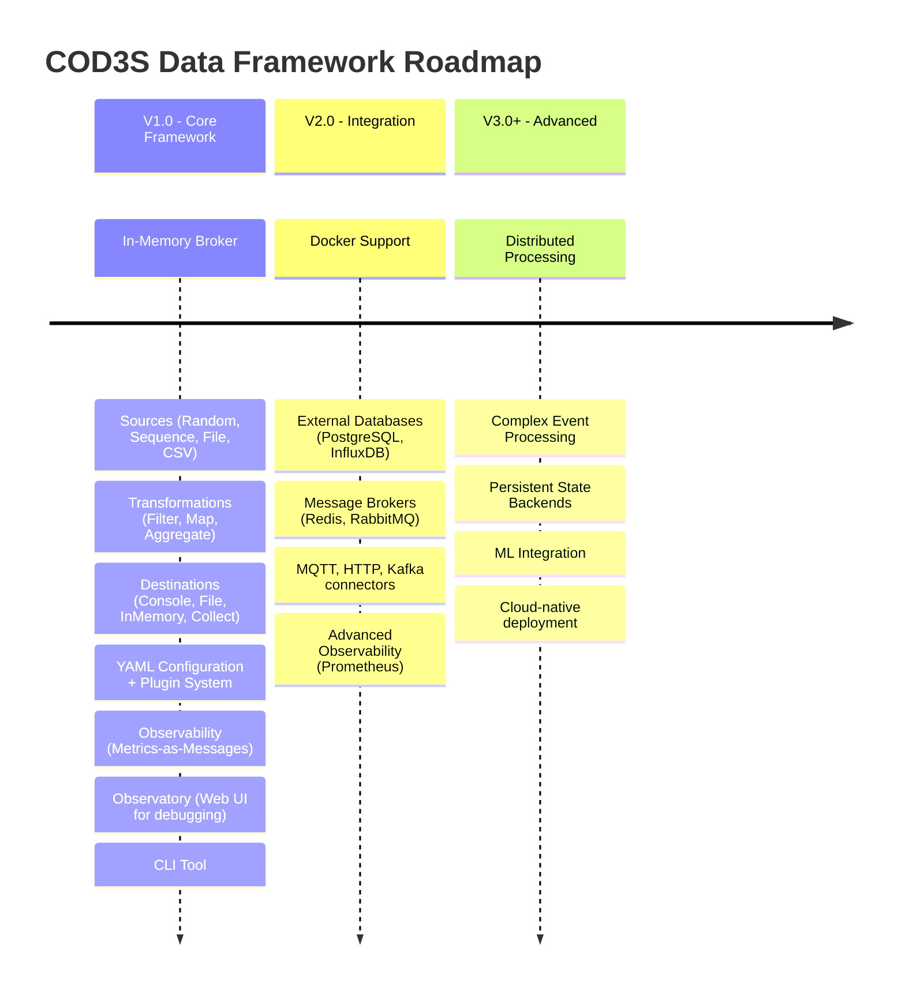

# COD3S Data Framework - Overview

**Version:** 1.0
**Date:** 2026-01-24
**Status:** Functional Specification

---

## Navigation

| Previous | Up | Next |
|----------|-----|------|
| - | [README](../README.md) | [01-INTRODUCTION →](01-INTRODUCTION.md) |

**Quick Links:**
- [Introduction](01-INTRODUCTION.md) | [Architecture](02-ARCHITECTURE.md) | [Messages](03-MESSAGES.md)
- [Sources](04-SOURCES.md) | [Transformations](05-TRANSFORMATIONS.md) | [Destinations](06-DESTINATIONS.md)
- [Channels & Routing](07-CHANNELS-ROUTING.md) | [Broker](08-BROKER.md)
- [Configuration](09-CONFIGURATION.md) | [Observability](10-OBSERVABILITY.md)
- [Deployment](11-DEPLOYMENT.md) | [Testing](12-TESTING.md)
- [Future Roadmap](13-FUTURE-V2-V3.md) | [Glossary](99-GLOSSARY.md)

---

## Table of Contents

- [What is COD3S Data?](#what-is-cods-data)
- [Value Proposition](#value-proposition)
- [Document Structure](#document-structure)
- [Quick Reference](#quick-reference)
- [Version Roadmap](#version-roadmap)
- [Reading Guide](#reading-guide)

---

## What is COD3S Data?

COD3S Data is a **lightweight, flexible data streaming framework** designed for **real-time processing of temporal sensor data** in industrial and IoT environments.

**Core Concept:** Move data from sources (sensors, files, databases) through transformations (filtering, computation, alerts) to destinations (databases, dashboards, files) using a **message-based architecture** with **configurable channels**.

**Primary Use Case:** 3D printer monitoring and optimization - collecting temperature, speed, vibration data to compute quality indicators and trigger alerts in real-time.

### Key Characteristics

- **Lightweight**: Embedded library or standalone service
- **Flexible**: Configurable via YAML, Python, or environment variables
- **Extensible**: Plugin architecture for custom sources, transformations, destinations
- **Observable**: Built-in metrics, logging, and debugging capabilities
- **Production-ready**: Retry logic, dead letter queues, backpressure handling

---

## Value Proposition

### Problems Solved

1. **Fragmented data pipelines** - Unify disparate sensor data sources
2. **Complex integration** - Reduce boilerplate for common data patterns
3. **Limited observability** - Built-in monitoring and debugging
4. **Scalability challenges** - Handle varying data rates gracefully
5. **Deployment complexity** - Single framework for embedded or standalone modes

### Benefits

| Stakeholder | Key Benefits |
|-------------|-------------|
| **Developers** | Simple API, minimal boilerplate, extensive examples |
| **Operations** | Easy deployment, clear metrics, actionable logs |
| **Data Engineers** | Flexible transformations, reliable delivery, testable pipelines |
| **Business** | Faster time-to-value, reduced maintenance, extensible architecture |

---

## Document Structure

This functional specification suite is organized into **feature-based documents** for clarity:

### Core Concepts (Read First)
1. **[Introduction](01-INTRODUCTION.md)** - Problem statement, scope, principles
2. **[Architecture](02-ARCHITECTURE.md)** - System design, components, data flows
3. **[Messages](03-MESSAGES.md)** - Message structure, delivery guarantees, reliability

### Components (Deep Dive)
4. **[Sources](04-SOURCES.md)** - Data ingestion, batch modes, source catalog
5. **[Transformations](05-TRANSFORMATIONS.md)** - Data processing, stateful/stateless patterns
6. **[Destinations](06-DESTINATIONS.md)** - Data output, buffering, failure handling
7. **[Channels & Routing](07-CHANNELS-ROUTING.md)** - Message routing, wildcards, filtering
8. **[Broker](08-BROKER.md)** - Message distribution, subscription management

### Operations (Running the System)
9. **[Configuration](09-CONFIGURATION.md)** - YAML/Python/env configuration
10. **[Observability](10-OBSERVABILITY.md)** - Monitoring, logging, debugging
11. **[Deployment](11-DEPLOYMENT.md)** - Embedded/standalone/CLI modes
12. **[Testing](12-TESTING.md)** - Test sources, record/replay, assertions

### Reference
13. **[Future Roadmap](13-FUTURE-V2-V3.md)** - V2.0 and V3.0+ planned features
14. **[Glossary](99-GLOSSARY.md)** - Comprehensive terminology reference

### Presentations
15. **[Executive Presentation](../PRESENTATION-EXECUTIVE.md)** - High-level overview (10-15 slides)
16. **[Technical Presentation](../PRESENTATION-TECHNICAL.md)** - Deep dive (25-30 slides)

---

## Quick Reference

### Key Decisions at a Glance

| Topic | Decision | Details |
|-------|----------|---------|
| **Delivery Guarantees** | Configurable (at-most-once default, at-least-once opt-in) | [03-MESSAGES](03-MESSAGES.md#delivery-guarantees) |
| **Message Ordering** | No ordering guarantee (sort by timestamp if needed) | [03-MESSAGES](03-MESSAGES.md#ordering) |
| **Backpressure** | Bounded buffers with configurable overflow strategies | [06-DESTINATIONS](06-DESTINATIONS.md#backpressure) |
| **Channel Routing** | Hierarchical with wildcard subscriptions (`*`, `**`) | [07-CHANNELS-ROUTING](07-CHANNELS-ROUTING.md#wildcards) |
| **Transformations** | Stateless (1:N) and Stateful (N:M multi-channel) | [05-TRANSFORMATIONS](05-TRANSFORMATIONS.md) |
| **Time Handling** | Require timezone-aware timestamps, reject naive, normalize to UTC | [03-MESSAGES](03-MESSAGES.md#timezone) |
| **Configuration** | Triple approach: YAML + Python + Environment variables | [09-CONFIGURATION](09-CONFIGURATION.md) |
| **Observability** | Metrics as messages on `_metrics.*` channels | [10-OBSERVABILITY](10-OBSERVABILITY.md) |
| **Deployment** | Embedded library, standalone service, or CLI tool | [11-DEPLOYMENT](11-DEPLOYMENT.md) |
| **Testing** | Built-in test sources, record/replay, assertions | [12-TESTING](12-TESTING.md) |

---

## Version Roadmap

### Scope Boundaries

**V1.0 - Current Focus** (This specification)
- In-memory broker with channel patterns (`*`, `**`)
- Sources: Random, Sequence, File (JSON/JSONL), CSV (Polars)
- Transformations: Filter, Map, Aggregate (custom via plugin system)
- Destinations: Console, File, InMemory, Collect (testing)
- YAML + Python + Env configuration
- Plugin system for extensibility
- Observability: metrics-as-messages, structured logging (structlog)
- **Observatory**: Web UI for real-time debugging and pipeline control
- CLI tool (`cod3s-data run`, `cod3s-data validate`)
- Embedded and standalone deployment
- Performance targets: <50ms p99, 10K msg/s, <512MB RAM

**V2.0 - Integration** (Future - documented but not detailed)
- Docker containerization
- External databases and message brokers
- Industry-standard observability (Prometheus, OpenTelemetry)

**V3.0+ - Advanced** (Ideas - subject to V1.0 feedback)
- Complex event processing
- Distributed processing
- Persistent state
- ML integration

---

## Reading Guide

### For Decision-Makers / Executives

**Goal:** Understand value proposition and strategic fit

**Recommended Path:**
1. This overview (you are here)
2. [Executive Presentation](../PRESENTATION-EXECUTIVE.md) - 10-15 slides
3. [Introduction](01-INTRODUCTION.md) - Problem and scope
4. [Architecture](02-ARCHITECTURE.md) - High-level design
5. [Future Roadmap](13-FUTURE-V2-V3.md) - Strategic direction

**Time Investment:** 30-45 minutes

---

### For Developers / Architects

**Goal:** Understand system design and prepare for implementation

**Recommended Path:**
1. This overview
2. [Introduction](01-INTRODUCTION.md) - Context and principles
3. [Architecture](02-ARCHITECTURE.md) - System design with diagrams
4. [Messages](03-MESSAGES.md) - Core data model
5. [Sources](04-SOURCES.md), [Transformations](05-TRANSFORMATIONS.md), [Destinations](06-DESTINATIONS.md) - Components
6. [Channels & Routing](07-CHANNELS-ROUTING.md), [Broker](08-BROKER.md) - Routing system
7. [Configuration](09-CONFIGURATION.md) - How to configure
8. [Technical Presentation](../PRESENTATION-TECHNICAL.md) - Comprehensive walkthrough
9. [Glossary](99-GLOSSARY.md) - Reference as needed

**Time Investment:** 2-3 hours

---

### For Operations / DevOps

**Goal:** Understand deployment and monitoring

**Recommended Path:**
1. This overview
2. [Architecture](02-ARCHITECTURE.md) - What components exist
3. [Configuration](09-CONFIGURATION.md) - How to configure
4. [Observability](10-OBSERVABILITY.md) - Monitoring and debugging
5. [Deployment](11-DEPLOYMENT.md) - Deployment modes and requirements
6. [Testing](12-TESTING.md) - How to test pipelines

**Time Investment:** 1-2 hours

---

### For Data Engineers

**Goal:** Understand data processing capabilities

**Recommended Path:**
1. This overview
2. [Messages](03-MESSAGES.md) - Message structure and guarantees
3. [Sources](04-SOURCES.md) - Data ingestion patterns
4. [Transformations](05-TRANSFORMATIONS.md) - Processing capabilities
5. [Destinations](06-DESTINATIONS.md) - Output options
6. [Channels & Routing](07-CHANNELS-ROUTING.md) - Filtering and routing
7. [Testing](12-TESTING.md) - Testing data pipelines

**Time Investment:** 2-3 hours

---

## Document Conventions

### Notation

- **Mermaid Diagrams:** Visual representations of architecture and flows
- **YAML Examples:** Configuration snippets (conceptual, not final syntax)
- **Python Pseudo-code:** API examples (conceptual, not implementation)
- **Tables:** Quick reference comparisons
- **Callouts:** Important notes and warnings

### Cross-References

- `[Document Name](filename.md)` - Links to other specification documents
- `[Section](filename.md#section)` - Links to specific sections
- `See: [Topic](file.md#anchor)` - Explicit references

### Version Tags

- **V1.0:** Features in current scope (detailed in this spec)
- **V2.0:** Planned for next major version (outlined, not detailed)
- **V3.0+:** Future ideas (mentioned, subject to change)
- **Deferred:** Explicitly not in V1.0, may appear in V2.0+

---

## Next Steps

**If you are new to COD3S Data:**
→ Continue to [Introduction](01-INTRODUCTION.md) to understand the problem and scope

**If you want a quick visual overview:**
→ Jump to [Executive Presentation](../PRESENTATION-EXECUTIVE.md)

**If you want to dive into the architecture:**
→ Go to [Architecture](02-ARCHITECTURE.md)

**If you need a specific term definition:**
→ Check the [Glossary](99-GLOSSARY.md)

---

## Navigation

| Previous | Up | Next |
|----------|-----|------|
| - | [README](../README.md) | [01-INTRODUCTION →](01-INTRODUCTION.md) |

---

*This is a functional specification document. Implementation details will be defined in the technical specification phase.*
