# COD3S Data Framework - Architecture

**Version:** 1.0
**Date:** 2026-01-24
**Status:** Functional Specification

---

## Navigation

| Previous | Up | Next |
|----------|-----|------|
| [← 01-INTRODUCTION](01-INTRODUCTION.md) | [OVERVIEW](00-OVERVIEW.md) | [03-MESSAGES →](03-MESSAGES.md) |

---

## Table of Contents

- [High-Level Architecture](#high-level-architecture)
- [Core Components](#core-components)
- [Data Flow Patterns](#data-flow-patterns)
- [Component Interactions](#component-interactions)
- [Deployment Modes](#deployment-modes)
- [Threading and Concurrency](#threading-and-concurrency)

---

## High-Level Architecture

### System Overview

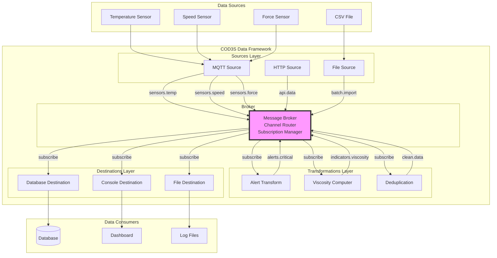

**Key Insight:** The **Broker** is the central hub. All components interact with the broker, never directly with each other.

---

### Architectural Principles

1. **Loose Coupling:** Components communicate only through the broker via channels
2. **Publish-Subscribe:** Sources publish messages, destinations subscribe to channels
3. **Transformation Chains:** Transformations are both subscribers and publishers
4. **Dynamic Routing:** Channels created on-the-fly, wildcard subscriptions
5. **Self-Contained:** Each component manages its own lifecycle and configuration

---

## Core Components

### 1. Sources

**Responsibility:** Ingest data from external systems and publish messages to channels

**Characteristics:**
- **Active components** - pull or listen for data
- **Batch modes** - BATCH (finite), REALTIME (continuous), TRANSPOSE (replay)
- **Controllable** - cancel, pause/resume, progress tracking
- **Configurable delivery** - at-most-once (default) or at-least-once

**V1.0 Catalog:**
- `RandomSource` - Generate random values (testing)
- `SequenceSource` - Generate numeric sequences (testing)
- `FileSource` - Read line-delimited files
- `CSVSource` - Read CSV files with headers

**V2.0+ Catalog:** (Future)
- `MQTTSource` - Subscribe to MQTT topics
- `HTTPSource` - Poll HTTP endpoints
- `DatabaseSource` - Query databases (polling or CDC)
- `KafkaSource` - Consume from Kafka topics

**See:** [04-SOURCES.md](04-SOURCES.md)

---

### 2. Broker

**Responsibility:** Route messages from publishers to subscribers based on channel subscriptions

**Characteristics:**
- **Central hub** - all messages flow through it
- **In-memory** (V1.0) - low latency, no persistence
- **Subscription management** - register/unregister subscribers
- **Wildcard support** - `*` (single-level), `**` (multi-level)
- **Buffering** - recent message history for late-joining subscribers

**Key Functions:**
```
publish(channel, message)        # Sources/Transformations publish
subscribe(pattern, callback)     # Destinations/Transformations subscribe
unsubscribe(pattern, callback)   # Cleanup
get_history(channel, count)      # Retrieve recent messages
```

**V2.0+:** External brokers (Redis, RabbitMQ) for persistence and distribution

**See:** [08-BROKER.md](08-BROKER.md)

---

### 3. Transformations

**Responsibility:** Process messages (filter, compute, enrich, route) and publish results

**Types:**

**A. Stateless Transformations (1:N)**
- Input: Single message from one channel
- Output: 0, 1, or N messages
- Examples: Filtering, alerts, unit conversion, splitting

**B. Stateful Transformations (N:M)**
- Input: Multiple messages from multiple channels
- Output: 0, 1, or N messages
- State: Framework-managed helpers (latest values, windows, caches)
- Examples: Multi-sensor computations, aggregations, deduplication

**Framework Helpers:**
- `self.latest` - Dictionary of latest message per input channel
- `TimeWindow(duration)` - Collect messages in time buckets
- `CountWindow(size)` - Collect N messages before processing
- `Cache(ttl)` - Deduplicate or cache with time-to-live

**See:** [05-TRANSFORMATIONS.md](05-TRANSFORMATIONS.md)

---

### 4. Destinations

**Responsibility:** Consume messages from channels and send to external systems

**Characteristics:**
- **Passive components** - subscribe and react to messages
- **Buffering** - bounded queues with overflow strategies
- **Retry logic** - exponential backoff for failures
- **Dead Letter Queue** - failed messages after retries exhausted
- **Historical access** - none/recent/all messages on subscription

**V1.0 Catalog:**
- `ConsoleDestination` - Print to stdout (debugging)
- `FileDestination` - Append to files
- `InMemoryDestination` / `CollectDestination` - Collect for testing

**V2.0+ Catalog:** (Future)
- `DatabaseDestination` - Insert into PostgreSQL, InfluxDB, etc.
- `MQTTDestination` - Publish to MQTT topics
- `HTTPDestination` - POST to HTTP endpoints
- `KafkaDestination` - Produce to Kafka topics

**See:** [06-DESTINATIONS.md](06-DESTINATIONS.md)

---

### 5. Channels

**Responsibility:** Logical routing paths for messages (not a separate component, but a concept)

**Characteristics:**
- **Hierarchical naming** - `domain.subdomain.metric` (recommended)
- **Dynamic creation** - created implicitly on first use
- **Wildcard subscriptions** - `sensors.*.temperature`, `sensors.**`
- **Reserved prefix** - `_` for system channels (`_dlq.*`, `_metrics.*`)

**Examples:**
```
sensors.printer1.temperature.extruder
sensors.printer1.temperature.bed
sensors.printer1.motor.speed.x
sensors.printer2.temperature.extruder

alerts.critical
alerts.warning

indicators.printer1.viscosity
indicators.printer2.viscosity

_dlq.db_failures
_metrics.broker.throughput
```

**See:** [07-CHANNELS-ROUTING.md](07-CHANNELS-ROUTING.md)

---

## Data Flow Patterns

### Pattern 1: Simple Forwarding

**Use Case:** Ingest sensor data and write to database

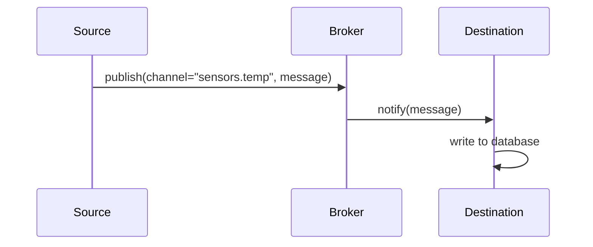

**Configuration:**
```yaml
sources:
  - type: mqtt
    channel: "sensors.temp"

destinations:
  - type: database
    channel: "sensors.temp"
```

---

### Pattern 2: Filtering and Alerting

**Use Case:** Monitor temperature, alert if exceeds threshold

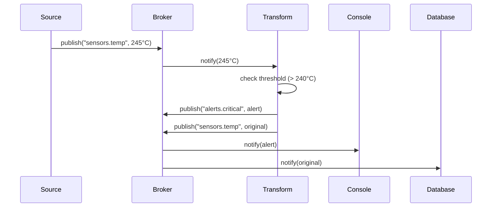

**Configuration:**
```yaml
sources:
  - type: mqtt
    channel: "sensors.temp"

transformations:
  - type: threshold_alert
    input: "sensors.temp"
    threshold: 240
    output: "alerts.critical"
    pass_through: true  # Also forward original

destinations:
  - type: console
    channel: "alerts.critical"

  - type: database
    channel: "sensors.temp"
```

---

### Pattern 3: Multi-Sensor Computation (Stateful)

**Use Case:** Compute viscosity from temperature, speed, and force

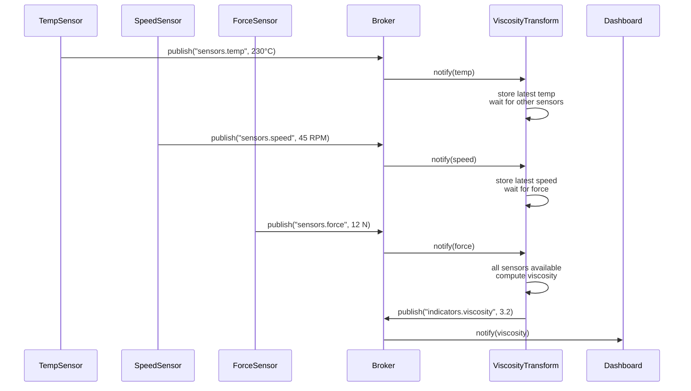

**Configuration:**
```yaml
sources:
  - type: mqtt
    channel: "sensors.temp"
  - type: mqtt
    channel: "sensors.speed"
  - type: mqtt
    channel: "sensors.force"

transformations:
  - type: custom_python
    class: ViscosityComputer
    inputs:
      - "sensors.temp"
      - "sensors.speed"
      - "sensors.force"
    output: "indicators.viscosity"

destinations:
  - type: websocket
    channel: "indicators.viscosity"
```

---

### Pattern 4: Fan-Out (Multiple Destinations)

**Use Case:** Send same data to console, database, and file

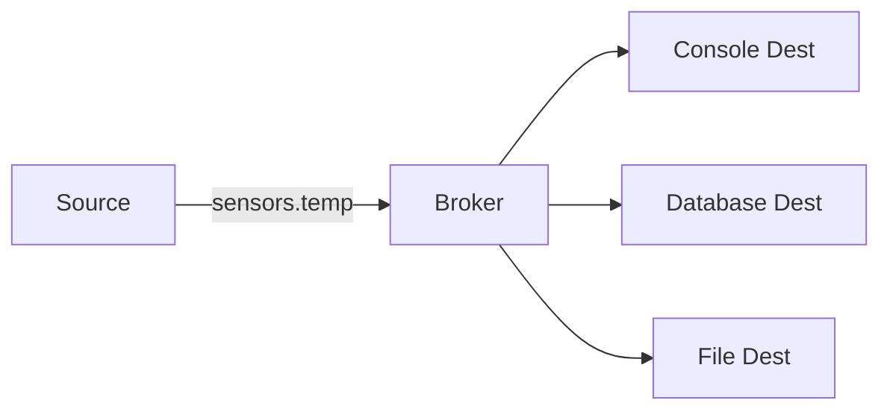

**Configuration:**
```yaml
sources:
  - type: mqtt
    channel: "sensors.temp"

destinations:
  - type: console
    channel: "sensors.temp"

  - type: database
    channel: "sensors.temp"

  - type: file
    channel: "sensors.temp"
    path: "sensor_data.log"
```

---

### Pattern 5: Transformation Chain

**Use Case:** Raw data → deduplication → unit conversion → storage

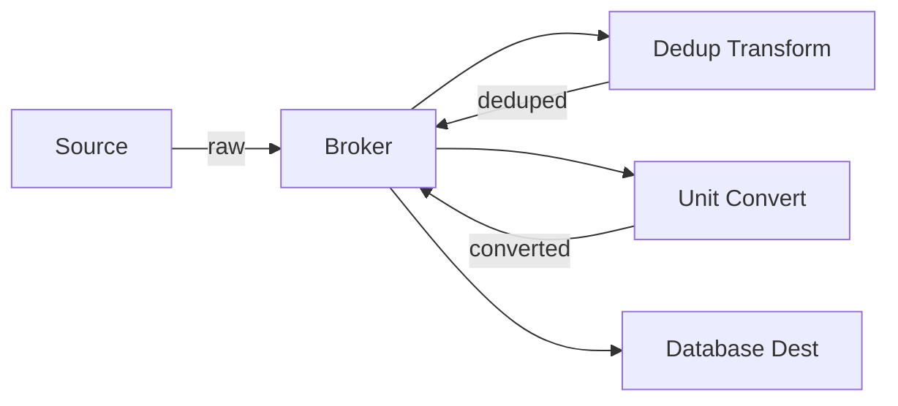

**Configuration:**
```yaml
sources:
  - type: mqtt
    channel: "sensors.temp.raw"
    delivery_guarantee: "at-least-once"  # May produce duplicates

transformations:
  - type: deduplication
    input: "sensors.temp.raw"
    output: "sensors.temp.deduped"

  - type: unit_conversion
    input: "sensors.temp.deduped"
    output: "sensors.temp.celsius"
    from_unit: "fahrenheit"
    to_unit: "celsius"

destinations:
  - type: database
    channel: "sensors.temp.celsius"
```

---

## Component Interactions

### Message Publication Flow

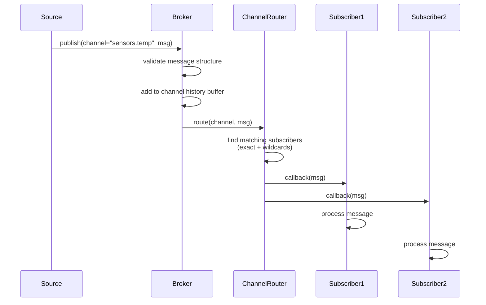

---

### Subscription Management

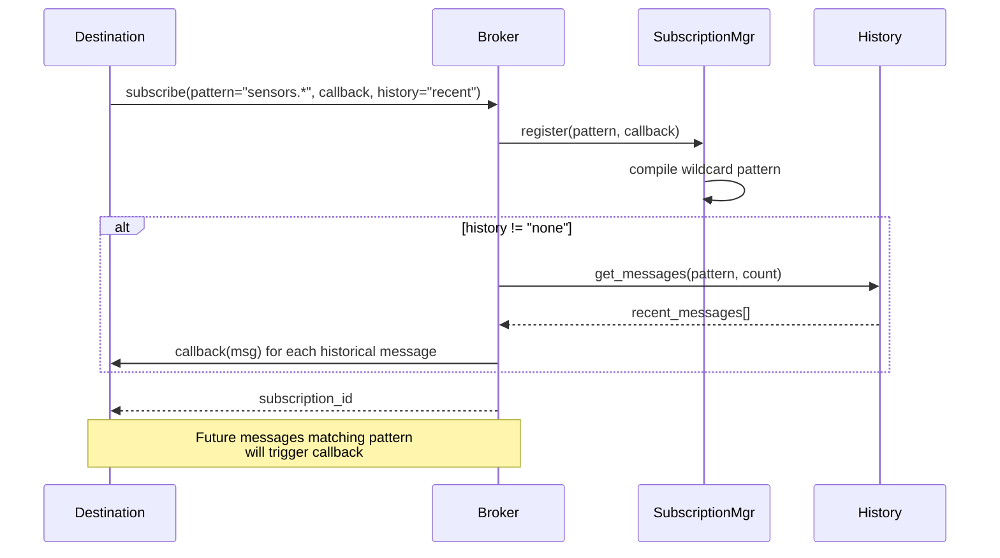

---

### Failure and Retry Flow

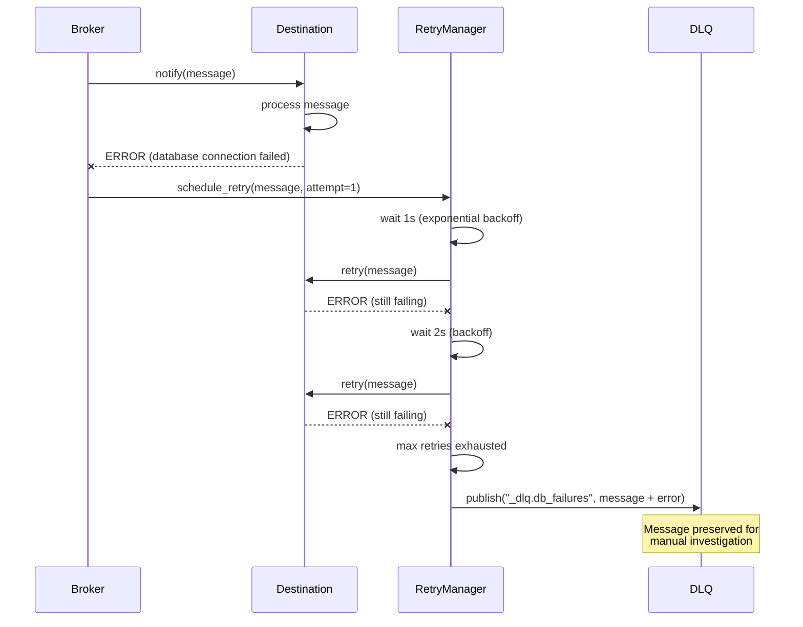

---

## Deployment Modes

### Mode 1: Embedded Library

**Use Case:** Integrate into existing Python application

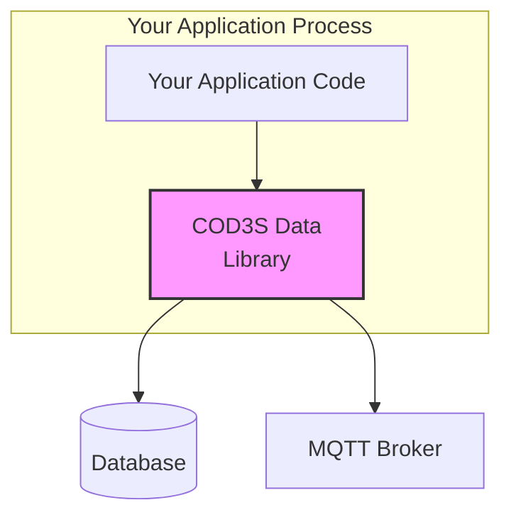

**Example:**
```python
from cod3s_data import Framework, ConsoleDestination

# Initialize framework
framework = Framework()

# Programmatic configuration
framework.add_source(type="mqtt", channel="sensors.temp")
framework.add_destination(ConsoleDestination(channel="sensors.**"))

# Start processing
framework.start()

# Your application continues running
while True:
    # Your application logic
    pass
```

**Benefits:**
- Minimal overhead (same process)
- Direct API access
- Easy debugging
- No network hop

**Drawbacks:**
- Shares resources with application
- Framework crash affects application

---

### Mode 2: Standalone Service

**Use Case:** Separate process, managed by systemd or Docker

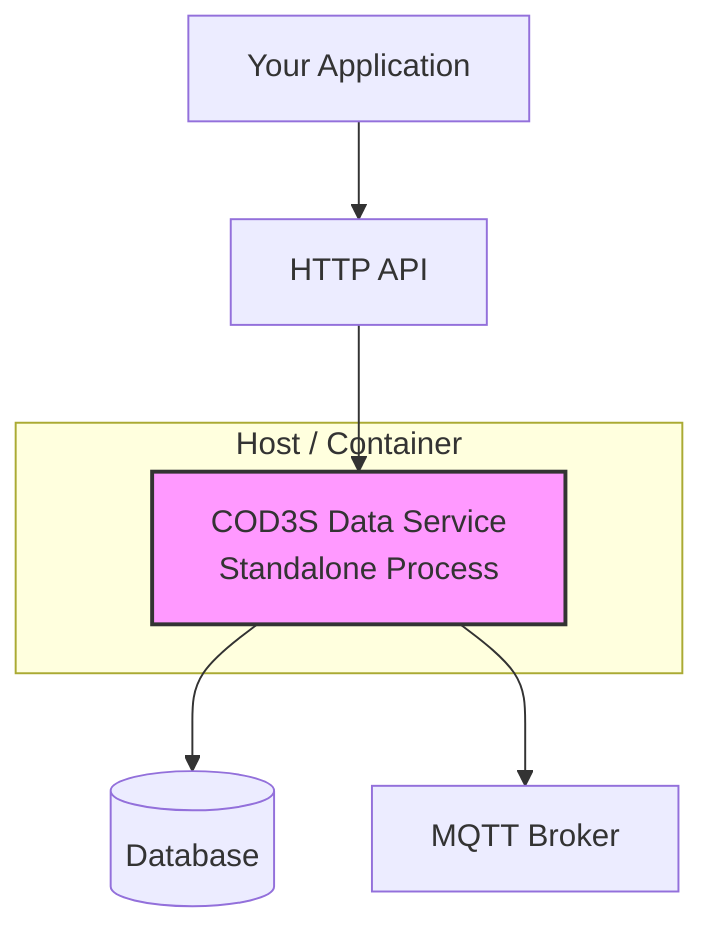

**Example:**
```bash
# Start with YAML configuration
cod3s-data --config pipeline.yaml

# Or with environment variables
export CODS_CONFIG=/etc/cod3s/pipeline.yaml
cod3s-data
```

**Benefits:**
- Process isolation
- Restart independently
- Managed by orchestration (systemd, Docker Compose)
- Can serve multiple applications (V2.0+ HTTP API)

**Drawbacks:**
- Separate deployment
- IPC overhead (if application needs to interact)

---

### Mode 3: CLI Tool

**Use Case:** Command-line operations (testing, batch processing, utilities)

```bash
# Run a one-off batch import
cod3s-data run --source csv --file data.csv --destination database

# Test a configuration
cod3s-data test --config pipeline.yaml

# Validate configuration
cod3s-data validate --config pipeline.yaml

# Monitor a running pipeline
cod3s-data monitor --metrics-channel "_metrics.**"
```

**Benefits:**
- Quick ad-hoc tasks
- Scripting and automation
- Testing and validation

**Drawbacks:**
- Not for long-running services
- No programmatic control

---

### Deployment Comparison

| Aspect | Embedded | Standalone | CLI |
|--------|----------|------------|-----|
| **Use Case** | Library integration | Long-running service | Ad-hoc tasks |
| **Configuration** | Python API or YAML | YAML + env vars | Command-line args |
| **Lifecycle** | Managed by app | Managed by OS | One-shot execution |
| **Resource Sharing** | Shared with app | Isolated | Isolated |
| **API Access** | Direct (Python) | HTTP (V2.0+) | N/A |
| **Debugging** | Easy (same process) | Medium (separate logs) | Easy (console output) |
| **Restart** | Restart app | Restart service only | N/A (exits) |

---

## Threading and Concurrency

**Note:** This section describes **conceptual** concurrency patterns, not implementation details.

### Concurrency Model (Conceptual)

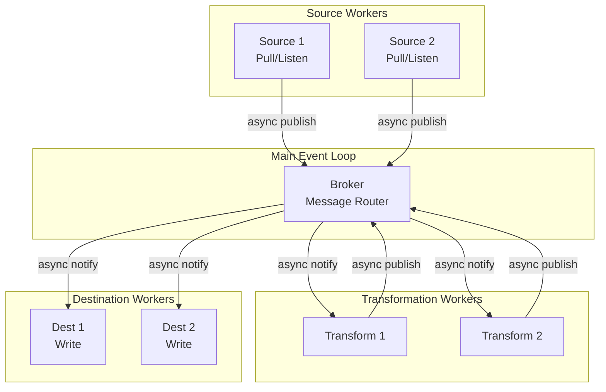

**Key Points:**

1. **Non-blocking I/O:** Sources, transformations, and destinations run asynchronously
2. **Broker is central:** All message passing goes through broker (no direct component-to-component calls)
3. **Isolation:** Each component runs independently, failures are contained
4. **Parallelism:** Multiple sources, transformations, destinations run concurrently

**Implementation Note:** Reference implementation uses Python asyncio, but other implementations could use threads, goroutines, actors, etc.

---

## Summary

**COD3S Data Architecture** is built on:

1. **Core Components:**
   - Sources (ingest data)
   - Broker (route messages)
   - Transformations (process messages)
   - Destinations (output data)
   - Channels (logical routing paths)

2. **Design Principles:**
   - Loose coupling (all communication via broker)
   - Publish-subscribe pattern
   - Dynamic channel creation
   - Transformation chains

3. **Data Flow Patterns:**
   - Simple forwarding
   - Filtering and alerting
   - Multi-sensor computation (stateful)
   - Fan-out to multiple destinations
   - Transformation chains

4. **Deployment Modes:**
   - Embedded library (integrate into apps)
   - Standalone service (separate process)
   - CLI tool (ad-hoc operations)

**Next:** Dive into [Messages](03-MESSAGES.md) to understand the core data model and guarantees.

---

## Navigation

| Previous | Up | Next |
|----------|-----|------|
| [← 01-INTRODUCTION](01-INTRODUCTION.md) | [OVERVIEW](00-OVERVIEW.md) | [03-MESSAGES →](03-MESSAGES.md) |

---

*This is a functional specification document. Implementation details will be defined in the technical specification phase.*
