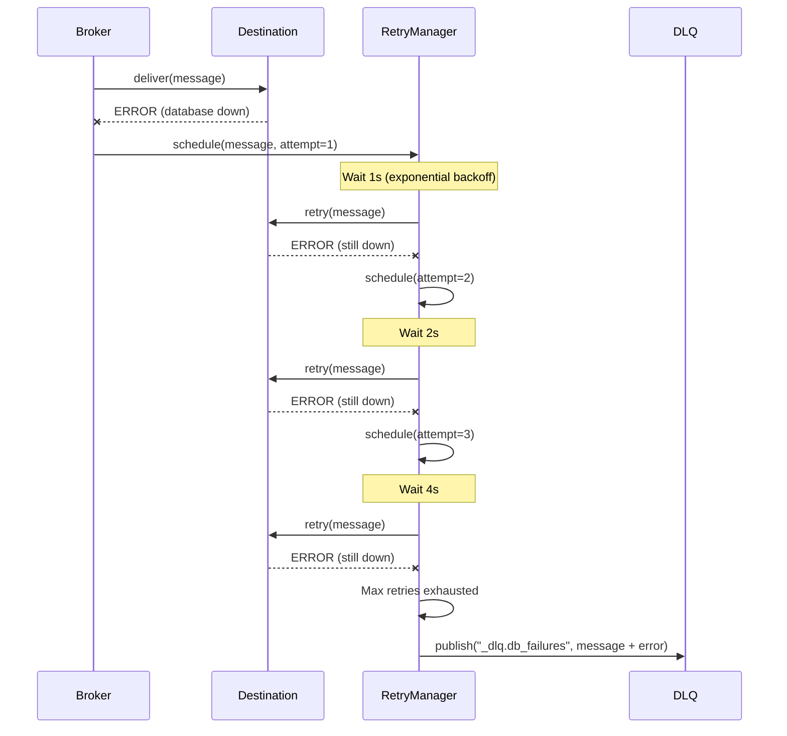
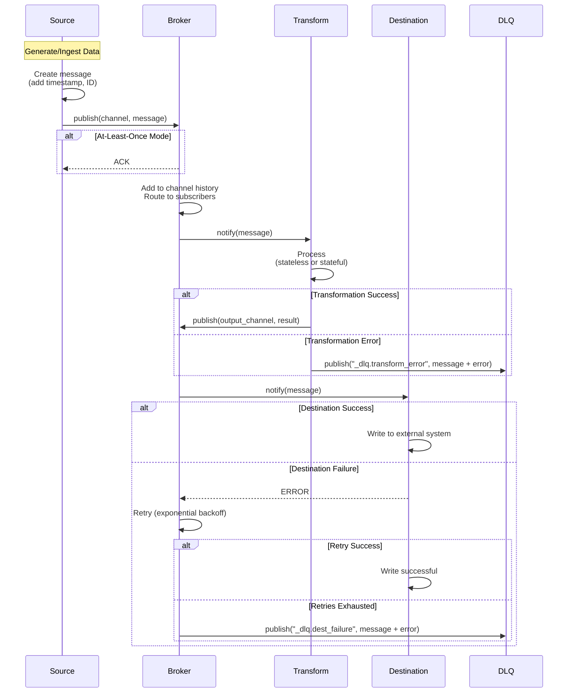

# COD3S Data Framework - Messages

**Version:** 1.0
**Date:** 2026-01-24
**Status:** Functional Specification

---

## Navigation

| Previous | Up | Next |
|----------|-----|------|
| [← 02-ARCHITECTURE](02-ARCHITECTURE.md) | [OVERVIEW](00-OVERVIEW.md) | [04-SOURCES →](04-SOURCES.md) |

---

## Table of Contents

- [Message Structure](#message-structure)
- [Delivery Guarantees](#delivery-guarantees)
- [Message Ordering](#message-ordering)
- [Retry Strategies](#retry-strategies)
- [Dead Letter Queue](#dead-letter-queue)
- [Timezone Handling](#timezone-handling)
- [Out-of-Order Messages](#out-of-order-messages)
- [Duplicate Detection](#duplicate-detection)
- [Message Lifecycle](#message-lifecycle)

---

## Message Structure

### Message Anatomy

Every message in COD3S Data has a **consistent structure** regardless of source or destination:

```yaml
key: "temperature_extruder"        # Identifier (what is measured)
timestamp: "2024-01-15T10:30:45Z"  # When (UTC normalized)
value: 235.7                       # The actual measurement
tags:                              # Optional metadata (key-value pairs)
  location: "warehouse_A"
  sensor_id: "TH001"
  printer_id: "printer_1"
id: "a3b7c9d1-e4f6-4a8b-9c1d-e2f3a4b5c6d7"  # Unique message ID (optional)
```

### Field Descriptions

| Field | Type | Required | Description |
|-------|------|----------|-------------|
| **key** | string | Yes | Identifies what is being measured (e.g., "temperature", "speed", "viscosity") |
| **timestamp** | ISO 8601 | Yes | When the measurement was taken (UTC normalized) |
| **value** | any | Yes | The actual measurement (number, string, boolean, JSON object) |
| **tags** | dict | No | Metadata for filtering/routing (all values as strings) |
| **id** | UUID | No | Unique message identifier (auto-generated if not provided) |

### Value Types

**Supported value types:**
- **Numbers:** `42`, `3.14`, `-273.15`
- **Strings:** `"OK"`, `"error"`, `"running"`
- **Booleans:** `true`, `false`
- **JSON objects:** `{"temp": 42, "unit": "C"}` (for complex measurements)
- **Arrays:** `[1.2, 3.4, 5.6]` (for multi-dimensional data)

**Validation:** No schema enforcement in V1.0 (destinations handle type mismatches as needed)

---

### Tags (Metadata)

**Purpose:** Enable filtering and routing without parsing the value

**Constraints (V1.0):**
- All tag values are **strings** (numbers/booleans auto-converted to strings)
- Exact match filtering only (no wildcards, ranges, or regex)
- AND logic across different keys

> **Planned (V1.x):** OR logic within same key (list of values). See [13-FUTURE](13-FUTURE-V2-V3.md).

**Example:**
```python
from datetime import datetime, timezone
from cod3s_data.core.message import Message

# Message with tags
msg = Message(
    key="temperature",
    timestamp=datetime.now(timezone.utc),
    value=235.7,
    tags={
        "location": "warehouse_A",
        "sensor_type": "temperature",
        "priority": "high",
    },
)

# Adding tags (creates new immutable message):
msg2 = msg.with_tags(alert="yes")
```

**See:** [07-CHANNELS-ROUTING.md](07-CHANNELS-ROUTING.md)

---

### Message ID

**Generation:**
- Auto-generated UUID if not provided by source
- Preserved through transformations (inherited from source message)
- New ID generated if transformation creates new message

**Use Cases:**
- **Tracing:** Follow message through pipeline (logs, debugging)
- **Deduplication:** Identify duplicate messages (if source provides stable IDs)
- **Audit:** Track message provenance

**Example:**
```python
# Source generates message (no ID)
source_msg = {
    "key": "temp",
    "value": 42,
    "timestamp": "2024-01-15T10:30:45Z"
}
# Framework adds ID: "a3b7c9d1-..."

# Transformation passes through (ID preserved)
transform_output = {
    "key": "temp_celsius",
    "value": 42,
    "timestamp": "2024-01-15T10:30:45Z",
    "id": "a3b7c9d1-..."  # Same ID as source
}

# Transformation creates new message (new ID)
alert_msg = {
    "key": "alert",
    "value": "High temperature",
    "timestamp": "2024-01-15T10:30:45Z",
    "id": "f7e8d9c1-..."  # New ID
}
```

---

## Delivery Guarantees

### Configurable Per Source

COD3S Data provides **two delivery guarantee modes**, configurable per source:

1. **At-Most-Once** (default) - Fire-and-forget
2. **At-Least-Once** (opt-in) - Acknowledged delivery with retries

### At-Most-Once (Default)

**Behavior:**
- Source publishes message to broker
- No acknowledgment from broker
- No retries if delivery fails
- **Trade-off:** Fast, low overhead | May lose messages on failure

**Use Cases:**
- High-frequency sensors where occasional loss is acceptable
- Non-critical monitoring data
- Test/development environments
- Maximum throughput required

**Configuration:**
```yaml
source:
  type: mqtt
  channel: "sensors.temp"
  delivery_guarantee: "at-most-once"  # Explicit (default if omitted)
```

**Guarantees:**
- ✅ Fast (no ACK overhead)
- ✅ Low latency
- ❌ May lose messages (network failure, broker crash)
- ❌ No retry logic

---

### At-Least-Once (Opt-In)

**Behavior:**
- Source publishes message to broker
- Waits for acknowledgment from broker
- Retries if ACK not received within timeout
- Sends to Dead Letter Queue if max retries exhausted
- **Trade-off:** Reliable | May deliver duplicates on retry

**Use Cases:**
- Critical sensor data (safety systems, compliance)
- Business transactions (orders, payments)
- Audit logs and historical records
- Any data that cannot be lost

**Configuration:**
```yaml
source:
  type: mqtt
  channel: "sensors.critical.temp"
  delivery_guarantee: "at-least-once"
  retry_attempts: 3                    # Max retry attempts (default: 3)
  retry_timeout: 5s                    # Timeout per attempt (default: 5s)
  dead_letter_channel: "_dlq.failed_messages"  # Where to send failures
```

**Guarantees:**
- ✅ No message loss (barring DLQ)
- ✅ Automatic retries
- ✅ Failed messages captured in DLQ
- ❌ May deliver duplicates (if ACK lost but message delivered)
- ❌ Higher latency (wait for ACK)
- ❌ More overhead (retry logic, state tracking)

---

### Comparison

| Aspect | At-Most-Once | At-Least-Once |
|--------|--------------|---------------|
| **Message Loss** | Possible | No (except DLQ) |
| **Duplicates** | No | Possible |
| **Latency** | Low | Higher (ACK wait) |
| **Throughput** | High | Lower (retry overhead) |
| **Complexity** | Simple | Retry logic + DLQ |
| **Use Case** | Non-critical data | Critical data |

---

### Exactly-Once?

**V1.0: Not Supported**

Exactly-once delivery is **not provided** in V1.0 because:
1. Requires distributed transaction support (complex)
2. Significant performance overhead
3. Most use cases satisfied by at-least-once + deduplication

**Workaround:** Use at-least-once + deduplication transformation

```yaml
source:
  delivery_guarantee: "at-least-once"  # May produce duplicates

transformations:
  - type: deduplication
    input: "sensors.temp.raw"
    output: "sensors.temp.clean"
    window: 60s
```

**V2.0+:** May explore exactly-once semantics with external transactional systems

---

## Message Ordering

### No Ordering Guarantee

**Decision:** COD3S Data does **not** guarantee message ordering.

**Rationale:**
- Simpler architecture (no buffering, no latency added)
- More scalable (no coordination overhead)
- Matches distributed reality (network delays, parallel processing)
- Acceptable for temporal data (timestamps provide logical order)

### Implications

**Messages may arrive out of order:**
- Network latency variations
- Parallel processing in transformations
- Retry logic (delayed messages)

**Applications must sort by timestamp if order matters:**
```python
# Destination sorts messages by timestamp
def process_messages(messages):
    sorted_msgs = sorted(messages, key=lambda m: m.timestamp)
    for msg in sorted_msgs:
        # Process in timestamp order
        pass
```

### Transformations and Ordering

**Stateful transformations** track `self.latest` as:
- **Most recently ARRIVED** message (not latest timestamp)

**Example:**
```
Messages arrive:
  1. msg@11:00:02 (arrives first)
  2. msg@11:00:01 (arrives second, older timestamp)

self.latest = msg@11:00:01  # Most recent ARRIVAL, not timestamp
```

**If timestamp order matters:**
```python
class TimestampOrderedTransform:
    def transform(self, message):
        # Check if current message is older than latest
        if message.timestamp < self.latest.timestamp:
            log.warning("Out-of-order message detected")
            # Option 1: Skip
            return []
            # Option 2: Buffer and reorder
            # Option 3: Process anyway (depends on use case)
```

**See:** [Out-of-Order Messages](#out-of-order-messages) for detailed handling strategies

---

## Retry Strategies

### Destination-Level Retries

**Applies to:** Message delivery from broker to destinations

**Behavior:**
- Destination fails to process message (e.g., database connection lost)
- Broker retries with exponential backoff
- If all retries exhausted → send to Dead Letter Queue

### Configuration

```yaml
destination:
  type: database
  channel: "sensors.temp"

  # Retry configuration
  retry_attempts: 3                    # 0 = no retries, -1 = infinite
  retry_backoff: "exponential"         # or "fixed"
  retry_initial_delay: 1s              # First retry delay
  retry_max_delay: 60s                 # Cap for exponential backoff
  dead_letter_channel: "_dlq.db_failures"  # Optional DLQ
```

### Backoff Strategies

#### Exponential Backoff (Default)

**Formula:** `delay = min(initial_delay * 2^attempt, max_delay)`

**Example:**
```
Attempt 1: 1s
Attempt 2: 2s
Attempt 3: 4s
Attempt 4: 8s
...
Attempt N: min(1s * 2^N, 60s)
```

**Use Case:** Transient failures (network blips, temporary database overload)

---

#### Fixed Backoff

**Formula:** `delay = initial_delay` (constant)

**Example:**
```
Attempt 1: 5s
Attempt 2: 5s
Attempt 3: 5s
```

**Use Case:** Rate-limited APIs, predictable retry intervals

---

### Retry Flow



---

## Dead Letter Queue

### Purpose

**Dead Letter Queue (DLQ)** captures messages that cannot be delivered after retries exhausted.

**Use Cases:**
- Destination permanently unavailable
- Invalid message format
- Business logic rejection (e.g., constraint violation)
- Out-of-order messages (if strict mode enabled)

### DLQ Channels

**Reserved channel prefix:** `_dlq.*`

**Naming Convention:**
```
_dlq.<reason>.<original_channel>

Examples:
_dlq.db_failures.sensors.temp
_dlq.out_of_order.sensors.critical.pressure
_dlq.retry_exhausted.alerts.critical
```

### DLQ Message Structure

> **Planned (V1.x):** Enriched DLQ metadata (original channel, failure reason, retry count) is not yet implemented. Currently, failed messages are sent to the DLQ channel as-is. See [13-FUTURE](13-FUTURE-V2-V3.md).

**Planned enriched format:**
```yaml
# Original message preserved + error metadata
key: "temperature"
timestamp: "2024-01-15T10:30:45Z"
value: 235.7
tags:
  location: "warehouse_A"
id: "a3b7c9d1-..."

# DLQ metadata (planned)
dlq_metadata:
  original_channel: "sensors.temp"
  failure_reason: "DatabaseConnectionError"
  retry_attempts: 3
  first_failure_time: "2024-01-15T10:30:46Z"
  last_failure_time: "2024-01-15T10:31:00Z"
  error_message: "Connection refused: database:5432"
```

### DLQ Subscription

**Monitor DLQ for failures:**
```yaml
destinations:
  - type: console
    channel: "_dlq.**"  # All DLQ messages

  - type: file
    channel: "_dlq.**"
    path: "dlq.log"

  - type: alerting
    channel: "_dlq.**"
    alert_level: "error"
```

### DLQ Processing Strategies

**Option 1: Manual Inspection**
- Review DLQ messages in logs
- Fix root cause (e.g., restore database)
- Replay messages manually

**Option 2: Automated Replay**
```python
# Custom replay tool
dlq_source = Source(channel="_dlq.db_failures.*", mode="TRANSPOSE")
dlq_source.replay_to(channel="sensors.temp.retry")
```

**Option 3: Alert on DLQ**
```yaml
transformations:
  - type: threshold_alert
    input: "_metrics.dlq.message_count"
    threshold: 10
    output: "alerts.dlq.high_volume"
```

---

## Timezone Handling

### Normalization Strategy

**Decision:** Require timezone-aware timestamps, normalize to UTC internally. Naive timestamps are **rejected** with a `ValueError`.

### Accepted Formats

```python
# All valid (ISO 8601 with timezone)
"2024-01-15T10:00:00Z"           # UTC with Z suffix (preferred)
"2024-01-15T10:00:00+00:00"      # UTC explicit offset
"2024-01-15T11:00:00+01:00"      # Paris time (CET) → converted to UTC
"2024-01-15T04:00:00-05:00"      # New York time (EST) → converted to UTC

# INVALID - raises ValueError
"2024-01-15T10:00:00"            # No timezone → REJECTED
```

### Normalization Behavior

**All timestamps converted to UTC:**
```python
# Input from source (Paris time)
input_timestamp = "2024-01-15T11:00:00+01:00"

# Normalized to UTC internally
normalized = "2024-01-15T10:00:00Z"

# Stored and processed as UTC
message.timestamp = "2024-01-15T10:00:00Z"
```

**Original timezone NOT preserved**

### Missing Timezone (Rejected)

```python
from datetime import datetime, timezone
from cod3s_data.core.message import Message

# This raises ValueError:
Message(
    key="temp",
    timestamp=datetime(2024, 1, 15, 10, 0, 0),  # naive datetime
    value=42.0,
)
# ValueError: Timestamp must be timezone-aware.
# Use datetime.now(timezone.utc) instead of datetime.now()

# Correct usage:
Message(
    key="temp",
    timestamp=datetime.now(timezone.utc),  # timezone-aware
    value=42.0,
)
```

**Always use timezone-aware datetimes.** Use `datetime.now(timezone.utc)` or `datetime.fromisoformat()` with timezone info.

### Transformation Timezone Awareness

**Transformations receive UTC timestamps:**
```python
async def transform(self, message):
    # message.timestamp is always UTC (timezone-aware)
    timestamp = message.timestamp

    # If you need local time, convert explicitly
    import zoneinfo
    local_tz = zoneinfo.ZoneInfo("Europe/Paris")
    local_time = timestamp.astimezone(local_tz)
```

**No automatic conversion to local timezones**

---

## Out-of-Order Messages

### Handling Strategy

**Decision:** Accept as-is (default) + optional rejection + always warn

### Default Mode: Accept All

**Behavior:**
- Messages processed in **arrival order**, regardless of timestamp
- No buffering, no reordering
- No latency added
- Warnings logged + metrics emitted

**Example:**
```
Arrival order:
  1. msg@11:00:02 → Accepted, processed
  2. msg@11:00:01 → Accepted, processed (older timestamp, but accepted)

Result: Both messages processed in arrival order
```

**Monitoring:**
```
WARNING: Out-of-order message on channel 'sensors.temp'
  Current timestamp: 11:00:01.000
  Expected after: 11:00:02.000
  Skew: -1000ms
  Action: Accepted (default mode)
```

---

### Strict Mode: Reject Out-of-Order

> **Planned (V1.x):** Strict out-of-order rejection is not yet implemented. See [13-FUTURE](13-FUTURE-V2-V3.md). The design below shows the planned behavior.

**Behavior:**
- Channel tracks latest timestamp seen
- Messages with `timestamp < latest_timestamp` are rejected
- Rejected messages sent to DLQ
- Warnings logged + metrics emitted

**Configuration:**
```yaml
# Global setting (affects all channels)
broker:
  reject_out_of_order: false  # Default: accept all
  warn_out_of_order: true     # Always warn

# Per-channel override
channels:
  "sensors.critical.*":
    reject_out_of_order: true  # Safety-critical: strict ordering

  "sensors.debug.*":
    warn_out_of_order: false   # Debug: don't spam logs
```

**Example:**
```
Channel "sensors.critical.temp" (strict mode enabled):
  1. msg@11:00:01 → Accepted (latest=11:00:01)
  2. msg@11:00:02 → Accepted (latest=11:00:02)
  3. msg@11:00:00 → REJECTED (older than latest)
     → Sent to DLQ: "_dlq.out_of_order.sensors.critical.temp"
     → Metric: out_of_order_rejected++
```

---

### Monitoring Out-of-Order

**Metrics emitted (all modes):**
```python
# On channel "_metrics.broker.out_of_order"
{
    "channel": "sensors.temp",
    "messages_out_of_order": 42,        # Total out-of-order detected
    "out_of_order_accepted": 35,        # Default mode: accepted
    "out_of_order_rejected": 7,         # Strict mode: rejected
    "max_timestamp_skew_ms": 1500       # Worst skew observed
}
```

**Subscribe to metrics:**
```yaml
destinations:
  - type: console
    channel: "_metrics.broker.out_of_order"

  - type: alerting
    channel: "_metrics.broker.out_of_order"
    filter:
      max_timestamp_skew_ms: "> 5000"  # Alert if skew > 5 seconds
```

---

### Stateful Transformations and Skew

**Helper: Check timestamp alignment across inputs**

```python
class ViscosityComputer(StatefulTransform):
    input_channels = ["sensors.temp", "sensors.speed", "sensors.force"]

    def transform(self, message):
        # Check if all inputs have recent data
        if len(self.latest) < 3:
            return []  # Wait for all sensors

        # Check timestamp skew across inputs
        timestamps = [msg.timestamp for msg in self.latest.values()]
        skew_seconds = max(timestamps) - min(timestamps)

        if skew_seconds > 1.0:  # More than 1 second skew
            log.warning(f"Sensor timestamp skew: {skew_seconds}s")
            # Option 1: Skip computation until aligned
            return []
            # Option 2: Compute anyway (depends on use case)
            # Option 3: Raise alert

        # Compute with current values
        return [compute_viscosity(self.latest)]
```

---

## Duplicate Detection

### No Built-In Deduplication

**Decision:** Deduplication is NOT built into the broker/channel layer

**Rationale:**
- Most sources use at-most-once (no duplicates)
- At-least-once sources can opt-in to explicit dedup transformation
- Keeps core simple and fast

### Deduplication Transformation

> **Planned (V1.x):** `DeduplicationTransform` is not yet implemented. See [13-FUTURE](13-FUTURE-V2-V3.md). The design below shows the planned API.

```python
class DeduplicationTransform(StatefulTransform):
    """Filter duplicate messages based on key+timestamp or custom strategy"""

    def __init__(self, window=60, strategy="key+timestamp"):
        self.cache = Cache(ttl=window)  # Sliding window
        self.strategy = strategy

    def transform(self, message):
        # Generate deduplication key
        if self.strategy == "key+timestamp":
            dedup_key = (message.key, message.timestamp)
        elif self.strategy == "key+timestamp+value":
            dedup_key = (message.key, message.timestamp, message.value)
        elif self.strategy == "message_id":
            dedup_key = message.id

        # Check cache
        if dedup_key in self.cache:
            # Duplicate - filter out
            return []

        # First occurrence - pass through
        self.cache.add(dedup_key)
        return [message]
```

### Configuration Example

```yaml
# At-least-once source (may produce duplicates)
source:
  type: mqtt
  channel: "sensors.temp.raw"
  delivery_guarantee: "at-least-once"

# Explicit deduplication step
transformations:
  - type: deduplication
    input: "sensors.temp.raw"
    output: "sensors.temp.clean"
    window: 60s                     # Dedup within 60s window
    strategy: "key+timestamp"       # Default

# Destinations receive deduplicated messages
destinations:
  - type: database
    channel: "sensors.temp.clean"
```

### Deduplication Strategies

| Strategy | Key | Use Case |
|----------|-----|----------|
| `key+timestamp` | (key, timestamp) | Default - same measurement at same time |
| `key+timestamp+value` | (key, timestamp, value) | Value changed (same time, different reading) |
| `message_id` | ID | Source provides stable IDs |

### Monitoring

```python
# Dedup transformation emits metrics
{
    "transformation": "deduplication",
    "messages_received": 1000,
    "duplicates_filtered": 42,
    "unique_messages": 958,
    "cache_size": 150  # Current cached keys
}
```

---

## Message Lifecycle

### Complete Flow



---

## Summary

**COD3S Data Messages** are the fundamental unit of data flow:

1. **Structure:** key, timestamp, value, tags (optional), id (optional)
2. **Delivery Guarantees:** At-most-once (default) or at-least-once (opt-in)
3. **Ordering:** No guarantee (application sorts by timestamp if needed)
4. **Retries:** Exponential/fixed backoff with configurable attempts
5. **Dead Letter Queue:** Captures failed messages for investigation
6. **Timezone:** Accept any, normalize to UTC internally
7. **Out-of-Order:** Accept (default) or reject (strict mode) + monitoring
8. **Duplicates:** Explicit deduplication transformation (opt-in)

**Next:** Explore [Sources](04-SOURCES.md) to understand data ingestion patterns.

---

## Navigation

| Previous | Up | Next |
|----------|-----|------|
| [← 02-ARCHITECTURE](02-ARCHITECTURE.md) | [OVERVIEW](00-OVERVIEW.md) | [04-SOURCES →](04-SOURCES.md) |

---

*This is a functional specification document. Implementation details will be defined in the technical specification phase.*
