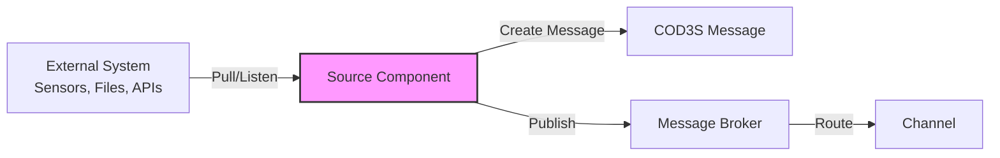
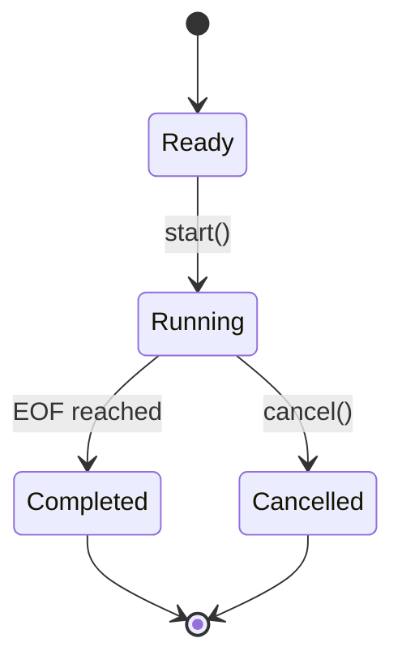
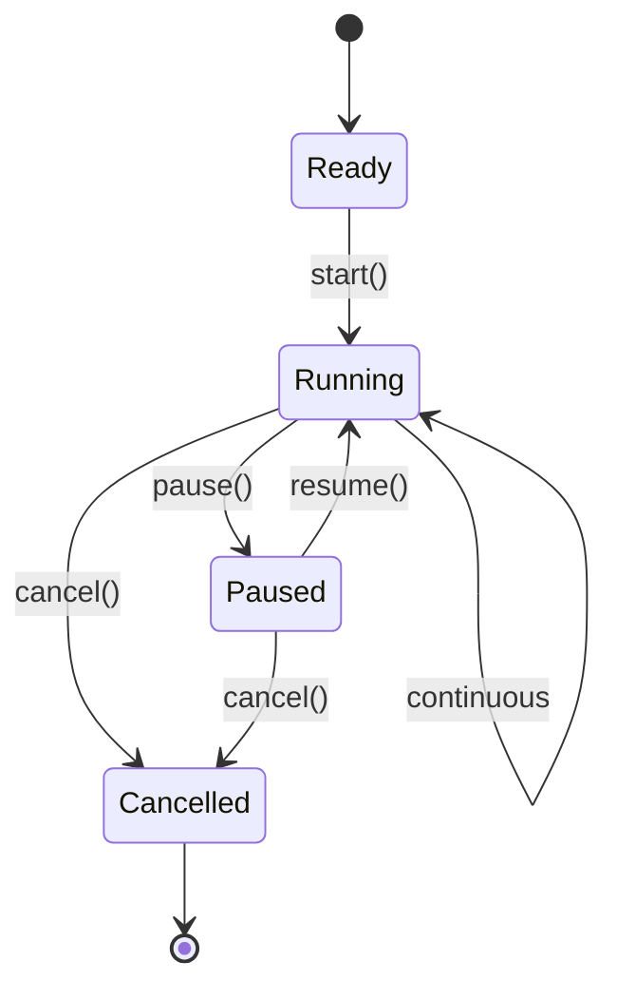
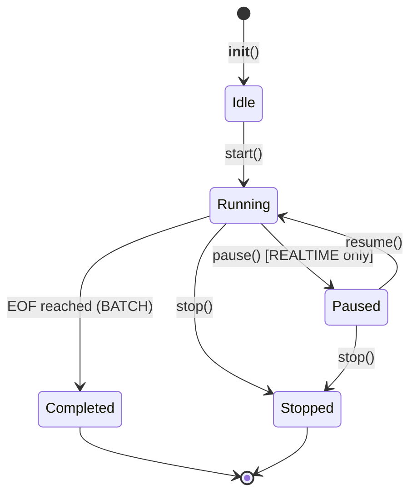
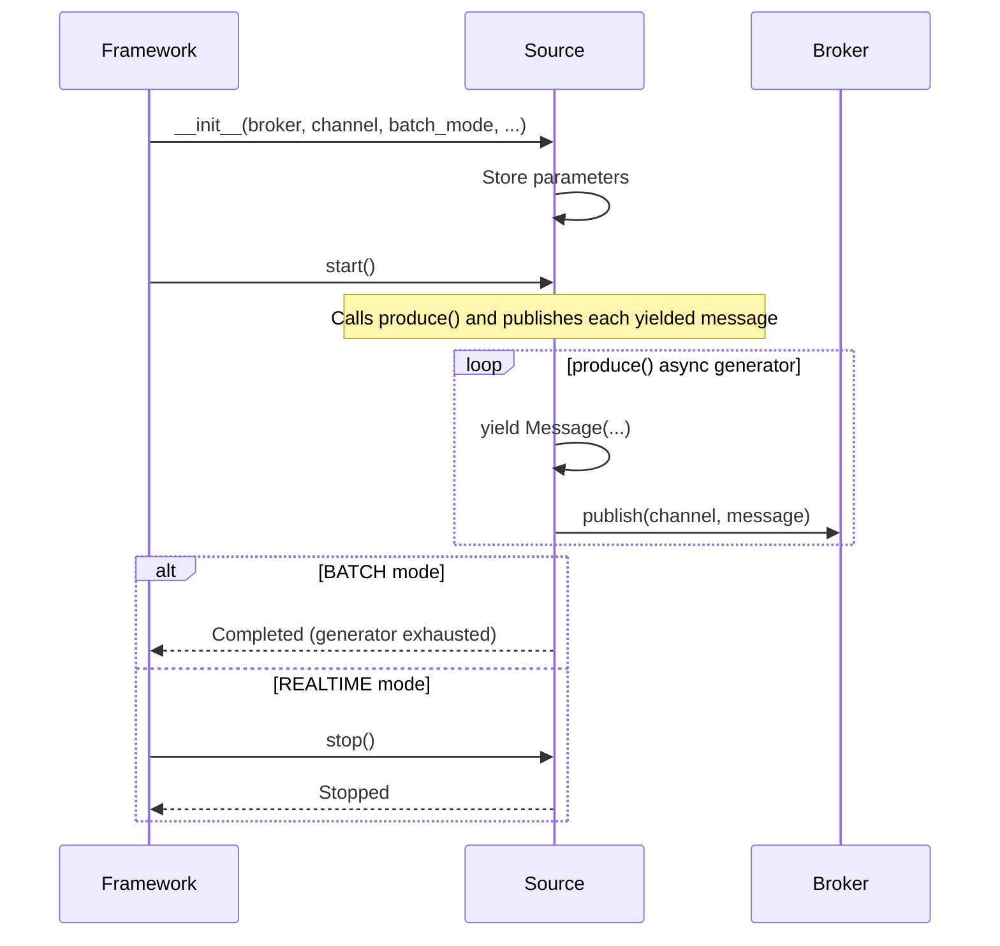

# COD3S Data Framework - Sources

**Version:** 1.0
**Date:** 2026-01-24
**Status:** Functional Specification

---

## Navigation

| Previous | Up | Next |
|----------|-----|------|
| [← 03-MESSAGES](03-MESSAGES.md) | [OVERVIEW](00-OVERVIEW.md) | [05-TRANSFORMATIONS →](05-TRANSFORMATIONS.md) |

---

## Table of Contents

- [Source Concept](#source-concept)
- [Batch Modes](#batch-modes)
- [Source Lifecycle](#source-lifecycle)
- [Control Operations](#control-operations)
- [V1.0 Source Catalog](#v10-source-catalog)
- [Configuration Patterns](#configuration-patterns)
- [Custom Source Development](#custom-source-development)
- [Best Practices](#best-practices)

---

## Source Concept

### What is a Source?

A **source** is an active component that:
1. **Ingests data** from external systems (sensors, files, databases, APIs)
2. **Converts data** to COD3S messages (key, timestamp, value, tags)
3. **Publishes messages** to channels via the broker

**Active vs Passive:**
- Sources are **active** - they pull or listen for data
- Destinations are **passive** - they react to published messages

### Source Characteristics



**Key Responsibilities:**
- Data acquisition (polling, streaming, file reading)
- Message construction (add timestamp, ID, normalize timezone)
- Delivery guarantee implementation (at-most-once or at-least-once)
- Error handling and logging
- Progress reporting (for batch modes)

---

### Source Types by Connectivity

| Type | Behavior | Examples | Use Cases |
|------|----------|----------|-----------|
| **Push Sources** | Listen for incoming data | HTTP server, MQTT subscriber, WebSocket | Real-time sensor streams, webhooks |
| **Pull Sources** | Periodically poll for data | HTTP client, Database query | API polling, database CDC |
| **Batch Sources** | Read finite datasets | File, CSV, JSON | Historical replay, testing, migration |
| **Synthetic Sources** | Generate test data | Random, Sequence, Sine wave | Testing, simulation, demos |

---

## Batch Modes

Sources operate in one of three **batch modes**, controlling how they produce messages:

### BATCH Mode

**Behavior:** Finite dataset, process once, then stop

**Characteristics:**
- Reads complete dataset (file, query result, range)
- Publishes all messages
- Signals completion
- Exits cleanly

**Use Cases:**
- Import historical data
- Process log files
- One-time data migration
- Testing with fixed datasets

**Example:**
```yaml
sources:
  - type: csv
    channel: "sensors.temp"
    params:
      file_path: "historical_data.csv"
```

**Lifecycle:**


---

### REALTIME Mode

**Behavior:** Continuous operation, no end condition

**Characteristics:**
- Runs indefinitely (until cancelled)
- Listens or polls continuously
- No completion signal
- Must be explicitly stopped

**Use Cases:**
- Live sensor data streams
- MQTT subscriptions
- API polling (continuous)
- Real-time monitoring

**Example:**
```yaml
sources:
  - type: random
    channel: "sensors.temp"
    params:
      rate: 10.0
      min_value: 20.0
      max_value: 100.0
```

**Lifecycle:**


---

### TRANSPOSE Mode

> **Planned (V1.x):** TRANSPOSE mode is defined in the `BatchMode` enum but its replay behavior (timestamp-based delays, time scaling) is not yet implemented. See [13-FUTURE](13-FUTURE-V2-V3.md).

**Intended behavior:** Replay historical data with timestamp preservation and optional time scaling.

**Planned use cases:**
- Replay historical data for analysis
- Time-compressed simulations
- Testing transformations with real data
- Debugging specific time windows

---

### Mode Comparison

| Aspect | BATCH | REALTIME | TRANSPOSE |
|--------|-------|----------|-----------|
| **Duration** | Finite | Infinite | Finite |
| **Completion** | Yes | No | Yes |
| **Timestamps** | Generated (now) | Generated (now) | Preserved (original) |
| **Cancellable** | Yes | Yes | Yes |
| **Pausable** | Optional | Yes | Yes |
| **Progress** | Yes (%) | Yes (count) | Yes (%) |
| **Use Case** | Import | Live streams | Replay |

---

## Source Lifecycle

### Lifecycle States

Sources use a simple 5-state lifecycle managed by the `Source` base class:



### State Descriptions

| State | Description | Valid Operations |
|-------|-------------|------------------|
| **Idle** | Object instantiated, ready to run | `start()` |
| **Running** | Actively producing messages via `produce()` | `pause()`, `stop()` |
| **Paused** | Temporarily suspended (REALTIME only) | `resume()`, `stop()` |
| **Completed** | All messages produced (BATCH mode natural end) | None (terminal) |
| **Stopped** | Explicitly stopped by framework or user | None (terminal) |

> **Note:** There is no separate "configured" or "error" state. Configuration is validated at construction time. Errors during `produce()` propagate as exceptions.

---

### Initialization Flow



---

## Control Operations

Sources are controlled via async methods directly on the `Source` instance. The Framework manages sources as `asyncio.Task` objects.

### Start Operation

**Purpose:** Begin message production

**Behavior:**
```python
# Framework starts each source as an asyncio task
await source.start()
# Calls produce() internally and publishes each yielded message
```

The `start()` method is a coroutine that runs the `produce()` async generator loop. It completes when:
- The generator is exhausted (BATCH mode)
- `stop()` is called externally (REALTIME mode)

**In the Framework**, sources are started as concurrent tasks:
```python
# Framework internally does:
task = asyncio.create_task(source.start())
```

---

### Stop Operation

**Purpose:** Stop source, end message production

**Behavior:**
- Sets `_running = False`, causing the `produce()` loop to exit
- Calls `_on_stop()` for subclass-specific cleanup

**Example:**
```python
await source.stop()
```

**Use Cases:**
- User-initiated stop
- Framework shutdown
- Timeout exceeded

---

### Pause/Resume Operations

**Purpose:** Temporarily suspend message production (REALTIME mode only)

**Behavior:**
- **Pause:** Sets `_paused = True`, the produce loop spins waiting
- **Resume:** Sets `_paused = False`, production continues

**Example:**
```python
await source.pause()
# Source stops sending messages, but stays alive

await source.resume()
# Source continues from where it left off
```

**Note:** `pause()` is a no-op for non-REALTIME sources.

---

### Basic Monitoring

Sources expose basic state via properties:

```python
source.is_running      # bool: True if source is active
source.message_count   # int: Total messages produced so far
```

> **Planned (V1.x):** Detailed progress monitoring with `SourceStatus` (progress %, ETA, error info). See [13-FUTURE](13-FUTURE-V2-V3.md).

---

## V1.0 Source Catalog

### RandomSource

**Purpose:** Generate random numeric values (testing, simulation)

**Constructor:**
```python
RandomSource(
    broker: Broker,
    channel: str,
    rate: float = 1.0,           # Messages per second
    min_value: float = 0.0,      # Minimum random value
    max_value: float = 100.0,    # Maximum random value
    key: str = "random_value",   # Message key
    max_messages: int | None = None,  # Stop after N messages (None = unlimited)
)
```

**YAML Configuration:**
```yaml
sources:
  - type: random
    channel: "test.random.temp"
    params:
      rate: 10
      min_value: 20.0
      max_value: 100.0
      key: "temperature"
      max_messages: 1000  # Optional limit (omit for REALTIME)
```

> When `max_messages` is set, the source operates in BATCH mode. Otherwise it runs in REALTIME mode until stopped.

**Example Output:**
```yaml
key: "temperature"
timestamp: "2024-01-15T10:30:45.123Z"
value: 67.3
tags: {}
```

**Use Cases:**
- Testing transformations
- Load testing destinations
- Simulation of sensor data
- Demo environments

---

### SequenceSource

**Purpose:** Generate numeric sequences (testing, counters)

**Constructor:**
```python
SequenceSource(
    broker: Broker,
    channel: str,
    start_value: int = 0,        # Starting value
    end_value: int | None = None, # Ending value (exclusive), None = unlimited
    step_value: int = 1,         # Increment step
    rate: float = 1.0,           # Messages per second
    key: str = "sequence",       # Message key
)
```

**YAML Configuration:**
```yaml
sources:
  - type: sequence
    channel: "test.sequence.counter"
    params:
      start_value: 1
      end_value: 1000
      step_value: 1
      rate: 100
      key: "counter"
```

> When `end_value` is set, the source operates in BATCH mode. Otherwise it runs in REALTIME mode.

**Example Output:**
```yaml
# Message 1
key: "counter"
timestamp: "2024-01-15T10:30:45.001Z"
value: 1
tags: {sequence_value: "1"}

# Message 2
key: "counter"
timestamp: "2024-01-15T10:30:45.011Z"
value: 2
tags: {sequence_value: "2"}
```

**Use Cases:**
- Sequence testing (ensure no gaps)
- Ordering verification
- Rate limiting tests

---

### FileSource

**Purpose:** Read messages from JSON/JSONL files (always BATCH mode)

**Constructor:**
```python
FileSource(
    broker: Broker,
    channel: str,
    file_path: str | Path,       # Path to JSON/JSONL file
)
```

**YAML Configuration:**
```yaml
sources:
  - type: file
    channel: "sensors.import.temp"
    params:
      file_path: "/data/sensor_logs.jsonl"
```

> FileSource always operates in BATCH mode. It auto-detects format: JSON array, single JSON object, or JSONL (one JSON object per line).

**Input File Example (`sensor_logs.jsonl`):**
```json
{"key": "temp", "timestamp": "2024-01-15T10:00:00Z", "value": 23.5, "tags": {"location": "warehouse_A"}}
{"key": "temp", "timestamp": "2024-01-15T10:00:01Z", "value": 23.6, "tags": {"location": "warehouse_A"}}
```

**Output Messages:**
```yaml
key: "temp"
timestamp: "2024-01-15T10:00:00Z"
value: 23.5
tags:
  location: "warehouse_A"
```

---

### CSVSource

**Purpose:** Read CSV files with headers (always BATCH mode, uses Polars)

**Constructor:**
```python
CSVSource(
    broker: Broker,
    channel: str,
    file_path: str | Path,
    key_column: str = "key",             # Column name for message key
    timestamp_column: str = "timestamp", # Column name for timestamp
    value_column: str = "value",         # Column name for value
    tag_columns: list[str] | None = None, # Column names to include as tags
)
```

**YAML Configuration:**
```yaml
sources:
  - type: csv
    channel: "sensors.import.temp"
    params:
      file_path: "/data/temperature_history.csv"
      key_column: "sensor_type"
      timestamp_column: "timestamp"
      value_column: "reading"
      tag_columns: ["location", "sensor_id"]
```

**Input File Example (`temperature_history.csv`):**
```csv
timestamp,sensor_type,reading,location,sensor_id
2024-01-15T10:00:00Z,temperature,23.5,warehouse_A,T001
2024-01-15T10:00:01Z,temperature,23.6,warehouse_A,T001
```

**Output Messages:**
```yaml
key: "temperature"
timestamp: "2024-01-15T10:00:00Z"
value: 23.5
tags:
  location: "warehouse_A"
  sensor_id: "T001"
```

---

## Configuration Patterns

### Basic Source Configuration

Sources are configured in YAML with a `type`, `channel`, and `params` dict:

```yaml
sources:
  # Minimal configuration
  - type: random
    channel: "sensors.temp"
    params: {}

  # Full configuration
  - type: csv
    channel: "sensors.import.temp"
    params:
      file_path: "/data/history.csv"
      timestamp_column: "ts"
      value_column: "value"
```

---

### Multiple Sources

```yaml
sources:
  # Continuous random data
  - type: random
    channel: "sensors.temp"
    params:
      rate: 10.0
      min_value: 20.0
      max_value: 100.0

  # Historical data import
  - type: csv
    channel: "sensors.temp.historical"
    params:
      file_path: "/data/historical_temp.csv"

  # Finite test sequence
  - type: sequence
    channel: "test.counter"
    params:
      start_value: 1
      end_value: 1000
      rate: 100
```

---

### Dynamic Channel Names

> **Planned (V1.x):** Placeholders in channel names filled from message data (e.g., `"sensors.{location}.temp"`). Not yet implemented in V1.0. See [13-FUTURE](13-FUTURE-V2-V3.md).

---

## Custom Source Development

### Source Interface

Subclass `Source` and implement the `produce()` async generator:

```python
import asyncio
from datetime import datetime, timezone
from typing import AsyncIterator

from cod3s_data.sources.base import Source, BatchMode
from cod3s_data.broker.base import Broker
from cod3s_data.core.message import Message


class CustomAPISource(Source):
    """Custom source that polls an external API."""

    def __init__(
        self,
        broker: Broker,
        channel: str,
        endpoint: str,
        rate: float = 1.0,
    ) -> None:
        super().__init__(broker, channel, BatchMode.REALTIME)
        self.endpoint = endpoint
        self.rate = rate

    async def produce(self) -> AsyncIterator[Message]:
        """
        Async generator that yields messages.

        The base class start() method handles:
        - Publishing each yielded message to the broker
        - Pause/resume logic
        - Stop signal checking
        """
        import aiohttp

        async with aiohttp.ClientSession() as session:
            while True:
                async with session.get(self.endpoint) as resp:
                    data = await resp.json()

                yield Message(
                    key=data["sensor_name"],
                    timestamp=datetime.now(timezone.utc),
                    value=data["value"],
                    tags={"location": data.get("location", "unknown")},
                )

                await asyncio.sleep(1.0 / self.rate)

    async def _on_stop(self) -> None:
        """Optional cleanup on stop."""
        pass
```

### Registration via Plugin

Register custom sources using a plugin module with the `ComponentFactory`:

```python
# my_plugin.py
from cod3s_data.config.factory import ComponentFactory

def register(factory: ComponentFactory) -> None:
    factory.register_source("custom_api", CustomAPISource)
```

Then use in YAML configuration:

```yaml
plugins:
  - my_plugin

sources:
  - type: custom_api
    channel: "sensors.external.temp"
    params:
      endpoint: "https://api.example.com/sensors"
      rate: 2.0
```

---

## Best Practices

### Configuration

**Do:**
- ✅ Use environment variables for secrets (`api_key: "${API_KEY}"`)
- ✅ Validate configuration in `configure()` method
- ✅ Test connections before starting message production
- ✅ Provide sensible defaults

**Don't:**
- ❌ Hard-code credentials
- ❌ Fail silently on configuration errors
- ❌ Start without validating parameters

---

### Error Handling

**Do:**
- ✅ Catch and log transient errors (network blips)
- ✅ Retry with backoff on recoverable errors
- ✅ Use Dead Letter Queue for persistent failures
- ✅ Emit error metrics

**Don't:**
- ❌ Crash on single message failure
- ❌ Retry indefinitely without backoff
- ❌ Swallow errors silently

**Example:**
```python
async def produce(self) -> AsyncIterator[Message]:
    retry_count = 0
    while True:
        try:
            data = await self.fetch_data()
            retry_count = 0  # Reset on success
            yield Message(key=data["key"], timestamp=..., value=data["value"])
        except TransientError as e:
            retry_count += 1
            if retry_count > 3:
                logger.error("Max retries exceeded", error=str(e))
                retry_count = 0
            else:
                await asyncio.sleep(2 ** retry_count)
        except FatalError as e:
            logger.error("Fatal error, stopping source", error=str(e))
            break
```

---

### Performance

**Do:**
- ✅ Batch reads when possible (database queries, file I/O)
- ✅ Use connection pooling
- ✅ Implement rate limiting to avoid overwhelming broker
- ✅ Monitor memory usage (avoid unbounded buffers)

**Don't:**
- ❌ Create new connections per message
- ❌ Block on slow external calls without timeout
- ❌ Load entire dataset into memory (stream instead)

---

### Testing

**Do:**
- ✅ Provide test mode with finite data (convert REALTIME → BATCH)
- ✅ Support dry-run (validate without publishing)
- ✅ Implement comprehensive logging
- ✅ Use synthetic sources (Random, Sequence) for testing downstream

**Don't:**
- ❌ Require external systems for unit tests
- ❌ Produce unbounded test data

---

## Summary

**COD3S Data Sources** are the entry point for data:

1. **Batch Modes:**
   - BATCH: Finite dataset, process once
   - REALTIME: Continuous operation
   - TRANSPOSE: Planned for V1.x (not yet implemented)

2. **Control Operations:**
   - `start()` / `stop()` - Async lifecycle
   - `pause()` / `resume()` - Temporary suspension (REALTIME only)
   - `is_running`, `message_count` - Basic monitoring

3. **V1.0 Catalog:**
   - RandomSource (random values, testing)
   - SequenceSource (sequential numbers, testing)
   - FileSource (JSON/JSONL files)
   - CSVSource (CSV files via Polars)

4. **Extensibility:**
   - Subclass `Source`, implement `produce()` async generator
   - Register via plugin with `factory.register_source()`
   - Use in YAML configuration with `params` dict

**Next:** Explore [Transformations](05-TRANSFORMATIONS.md) to process messages.

---

## Navigation

| Previous | Up | Next |
|----------|-----|------|
| [← 03-MESSAGES](03-MESSAGES.md) | [OVERVIEW](00-OVERVIEW.md) | [05-TRANSFORMATIONS →](05-TRANSFORMATIONS.md) |

---

*This is a functional specification document. Implementation details will be defined in the technical specification phase.*
