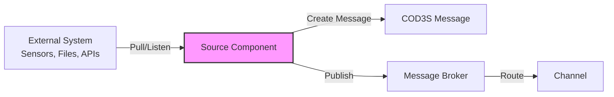
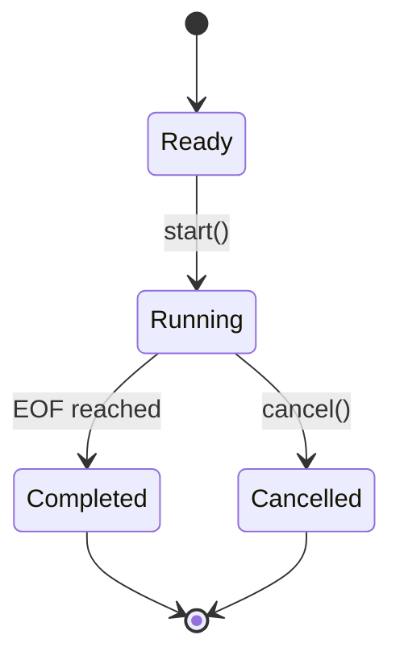
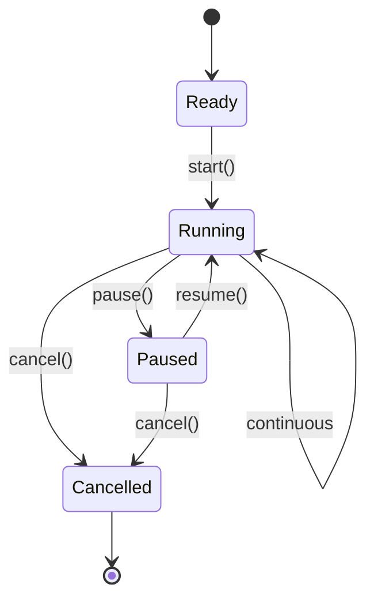
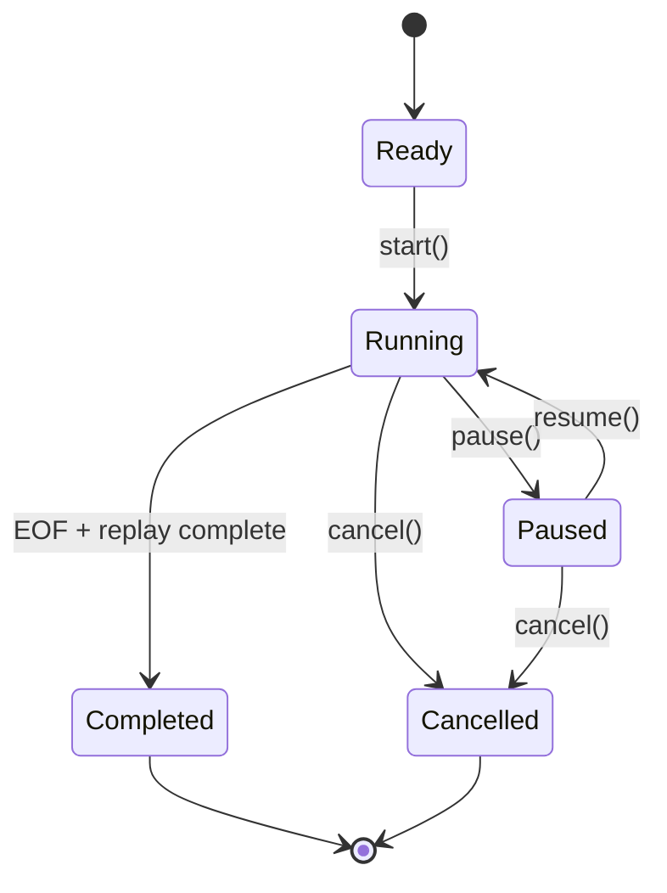
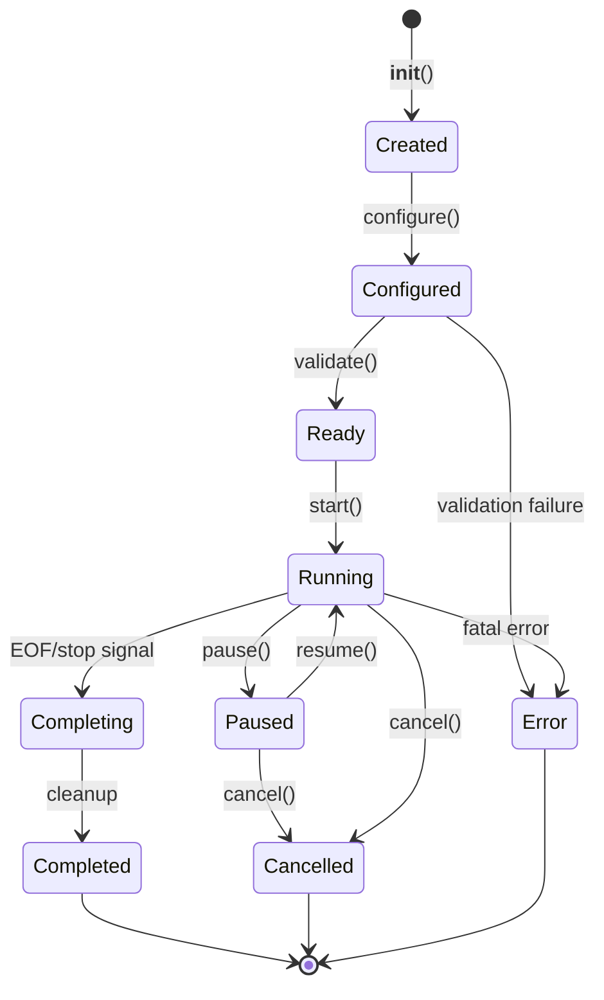
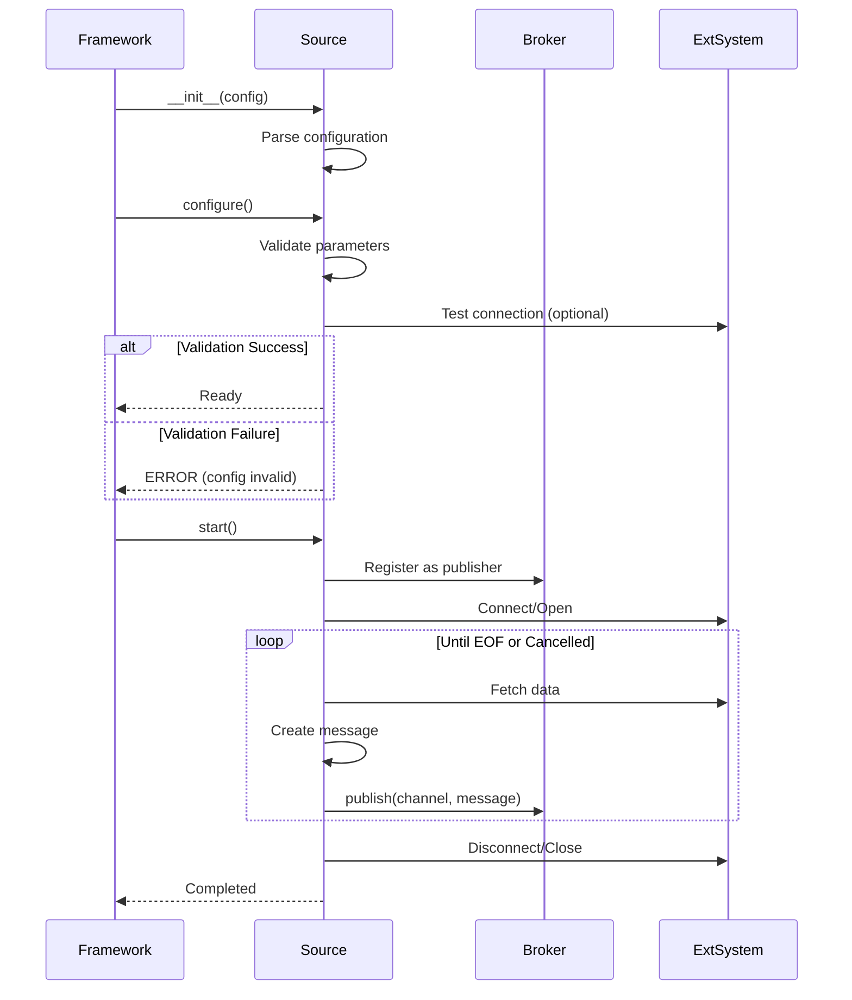

# COD3S Data Framework - Sources

**Version:** 1.0
**Date:** 2026-01-24
**Status:** Functional Specification

---

## Navigation

| Previous | Up | Next |
|----------|-----|------|
| [← 03-MESSAGES](03-MESSAGES.md) | [OVERVIEW](00-OVERVIEW.md) | [05-TRANSFORMATIONS →](05-TRANSFORMATIONS.md) |

---

## Table of Contents

- [Source Concept](#source-concept)
- [Batch Modes](#batch-modes)
- [Source Lifecycle](#source-lifecycle)
- [Control Operations](#control-operations)
- [V1.0 Source Catalog](#v10-source-catalog)
- [Configuration Patterns](#configuration-patterns)
- [Custom Source Development](#custom-source-development)
- [Best Practices](#best-practices)

---

## Source Concept

### What is a Source?

A **source** is an active component that:
1. **Ingests data** from external systems (sensors, files, databases, APIs)
2. **Converts data** to COD3S messages (key, timestamp, value, tags)
3. **Publishes messages** to channels via the broker

**Active vs Passive:**
- Sources are **active** - they pull or listen for data
- Destinations are **passive** - they react to published messages

### Source Characteristics



**Key Responsibilities:**
- Data acquisition (polling, streaming, file reading)
- Message construction (add timestamp, ID, normalize timezone)
- Delivery guarantee implementation (at-most-once or at-least-once)
- Error handling and logging
- Progress reporting (for batch modes)

---

### Source Types by Connectivity

| Type | Behavior | Examples | Use Cases |
|------|----------|----------|-----------|
| **Push Sources** | Listen for incoming data | HTTP server, MQTT subscriber, WebSocket | Real-time sensor streams, webhooks |
| **Pull Sources** | Periodically poll for data | HTTP client, Database query | API polling, database CDC |
| **Batch Sources** | Read finite datasets | File, CSV, JSON | Historical replay, testing, migration |
| **Synthetic Sources** | Generate test data | Random, Sequence, Sine wave | Testing, simulation, demos |

---

## Batch Modes

Sources operate in one of three **batch modes**, controlling how they produce messages:

### BATCH Mode

**Behavior:** Finite dataset, process once, then stop

**Characteristics:**
- Reads complete dataset (file, query result, range)
- Publishes all messages
- Signals completion
- Exits cleanly

**Use Cases:**
- Import historical data
- Process log files
- One-time data migration
- Testing with fixed datasets

**Example:**
```yaml
sources:
  - type: csv
    path: "historical_data.csv"
    channel: "sensors.temp"
    mode: BATCH  # Default for file sources
```

**Lifecycle:**


---

### REALTIME Mode

**Behavior:** Continuous operation, no end condition

**Characteristics:**
- Runs indefinitely (until cancelled)
- Listens or polls continuously
- No completion signal
- Must be explicitly stopped

**Use Cases:**
- Live sensor data streams
- MQTT subscriptions
- API polling (continuous)
- Real-time monitoring

**Example:**
```yaml
sources:
  - type: mqtt
    broker: "mqtt://localhost:1883"
    topic: "sensors/#"
    channel: "sensors.{topic}"
    mode: REALTIME  # Default for streaming sources
```

**Lifecycle:**


---

### TRANSPOSE Mode

**Behavior:** Replay historical data with timestamp preservation

**Characteristics:**
- Reads dataset like BATCH
- Preserves original timestamps (no modification)
- Optionally applies time scaling (speed up/slow down)
- Signals completion after full replay

**Use Cases:**
- Replay historical data for analysis
- Time-compressed simulations
- Testing transformations with real data
- Debugging specific time windows

**Example:**
```yaml
sources:
  - type: csv
    path: "2024-01-15-incident.csv"
    channel: "replay.sensors.temp"
    mode: TRANSPOSE
    time_scale: 10.0  # Replay 10x faster
```

**Time Scaling:**
```python
# Original timestamps preserved, but delays scaled
original_delays = [t2-t1, t3-t2, t4-t3]  # e.g., [1s, 1s, 1s]
scaled_delays = [delay/time_scale for delay in original_delays]  # [0.1s, 0.1s, 0.1s] @ 10x

# Messages published with original timestamps, but faster
# Timestamp: 2024-01-15T10:00:00Z (original)
# Timestamp: 2024-01-15T10:00:01Z (original, but sent 0.1s later)
```

**Lifecycle:**


---

### Mode Comparison

| Aspect | BATCH | REALTIME | TRANSPOSE |
|--------|-------|----------|-----------|
| **Duration** | Finite | Infinite | Finite |
| **Completion** | Yes | No | Yes |
| **Timestamps** | Generated (now) | Generated (now) | Preserved (original) |
| **Cancellable** | Yes | Yes | Yes |
| **Pausable** | Optional | Yes | Yes |
| **Progress** | Yes (%) | Yes (count) | Yes (%) |
| **Use Case** | Import | Live streams | Replay |

---

## Source Lifecycle

### Lifecycle States



### State Descriptions

| State | Description | Valid Operations |
|-------|-------------|------------------|
| **Created** | Object instantiated, not configured | configure() |
| **Configured** | Configuration loaded | validate(), start() |
| **Ready** | Validated, ready to run | start() |
| **Running** | Actively producing messages | pause(), cancel(), get_status() |
| **Paused** | Temporarily stopped | resume(), cancel() |
| **Completing** | Finishing (BATCH/TRANSPOSE only) | wait_for_completion() |
| **Completed** | Finished successfully | None (terminal) |
| **Cancelled** | User-cancelled | None (terminal) |
| **Error** | Fatal error occurred | None (terminal) |

---

### Initialization Flow



---

## Control Operations

### Start Operation

**Purpose:** Begin message production

**Behavior:**
```python
handle = source.start()
# Returns SourceHandle for control and monitoring
```

**Synchronous vs Asynchronous:**
- **Asynchronous (default):** Returns immediately, source runs in background
- **Synchronous (blocking):** Waits until source completes (BATCH/TRANSPOSE only)

**Example:**
```python
# Asynchronous (non-blocking)
handle = source.start()
# Continue with other work
...
# Check later
if handle.is_complete():
    print("Source finished")

# Synchronous (blocking - BATCH mode only)
source.start_and_wait(timeout=3600)  # Wait up to 1 hour
```

---

### Cancel Operation

**Purpose:** Stop source immediately, discard remaining messages

**Behavior:**
- Source stops producing messages
- Resources cleaned up (close files, disconnect)
- State transitions to Cancelled
- Incomplete data is NOT published

**Example:**
```python
handle = source.start()

# Cancel after some condition
if error_detected:
    handle.cancel()
    # Source stops, resources released
```

**Use Cases:**
- User-initiated stop
- Error condition requires abort
- Timeout exceeded
- System shutdown

---

### Pause/Resume Operations

**Purpose:** Temporarily suspend message production

**Behavior:**
- **Pause:** Stop producing messages, maintain state/connection
- **Resume:** Continue from where paused

**Example:**
```python
handle = source.start()

# Pause during high load
handle.pause()
# Source stops sending messages, but connection stays open

# Resume when ready
handle.resume()
# Source continues from where it left off
```

**Use Cases:**
- Backpressure handling (downstream overload)
- Scheduled maintenance windows
- Resource throttling
- Testing and debugging

**Not Supported:**
- Sources that cannot maintain state (some streaming APIs)
- Sources will error on pause() if not supported

---

### Progress Monitoring

**Purpose:** Track source execution progress

**API:**
```python
status = handle.get_status()

# Returns SourceStatus object:
{
    "state": "running",           # created, ready, running, paused, completed, cancelled, error
    "mode": "BATCH",              # BATCH, REALTIME, TRANSPOSE

    # Message counts
    "total_messages": 10000,      # Total to process (BATCH/TRANSPOSE) or -1 (REALTIME)
    "messages_sent": 2500,        # Messages published so far
    "messages_remaining": 7500,   # Remaining (BATCH/TRANSPOSE) or -1 (REALTIME)

    # Time tracking
    "start_time": "2024-01-15T10:00:00Z",
    "elapsed_seconds": 125.3,
    "estimated_remaining_seconds": 375.9,  # ETA for BATCH/TRANSPOSE, None for REALTIME

    # Progress percentage (BATCH/TRANSPOSE only)
    "progress_percent": 25.0,     # 0-100, or None for REALTIME

    # Error information (if state=error)
    "error_message": None,        # Error string if failed
    "error_timestamp": None       # When error occurred
}
```

**Example:**
```python
handle = source.start()

while not handle.is_complete():
    status = handle.get_status()

    if status.mode == "BATCH":
        print(f"Progress: {status.progress_percent:.1f}% "
              f"({status.messages_sent}/{status.total_messages})")
        print(f"ETA: {status.estimated_remaining_seconds:.0f}s")
    else:
        print(f"Messages sent: {status.messages_sent}")

    time.sleep(5)
```

---

### Wait for Completion

**Purpose:** Block until source finishes (BATCH/TRANSPOSE only)

**API:**
```python
# Wait indefinitely
handle.wait_for_completion()

# Wait with timeout
completed = handle.wait_for_completion(timeout=3600)  # 1 hour
if not completed:
    print("Timeout - source still running")
    handle.cancel()
```

**Use Cases:**
- Synchronous batch processing
- Testing (wait for test source to finish)
- Sequential pipeline steps

**Not Applicable:**
- REALTIME sources (never complete)
- Will raise error if called on REALTIME source

---

## V1.0 Source Catalog

### RandomSource

**Purpose:** Generate random numeric values (testing, simulation)

**Configuration:**
```yaml
sources:
  - type: random
    channel: "test.random.temp"
    mode: REALTIME

    # Value generation
    min_value: 20.0
    max_value: 100.0
    value_type: "float"  # or "int"

    # Message rate
    rate_per_second: 10
    duration_seconds: 60  # Optional - convert REALTIME to finite

    # Message metadata
    key: "temperature"
    tags:
      sensor_id: "random_001"
      location: "test_lab"
```

**Example Output:**
```yaml
key: "temperature"
timestamp: "2024-01-15T10:30:45.123Z"
value: 67.3
tags:
  sensor_id: "random_001"
  location: "test_lab"
```

**Use Cases:**
- Testing transformations
- Load testing destinations
- Simulation of sensor failures
- Demo environments

---

### SequenceSource

**Purpose:** Generate numeric sequences (testing, counters)

**Configuration:**
```yaml
sources:
  - type: sequence
    channel: "test.sequence.counter"
    mode: BATCH

    # Sequence parameters
    start: 1
    stop: 1000
    step: 1

    # Message rate
    rate_per_second: 100

    # Message metadata
    key: "counter"
```

**Example Output:**
```yaml
# Message 1
key: "counter"
timestamp: "2024-01-15T10:30:45.001Z"
value: 1

# Message 2
key: "counter"
timestamp: "2024-01-15T10:30:45.011Z"
value: 2
```

**Use Cases:**
- Sequence testing (ensure no gaps)
- Ordering verification
- Rate limiting tests

---

### FileSource

**Purpose:** Read line-delimited files (JSON, text)

**Configuration:**
```yaml
sources:
  - type: file
    path: "/data/sensor_logs.jsonl"
    channel: "sensors.import.temp"
    mode: BATCH  # or TRANSPOSE

    # Format
    format: "jsonl"  # Each line is a JSON object

    # Message construction
    key_field: "sensor_name"       # Extract key from JSON field
    timestamp_field: "ts"           # Extract timestamp from field
    value_field: "value"            # Extract value from field
    tags_fields: ["location", "id"] # Extract tags from these fields

    # Performance
    batch_size: 1000  # Read 1000 lines at a time
```

**Input File Example (`sensor_logs.jsonl`):**
```json
{"ts": "2024-01-15T10:00:00Z", "sensor_name": "temp", "value": 23.5, "location": "warehouse_A", "id": "T001"}
{"ts": "2024-01-15T10:00:01Z", "sensor_name": "temp", "value": 23.6, "location": "warehouse_A", "id": "T001"}
```

**Output Messages:**
```yaml
key: "temp"
timestamp: "2024-01-15T10:00:00Z"
value: 23.5
tags:
  location: "warehouse_A"
  id: "T001"
```

---

### CSVSource

**Purpose:** Read CSV files with headers

**Configuration:**
```yaml
sources:
  - type: csv
    path: "/data/temperature_history.csv"
    channel: "sensors.import.temp"
    mode: BATCH

    # CSV parsing
    delimiter: ","
    has_header: true
    skip_rows: 0

    # Message construction
    timestamp_column: "timestamp"  # Column name or index
    key_column: "sensor_type"      # Optional - or use fixed key
    value_column: "reading"
    tag_columns: ["location", "sensor_id"]  # Optional

    # Fixed metadata (if not in CSV)
    key: "temperature"  # Use if no key_column
    tags:
      import_batch: "2024-01-15"
```

**Input File Example (`temperature_history.csv`):**
```csv
timestamp,sensor_type,reading,location,sensor_id
2024-01-15T10:00:00Z,temperature,23.5,warehouse_A,T001
2024-01-15T10:00:01Z,temperature,23.6,warehouse_A,T001
```

**Output Messages:**
```yaml
key: "temperature"
timestamp: "2024-01-15T10:00:00Z"
value: 23.5
tags:
  location: "warehouse_A"
  sensor_id: "T001"
  import_batch: "2024-01-15"
```

---

## Configuration Patterns

### Basic Source Configuration

```yaml
sources:
  # Minimal configuration
  - type: random
    channel: "sensors.temp"

  # Full configuration
  - type: csv
    path: "/data/history.csv"
    channel: "sensors.import.temp"
    mode: BATCH

    # Delivery guarantee
    delivery_guarantee: "at-least-once"
    retry_attempts: 3
    retry_timeout: 5s
    dead_letter_channel: "_dlq.source_failures"

    # Source-specific parameters
    delimiter: ","
    timestamp_column: "ts"
    value_column: "value"
```

---

### Multiple Sources

```yaml
sources:
  # Real-time temperature sensor
  - type: mqtt
    broker: "mqtt://localhost"
    topic: "sensors/temp/#"
    channel: "sensors.temp"
    mode: REALTIME

  # Historical data import
  - type: csv
    path: "/data/historical_temp.csv"
    channel: "sensors.temp.historical"
    mode: TRANSPOSE
    time_scale: 100  # Replay 100x faster

  # Test data generator
  - type: random
    channel: "test.temp"
    mode: REALTIME
    rate_per_second: 1
```

---

### Dynamic Channel Names

**Pattern:** Use placeholders in channel names filled from message data

```yaml
sources:
  # MQTT - topic becomes part of channel
  - type: mqtt
    topic: "sensors/+/temperature"
    channel: "sensors.{topic[1]}.temperature"
    # sensors/printer1/temperature → channel: sensors.printer1.temperature
    # sensors/printer2/temperature → channel: sensors.printer2.temperature

  # CSV - column value becomes part of channel
  - type: csv
    path: "data.csv"
    channel: "sensors.{location}.temp"
    # Row: location=warehouse_A → channel: sensors.warehouse_A.temp
```

---

## Custom Source Development

### Source Interface

```python
from cod3s_data import Source, Message
from typing import Iterator

class CustomSource(Source):
    """Custom source template"""

    def __init__(self, config: dict):
        super().__init__(config)
        # Extract configuration
        self.endpoint = config.get("endpoint")
        self.api_key = config.get("api_key")

    def configure(self):
        """Validate configuration, test connection"""
        if not self.endpoint:
            raise ConfigError("endpoint required")

        # Test connection
        response = requests.get(self.endpoint, timeout=5)
        response.raise_for_status()

    def generate_messages(self) -> Iterator[Message]:
        """
        Main loop - yield messages

        Framework handles:
        - Publishing to broker
        - Delivery guarantees
        - Error handling
        - Progress tracking
        """
        while True:
            # Fetch data from external system
            data = self.fetch_data()

            # Convert to message
            message = Message(
                key=data["sensor_name"],
                timestamp=data["timestamp"],
                value=data["value"],
                tags={"location": data["location"]}
            )

            yield message

            # Check if should stop
            if self.mode == "BATCH" and self.is_complete():
                break

            # Rate limiting
            time.sleep(1.0 / self.rate_per_second)

    def fetch_data(self):
        """External system interaction"""
        response = requests.get(
            self.endpoint,
            headers={"Authorization": f"Bearer {self.api_key}"}
        )
        return response.json()

    def cleanup(self):
        """Called on stop/cancel - close connections"""
        # Close any open connections
        pass
```

### Registration

```python
# Register custom source
from cod3s_data import SourceRegistry

SourceRegistry.register("custom_api", CustomSource)

# Use in YAML configuration
sources:
  - type: custom_api
    endpoint: "https://api.example.com/sensors"
    api_key: "${API_KEY}"
    channel: "sensors.external.temp"
```

---

## Best Practices

### Configuration

**Do:**
- ✅ Use environment variables for secrets (`api_key: "${API_KEY}"`)
- ✅ Validate configuration in `configure()` method
- ✅ Test connections before starting message production
- ✅ Provide sensible defaults

**Don't:**
- ❌ Hard-code credentials
- ❌ Fail silently on configuration errors
- ❌ Start without validating parameters

---

### Error Handling

**Do:**
- ✅ Catch and log transient errors (network blips)
- ✅ Retry with backoff on recoverable errors
- ✅ Use Dead Letter Queue for persistent failures
- ✅ Emit error metrics

**Don't:**
- ❌ Crash on single message failure
- ❌ Retry indefinitely without backoff
- ❌ Swallow errors silently

**Example:**
```python
def generate_messages(self):
    retry_count = 0
    while True:
        try:
            data = self.fetch_data()
            retry_count = 0  # Reset on success
            yield self.create_message(data)
        except TransientError as e:
            retry_count += 1
            if retry_count > 3:
                # Send to DLQ
                self.send_to_dlq(error=e)
                retry_count = 0
            else:
                # Retry with backoff
                time.sleep(2 ** retry_count)
        except FatalError as e:
            # Cannot recover - stop source
            self.log_error(e)
            break
```

---

### Performance

**Do:**
- ✅ Batch reads when possible (database queries, file I/O)
- ✅ Use connection pooling
- ✅ Implement rate limiting to avoid overwhelming broker
- ✅ Monitor memory usage (avoid unbounded buffers)

**Don't:**
- ❌ Create new connections per message
- ❌ Block on slow external calls without timeout
- ❌ Load entire dataset into memory (stream instead)

---

### Testing

**Do:**
- ✅ Provide test mode with finite data (convert REALTIME → BATCH)
- ✅ Support dry-run (validate without publishing)
- ✅ Implement comprehensive logging
- ✅ Use synthetic sources (Random, Sequence) for testing downstream

**Don't:**
- ❌ Require external systems for unit tests
- ❌ Produce unbounded test data

---

## Summary

**COD3S Data Sources** are the entry point for data:

1. **Batch Modes:**
   - BATCH: Finite dataset, process once
   - REALTIME: Continuous operation
   - TRANSPOSE: Replay with preserved timestamps

2. **Control Operations:**
   - Start (async or blocking)
   - Cancel (stop immediately)
   - Pause/Resume (temporary suspension)
   - Progress monitoring

3. **V1.0 Catalog:**
   - RandomSource (testing)
   - SequenceSource (testing)
   - FileSource (JSON lines)
   - CSVSource (CSV files)

4. **Extensibility:**
   - Implement Source interface
   - Register custom sources
   - Use in YAML configuration

**Next:** Explore [Transformations](05-TRANSFORMATIONS.md) to process messages.

---

## Navigation

| Previous | Up | Next |
|----------|-----|------|
| [← 03-MESSAGES](03-MESSAGES.md) | [OVERVIEW](00-OVERVIEW.md) | [05-TRANSFORMATIONS →](05-TRANSFORMATIONS.md) |

---

*This is a functional specification document. Implementation details will be defined in the technical specification phase.*
