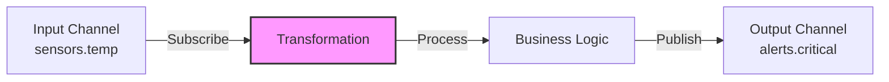
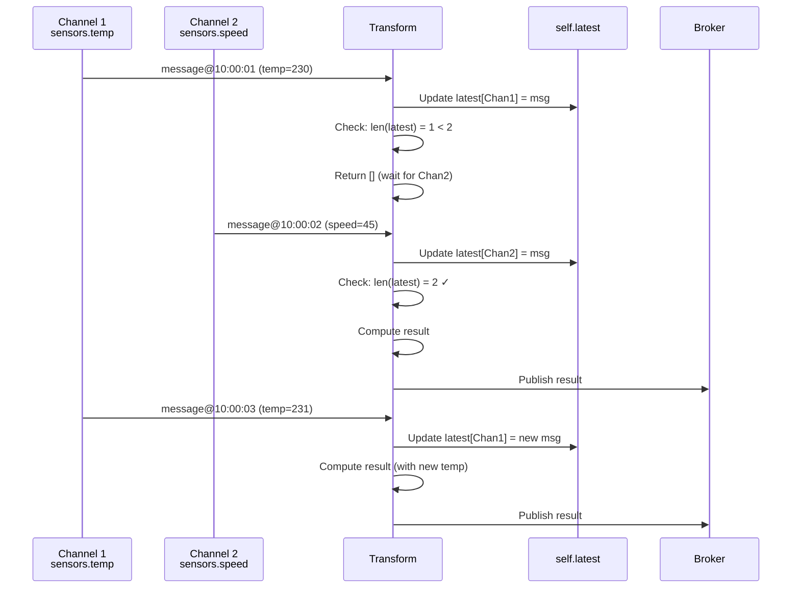

# COD3S Data Framework - Transformations

**Version:** 1.0
**Date:** 2026-01-24
**Status:** Functional Specification

---

## Navigation

| Previous | Up | Next |
|----------|-----|------|
| [← 04-SOURCES](04-SOURCES.md) | [OVERVIEW](00-OVERVIEW.md) | [06-DESTINATIONS →](06-DESTINATIONS.md) |

---

## Table of Contents

- [Transformation Concept](#transformation-concept)
- [Stateless Transformations](#stateless-transformations)
- [Stateful Transformations](#stateful-transformations)
- [Framework State Helpers](#framework-state-helpers)
- [Common Transformation Patterns](#common-transformation-patterns)
- [Built-In Transformations](#built-in-transformations)
- [Custom Transformation Development](#custom-transformation-development)
- [Configuration Patterns](#configuration-patterns)
- [Best Practices](#best-practices)

---

## Transformation Concept

### What is a Transformation?

A **transformation** is a message processor that:
1. **Subscribes** to input channel(s) via the broker
2. **Processes** messages (filter, compute, enrich, aggregate)
3. **Publishes** results to output channel(s) via the broker

**Dual Role:**
- Acts as a **destination** (subscribes to input channels)
- Acts as a **source** (publishes to output channels)



---

### Transformation Characteristics

**Key Properties:**
- **Chainable:** Output of one transformation → input of another
- **Stateless or Stateful:** Single message processing or multi-message aggregation
- **1:N Cardinality:** One input message can produce 0, 1, or many output messages
- **Multi-Channel:** Can consume from and publish to multiple channels

**Use Cases:**
- **Filtering:** Drop unwanted messages
- **Alerting:** Detect thresholds and generate alerts
- **Computation:** Derive metrics from raw data
- **Enrichment:** Add context or lookup data
- **Aggregation:** Combine multiple messages
- **Routing:** Direct messages to different channels based on content

---

## Stateless Transformations

### Concept

**Stateless transformations** process **one message at a time** with **no memory** of previous messages.

**Characteristics:**
- **1:N mapping:** One input message → 0, 1, or N output messages
- **No state:** Each message processed independently
- **Simple:** Easy to understand, test, and parallelize
- **Fast:** Minimal overhead

**Pattern:**
```python
def transform(message: Message) -> List[Message]:
    """
    Process single message, return 0-N results

    Args:
        message: Input message from subscribed channel

    Returns:
        List of messages to publish (can be empty)
    """
    # Process message
    result = process(message)

    if result:
        return [result]  # 1 output
    else:
        return []  # 0 outputs (filtered)
```

---

### Cardinality Patterns

#### 1:0 - Filtering (Drop)

**Use Case:** Remove unwanted messages

```python
class TemperatureFilter:
    def __init__(self, min_value, max_value):
        self.min_value = min_value
        self.max_value = max_value

    def transform(self, message):
        # Drop messages outside range
        if self.min_value <= message.value <= self.max_value:
            return [message]  # Keep
        else:
            return []  # Drop
```

**Configuration:**
```yaml
transformations:
  - type: filter
    input: "sensors.temp.raw"
    output: "sensors.temp.clean"
    min_value: -50
    max_value: 150
```

---

#### 1:1 - Mapping (Transform)

**Use Case:** Convert message format or values

```python
class UnitConversion:
    def transform(self, message):
        # Convert Fahrenheit to Celsius
        celsius = (message.value - 32) * 5/9

        return [Message(
            key=message.key,
            timestamp=message.timestamp,
            value=celsius,
            tags={**message.tags, "unit": "celsius"}
        )]
```

**Configuration:**
```yaml
transformations:
  - type: unit_conversion
    input: "sensors.temp.fahrenheit"
    output: "sensors.temp.celsius"
    from_unit: "fahrenheit"
    to_unit: "celsius"
```

---

#### 1:N - Splitting (Expand)

**Use Case:** Generate multiple messages from one

```python
class ThresholdAlert:
    def __init__(self, threshold):
        self.threshold = threshold

    def transform(self, message):
        results = [message]  # Always pass through original

        # Generate alert if threshold exceeded
        if message.value > self.threshold:
            alert = Message(
                key="alert",
                timestamp=message.timestamp,
                value=f"Temperature {message.value} exceeds {self.threshold}",
                tags={
                    **message.tags,
                    "severity": "critical",
                    "alert_type": "threshold"
                }
            )
            results.append(alert)

        return results  # 1 or 2 messages
```

**Configuration:**
```yaml
transformations:
  - type: threshold_alert
    input: "sensors.temp"
    output: "sensors.temp"  # Pass-through
    alert_output: "alerts.critical"  # Alert channel
    threshold: 100
```

---

## Stateful Transformations

### Concept

**Stateful transformations** process messages with **memory** of previous messages, enabling:
- Multi-sensor coordination (combine temperature + speed + force)
- Time-based aggregation (average over 5 minutes)
- Deduplication (remember recent messages)
- Complex event processing (detect patterns)

**Characteristics:**
- **N:M mapping:** Multiple inputs → 0, 1, or N outputs
- **Multi-channel:** Subscribe to multiple input channels
- **Framework-managed state:** Built-in helpers for common patterns
- **More complex:** Requires state management and cleanup

---

### Multi-Channel Pattern

**Use Case:** Compute viscosity from temperature, speed, and force sensors

```python
from cod3s_data import StatefulTransform, Message

class ViscosityComputer(StatefulTransform):
    """Stateful transformation consuming from 3 channels"""

    # Declare input channels
    input_channels = [
        "sensors.{id}.temperature",
        "sensors.{id}.speed",
        "sensors.{id}.force"
    ]

    # Single output channel
    output_channel = "indicators.{id}.viscosity"

    def transform(self, message: Message) -> List[Message]:
        """
        Called on EACH message from ANY input channel

        self.latest: Dict[channel, Message] - latest message per channel
                     (framework-managed, automatically updated)
        """

        # Wait until all sensors have data
        if len(self.latest) < 3:
            return []  # Not ready yet

        # Extract latest values
        temp = self.latest["sensors.{id}.temperature"].value
        speed = self.latest["sensors.{id}.speed"].value
        force = self.latest["sensors.{id}.force"].value

        # Compute derived metric
        viscosity = self.compute_viscosity(temp, speed, force)

        # Return result
        return [Message(
            key="viscosity",
            timestamp=message.timestamp,  # Use triggering message timestamp
            value=viscosity,
            tags=message.tags
        )]

    def compute_viscosity(self, temp, speed, force):
        # Simplified physics formula
        return force / (speed * (1 + 0.01 * (temp - 20)))
```

**Configuration:**
```yaml
transformations:
  - type: custom_python
    class: ViscosityComputer
    inputs:
      - "sensors.printer1.temperature"
      - "sensors.printer1.speed"
      - "sensors.printer1.force"
    output: "indicators.printer1.viscosity"
```

---

### State Lifecycle



---

## Framework State Helpers

### self.latest - Latest Values

**Purpose:** Track most recent message per input channel

**Provided By:** Framework (automatic)

**Type:** `Dict[channel_name: str, message: Message]`

**Behavior:**
- Automatically updated on each message
- One entry per input channel
- Overwritten on new message (not a history)

**Example:**
```python
class MultiSensorTransform(StatefulTransform):
    input_channels = ["sensors.temp", "sensors.pressure"]

    def transform(self, message):
        # self.latest automatically maintained by framework
        # self.latest = {
        #     "sensors.temp": Message(...),      # Most recent temp
        #     "sensors.pressure": Message(...)   # Most recent pressure
        # }

        if len(self.latest) < 2:
            return []  # Wait for both sensors

        temp = self.latest["sensors.temp"].value
        pressure = self.latest["sensors.pressure"].value

        result = compute(temp, pressure)
        return [Message(key="result", value=result)]
```

---

### TimeWindow - Time-Based Aggregation

**Purpose:** Collect messages within time windows (e.g., 5-minute averages)

**API:**
```python
from cod3s_data import TimeWindow

class TemperatureAggregator(StatefulTransform):
    def __init__(self, window_duration=300):  # 5 minutes
        self.window = TimeWindow(duration=window_duration)

    def transform(self, message):
        # Add message to current window
        self.window.add(message)

        # Check if window is complete
        if self.window.is_complete():
            messages = self.window.get_messages()

            # Compute aggregate
            avg_temp = sum(m.value for m in messages) / len(messages)
            max_temp = max(m.value for m in messages)
            min_temp = min(m.value for m in messages)

            # Start new window
            self.window.reset()

            return [Message(
                key="temp_avg_5min",
                timestamp=messages[-1].timestamp,
                value=avg_temp,
                tags={"max": max_temp, "min": min_temp}
            )]

        return []  # Window not complete yet
```

**Configuration:**
```yaml
transformations:
  - type: time_aggregator
    input: "sensors.temp"
    output: "sensors.temp.5min_avg"
    window_duration: 300  # 5 minutes
    aggregation: "average"
```

---

### CountWindow - Count-Based Aggregation

**Purpose:** Collect N messages before processing

**API:**
```python
from cod3s_data import CountWindow

class MovingAverage(StatefulTransform):
    def __init__(self, window_size=10):
        self.window = CountWindow(size=window_size)

    def transform(self, message):
        self.window.add(message)

        if self.window.is_full():
            messages = self.window.get_messages()
            avg = sum(m.value for m in messages) / len(messages)

            # Slide window (remove oldest, keep recent)
            self.window.slide()

            return [Message(key="moving_avg", value=avg)]

        return []
```

**Configuration:**
```yaml
transformations:
  - type: moving_average
    input: "sensors.temp"
    output: "sensors.temp.ma10"
    window_size: 10
```

---

### Cache - Deduplication and Caching

**Purpose:** Remember recent messages for deduplication or lookup

**API:**
```python
from cod3s_data import Cache

class Deduplication(StatefulTransform):
    def __init__(self, ttl=60):  # 60 second cache
        self.cache = Cache(ttl=ttl)

    def transform(self, message):
        # Generate deduplication key
        dedup_key = (message.key, message.timestamp)

        if dedup_key in self.cache:
            # Duplicate - filter out
            return []

        # First occurrence - add to cache and pass through
        self.cache.add(dedup_key, message)
        return [message]
```

**Configuration:**
```yaml
transformations:
  - type: deduplication
    input: "sensors.temp.raw"
    output: "sensors.temp.clean"
    window: 60  # Deduplicate within 60 seconds
```

**See:** [03-MESSAGES.md#duplicate-detection](03-MESSAGES.md#duplicate-detection)

---

## Common Transformation Patterns

### Pattern 1: Threshold Alert

**Use Case:** Detect when value exceeds threshold and generate alert

```python
class ThresholdAlert(StatelessTransform):
    def __init__(self, threshold, severity="warning"):
        self.threshold = threshold
        self.severity = severity

    def transform(self, message):
        if message.value > self.threshold:
            alert = Message(
                key="alert",
                timestamp=message.timestamp,
                value=f"{message.key} exceeded {self.threshold}: {message.value}",
                tags={
                    **message.tags,
                    "severity": self.severity,
                    "threshold": str(self.threshold),
                    "actual_value": str(message.value)
                }
            )
            return [message, alert]  # Pass-through + Alert

        return [message]  # Pass-through only
```

---

### Pattern 2: Enrichment (Lookup)

**Use Case:** Add context data from external source

```python
class SensorEnrichment(StatelessTransform):
    def __init__(self):
        # Load lookup table (from database, file, API)
        self.sensor_metadata = {
            "T001": {"location": "Warehouse A", "calibration_date": "2024-01-01"},
            "T002": {"location": "Warehouse B", "calibration_date": "2024-01-15"}
        }

    def transform(self, message):
        sensor_id = message.tags.get("sensor_id")

        if sensor_id in self.sensor_metadata:
            enriched_tags = {
                **message.tags,
                **self.sensor_metadata[sensor_id]
            }

            return [Message(
                key=message.key,
                timestamp=message.timestamp,
                value=message.value,
                tags=enriched_tags
            )]

        return [message]  # No enrichment available
```

---

### Pattern 3: Smoothing (Moving Average)

**Use Case:** Reduce noise with moving average

```python
class ExponentialSmoothing(StatefulTransform):
    def __init__(self, alpha=0.3):
        self.alpha = alpha
        self.smoothed_value = None

    def transform(self, message):
        if self.smoothed_value is None:
            self.smoothed_value = message.value
        else:
            # Exponential smoothing: S_t = α * Y_t + (1-α) * S_{t-1}
            self.smoothed_value = (
                self.alpha * message.value +
                (1 - self.alpha) * self.smoothed_value
            )

        return [Message(
            key=f"{message.key}_smoothed",
            timestamp=message.timestamp,
            value=self.smoothed_value,
            tags=message.tags
        )]
```

---

### Pattern 4: Rate Limiting

**Use Case:** Throttle high-frequency sensors

```python
class RateLimiter(StatefulTransform):
    def __init__(self, max_rate=1.0):  # Max 1 message per second
        self.min_interval = 1.0 / max_rate
        self.last_sent = None

    def transform(self, message):
        now = message.timestamp.timestamp()

        if self.last_sent is None or (now - self.last_sent) >= self.min_interval:
            self.last_sent = now
            return [message]
        else:
            return []  # Drop (too frequent)
```

---

### Pattern 5: Sampling (Downsample)

**Use Case:** Reduce data volume by sampling

```python
class Sampler(StatefulTransform):
    def __init__(self, sample_rate=10):  # Keep 1 in 10
        self.sample_rate = sample_rate
        self.counter = 0

    def transform(self, message):
        self.counter += 1

        if self.counter % self.sample_rate == 0:
            return [message]  # Keep this one
        else:
            return []  # Drop
```

---

## Built-In Transformations

### V1.0 Catalog

| Transformation | Type | Purpose | Parameters |
|----------------|------|---------|------------|
| **Filter** | Stateless | Drop messages outside range | `min_value`, `max_value` |
| **ThresholdAlert** | Stateless | Alert on threshold exceeded | `threshold`, `severity` |
| **UnitConversion** | Stateless | Convert units | `from_unit`, `to_unit` |
| **Deduplication** | Stateful | Remove duplicates | `window`, `strategy` |
| **TimeAggregator** | Stateful | Time-based aggregation | `window_duration`, `aggregation` |
| **MovingAverage** | Stateful | Sliding window average | `window_size` |
| **Sampler** | Stateless | Downsample data | `sample_rate` |
| **RateLimiter** | Stateful | Throttle message rate | `max_rate` |

---

## Custom Transformation Development

### Stateless Transformation Template

```python
from cod3s_data import StatelessTransform, Message
from typing import List

class MyTransform(StatelessTransform):
    """Custom stateless transformation"""

    def __init__(self, param1, param2):
        """Initialize with configuration parameters"""
        super().__init__()
        self.param1 = param1
        self.param2 = param2

    def transform(self, message: Message) -> List[Message]:
        """
        Process single message

        Args:
            message: Input message

        Returns:
            List of output messages (0, 1, or N)
        """
        # Process message
        result = self.process(message)

        if result is not None:
            return [result]
        else:
            return []

    def process(self, message):
        # Your business logic
        if message.value > self.param1:
            return Message(
                key=message.key,
                timestamp=message.timestamp,
                value=message.value * self.param2,
                tags=message.tags
            )
        return None
```

---

### Stateful Transformation Template

```python
from cod3s_data import StatefulTransform, Message
from typing import List

class MyStatefulTransform(StatefulTransform):
    """Custom stateful transformation"""

    # Declare input channels
    input_channels = [
        "sensors.temp",
        "sensors.pressure"
    ]

    # Optional: declare output channel
    output_channel = "indicators.result"

    def __init__(self, config):
        super().__init__()
        self.threshold = config.get("threshold", 100)

    def transform(self, message: Message) -> List[Message]:
        """
        Process message with access to state

        Framework provides:
        - self.latest: Dict[channel, Message] - latest message per channel
        """

        # Wait for all inputs
        if len(self.latest) < len(self.input_channels):
            return []

        # Extract latest values
        temp = self.latest["sensors.temp"].value
        pressure = self.latest["sensors.pressure"].value

        # Compute result
        result = self.compute(temp, pressure)

        # Return message
        return [Message(
            key="result",
            timestamp=message.timestamp,
            value=result,
            tags=message.tags
        )]

    def compute(self, temp, pressure):
        # Your business logic
        return temp * pressure / self.threshold
```

---

### Registration and Usage

```python
# Register custom transformation
from cod3s_data import TransformRegistry

TransformRegistry.register("my_transform", MyTransform)

# Use in YAML configuration
transformations:
  - type: my_transform
    input: "sensors.temp"
    output: "sensors.temp.processed"
    param1: 100
    param2: 2.5

# Or use programmatically
from cod3s_data import Framework

framework = Framework()
transform = MyTransform(param1=100, param2=2.5)
framework.add_transformation(
    transform,
    input_channel="sensors.temp",
    output_channel="sensors.temp.processed"
)
```

---

## Configuration Patterns

### Basic Configuration

```yaml
transformations:
  # Stateless (single input → single output)
  - type: filter
    input: "sensors.temp.raw"
    output: "sensors.temp.clean"
    min_value: -50
    max_value: 150

  # Stateful (multiple inputs → single output)
  - type: custom_python
    class: ViscosityComputer
    inputs:
      - "sensors.temp"
      - "sensors.speed"
      - "sensors.force"
    output: "indicators.viscosity"
```

---

### Transformation Chains

```yaml
transformations:
  # Step 1: Deduplication
  - type: deduplication
    input: "sensors.temp.raw"
    output: "sensors.temp.deduped"
    window: 60

  # Step 2: Unit conversion
  - type: unit_conversion
    input: "sensors.temp.deduped"
    output: "sensors.temp.celsius"
    from_unit: "fahrenheit"
    to_unit: "celsius"

  # Step 3: Smoothing
  - type: moving_average
    input: "sensors.temp.celsius"
    output: "sensors.temp.smooth"
    window_size: 10

  # Step 4: Alert
  - type: threshold_alert
    input: "sensors.temp.smooth"
    output: "sensors.temp.smooth"  # Pass-through
    alert_output: "alerts.critical"
    threshold: 100
```

**Flow:**
```
Raw → Dedup → Convert → Smooth → Alert → Destinations
```

---

### Multi-Output Transformations

```yaml
transformations:
  - type: threshold_classifier
    input: "sensors.temp"
    outputs:
      low: "sensors.temp.low"      # value < 20
      normal: "sensors.temp.normal"  # 20 <= value <= 100
      high: "sensors.temp.high"    # value > 100
    low_threshold: 20
    high_threshold: 100
```

---

## Best Practices

### Design

**Do:**
- ✅ Keep transformations focused (single responsibility)
- ✅ Make transformations pure (no side effects beyond message output)
- ✅ Use stateless when possible (simpler, faster)
- ✅ Emit metrics for monitoring

**Don't:**
- ❌ Call external APIs in tight loops (cache results)
- ❌ Store unbounded state (use TTL-based caches)
- ❌ Block on slow operations (use async if needed)

---

### Error Handling

**Do:**
- ✅ Catch and log errors
- ✅ Return empty list on error (filter out bad message)
- ✅ Send problematic messages to DLQ
- ✅ Emit error metrics

**Example:**
```python
def transform(self, message):
    try:
        result = self.process(message)
        return [result]
    except ValueError as e:
        self.log_error(f"Invalid value: {e}")
        self.send_to_dlq(message, error=str(e))
        return []  # Drop message
    except Exception as e:
        self.log_error(f"Unexpected error: {e}")
        raise  # Re-raise for framework to handle
```

---

### Performance

**Do:**
- ✅ Minimize state size (use windowing, TTL)
- ✅ Batch external lookups when possible
- ✅ Use efficient data structures (deque for windows)
- ✅ Profile and optimize hot paths

**Don't:**
- ❌ Accumulate unbounded history
- ❌ Perform expensive operations per message
- ❌ Hold locks for long durations

---

### Testing

**Do:**
- ✅ Unit test transformations in isolation
- ✅ Test edge cases (empty input, null values, extremes)
- ✅ Test stateful transformations with various message orderings
- ✅ Use test sources and collect destinations

**Example:**
```python
def test_threshold_alert():
    transform = ThresholdAlert(threshold=100)

    # Below threshold - no alert
    msg1 = Message(key="temp", value=50, timestamp=now())
    result = transform.transform(msg1)
    assert len(result) == 1  # Pass-through only

    # Above threshold - alert
    msg2 = Message(key="temp", value=150, timestamp=now())
    result = transform.transform(msg2)
    assert len(result) == 2  # Pass-through + Alert
```

---

## Summary

**COD3S Data Transformations** process messages:

1. **Stateless Transformations:**
   - 1:N processing (one message in, 0-N out)
   - No state, simple, fast
   - Patterns: filtering, mapping, splitting

2. **Stateful Transformations:**
   - N:M processing (multi-channel coordination)
   - Framework-managed state helpers
   - Patterns: aggregation, deduplication, multi-sensor computation

3. **Framework Helpers:**
   - `self.latest` - Latest message per channel
   - `TimeWindow` - Time-based aggregation
   - `CountWindow` - Count-based aggregation
   - `Cache` - Deduplication and caching

4. **Extensibility:**
   - Implement Transform interface
   - Register custom transformations
   - Use in YAML or programmatically

**Next:** Explore [Destinations](06-DESTINATIONS.md) for data output.

---

## Navigation

| Previous                      | Up                         | Next                                    |
| ----------------------------- | -------------------------- | --------------------------------------- |
| [← 04-SOURCES](04-SOURCES.md) | [OVERVIEW](00-OVERVIEW.md) | [06-DESTINATIONS →](06-DESTINATIONS.md) |
|                               |                            |                                         |

---

*This is a functional specification document. Implementation details will be defined in the technical specification phase.*
