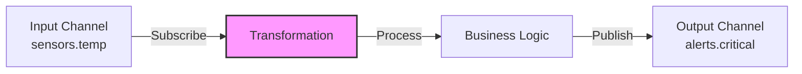
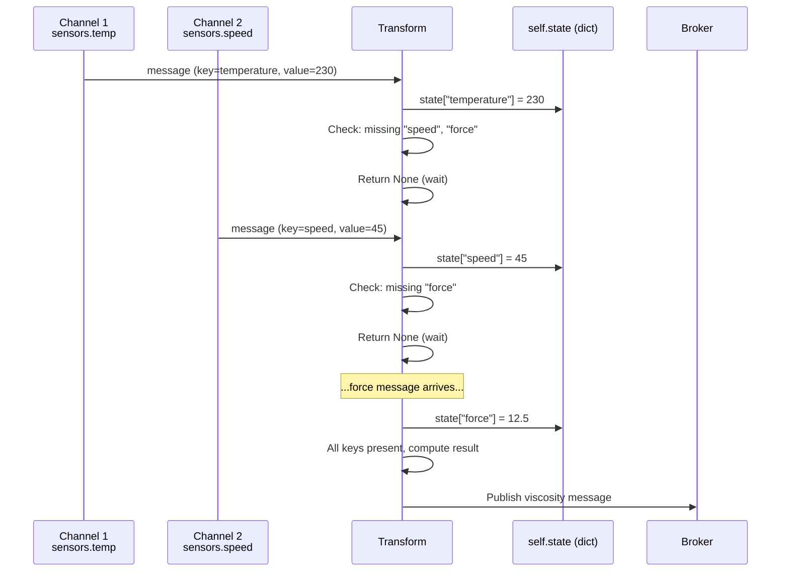

# COD3S Data Framework - Transformations

**Version:** 1.0
**Date:** 2026-01-24
**Status:** Functional Specification

---

## Navigation

| Previous | Up | Next |
|----------|-----|------|
| [← 04-SOURCES](04-SOURCES.md) | [OVERVIEW](00-OVERVIEW.md) | [06-DESTINATIONS →](06-DESTINATIONS.md) |

---

## Table of Contents

- [Transformation Concept](#transformation-concept)
- [Stateless Transformations](#stateless-transformations)
- [Stateful Transformations](#stateful-transformations)
- [Framework State Helpers](#framework-state-helpers)
- [Common Transformation Patterns](#common-transformation-patterns)
- [Built-In Transformations](#built-in-transformations)
- [Custom Transformation Development](#custom-transformation-development)
- [Configuration Patterns](#configuration-patterns)
- [Best Practices](#best-practices)

---

## Transformation Concept

### What is a Transformation?

A **transformation** is a message processor that:
1. **Subscribes** to input channel(s) via the broker
2. **Processes** messages (filter, compute, enrich, aggregate)
3. **Publishes** results to output channel(s) via the broker

**Dual Role:**
- Acts as a **destination** (subscribes to input channels)
- Acts as a **source** (publishes to output channels)



---

### Transformation Characteristics

**Key Properties:**
- **Chainable:** Output of one transformation → input of another
- **Stateless or Stateful:** Single message processing or multi-message aggregation
- **1:N Cardinality:** One input message can produce 0, 1, or many output messages
- **Multi-Channel:** Can consume from and publish to multiple channels

**Use Cases:**
- **Filtering:** Drop unwanted messages
- **Alerting:** Detect thresholds and generate alerts
- **Computation:** Derive metrics from raw data
- **Enrichment:** Add context or lookup data
- **Aggregation:** Combine multiple messages
- **Routing:** Direct messages to different channels based on content

---

## Stateless Transformations

### Concept

**Stateless transformations** process **one message at a time** with **no memory** of previous messages.

**Characteristics:**
- **1:N mapping:** One input message → 0, 1, or N output messages
- **No state:** Each message processed independently
- **Simple:** Easy to understand, test, and parallelize
- **Fast:** Minimal overhead

**Pattern:**
```python
def transform(message: Message) -> List[Message]:
    """
    Process single message, return 0-N results

    Args:
        message: Input message from subscribed channel

    Returns:
        List of messages to publish (can be empty)
    """
    # Process message
    result = process(message)

    if result:
        return [result]  # 1 output
    else:
        return []  # 0 outputs (filtered)
```

---

### Cardinality Patterns

#### 1:0 - Filtering (Drop)

**Use Case:** Remove unwanted messages

```python
class TemperatureFilter:
    def __init__(self, min_value, max_value):
        self.min_value = min_value
        self.max_value = max_value

    def transform(self, message):
        # Drop messages outside range
        if self.min_value <= message.value <= self.max_value:
            return [message]  # Keep
        else:
            return []  # Drop
```

**Configuration:**
```yaml
transformations:
  - type: filter
    input: "sensors.temp.raw"
    output: "sensors.temp.clean"
    min_value: -50
    max_value: 150
```

---

#### 1:1 - Mapping (Transform)

**Use Case:** Convert message format or values

```python
class UnitConversion:
    def transform(self, message):
        # Convert Fahrenheit to Celsius
        celsius = (message.value - 32) * 5/9

        return [Message(
            key=message.key,
            timestamp=message.timestamp,
            value=celsius,
            tags={**message.tags, "unit": "celsius"}
        )]
```

**Configuration:**
```yaml
transformations:
  - type: unit_conversion
    input: "sensors.temp.fahrenheit"
    output: "sensors.temp.celsius"
    from_unit: "fahrenheit"
    to_unit: "celsius"
```

---

#### 1:N - Splitting (Expand)

**Use Case:** Generate multiple messages from one

```python
class ThresholdAlert:
    def __init__(self, threshold):
        self.threshold = threshold

    def transform(self, message):
        results = [message]  # Always pass through original

        # Generate alert if threshold exceeded
        if message.value > self.threshold:
            alert = Message(
                key="alert",
                timestamp=message.timestamp,
                value=f"Temperature {message.value} exceeds {self.threshold}",
                tags={
                    **message.tags,
                    "severity": "critical",
                    "alert_type": "threshold"
                }
            )
            results.append(alert)

        return results  # 1 or 2 messages
```

**Configuration:**
```yaml
transformations:
  - type: threshold_alert
    input: "sensors.temp"
    output: "sensors.temp"  # Pass-through
    alert_output: "alerts.critical"  # Alert channel
    threshold: 100
```

---

## Stateful Transformations

### Concept

**Stateful transformations** process messages with **memory** of previous messages, enabling:
- Multi-sensor coordination (combine temperature + speed + force)
- Time-based aggregation (average over 5 minutes)
- Deduplication (remember recent messages)
- Complex event processing (detect patterns)

**Characteristics:**
- **N:M mapping:** Multiple inputs → 0, 1, or N outputs
- **Multi-channel:** Subscribe to multiple input channels
- **Framework-managed state:** Built-in helpers for common patterns
- **More complex:** Requires state management and cleanup

---

### Multi-Channel Pattern

**Use Case:** Compute viscosity from temperature, speed, and force sensors

```python
from cod3s_data.transformations.base import StatefulTransform
from cod3s_data.core.message import Message
from typing import Any

class ViscosityComputer(StatefulTransform):
    """Stateful transformation consuming from 3 channels.

    Uses self.state (dict) to track latest values per channel.
    The state dict is user-managed inside transform_with_state().
    """

    async def transform_with_state(
        self, message: Message, state: dict[str, Any]
    ) -> Message | list[Message] | None:
        """
        Called on EACH message from ANY input channel.
        Access is serialized via an asyncio.Lock (thread-safe).

        Args:
            message: The incoming message
            state: Mutable dict persisted across calls (self.state)
        """
        # Track latest value by channel/key
        state[message.key] = message.value

        # Wait until all sensors have data
        required = {"temperature", "speed", "force"}
        if not required.issubset(state.keys()):
            return None  # Not ready yet

        # Compute derived metric
        temp = state["temperature"]
        speed = state["speed"]
        force = state["force"]
        viscosity = force / (speed * (1 + 0.01 * (temp - 20)))

        return Message(
            key="viscosity",
            timestamp=message.timestamp,
            value=viscosity,
            tags=message.tags,
        )
```

**Configuration (via plugin):**
```yaml
plugins:
  - my_transforms_plugin

transformations:
  - type: viscosity_computer
    input_channels:
      - "sensors.printer1.temperature"
      - "sensors.printer1.speed"
      - "sensors.printer1.force"
    output_channel: "indicators.printer1.viscosity"
    params: {}
```

---

### State Lifecycle



---

## Framework State Helpers

### self.state - Stateful Transform State Dict

**Purpose:** Mutable dictionary for tracking state across messages in `StatefulTransform`

**Type:** `dict[str, Any]` (initialized as empty `{}`)

**Behavior:**
- User-managed inside `transform_with_state(message, state)`
- Access is serialized via `asyncio.Lock` (thread-safe)
- Persists for the lifetime of the transform

**Example:**
```python
from cod3s_data.transformations.base import StatefulTransform
from cod3s_data.core.message import Message
from typing import Any

class MultiSensorTransform(StatefulTransform):
    async def transform_with_state(
        self, message: Message, state: dict[str, Any]
    ) -> Message | list[Message] | None:
        # Track latest value per key in state dict
        state[message.key] = message.value

        if "temperature" not in state or "pressure" not in state:
            return None  # Wait for both sensors

        result = compute(state["temperature"], state["pressure"])
        return Message(
            key="result",
            timestamp=message.timestamp,
            value=result,
        )
```

> **Tip:** Use the buffer helpers below (`Latest`, `TimeWindow`, `CountWindow`, `Cache`) inside your `transform_with_state()` for common patterns.

---

### Buffer Helpers

These structures from `cod3s_data.core.buffers` can be stored in `self.state` or as instance attributes on custom transforms.

#### Latest - Track Latest Per Channel

```python
from cod3s_data.core.buffers import Latest

# In your transform __init__:
self.latest = Latest()

# In transform_with_state:
self.latest.update(message.key, message)
if self.latest.has_all(["temperature", "pressure"]):
    temp = self.latest.get("temperature").value
    ...
```

#### TimeWindow - Time-Based Aggregation

```python
from datetime import timedelta
from cod3s_data.core.buffers import TimeWindow

# Keep messages from the last 5 minutes
window = TimeWindow(duration=timedelta(minutes=5))
window.add(message)

messages = window.all()       # All messages in window
values = window.values()      # Extracted values
avg = sum(values) / len(values) if values else 0
```

#### CountWindow - Count-Based Aggregation

```python
from cod3s_data.core.buffers import CountWindow

# Keep last 10 messages
window = CountWindow(max_count=10)
window.add(message)

if window.is_full():
    values = window.values()
    avg = sum(values) / len(values)
```

#### Cache - Deduplication and Caching

```python
from datetime import timedelta
from cod3s_data.core.buffers import Cache

# Cache with 60-second TTL
cache = Cache(ttl=timedelta(seconds=60))
cache.set("my_key", some_value)
cache.get("my_key")   # None if expired
cache.has("my_key")   # bool
```

---

## Common Transformation Patterns

### Pattern 1: Threshold Alert

**Use Case:** Detect when value exceeds threshold and generate alert

```python
class ThresholdAlert(StatelessTransform):
    def __init__(self, threshold, severity="warning"):
        self.threshold = threshold
        self.severity = severity

    def transform(self, message):
        if message.value > self.threshold:
            alert = Message(
                key="alert",
                timestamp=message.timestamp,
                value=f"{message.key} exceeded {self.threshold}: {message.value}",
                tags={
                    **message.tags,
                    "severity": self.severity,
                    "threshold": str(self.threshold),
                    "actual_value": str(message.value)
                }
            )
            return [message, alert]  # Pass-through + Alert

        return [message]  # Pass-through only
```

---

### Pattern 2: Enrichment (Lookup)

**Use Case:** Add context data from external source

```python
class SensorEnrichment(StatelessTransform):
    def __init__(self):
        # Load lookup table (from database, file, API)
        self.sensor_metadata = {
            "T001": {"location": "Warehouse A", "calibration_date": "2024-01-01"},
            "T002": {"location": "Warehouse B", "calibration_date": "2024-01-15"}
        }

    def transform(self, message):
        sensor_id = message.tags.get("sensor_id")

        if sensor_id in self.sensor_metadata:
            enriched_tags = {
                **message.tags,
                **self.sensor_metadata[sensor_id]
            }

            return [Message(
                key=message.key,
                timestamp=message.timestamp,
                value=message.value,
                tags=enriched_tags
            )]

        return [message]  # No enrichment available
```

---

### Pattern 3: Smoothing (Moving Average)

**Use Case:** Reduce noise with moving average

```python
class ExponentialSmoothing(StatefulTransform):
    def __init__(self, alpha=0.3):
        self.alpha = alpha
        self.smoothed_value = None

    def transform(self, message):
        if self.smoothed_value is None:
            self.smoothed_value = message.value
        else:
            # Exponential smoothing: S_t = α * Y_t + (1-α) * S_{t-1}
            self.smoothed_value = (
                self.alpha * message.value +
                (1 - self.alpha) * self.smoothed_value
            )

        return [Message(
            key=f"{message.key}_smoothed",
            timestamp=message.timestamp,
            value=self.smoothed_value,
            tags=message.tags
        )]
```

---

### Pattern 4: Rate Limiting

**Use Case:** Throttle high-frequency sensors

```python
class RateLimiter(StatefulTransform):
    def __init__(self, max_rate=1.0):  # Max 1 message per second
        self.min_interval = 1.0 / max_rate
        self.last_sent = None

    def transform(self, message):
        now = message.timestamp.timestamp()

        if self.last_sent is None or (now - self.last_sent) >= self.min_interval:
            self.last_sent = now
            return [message]
        else:
            return []  # Drop (too frequent)
```

---

### Pattern 5: Sampling (Downsample)

**Use Case:** Reduce data volume by sampling

```python
class Sampler(StatefulTransform):
    def __init__(self, sample_rate=10):  # Keep 1 in 10
        self.sample_rate = sample_rate
        self.counter = 0

    def transform(self, message):
        self.counter += 1

        if self.counter % self.sample_rate == 0:
            return [message]  # Keep this one
        else:
            return []  # Drop
```

---

## Built-In Transformations

### V1.0 Implemented

| Transformation | Type | Purpose | YAML `type` | Key Parameters |
|----------------|------|---------|-------------|----------------|
| **FilterTransform** | Stateless | Drop messages by predicate | `filter` | `predicate_code` |
| **MapTransform** | Stateless | Transform message values | `map` | `map_fn_code` |
| **AggregateTransform** | Stateful | Aggregate over windows | `aggregate` | `window_type`, `window_size`, `aggregation_fn_code` |

### Planned (V1.x)

The following transformations are described in this specification but **not yet implemented**. See [13-FUTURE](13-FUTURE-V2-V3.md).

| Transformation | Type | Purpose |
|----------------|------|---------|
| **DeduplicationTransform** | Stateful | Remove duplicate messages |
| **ThresholdAlert** | Stateless | Alert on threshold exceeded |
| **UnitConversion** | Stateless | Convert units |
| **Sampler** | Stateless | Downsample data |
| **RateLimiter** | Stateful | Throttle message rate |

---

## Custom Transformation Development

### Stateless Transformation Template

```python
from cod3s_data.transformations.base import StatelessTransform
from cod3s_data.broker.base import Broker
from cod3s_data.core.message import Message
from typing import Callable

class MyTransform(StatelessTransform):
    """Custom stateless transformation.

    StatelessTransform takes a transform_fn callable in its constructor.
    For custom logic, subclass Transformation directly and implement transform().
    """
    pass

# Using StatelessTransform with a lambda/function:
transform = StatelessTransform(
    broker=broker,
    input_channels="input",
    output_channel="output",
    transform_fn=lambda msg: msg.with_value(msg.value * 2) if msg.value > 10 else None,
)
```

For more complex logic, subclass `Transformation` directly:

```python
from cod3s_data.transformations.base import Transformation
from cod3s_data.core.message import Message

class MyCustomTransform(Transformation):
    def __init__(self, broker, input_channels, output_channel, threshold=10.0, multiplier=2.0):
        super().__init__(broker, input_channels, output_channel)
        self.threshold = threshold
        self.multiplier = multiplier

    async def transform(self, message: Message) -> Message | list[Message] | None:
        if message.value > self.threshold:
            return message.with_value(message.value * self.multiplier)
        return None  # Filter out
```

---

### Stateful Transformation Template

```python
from cod3s_data.transformations.base import StatefulTransform
from cod3s_data.broker.base import Broker
from cod3s_data.core.message import Message
from typing import Any

class MyStatefulTransform(StatefulTransform):
    """Custom stateful transformation.

    Uses self.state (dict) for persistent state across messages.
    Access is serialized via asyncio.Lock.
    """

    def __init__(
        self,
        broker: Broker,
        input_channels: str | list[str],
        output_channel: str,
        threshold: float = 100.0,
    ) -> None:
        super().__init__(broker, input_channels, output_channel)
        self.threshold = threshold

    async def transform_with_state(
        self, message: Message, state: dict[str, Any]
    ) -> Message | list[Message] | None:
        """
        Process message with access to mutable state dict.

        Args:
            message: Incoming message
            state: Persistent dict (self.state), modify in place
        """
        # Track latest values by key
        state[message.key] = message.value

        # Wait for all inputs
        if "temperature" not in state or "pressure" not in state:
            return None

        # Compute result
        result = state["temperature"] * state["pressure"] / self.threshold

        return Message(
            key="result",
            timestamp=message.timestamp,
            value=result,
            tags=message.tags,
        )
```

---

### Registration via Plugin

Register custom transformations using the plugin system with `ComponentFactory`:

```python
# my_plugin.py
from cod3s_data.config.factory import ComponentFactory

def register(factory: ComponentFactory) -> None:
    factory.register_transformation("my_transform", MyTransformClass)
```

Then use in YAML configuration:

```yaml
plugins:
  - my_plugin

transformations:
  - type: my_transform
    input_channels: "sensors.temp"
    output_channel: "sensors.temp.processed"
    params:
      param1: 100
      param2: 2.5
```

---

## Configuration Patterns

### Basic Configuration

```yaml
transformations:
  # Stateless filter
  - type: filter
    input_channels: "sensors.temp.raw"
    output_channel: "sensors.temp.clean"
    params:
      predicate_code: "lambda msg: -50 <= msg.value <= 150"

  # Stateless map
  - type: map
    input_channels: "sensors.temp"
    output_channel: "sensors.temp.doubled"
    params:
      map_fn_code: "lambda x: x * 2"

  # Stateful aggregate
  - type: aggregate
    input_channels: "sensors.temp"
    output_channel: "sensors.temp.avg"
    params:
      window_type: count
      window_size: 10
      aggregation_fn_code: "lambda msgs: sum(m.value for m in msgs) / len(msgs)"
```

---

### Transformation Chains

```yaml
transformations:
  # Step 1: Filter out invalid values
  - type: filter
    input_channels: "sensors.temp.raw"
    output_channel: "sensors.temp.clean"
    params:
      predicate_code: "lambda msg: -50 <= msg.value <= 150"

  # Step 2: Compute moving average
  - type: aggregate
    input_channels: "sensors.temp.clean"
    output_channel: "sensors.temp.smooth"
    params:
      window_type: count
      window_size: 10
      aggregation_fn_code: "lambda msgs: sum(m.value for m in msgs) / len(msgs)"

  # Step 3: Filter alerts
  - type: filter
    input_channels: "sensors.temp.smooth"
    output_channel: "alerts.temp.high"
    params:
      predicate_code: "lambda msg: msg.value > 100"
```

**Flow:**
```
Raw → Filter → Aggregate → Alert → Destinations
```

---

## Best Practices

### Design

**Do:**
- ✅ Keep transformations focused (single responsibility)
- ✅ Make transformations pure (no side effects beyond message output)
- ✅ Use stateless when possible (simpler, faster)
- ✅ Emit metrics for monitoring

**Don't:**
- ❌ Call external APIs in tight loops (cache results)
- ❌ Store unbounded state (use TTL-based caches)
- ❌ Block on slow operations (use async if needed)

---

### Error Handling

**Do:**
- ✅ Catch and log errors
- ✅ Return empty list on error (filter out bad message)
- ✅ Send problematic messages to DLQ
- ✅ Emit error metrics

**Example:**
```python
def transform(self, message):
    try:
        result = self.process(message)
        return [result]
    except ValueError as e:
        self.log_error(f"Invalid value: {e}")
        self.send_to_dlq(message, error=str(e))
        return []  # Drop message
    except Exception as e:
        self.log_error(f"Unexpected error: {e}")
        raise  # Re-raise for framework to handle
```

---

### Performance

**Do:**
- ✅ Minimize state size (use windowing, TTL)
- ✅ Batch external lookups when possible
- ✅ Use efficient data structures (deque for windows)
- ✅ Profile and optimize hot paths

**Don't:**
- ❌ Accumulate unbounded history
- ❌ Perform expensive operations per message
- ❌ Hold locks for long durations

---

### Testing

**Do:**
- ✅ Unit test transformations in isolation
- ✅ Test edge cases (empty input, null values, extremes)
- ✅ Test stateful transformations with various message orderings
- ✅ Use test sources and collect destinations

**Example:**
```python
def test_threshold_alert():
    transform = ThresholdAlert(threshold=100)

    # Below threshold - no alert
    msg1 = Message(key="temp", value=50, timestamp=now())
    result = transform.transform(msg1)
    assert len(result) == 1  # Pass-through only

    # Above threshold - alert
    msg2 = Message(key="temp", value=150, timestamp=now())
    result = transform.transform(msg2)
    assert len(result) == 2  # Pass-through + Alert
```

---

## Summary

**COD3S Data Transformations** process messages:

1. **Stateless Transformations:**
   - `StatelessTransform` wraps a callable for simple 1:N processing
   - Subclass `Transformation` directly for custom logic
   - V1.0 built-ins: `FilterTransform`, `MapTransform`

2. **Stateful Transformations:**
   - `StatefulTransform` with `self.state` dict + `transform_with_state()`
   - Access serialized via `asyncio.Lock`
   - V1.0 built-in: `AggregateTransform`

3. **Buffer Helpers** (`cod3s_data.core.buffers`):
   - `Latest` - Latest message per channel
   - `TimeWindow` - Time-based sliding window
   - `CountWindow` - Count-based sliding window
   - `Cache` - Key-value cache with optional TTL

4. **Extensibility:**
   - Subclass `Transformation` or `StatefulTransform`
   - Register via plugin with `factory.register_transformation()`
   - Use in YAML with `input_channels`, `output_channel`, `params`

**Next:** Explore [Destinations](06-DESTINATIONS.md) for data output.

---

## Navigation

| Previous                      | Up                         | Next                                    |
| ----------------------------- | -------------------------- | --------------------------------------- |
| [← 04-SOURCES](04-SOURCES.md) | [OVERVIEW](00-OVERVIEW.md) | [06-DESTINATIONS →](06-DESTINATIONS.md) |
|                               |                            |                                         |

---

*This is a functional specification document. Implementation details will be defined in the technical specification phase.*
