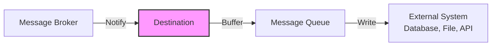
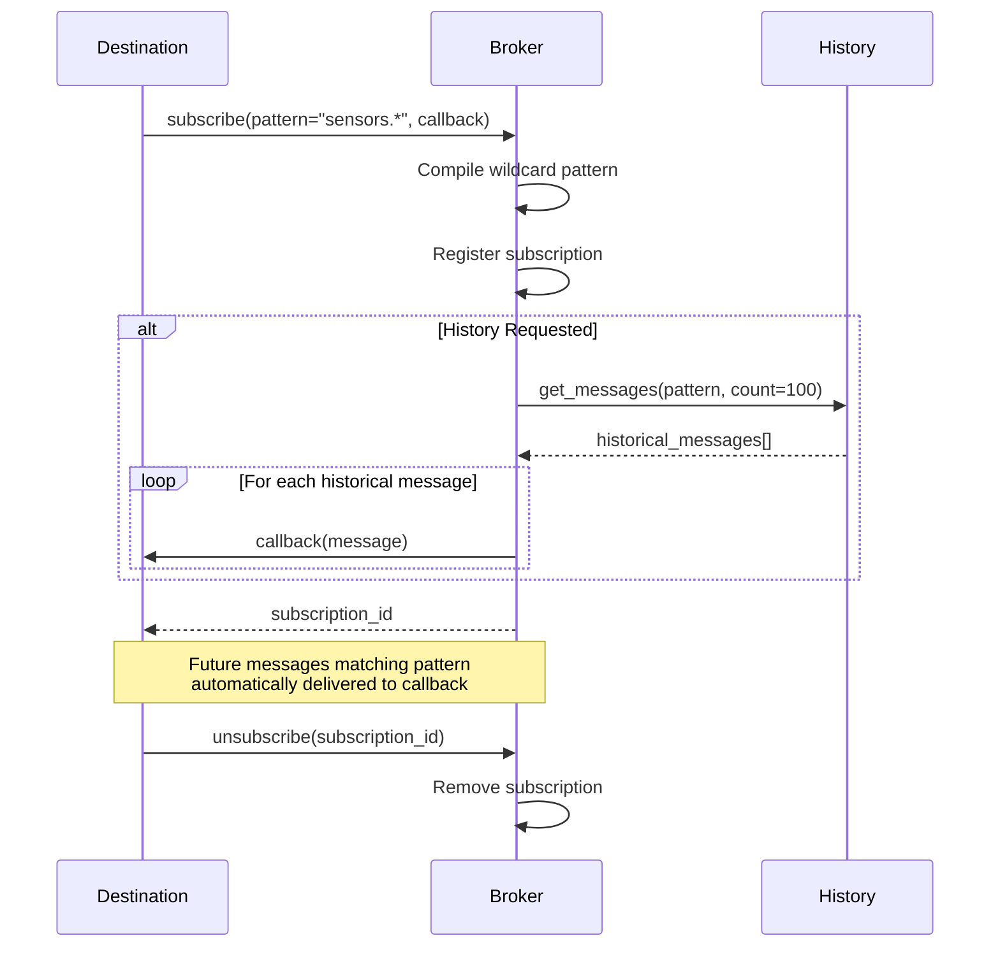
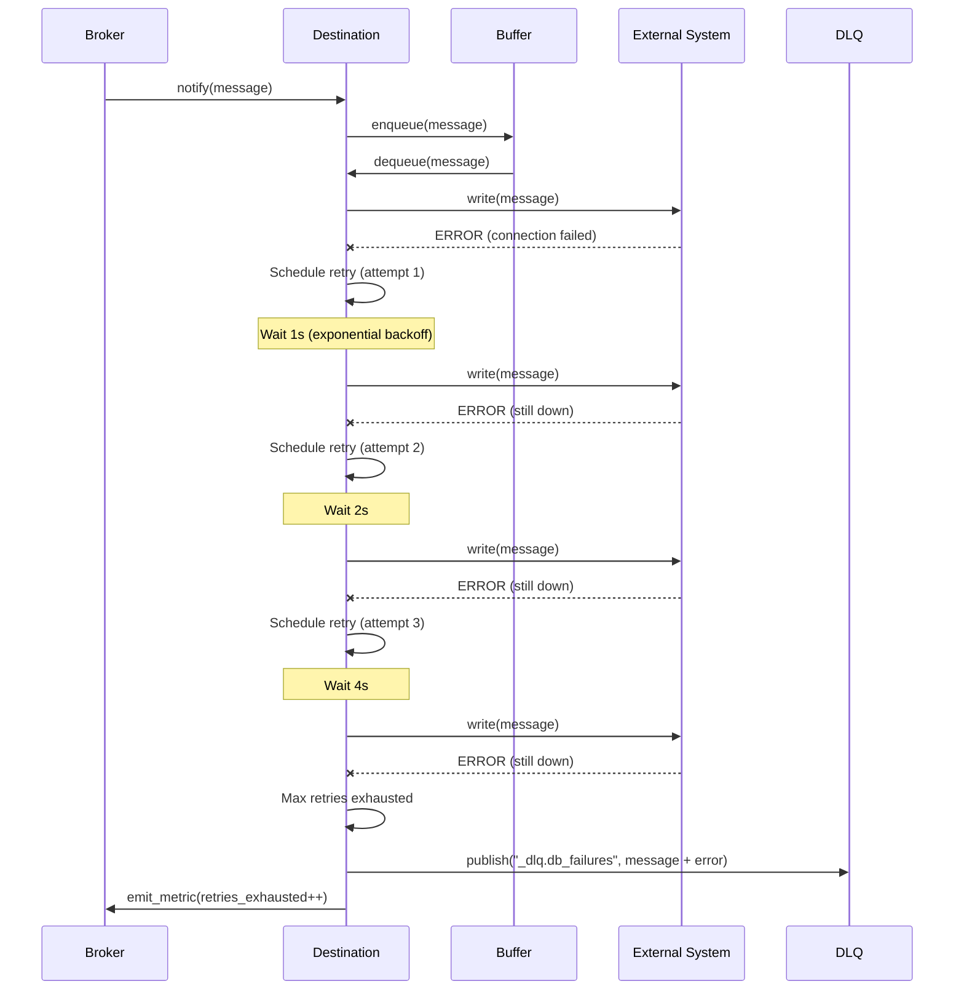

# COD3S Data Framework - Destinations

**Version:** 1.0
**Date:** 2026-01-24
**Status:** Functional Specification

---

## Navigation

| Previous | Up | Next |
|----------|-----|------|
| [← 05-TRANSFORMATIONS](05-TRANSFORMATIONS.md) | [OVERVIEW](00-OVERVIEW.md) | [07-CHANNELS-ROUTING →](07-CHANNELS-ROUTING.md) |

---

## Table of Contents

- [Destination Concept](#destination-concept)
- [Subscription Model](#subscription-model)
- [Buffering and Backpressure](#buffering-and-backpressure)
- [Retry Strategies](#retry-strategies)
- [Historical Message Access](#historical-message-access)
- [V1.0 Destination Catalog](#v10-destination-catalog)
- [Configuration Patterns](#configuration-patterns)
- [Custom Destination Development](#custom-destination-development)
- [Best Practices](#best-practices)

---

## Destination Concept

### What is a Destination?

A **destination** is a passive component that:
1. **Subscribes** to channel(s) via the broker
2. **Receives** messages when they match subscription pattern
3. **Writes** messages to external systems (databases, files, dashboards, APIs)

**Passive vs Active:**
- Destinations are **passive** - they react to published messages
- Sources are **active** - they pull or listen for data



---

### Destination Characteristics

**Key Responsibilities:**
- Channel subscription (exact or wildcard patterns)
- Message buffering (handle rate mismatches)
- External system integration (write, API calls)
- Retry logic (handle transient failures)
- Error handling and Dead Letter Queue
- Metrics emission (throughput, latency, errors)

**Delivery Semantics:**
- Inherited from source delivery guarantee
- Additional retry logic at destination level
- Dead Letter Queue for failed messages

---

### Destination Types by Persistence

| Type | Persistence | Examples | Use Cases |
|------|-------------|----------|-----------|
| **Persistent Storage** | Durable | PostgreSQL, InfluxDB, Files | Historical data, compliance, analytics |
| **Real-Time Displays** | Transient | WebSocket, Console, Dashboard | Monitoring, debugging, live visualization |
| **Message Queues** | Durable | RabbitMQ, Kafka | Integration, event-driven architecture |
| **Test/Debug** | Transient | Console, InMemory | Development, testing, debugging |

---

## Subscription Model

### Channel Subscription

Destinations subscribe to channels using **exact match** or **wildcard patterns**.

**Subscription API:**
```python
# Exact channel
destination = Destination(channel="sensors.temp")

# Wildcard subscriptions
destination = Destination(channel="sensors.*.temperature")  # Single-level
destination = Destination(channel="sensors.**")             # Multi-level
```

**See:** [07-CHANNELS-ROUTING.md](07-CHANNELS-ROUTING.md) for wildcard details

---

### Subscription Lifecycle



---

### Multiple Subscriptions

**Single destination can subscribe to multiple channels:**

```yaml
destinations:
  - type: database
    name: "timeseries_db"
    subscriptions:
      - channel: "sensors.**"           # All sensors
      - channel: "alerts.**"            # All alerts
      - channel: "indicators.**"        # All computed indicators
```

**Programmatic API:**
```python
dest = DatabaseDestination()
dest.subscribe("sensors.**")
dest.subscribe("alerts.**")
dest.subscribe("indicators.**")
```

---

## Buffering and Backpressure

### Problem: Slow Consumers

**Scenario:** Destination cannot keep up with message production rate

**Consequences without buffering:**
- Source blocks (if synchronous)
- Messages dropped (if source continues)
- Memory exhaustion (if unbounded buffering)

**Solution:** Bounded buffers with overflow strategies

---

### Bounded Buffer Configuration

```yaml
destination:
  type: database
  channel: "sensors.**"

  # Buffer configuration
  buffer_size: 1000                    # Max messages in buffer (default)
  overflow_strategy: "drop_oldest"     # What to do when full (default)
  overflow_warning_rate: 60s           # Log warning frequency
```

---

### Overflow Strategies

#### Drop Oldest (Default)

**Behavior:** When buffer full, discard oldest message and add new message

**Use Cases:**
- Real-time monitoring (latest data most important)
- Dashboard displays
- Live metrics

**Trade-offs:**
- ✅ Latest data always available
- ✅ No memory exhaustion
- ❌ Lose historical data (during overload)

**Example:**
```
Buffer (size=3): [msg1, msg2, msg3]  ← FULL
New msg4 arrives
Buffer: [msg2, msg3, msg4]  ← msg1 dropped
```

---

#### Drop Newest

**Behavior:** When buffer full, discard incoming message

**Use Cases:**
- Historical replay (preserve complete sequence)
- Batch processing (all-or-nothing)
- Compliance (cannot skip messages)

**Trade-offs:**
- ✅ Preserve oldest data (already in buffer)
- ✅ No memory exhaustion
- ❌ Lose latest updates (during overload)

**Configuration:**
```yaml
destination:
  buffer_size: 1000
  overflow_strategy: "drop_newest"  # Reject new messages when full
```

---

#### Block (Warning: Not Recommended)

**Behavior:** When buffer full, block publisher until space available

**Use Cases:**
- Critical data (cannot lose any messages)
- Testing (controlled environments)

**Trade-offs:**
- ✅ No data loss
- ❌ Backpressure to sources (entire pipeline slows)
- ❌ Risk of deadlock

**Configuration:**
```yaml
destination:
  buffer_size: 1000
  overflow_strategy: "block"
  block_timeout: 30s  # Timeout and error if still full
```

**Deferred to V2.0:** Full backpressure propagation to sources

---

### Buffer Monitoring

**Metrics emitted:**
```python
# On channel "_metrics.destination.{name}.buffer"
{
    "destination": "database_dest",
    "buffer_size": 1000,
    "buffer_current": 750,           # Current depth
    "buffer_utilization": 0.75,      # 75% full
    "messages_dropped": 42,          # Total dropped (overflow)
    "drop_strategy": "drop_oldest"
}
```

**Alerting:**
```yaml
transformations:
  - type: threshold_alert
    input: "_metrics.destination.**.buffer_utilization"
    threshold: 0.9  # Alert when 90% full
    output: "alerts.backpressure"
```

---

## Retry Strategies

### Destination-Level Retries

**Purpose:** Handle transient failures (network blips, database restarts)

**Configuration:**
```yaml
destination:
  type: database
  channel: "sensors.temp"

  # Retry configuration
  retry_attempts: 3                    # 0 = no retries, -1 = infinite
  retry_backoff: "exponential"         # or "fixed"
  retry_initial_delay: 1s              # First retry delay
  retry_max_delay: 60s                 # Cap for exponential backoff
  retry_timeout: 300s                  # Total retry window (5 minutes)
  dead_letter_channel: "_dlq.db_failures"  # DLQ for failed messages
```

---

### Backoff Strategies

#### Exponential Backoff (Default)

**Formula:** `delay = min(initial_delay * 2^attempt, max_delay)`

**Example:**
```
Attempt 0: Initial write → FAILURE
Attempt 1: Wait 1s → Retry → FAILURE
Attempt 2: Wait 2s → Retry → FAILURE
Attempt 3: Wait 4s → Retry → FAILURE
Max retries exhausted → Send to DLQ
```

**Use Cases:**
- Transient network failures
- Database connection recovery
- Rate-limited APIs (with appropriate delays)

---

#### Fixed Backoff

**Formula:** `delay = initial_delay` (constant)

**Example:**
```
Attempt 0: Initial write → FAILURE
Attempt 1: Wait 5s → Retry → FAILURE
Attempt 2: Wait 5s → Retry → FAILURE
Attempt 3: Wait 5s → Retry → SUCCESS
```

**Configuration:**
```yaml
destination:
  retry_backoff: "fixed"
  retry_initial_delay: 5s
  retry_attempts: 5
```

**Use Cases:**
- Rate-limited APIs (predictable intervals)
- Batch processing windows
- Scheduled maintenance awareness

---

### Retry Flow with DLQ



---

### Error Categorization

**Retriable Errors:**
- Network timeouts
- Connection refused (database restarting)
- Rate limit errors (HTTP 429)
- Temporary unavailability (HTTP 503)

**Non-Retriable Errors:**
- Invalid data format (cannot be fixed by retry)
- Authentication failures (need configuration fix)
- Constraint violations (duplicate key, foreign key)
- Permanent not found (HTTP 404)

**Handling:**
```python
class DatabaseDestination:
    def write(self, message):
        try:
            self.db.insert(message)
        except ConnectionError as e:
            # Retriable - let retry logic handle
            raise RetriableError(e)
        except ValidationError as e:
            # Non-retriable - send to DLQ immediately
            self.send_to_dlq(message, error=e)
            return  # Don't retry
```

---

## Historical Message Access

### Subscription History Modes

**Configuration:**
```yaml
destination:
  type: console
  channel: "sensors.temp"
  history: "recent"  # Options: "none", "recent", "all"
  history_size: 100  # For "recent" mode (default)
```

---

### Mode 1: None (Real-Time Only)

**Behavior:** Receive only new messages published after subscription

**Use Cases:**
- Real-time monitoring dashboards
- Live metrics displays
- Alert handlers (future alerts only)

**Example:**
```python
dest = ConsoleDestination(channel="sensors.temp", history="none")
# Only messages published AFTER subscription are received
```

**Timeline:**
```
Existing messages: [msg1, msg2, msg3]
Subscribe (history="none")
Receive: []  ← No historical messages
New msg4 published
Receive: [msg4]  ← Only new messages
```

---

### Mode 2: Recent (Default)

**Behavior:** Receive last N messages from buffer + new messages

**Use Cases:**
- Late-joining consumers (need context)
- Dashboard initialization (show recent data immediately)
- Testing (see what's been happening)

**Configuration:**
```yaml
destination:
  history: "recent"
  history_size: 100  # Last 100 messages (default)
```

**Timeline:**
```
Existing messages: [msg1, msg2, ..., msg100]
Subscribe (history="recent", size=100)
Receive: [msg1, msg2, ..., msg100]  ← Historical messages
New msg101 published
Receive: [msg101]  ← New messages
```

---

### Mode 3: All (Full Replay)

**Behavior:** Receive all messages since broker start + new messages

**Use Cases:**
- Batch processing (need complete dataset)
- Historical analysis
- Data migration

**Configuration:**
```yaml
destination:
  history: "all"
```

**Limitations (V1.0):**
- Only available if broker has buffered all messages
- In-memory broker has limited buffer (e.g., 10,000 messages)
- For true persistence, use TRANSPOSE source mode instead

**Timeline:**
```
Broker started, messages: [msg1, msg2, ..., msg10000]
Subscribe (history="all")
Receive: [msg1, msg2, ..., msg10000]  ← All buffered messages
New msg10001 published
Receive: [msg10001]  ← New messages
```

**Deferred to V2.0:** Persistent broker with full replay from durable storage

---

## V1.0 Destination Catalog

### ConsoleDestination

**Purpose:** Print messages to stdout (debugging, development)

**Configuration:**
```yaml
destinations:
  - type: console
    channel: "sensors.**"
    format: "pretty"  # or "json", "compact"
    colors: true      # ANSI color codes
```

**Output Example (pretty format):**
```
[2024-01-15 10:30:45.123] sensors.temp.extruder
  Key: temperature
  Value: 235.7
  Tags: {location: warehouse_A, sensor_id: T001}
  ID: a3b7c9d1-e4f6-4a8b-9c1d-e2f3a4b5c6d7
```

**Use Cases:**
- Development debugging
- Testing transformations
- Live monitoring in terminal

---

### FileDestination

**Purpose:** Append messages to files

**Configuration:**
```yaml
destinations:
  - type: file
    channel: "sensors.**"
    path: "/data/sensors.jsonl"  # JSON lines format
    format: "jsonl"               # or "json", "csv"
    rotation:
      max_size: "100MB"           # Rotate at 100MB
      max_age: "24h"              # Rotate daily
      max_files: 7                # Keep 7 files
```

**Output Example (JSONL):**
```json
{"key":"temperature","timestamp":"2024-01-15T10:30:45.123Z","value":235.7,"tags":{"location":"warehouse_A","sensor_id":"T001"},"id":"a3b7c9d1-..."}
{"key":"temperature","timestamp":"2024-01-15T10:30:46.234Z","value":235.8,"tags":{"location":"warehouse_A","sensor_id":"T001"},"id":"b4c8d2e3-..."}
```

**Use Cases:**
- Long-term storage
- Audit logs
- Batch processing input
- Backup

---

### InMemoryDestination / CollectDestination

**Purpose:** Collect messages in memory (testing, assertions)

**Configuration:**
```yaml
destinations:
  - type: collect
    name: "test_collector"
    channel: "sensors.temp"
    max_messages: 1000  # Prevent memory exhaustion
```

**Programmatic API:**
```python
# Create collector
collector = CollectDestination(channel="sensors.temp")
framework.add_destination(collector)

# Run pipeline
framework.start()
time.sleep(5)
framework.stop()

# Retrieve collected messages
messages = collector.get_messages()
assert len(messages) == 100
assert messages[0].key == "temperature"
```

**Use Cases:**
- Unit testing transformations
- Integration testing pipelines
- Assertions on message content
- Debugging specific channels

---

## Configuration Patterns

### Basic Destination Configuration

```yaml
destinations:
  # Minimal
  - type: console
    channel: "sensors.temp"

  # Full configuration
  - type: database
    name: "timeseries_db"
    channel: "sensors.**"

    # Subscription
    history: "recent"
    history_size: 100

    # Buffering
    buffer_size: 5000
    overflow_strategy: "drop_oldest"

    # Retry
    retry_attempts: 3
    retry_backoff: "exponential"
    retry_initial_delay: 1s
    retry_max_delay: 60s
    dead_letter_channel: "_dlq.db_failures"

    # Destination-specific
    connection_string: "${DB_URL}"
    table_name: "sensor_data"
```

---

### Multiple Destinations (Fan-Out)

```yaml
destinations:
  # Console for debugging
  - type: console
    channel: "sensors.**"
    format: "compact"

  # Database for persistence
  - type: database
    channel: "sensors.**"
    table: "sensor_data"

  # File for backup
  - type: file
    channel: "sensors.**"
    path: "/backup/sensors.jsonl"
```

**All three receive same messages (fan-out pattern)**

---

### Filtered Destinations

```yaml
destinations:
  # Critical alerts only
  - type: console
    channel: "alerts.critical"
    format: "pretty"
    colors: true

  # All alerts to file
  - type: file
    channel: "alerts.**"
    path: "/logs/alerts.log"

  # Specific sensor to database
  - type: database
    channel: "sensors.warehouse_A.**"
    table: "warehouse_a_sensors"
```

---

## Custom Destination Development

### Destination Interface

```python
from cod3s_data import Destination, Message
from typing import List

class CustomDestination(Destination):
    """Custom destination template"""

    def __init__(self, config: dict):
        super().__init__(config)

        # Extract configuration
        self.endpoint = config.get("endpoint")
        self.api_key = config.get("api_key")
        self.batch_size = config.get("batch_size", 100)

        # Internal state
        self.connection = None
        self.batch = []

    def configure(self):
        """Validate configuration, establish connection"""
        if not self.endpoint:
            raise ConfigError("endpoint required")

        # Test connection
        self.connection = self.connect()

    def connect(self):
        """Establish connection to external system"""
        # Your connection logic
        return ExternalSystemClient(
            endpoint=self.endpoint,
            api_key=self.api_key
        )

    def write(self, message: Message):
        """
        Write single message (called by framework)

        Framework handles:
        - Buffering (before this method)
        - Retry logic (if this raises retriable error)
        - DLQ (if retries exhausted)
        """
        # Add to batch
        self.batch.append(message)

        # Flush when batch full
        if len(self.batch) >= self.batch_size:
            self.flush()

    def flush(self):
        """Write batch to external system"""
        if not self.batch:
            return

        try:
            # Batch write
            self.connection.write_batch(self.batch)
            self.batch = []  # Clear on success

        except ConnectionError as e:
            # Retriable error - let framework retry
            raise RetriableError(e)

        except ValidationError as e:
            # Non-retriable - send to DLQ
            for msg in self.batch:
                self.send_to_dlq(msg, error=e)
            self.batch = []  # Clear after DLQ

    def cleanup(self):
        """Called on shutdown - flush remaining messages"""
        self.flush()
        if self.connection:
            self.connection.close()
```

---

### Registration and Usage

```python
# Register custom destination
from cod3s_data import DestinationRegistry

DestinationRegistry.register("custom_api", CustomDestination)

# Use in YAML
destinations:
  - type: custom_api
    channel: "sensors.**"
    endpoint: "https://api.example.com/ingest"
    api_key: "${API_KEY}"
    batch_size: 500
```

---

## Best Practices

### Configuration

**Do:**
- ✅ Set appropriate buffer sizes (based on expected load)
- ✅ Choose overflow strategy matching use case
- ✅ Configure retries for transient failures
- ✅ Use DLQ for permanent failures
- ✅ Monitor buffer utilization

**Don't:**
- ❌ Use infinite buffers (memory exhaustion)
- ❌ Ignore overflow warnings
- ❌ Retry non-retriable errors indefinitely

---

### Performance

**Do:**
- ✅ Batch writes when possible (reduce network overhead)
- ✅ Use connection pooling
- ✅ Implement flush on shutdown (don't lose buffered messages)
- ✅ Emit metrics (throughput, latency, errors)

**Don't:**
- ❌ Write one message at a time (high overhead)
- ❌ Block on slow writes (buffer instead)
- ❌ Create new connections per message

**Example:**
```python
class BatchedDestination:
    def __init__(self, batch_size=100, flush_interval=5):
        self.batch = []
        self.batch_size = batch_size
        self.last_flush = time.time()
        self.flush_interval = flush_interval

    def write(self, message):
        self.batch.append(message)

        # Flush on size or time
        if (len(self.batch) >= self.batch_size or
            time.time() - self.last_flush > self.flush_interval):
            self.flush()
```

---

### Error Handling

**Do:**
- ✅ Distinguish retriable vs non-retriable errors
- ✅ Log errors with context (message ID, error details)
- ✅ Emit error metrics
- ✅ Use DLQ for problematic messages

**Don't:**
- ❌ Silently drop failed messages
- ❌ Retry forever without backoff
- ❌ Crash on single message failure

---

### Testing

**Do:**
- ✅ Test with CollectDestination (in-memory)
- ✅ Simulate failures (connection errors, timeouts)
- ✅ Verify retry logic
- ✅ Check DLQ messages

**Example:**
```python
def test_destination_retry():
    # Mock external system
    mock_system = MockExternalSystem()
    mock_system.fail_count = 2  # Fail first 2 attempts

    dest = CustomDestination(endpoint=mock_system)
    dest.retry_attempts = 3

    message = Message(key="test", value=42)

    # Should succeed on 3rd attempt
    dest.write(message)

    assert mock_system.call_count == 3
    assert mock_system.messages == [message]
```

---

## Summary

**COD3S Data Destinations** output messages to external systems:

1. **Subscription:**
   - Exact or wildcard channel patterns
   - Historical message access (none, recent, all)

2. **Buffering:**
   - Bounded buffers prevent memory exhaustion
   - Overflow strategies (drop_oldest, drop_newest, block)
   - Monitoring and alerting

3. **Retry Logic:**
   - Exponential/fixed backoff
   - Configurable retry attempts
   - Dead Letter Queue for failed messages

4. **V1.0 Catalog:**
   - ConsoleDestination (debugging)
   - FileDestination (persistence)
   - CollectDestination (testing)

5. **Extensibility:**
   - Implement Destination interface
   - Register custom destinations
   - Use in YAML or programmatically

**Next:** Explore [Channels & Routing](07-CHANNELS-ROUTING.md) for message routing patterns.

---

## Navigation

| Previous | Up | Next |
|----------|-----|------|
| [← 05-TRANSFORMATIONS](05-TRANSFORMATIONS.md) | [OVERVIEW](00-OVERVIEW.md) | [07-CHANNELS-ROUTING →](07-CHANNELS-ROUTING.md) |

---

*This is a functional specification document. Implementation details will be defined in the technical specification phase.*
