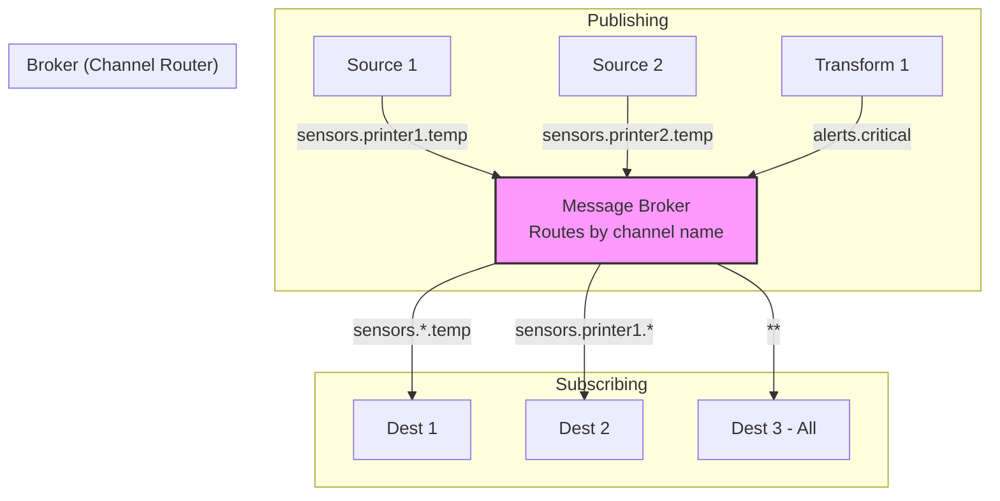
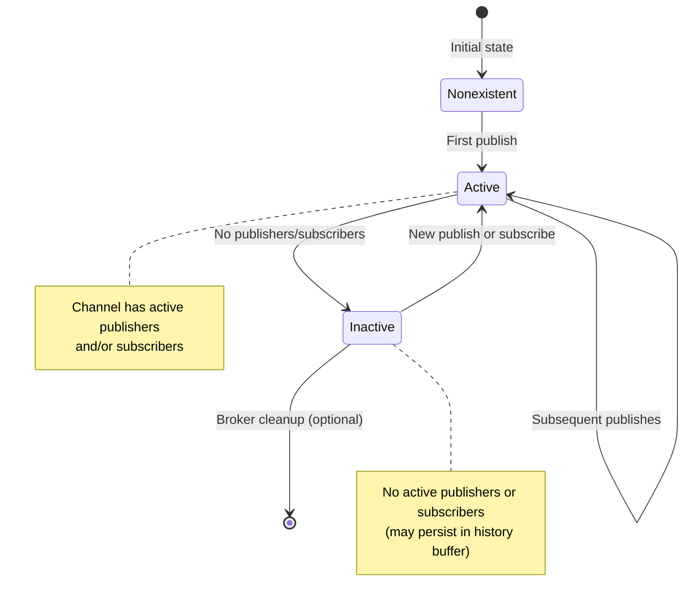
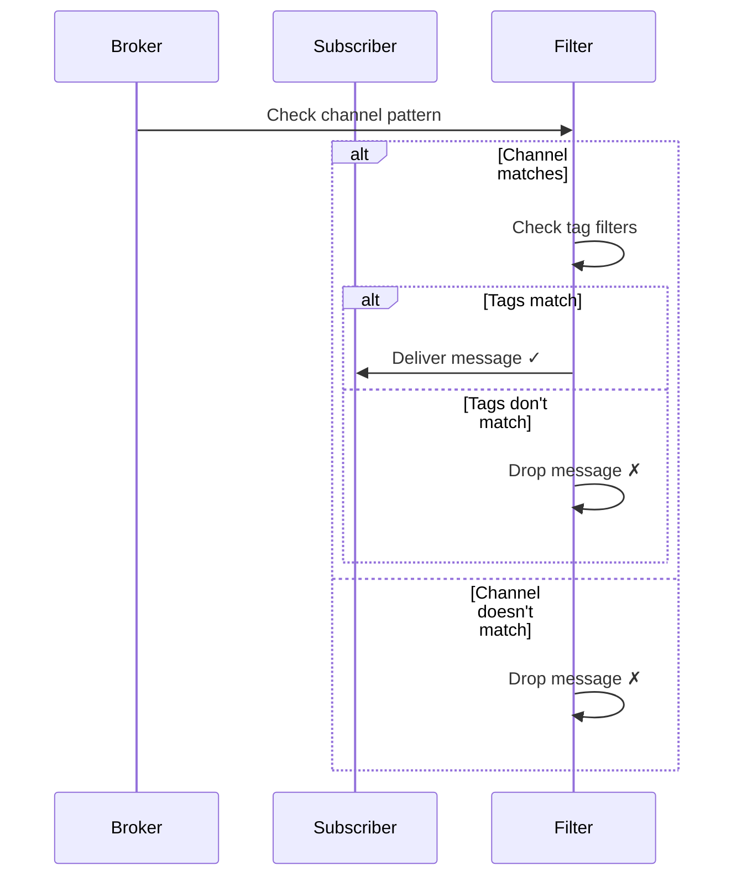

# COD3S Data Framework - Channels & Routing

**Version:** 1.0
**Date:** 2026-01-24
**Status:** Functional Specification

---

## Navigation

| Previous | Up | Next |
|----------|-----|------|
| [← 06-DESTINATIONS](06-DESTINATIONS.md) | [OVERVIEW](00-OVERVIEW.md) | [08-BROKER →](08-BROKER.md) |

---

## Table of Contents

- [Channel Concept](#channel-concept)
- [Channel Naming](#channel-naming)
- [Wildcard Subscriptions](#wildcard-subscriptions)
- [Dynamic Channel Creation](#dynamic-channel-creation)
- [Metadata Filtering](#metadata-filtering)
- [Routing Patterns](#routing-patterns)
- [System Channels](#system-channels)
- [Best Practices](#best-practices)

---

## Channel Concept

### What is a Channel?

A **channel** is a **logical routing path** for messages. It's not a physical queue or buffer, but a **naming convention** that enables publish-subscribe routing.

**Key Characteristics:**
- **Strings:** Channels are simply string identifiers
- **Hierarchical:** Recommended dot-separated naming (e.g., `sensors.temp.extruder`)
- **Dynamic:** Created implicitly on first use (no predeclaration)
- **Pattern-Matchable:** Support wildcard subscriptions



---

### Channels vs Queues

**Channels are NOT queues:**
- No persistent storage (messages route through broker)
- No independent lifecycle (exist only while in use)
- Multiple subscribers receive same message (fan-out)

**Comparison:**

| Aspect | Channels (COD3S Data) | Queues (RabbitMQ/Kafka) |
|--------|----------------------|--------------------------|
| **Routing** | By name pattern | By queue name or topic |
| **Persistence** | In-memory (V1.0) | Durable (disk-backed) |
| **Subscribers** | Multiple (fan-out) | Competing consumers or fan-out |
| **Creation** | Dynamic (on publish) | Explicit (predeclared) |
| **Wildcards** | Yes (`*`, `**`) | Depends (topics support) |

---

## Channel Naming

### Naming Convention

**Recommended:** Hierarchical dot-separated naming

**Format:**
```
<domain>.<subdomain>.<metric>[.<detail>]

Examples:
sensors.temperature.extruder
sensors.printer1.motor.speed.x
indicators.viscosity
alerts.critical.temperature
```

**Benefits:**
- Clear organization
- Wildcard subscriptions work naturally
- Easy to understand and maintain
- Supports multi-level hierarchies

---

### Naming Rules

**Valid Characters:**
- Lowercase letters: `a-z`
- Uppercase letters: `A-Z`
- Numbers: `0-9`
- Separator: `.` (dot)
- Special: `-` (hyphen), `_` (underscore)

**Constraints:**
- Max length: 255 characters
- Cannot start with `.` (dot)
- Cannot end with `.` (dot)
- No consecutive `.` (dots)
- Reserved prefix: `_` (underscore for system channels)

**Valid Examples:**
```
sensors.temp
sensors.warehouse_A.temperature
printers.3d-printer-001.status
indicators.quality_score
```

**Invalid Examples:**
```
.sensors.temp           # Starts with dot
sensors..temp           # Consecutive dots
sensors.temp.           # Ends with dot
sensors temp            # Contains space
sensors/temp            # Invalid character (/)
```

---

### Naming Strategies

#### Strategy 1: Resource-Based

**Pattern:** `<resource_type>.<resource_id>.<attribute>`

**Examples:**
```
printers.printer1.temperature
printers.printer1.speed
printers.printer2.temperature
printers.printer2.speed

sensors.TH001.temperature
sensors.TH002.temperature
sensors.VB001.vibration
```

**Use Case:** Resource-centric systems (IoT devices, equipment monitoring)

---

#### Strategy 2: Metric-Based

**Pattern:** `<metric>.<location>.<detail>`

**Examples:**
```
temperature.warehouse_A.extruder
temperature.warehouse_B.extruder
speed.warehouse_A.motor_x
vibration.warehouse_A.frame
```

**Use Case:** Metric-centric analytics (dashboards, reporting)

---

#### Strategy 3: Domain-Based

**Pattern:** `<domain>.<subdomain>.<entity>.<attribute>`

**Examples:**
```
manufacturing.3d_printing.printer1.temperature
manufacturing.3d_printing.printer1.speed
manufacturing.cnc.machine2.spindle_rpm
quality.inspection.camera1.defect_count
```

**Use Case:** Large multi-domain systems (enterprise deployments)

---

## Wildcard Subscriptions

### Wildcard Operators

COD3S Data supports two wildcard operators:

| Operator | Behavior | Example | Matches |
|----------|----------|---------|---------|
| `*` | **Single-level** wildcard | `sensors.*.temperature` | `sensors.printer1.temperature`<br/>`sensors.printer2.temperature`<br/>NOT `sensors.printer1.temp.extruder` |
| `**` | **Multi-level** wildcard | `sensors.**` | `sensors.temp`<br/>`sensors.printer1.temperature`<br/>`sensors.printer1.motor.speed.x` |

---

### Single-Level Wildcard (`*`)

**Behavior:** Matches exactly one segment

**Examples:**

```python
# Subscribe to all printer temperatures
destination.subscribe("sensors.*.temperature")

# Matches:
"sensors.printer1.temperature"  ✓
"sensors.printer2.temperature"  ✓

# Does NOT match:
"sensors.temperature"           ✗ (missing segment)
"sensors.printer1.temp.extruder" ✗ (too many segments)
"alerts.printer1.temperature"   ✗ (different prefix)
```

**Use Cases:**
- Subscribe to specific metric across all resources
- Filter by specific level in hierarchy

---

### Multi-Level Wildcard (`**`)

**Behavior:** Matches zero or more segments (greedy)

**Examples:**

```python
# Subscribe to all sensors
destination.subscribe("sensors.**")

# Matches:
"sensors.temp"                       ✓
"sensors.printer1.temperature"       ✓
"sensors.printer1.motor.speed.x"     ✓
"sensors.warehouse.rack3.temp"       ✓

# Does NOT match:
"alerts.critical"                    ✗ (different prefix)
```

**Use Cases:**
- Subscribe to entire domain
- Catch-all logging/debugging
- Aggregate metrics across all resources

---

### Combining Wildcards

**Multiple wildcards in pattern:**

```python
# Specific metric for all printers in all warehouses
"warehouses.*.printers.*.temperature"

# Matches:
"warehouses.A.printers.printer1.temperature"  ✓
"warehouses.B.printers.printer2.temperature"  ✓

# Does NOT match:
"warehouses.A.cnc.machine1.temperature"       ✗ (not a printer)
```

**Mixing `*` and `**`:**

```python
# All alerts for any printer
"alerts.*.printers.**"

# Matches:
"alerts.critical.printers.printer1.temp"      ✓
"alerts.warning.printers.printer2.motor.jam"  ✓

# Does NOT match:
"alerts.critical.sensors.temp"                ✗ (not printers)
```

---

### Wildcard Matching Algorithm

**Conceptual matching logic:**

```python
def matches_pattern(channel: str, pattern: str) -> bool:
    """
    Check if channel matches subscription pattern

    Examples:
        matches_pattern("sensors.temp", "sensors.*") → True
        matches_pattern("sensors.temp", "sensors.**") → True
        matches_pattern("sensors.printer1.temp", "sensors.*") → False
    """

    # Split into segments
    channel_parts = channel.split(".")
    pattern_parts = pattern.split(".")

    # Match recursively
    return _match_recursive(channel_parts, pattern_parts)

def _match_recursive(channel_parts, pattern_parts):
    # Both exhausted - match
    if not channel_parts and not pattern_parts:
        return True

    # Pattern exhausted, channel remains - no match
    if not pattern_parts:
        return False

    # Channel exhausted, pattern remains
    if not channel_parts:
        # Only match if remaining pattern is "**"
        return pattern_parts == ["**"]

    # Current pattern segment
    pattern_seg = pattern_parts[0]

    if pattern_seg == "**":
        # Multi-level wildcard - match rest of channel
        return True
    elif pattern_seg == "*":
        # Single-level wildcard - match one segment
        return _match_recursive(channel_parts[1:], pattern_parts[1:])
    else:
        # Exact match required
        if channel_parts[0] == pattern_seg:
            return _match_recursive(channel_parts[1:], pattern_parts[1:])
        else:
            return False
```

---

## Dynamic Channel Creation

### Implicit Creation

**Channels are created automatically on first publish:**

```python
# No channel predeclaration needed
source.publish(channel="sensors.new_sensor.temp", message=msg)
# Channel "sensors.new_sensor.temp" now exists

# Destinations can subscribe before or after creation
dest.subscribe("sensors.**")
# Will receive messages from existing AND future channels
```

**Benefits:**
- No configuration overhead
- Flexible for dynamic systems (sensors added/removed)
- Natural for hierarchical resource models

---

### Channel Lifecycle



**Cleanup (V1.0):**
- Channels remain in broker history buffer
- No automatic cleanup (bounded buffer discards oldest messages)
- Inactive channels consume minimal resources (just metadata)

---

### Dynamic Channel Names from Data

**Pattern:** Use message attributes to construct channel names

**Example 1: MQTT Topic Mapping**
```yaml
sources:
  - type: mqtt
    topic: "sensors/+/temperature"
    channel: "sensors.{topic[1]}.temperature"

# MQTT messages:
# sensors/printer1/temperature → channel: sensors.printer1.temperature
# sensors/printer2/temperature → channel: sensors.printer2.temperature
```

**Example 2: Tag-Based Channels**
```yaml
sources:
  - type: csv
    path: "data.csv"
    channel: "sensors.{location}.{sensor_type}"

# CSV row: location=warehouse_A, sensor_type=temperature
# → channel: sensors.warehouse_A.temperature
```

**See:** [04-SOURCES.md#dynamic-channel-names](04-SOURCES.md#dynamic-channel-names)

---

## Metadata Filtering

### Tag-Based Filtering

**In addition to channel-based routing**, destinations can filter by message **tags** (metadata).

**Configuration:**
```yaml
destinations:
  - type: database
    channel: "sensors.**"  # All sensors

    # Filter by tags
    filter:
      location: "warehouse_A"      # Exact match
      sensor_type: "temperature"   # AND logic
```

**Only messages matching BOTH channel pattern AND tag filter are delivered.**

---

### Filter Expressiveness (V1.0)

**Supported (Phase 1):**
- **Exact match:** `key: "value"`
- **OR logic (same key):** `key: ["value1", "value2", "value3"]`
- **AND logic (different keys):** Multiple key-value pairs

**Examples:**

```yaml
# Single exact match
filter:
  location: "warehouse_A"

# OR within same key
filter:
  location: ["warehouse_A", "warehouse_B", "warehouse_C"]
  # Matches if location is A OR B OR C

# AND across keys
filter:
  location: "warehouse_A"
  sensor_type: "temperature"
  priority: "high"
  # Matches if location=A AND sensor_type=temperature AND priority=high

# Combined AND + OR
filter:
  location: ["warehouse_A", "warehouse_B"]  # OR
  sensor_type: "temperature"                 # AND
  # Matches if (location=A OR B) AND sensor_type=temperature
```

---

### Filter Evaluation



**Filter Logic:**
```python
def matches_filter(message, filter_config):
    """
    Check if message matches tag filter

    Args:
        message: Message with tags
        filter_config: Dict of tag filters

    Returns:
        True if all filters match (AND logic across keys)
    """
    for key, value in filter_config.items():
        msg_value = message.tags.get(key)

        if isinstance(value, list):
            # OR logic within same key
            if msg_value not in value:
                return False
        else:
            # Exact match
            if msg_value != value:
                return False

    return True  # All filters matched
```

---

### Deferred to Phase 2 (Future)

**Advanced filtering (not in V1.0):**
- Wildcard patterns: `sensor_id: "TH*"`
- NOT logic: `status!: "maintenance"`
- Value comparisons: `priority: ">= 5"`
- Range filters: `temperature: "20..100"`
- Regular expressions: `sensor_id: "/^TH[0-9]{3}$/"`
- Custom filter functions

**Rationale:** V1.0 exact match + OR solves 80% of use cases, keeps implementation simple

---

## Routing Patterns

### Pattern 1: Direct Routing (Exact Match)

**Use Case:** Single source → single destination

```yaml
sources:
  - type: mqtt
    channel: "sensors.temp"

destinations:
  - type: database
    channel: "sensors.temp"  # Exact match
```

**Flow:**
```
Source → "sensors.temp" → Broker → "sensors.temp" → Destination
```

---

### Pattern 2: Fan-Out (Multiple Subscribers)

**Use Case:** One message → multiple destinations

```yaml
sources:
  - type: mqtt
    channel: "sensors.temp"

destinations:
  - type: console
    channel: "sensors.temp"

  - type: database
    channel: "sensors.temp"

  - type: file
    channel: "sensors.temp"
```

**Flow:**
```
Source → "sensors.temp" → Broker → "sensors.temp" → Console
                                                  → Database
                                                  → File
```

---

### Pattern 3: Topic-Based Routing (Wildcard)

**Use Case:** Subscribe to category of messages

```yaml
sources:
  - type: mqtt
    topics:
      - "sensors/printer1/temperature"
      - "sensors/printer1/speed"
      - "sensors/printer2/temperature"
    channel: "sensors.{printer}.{metric}"

destinations:
  # All printer1 metrics
  - type: dashboard
    channel: "sensors.printer1.*"

  # All temperatures
  - type: database
    channel: "sensors.*.temperature"

  # Everything
  - type: file
    channel: "sensors.**"
```

---

### Pattern 4: Content-Based Routing (Transformation)

**Use Case:** Route based on message content (not just channel name)

```yaml
sources:
  - type: mqtt
    channel: "sensors.temp"

transformations:
  # Route to different channels based on value
  - type: threshold_router
    input: "sensors.temp"
    outputs:
      low: "sensors.temp.low"      # value < 20
      normal: "sensors.temp.normal"  # 20 <= value <= 100
      high: "sensors.temp.high"    # value > 100

destinations:
  - type: console
    channel: "sensors.temp.high"  # Only high temperatures
```

---

### Pattern 5: Filtered Routing (Channel + Tags)

**Use Case:** Combine channel patterns with metadata filters

```yaml
destinations:
  # Warehouse A sensors only
  - type: database
    name: "warehouse_a_db"
    channel: "sensors.**"
    filter:
      location: "warehouse_A"

  # Warehouse B sensors only
  - type: database
    name: "warehouse_b_db"
    channel: "sensors.**"
    filter:
      location: "warehouse_B"

  # Critical alerts for any warehouse
  - type: alerting
    channel: "alerts.**"
    filter:
      severity: "critical"
```

---

## System Channels

### Reserved Prefix: `_` (Underscore)

**Purpose:** Channels starting with `_` are reserved for system use

**System Channel Categories:**

| Prefix | Purpose | Examples |
|--------|---------|----------|
| `_dlq.*` | Dead Letter Queue | `_dlq.db_failures`, `_dlq.out_of_order` |
| `_metrics.*` | Framework metrics | `_metrics.broker.throughput`, `_metrics.destination.buffer` |
| `_logs.*` | Structured logging (optional) | `_logs.error`, `_logs.warning` |
| `_control.*` | Control commands (future) | `_control.pause`, `_control.resume` |

---

### Dead Letter Queue Channels

**Pattern:** `_dlq.<reason>.<original_channel>`

**Examples:**
```
_dlq.db_failures.sensors.temp
_dlq.retry_exhausted.alerts.critical
_dlq.out_of_order.sensors.pressure
_dlq.transform_error.indicators.viscosity
```

**Usage:**
```yaml
destinations:
  # Monitor all DLQ messages
  - type: console
    channel: "_dlq.**"
    format: "pretty"

  # Alert on DLQ activity
  - type: alerting
    channel: "_dlq.**"
    alert_level: "error"
```

**See:** [03-MESSAGES.md#dead-letter-queue](03-MESSAGES.md#dead-letter-queue)

---

### Metrics Channels

**Pattern:** `_metrics.<component>.<metric_name>`

**Examples:**
```
_metrics.broker.throughput
_metrics.broker.latency_p99
_metrics.destination.database.buffer_utilization
_metrics.source.mqtt.messages_received
_metrics.transformation.viscosity.compute_time
```

**Usage:**
```yaml
destinations:
  # Dashboard metrics
  - type: dashboard
    channel: "_metrics.broker.**"

  # Alert on high latency
  - type: threshold_alert
    input: "_metrics.broker.latency_p99"
    threshold: 100  # Alert if p99 > 100ms
    output: "alerts.performance"
```

**See:** [10-OBSERVABILITY.md](10-OBSERVABILITY.md)

---

## Best Practices

### Naming

**Do:**
- ✅ Use hierarchical dot-separated naming
- ✅ Keep names descriptive but concise
- ✅ Use lowercase for consistency
- ✅ Document your naming convention

**Don't:**
- ❌ Use special characters (except `.`, `-`, `_`)
- ❌ Start with `_` (reserved for system channels)
- ❌ Create overly deep hierarchies (>5 levels)
- ❌ Mix naming strategies inconsistently

---

### Wildcards

**Do:**
- ✅ Use wildcards for category subscriptions
- ✅ Combine with tag filters for precision
- ✅ Monitor wildcard subscription overhead

**Don't:**
- ❌ Subscribe to `**` in production (too broad)
- ❌ Use wildcards when exact match is sufficient
- ❌ Create overlapping wildcard subscriptions unintentionally

---

### Performance

**Do:**
- ✅ Use specific channel names when possible (faster routing)
- ✅ Limit wildcard subscriptions (broker must check all)
- ✅ Monitor broker routing metrics

**Don't:**
- ❌ Create thousands of unique channels (memory overhead)
- ❌ Use deeply nested wildcards (`**.**.**`)

---

## Summary

**COD3S Data Channels** provide flexible message routing:

1. **Channels:**
   - Logical routing paths (not queues)
   - Hierarchical dot-separated naming
   - Dynamic creation on first use

2. **Wildcards:**
   - `*` - Single-level wildcard
   - `**` - Multi-level wildcard
   - Combine for flexible subscriptions

3. **Metadata Filtering:**
   - Exact match + OR support (V1.0)
   - AND logic across keys
   - Combined with channel patterns

4. **System Channels:**
   - `_dlq.*` - Dead Letter Queue
   - `_metrics.*` - Framework metrics
   - Reserved `_` prefix

**Next:** Explore [Broker](08-BROKER.md) for message distribution implementation.

---

## Navigation

| Previous | Up | Next |
|----------|-----|------|
| [← 06-DESTINATIONS](06-DESTINATIONS.md) | [OVERVIEW](00-OVERVIEW.md) | [08-BROKER →](08-BROKER.md) |

---

*This is a functional specification document. Implementation details will be defined in the technical specification phase.*
