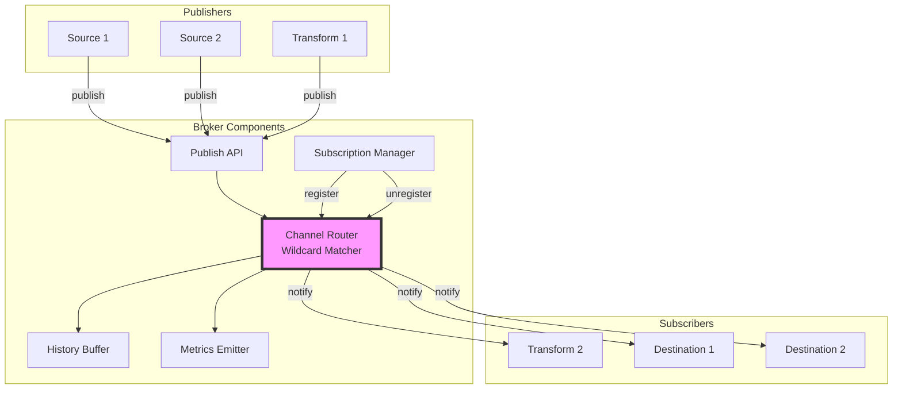
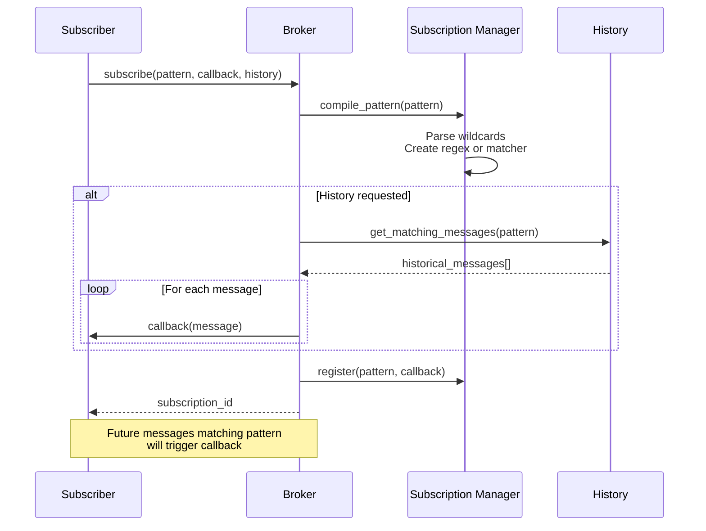
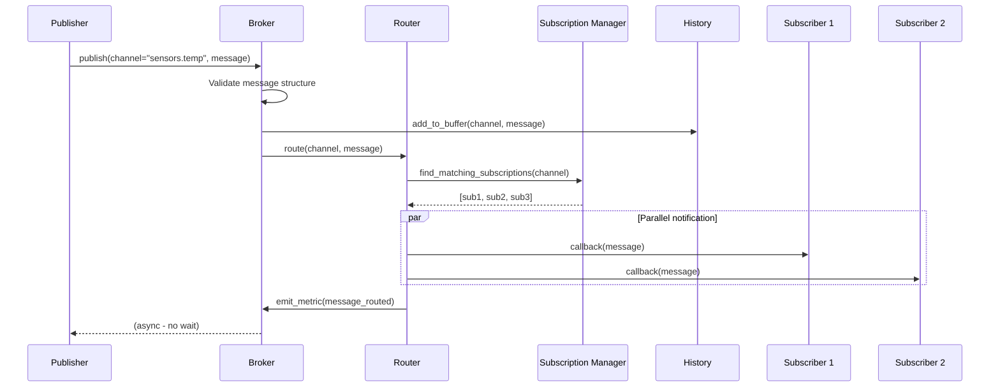

# COD3S Data Framework - Broker

**Version:** 1.0
**Date:** 2026-01-24
**Status:** Functional Specification

---

## Navigation

| Previous | Up | Next |
|----------|-----|------|
| [← 07-CHANNELS-ROUTING](07-CHANNELS-ROUTING.md) | [OVERVIEW](00-OVERVIEW.md) | [09-CONFIGURATION →](09-CONFIGURATION.md) |

---

## Table of Contents

- [Broker Concept](#broker-concept)
- [In-Memory Broker (V1.0)](#in-memory-broker-v10)
- [Subscription Management](#subscription-management)
- [Message Distribution](#message-distribution)
- [History Buffer](#history-buffer)
- [Performance Characteristics](#performance-characteristics)
- [Monitoring and Metrics](#monitoring-and-metrics)
- [Future Broker Implementations](#future-broker-implementations)

---

## Broker Concept

### What is the Broker?

The **broker** is the **central message router** that:
1. **Receives** messages from publishers (sources, transformations)
2. **Routes** messages to subscribers based on channel patterns
3. **Buffers** recent messages for late-joining subscribers
4. **Manages** subscriptions (register, unregister, wildcard matching)

**Architecture:**



---

### Broker Responsibilities

| Responsibility | Description |
|----------------|-------------|
| **Message Routing** | Match published messages to subscribed patterns |
| **Subscription Management** | Register, unregister, wildcard compilation |
| **History Buffering** | Keep recent messages for late-joining subscribers |
| **Metrics Emission** | Throughput, latency, subscription counts |
| **Channel Lifecycle** | Track active channels, cleanup inactive |

**The broker does NOT:**
- ❌ Modify message content
- ❌ Apply business logic
- ❌ Persist messages to disk (V1.0)
- ❌ Guarantee message ordering
- ❌ Implement delivery guarantees (sources handle this)

---

## In-Memory Broker (V1.0)

### Characteristics

**V1.0 Implementation:** In-memory, single-process broker

**Properties:**
- **Fast:** No disk I/O, no network overhead
- **Simple:** No external dependencies
- **Volatile:** Messages lost on restart
- **Single-node:** No distributed coordination
- **Bounded buffers:** Configurable history size

**Trade-offs:**

| Advantage | Limitation |
|-----------|------------|
| ✅ Low latency (<1ms routing) | ❌ No persistence (restart = data loss) |
| ✅ High throughput (10K+ msg/s) | ❌ Single-process only |
| ✅ Simple deployment | ❌ Limited by RAM |
| ✅ No external dependencies | ❌ No disaster recovery |

---

### Architecture

```mermaid
graph TB
    subgraph "In-Memory Broker"
        PubAPI[Publish API]
        SubMap[Subscription Map<br/>Dict[pattern, callbacks]]
        ChanBuf[Channel Buffers<br/>Dict[channel, deque]]
        Router[Router Logic]
    end

    PubAPI --> Router
    Router --> SubMap
    Router --> ChanBuf
    SubMap --> Router

    Router -->|notify| Sub1[Subscriber 1]
    Router -->|notify| Sub2[Subscriber 2]

    style Router fill:#f9f,stroke:#333,stroke-width:2px
```

**Data Structures (Conceptual):**

```python
class InMemoryBroker:
    def __init__(self):
        # Subscriptions: pattern → list of callbacks
        self.subscriptions = {}  # Dict[str, List[Callable]]

        # Channel history: channel → deque of messages
        self.history = {}  # Dict[str, deque]
        self.history_size = 100  # Configurable

        # Metrics
        self.message_count = 0
        self.publish_latency = []
```

---

## Subscription Management

### Registration

**API:**
```python
subscription_id = broker.subscribe(
    pattern="sensors.*",
    callback=destination.on_message,
    history="recent"
)
```

**Process:**



---

### Pattern Compilation

**Wildcard patterns compiled for efficiency:**

```python
def compile_pattern(pattern: str):
    """
    Convert channel pattern to matcher

    Examples:
        "sensors.temp" → exact match
        "sensors.*" → regex: "^sensors\.[^.]+$"
        "sensors.**" → regex: "^sensors\..*$"
    """
    if "**" not in pattern and "*" not in pattern:
        # Exact match (fastest)
        return ExactMatcher(pattern)

    # Convert to regex
    regex = pattern.replace(".", r"\.")  # Escape dots
    regex = regex.replace("**", ".*")    # ** → .*
    regex = regex.replace("*", "[^.]+")  # * → [^.]+
    regex = "^" + regex + "$"            # Anchor

    return RegexMatcher(regex)
```

**Matching Performance:**

| Pattern Type | Matching Method | Performance |
|--------------|----------------|-------------|
| Exact (`sensors.temp`) | Dictionary lookup | O(1) - fastest |
| Single-level (`sensors.*`) | Regex match | O(n) pattern length |
| Multi-level (`sensors.**`) | Regex match | O(n) pattern length |

---

### Unsubscription

**API:**
```python
broker.unsubscribe(subscription_id)
```

**Process:**
- Remove callback from subscription map
- Cleanup internal state if no subscribers remain
- No impact on other subscribers

**Example:**
```python
# Subscribe
sub_id = broker.subscribe("sensors.*", callback)

# Later, unsubscribe
broker.unsubscribe(sub_id)

# Callback no longer receives messages
```

---

## Message Distribution

### Publication Flow



---

### Routing Algorithm

**Conceptual implementation:**

```python
def publish(self, channel: str, message: Message):
    """
    Publish message to channel

    1. Validate message
    2. Add to history buffer
    3. Find matching subscriptions
    4. Notify subscribers (async)
    5. Emit metrics
    """
    # 1. Validate
    if not self.validate_message(message):
        raise ValueError("Invalid message structure")

    # 2. History
    self.add_to_history(channel, message)

    # 3. Find subscribers
    subscribers = []
    for pattern, callbacks in self.subscriptions.items():
        if self.matches_pattern(channel, pattern):
            subscribers.extend(callbacks)

    # 4. Notify (asynchronous)
    for callback in subscribers:
        try:
            callback(message)  # Fire and forget (at-most-once)
        except Exception as e:
            # Log error, don't fail other subscribers
            self.log_error(f"Subscriber error: {e}")

    # 5. Metrics
    self.emit_metric("messages_published", 1)
    self.emit_metric("subscribers_notified", len(subscribers))
```

---

### Fan-Out Behavior

**One message → multiple subscribers:**

```python
# Three subscribers to same channel
broker.subscribe("sensors.temp", dest1.callback)
broker.subscribe("sensors.temp", dest2.callback)
broker.subscribe("sensors.temp", dest3.callback)

# Publish one message
broker.publish("sensors.temp", message)

# All three receive SAME message instance
# dest1.callback(message)  ← Same object
# dest2.callback(message)  ← Same object
# dest3.callback(message)  ← Same object
```

**Implications:**
- ✅ Efficient (no message copying)
- ⚠️ Subscribers must not modify message (immutable recommendation)
- ⚠️ Concurrent access possible (thread safety if multi-threaded)

---

## History Buffer

### Purpose

**History buffer** stores recent messages per channel for:
- Late-joining subscribers (receive recent context)
- Debugging (inspect recent activity)
- Replay (re-deliver historical messages)

**NOT for:**
- ❌ Durable persistence (messages lost on restart)
- ❌ Long-term storage (use destinations for that)
- ❌ Full replay (limited buffer size)

---

### Configuration

```yaml
broker:
  # Global history settings
  history_enabled: true
  history_size: 100  # Messages per channel (default)
  history_ttl: 3600  # Seconds (1 hour) - optional

  # Per-channel overrides
  channel_history:
    "sensors.**":
      size: 1000  # More history for sensors
    "alerts.**":
      size: 10    # Less history for alerts
```

---

### Buffer Management

**Implementation (Conceptual):**

```python
from collections import deque

class HistoryBuffer:
    def __init__(self, max_size=100):
        # Channel → bounded deque
        self.buffers = {}  # Dict[channel, deque]
        self.max_size = max_size

    def add(self, channel: str, message: Message):
        """Add message to channel history"""
        if channel not in self.buffers:
            self.buffers[channel] = deque(maxlen=self.max_size)

        self.buffers[channel].append(message)

    def get(self, channel: str, count: int = None) -> List[Message]:
        """Retrieve recent messages from channel"""
        if channel not in self.buffers:
            return []

        buffer = self.buffers[channel]

        if count is None:
            return list(buffer)  # All messages
        else:
            return list(buffer)[-count:]  # Last N messages
```

**Bounded Buffer:**
- When buffer full (100 messages), oldest message discarded
- No memory exhaustion (bounded by `max_size * num_channels`)
- FIFO (First In, First Out)

---

### Historical Delivery

**On subscription, deliver historical messages:**

```python
# Subscriber requests recent history
broker.subscribe(
    pattern="sensors.temp",
    callback=dest.on_message,
    history="recent",  # Options: "none", "recent", "all"
    history_size=50    # Last 50 messages (override default 100)
)

# Broker delivers:
# 1. Last 50 messages from "sensors.temp" (if available)
# 2. All future messages matching "sensors.temp"
```

**See:** [06-DESTINATIONS.md#historical-message-access](06-DESTINATIONS.md#historical-message-access)

---

## Performance Characteristics

### V1.0 Targets

| Metric | Target | Description |
|--------|--------|-------------|
| **Throughput** | 10,000 msg/s | Single-instance message rate |
| **Latency (p99)** | <50ms | Publish to subscriber notification |
| **Latency (p50)** | <5ms | Median routing time |
| **Memory** | <512MB | Typical workload (100 channels, 10K history) |
| **Subscriptions** | 1,000+ | Concurrent subscriptions supported |

---

### Latency Breakdown

**Publish → Subscriber notification:**

```
Total: ~5ms (p50), ~50ms (p99)

1. Publish API entry:         <0.1ms
2. Message validation:         <0.1ms
3. History buffer add:         <0.5ms (deque append)
4. Subscription matching:      1-2ms (100 subscriptions)
5. Subscriber notification:    1-3ms (varies by subscriber)
6. Metrics emission:           <0.5ms
```

**Optimization opportunities:**
- Compiled pattern matchers (regex caching)
- Subscription indexing (by prefix)
- Parallel subscriber notification (multi-threading)

---

### Memory Usage

**Estimation:**

```python
# Per message (approximate)
message_size = 1KB  # JSON serialization

# History buffer (100 messages × 100 channels)
history_memory = 100 * 100 * 1KB = 10MB

# Subscriptions (1000 subscriptions)
subscription_memory = 1000 * 1KB = 1MB

# Total (typical)
total_memory = history_memory + subscription_memory + overhead
             ≈ 10MB + 1MB + 5MB
             ≈ 16MB (baseline)

# Under load (1000 msg/s sustained)
# + message processing buffers
# + destination buffers (1000 × 100 = 100K messages)
# ≈ 100MB + 16MB = ~120MB
```

**Scaling:**
- Linear with number of channels (history)
- Linear with number of subscriptions
- Bounded by buffer limits (no unbounded growth)

---

## Monitoring and Metrics

### Broker Metrics

**Emitted on channel `_metrics.broker.*`:**

```python
# Throughput
{
    "channel": "_metrics.broker.throughput",
    "timestamp": "2024-01-15T10:30:45Z",
    "value": 1234,  # Messages per second
    "tags": {
        "window": "1s"
    }
}

# Latency
{
    "channel": "_metrics.broker.latency",
    "timestamp": "2024-01-15T10:30:45Z",
    "value": {
        "p50": 3.2,
        "p95": 12.5,
        "p99": 48.7
    },
    "tags": {
        "unit": "milliseconds"
    }
}

# Subscriptions
{
    "channel": "_metrics.broker.subscriptions",
    "timestamp": "2024-01-15T10:30:45Z",
    "value": 42,  # Active subscriptions
    "tags": {
        "type": "total"
    }
}

# Channels
{
    "channel": "_metrics.broker.channels",
    "timestamp": "2024-01-15T10:30:45Z",
    "value": 15,  # Active channels
    "tags": {
        "type": "active"
    }
}

# History buffer usage
{
    "channel": "_metrics.broker.history_usage",
    "timestamp": "2024-01-15T10:30:45Z",
    "value": 0.65,  # 65% utilized
    "tags": {
        "channel": "sensors.temp"
    }
}
```

---

### Monitoring Dashboard

**Subscribe to broker metrics:**

```yaml
destinations:
  - type: console
    channel: "_metrics.broker.**"
    format: "compact"

  - type: time_series_db
    channel: "_metrics.broker.**"
    table: "broker_metrics"
```

**Alert on performance degradation:**

```yaml
transformations:
  - type: threshold_alert
    input: "_metrics.broker.latency_p99"
    threshold: 100  # Alert if p99 > 100ms
    output: "alerts.broker.slow_routing"

  - type: threshold_alert
    input: "_metrics.broker.history_usage"
    threshold: 0.9  # Alert if 90% full
    output: "alerts.broker.memory_pressure"
```

---

## Future Broker Implementations

### V2.0: External Brokers

**Planned support for external message brokers:**

| Broker | Characteristics | Use Cases |
|--------|----------------|-----------|
| **Redis** | In-memory, persistent, pub/sub + streams | Single-server, low latency |
| **RabbitMQ** | Durable, routing, clustering | Reliable delivery, enterprise |
| **Kafka** | Distributed, high-throughput, log-based | Large-scale, analytics |

**Configuration (V2.0+):**
```yaml
broker:
  type: redis  # or "rabbitmq", "kafka", "inmemory" (default)
  connection:
    host: "localhost"
    port: 6379
    password: "${REDIS_PASSWORD}"
```

---

### V3.0+: Distributed Broker

**Potential features:**
- Multi-node coordination (consensus algorithms)
- Persistent message log (durable storage)
- Geo-replication (multi-datacenter)
- Exactly-once delivery (transactional guarantees)

**Not in scope for V1.0 or V2.0**

---

## Summary

**COD3S Data Broker** is the central message router:

1. **In-Memory Broker (V1.0):**
   - Fast, simple, volatile
   - 10K msg/s throughput
   - <50ms p99 latency

2. **Subscription Management:**
   - Exact and wildcard patterns
   - Dynamic registration/unregistration
   - Compiled pattern matchers

3. **Message Distribution:**
   - Fan-out to multiple subscribers
   - Asynchronous notification
   - Error isolation

4. **History Buffer:**
   - Bounded per-channel buffers
   - Late-joiner support
   - Configurable size and TTL

5. **Future:**
   - V2.0: External brokers (Redis, RabbitMQ, Kafka)
   - V3.0+: Distributed, persistent

**Next:** Explore [Configuration](09-CONFIGURATION.md) for system configuration.

---

## Navigation

| Previous | Up | Next |
|----------|-----|------|
| [← 07-CHANNELS-ROUTING](07-CHANNELS-ROUTING.md) | [OVERVIEW](00-OVERVIEW.md) | [09-CONFIGURATION →](09-CONFIGURATION.md) |

---

*This is a functional specification document. Implementation details will be defined in the technical specification phase.*
