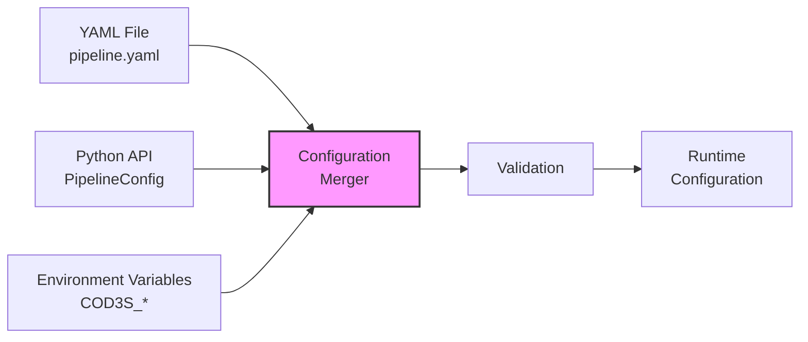
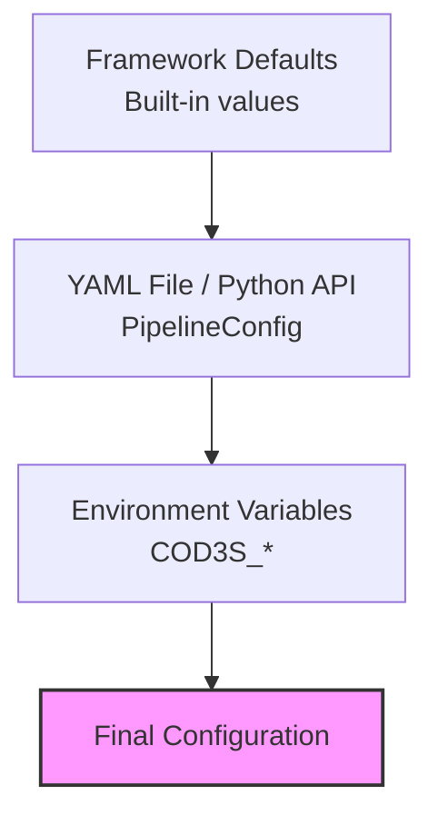

# COD3S Data Framework - Configuration

**Version:** 1.0
**Date:** 2026-01-24
**Status:** Functional Specification

---

## Navigation

| Previous | Up | Next |
|----------|-----|------|
| [← 08-BROKER](08-BROKER.md) | [OVERVIEW](00-OVERVIEW.md) | [10-OBSERVABILITY →](10-OBSERVABILITY.md) |

---

## Table of Contents

- [Configuration Approach](#configuration-approach)
- [YAML Configuration](#yaml-configuration)
- [Python API Configuration](#python-api-configuration)
- [Environment Variables](#environment-variables)
- [Configuration Hierarchy](#configuration-hierarchy)
- [Validation](#validation)
- [Examples and Patterns](#examples-and-patterns)
- [Best Practices](#best-practices)

---

## Configuration Approach

### Triple Configuration Model

COD3S Data supports **three configuration methods**, designed to work together:

1. **YAML Files** - Declarative configuration for standard cases
2. **Python API** - Programmatic configuration for advanced cases
3. **Environment Variables** - Runtime overrides and secrets



---

### Design Principles

**1. Declarative First**
- YAML for common patterns (80% of use cases)
- Clear, readable, version-controllable

**2. Programmatic for Power**
- Python API for complex logic
- Dynamic configuration
- Custom components

**3. Environment for Deployment**
- Secrets and credentials
- Deployment-specific overrides
- 12-factor app compliance

---

### Configuration Scope

**What can be configured:**
- Plugins (custom component modules to load)
- Sources (type, channel, source-specific parameters)
- Transformations (type, input channels, output channel, parameters)
- Destinations (type, channel pattern, destination-specific parameters)
- Broker (history size, metrics)
- Observatory (web UI for debugging)
- Logging (via CLI flags or structlog configuration)

**What cannot be configured (yet):**
- Internal data structures (V1.0 - fixed)
- Concurrency model (V1.0 - asyncio)
- Serialization format (V1.0 - JSON)

---

## YAML Configuration

### Basic Structure

```yaml
# pipeline.yaml - Full pipeline configuration

# Pipeline name (optional)
name: "my_pipeline"

# Plugins (optional) - Custom component modules to load before creating components
plugins:
  - my_package.custom_sources
  - my_package.custom_transforms

# Broker settings (optional)
broker:
  enable_metrics: true
  history_size: 100

# Observatory (optional) - Web UI for debugging
observatory:
  enabled: true
  port: 8765

# Sources
sources:
  - type: csv
    channel: "sensors.temp"
    params:
      path: "/data/sensors.csv"
      timestamp_column: "ts"
      value_column: "reading"

  - type: random
    channel: "test.random"
    params:
      rate: 10
      min_value: 20.0
      max_value: 100.0

# Transformations
transformations:
  - type: filter
    input_channels: "sensors.temp"
    output_channel: "sensors.temp.filtered"
    params:
      condition: "value > 50"

  - type: map
    input_channels: "sensors.temp.filtered"
    output_channel: "sensors.temp.celsius"
    params:
      expression: "value - 273.15"

# Destinations
destinations:
  - type: console
    channel_pattern: "sensors.temp.*"
    params:
      format: "pretty"

  - type: collect
    channel_pattern: "sensors.temp.celsius"
```

---

### Sources Configuration

```yaml
sources:
  # CSV file source (always operates in BATCH mode)
  - type: csv
    label: "historical_import"  # Optional label for display
    channel: "sensors.temp"
    params:
      path: "/data/temperature_history.csv"
      timestamp_column: "ts"
      value_column: "reading"
      tag_columns: ["location", "sensor_id"]

  # Real-time random source
  - type: random
    label: "test_generator"
    channel: "test.random.temp"
    params:
      rate: 100
      min_value: 20.0
      max_value: 100.0

  # Sequence source
  - type: sequence
    channel: "test.sequence"
    params:
      start_value: 0
      end_value: 100
      step_value: 1
      rate: 10
```

---

### Transformations Configuration

```yaml
transformations:
  # Filter transformation
  - type: filter
    label: "temp_filter"
    input_channels: "sensors.temp"
    output_channel: "sensors.temp.high"
    params:
      condition: "value > 80"

  # Map transformation
  - type: map
    label: "unit_converter"
    input_channels: "sensors.temp.high"
    output_channel: "sensors.temp.converted"
    params:
      expression: "(value - 32) * 5 / 9"

  # Aggregate transformation
  - type: aggregate
    label: "temp_avg"
    input_channels: "sensors.temp"
    output_channel: "sensors.temp.avg"
    params:
      window: 60
      function: "mean"

  # Multi-channel input (custom plugin transform)
  - type: viscosity       # Registered by a plugin
    input_channels:
      - "sensors.temp"
      - "sensors.speed"
      - "sensors.force"
    output_channel: "indicators.viscosity"
    params:
      calibration_factor: 1.2
```

> **Note:** Only `filter`, `map`, and `aggregate` transforms are built-in in V1.0. Additional transforms (threshold alerts, deduplication, etc.) are **Planned (V1.x)** — see [13-FUTURE](13-FUTURE-V2-V3.md).

---

### Destinations Configuration

```yaml
destinations:
  # Console destination
  - type: console
    label: "debug_console"
    channel_pattern: "alerts.**"
    params:
      format: "pretty"

  # File destination
  - type: file
    label: "sensor_archive"
    channel_pattern: "sensors.**"
    params:
      path: "/data/sensors.jsonl"

  # In-memory collector (testing)
  - type: collect
    label: "test_collector"
    channel_pattern: "test.results"
```

---

### Broker Configuration

```yaml
broker:
  # Metrics emission (publishes to _metrics.broker.* channels)
  enable_metrics: true  # Default: true

  # History buffer size (per channel)
  history_size: 100  # Default: 100
```

---

### Observatory Configuration

```yaml
observatory:
  enabled: true         # Enable Observatory web UI
  host: "0.0.0.0"      # Listen host (default: 0.0.0.0)
  port: 8765            # Listen port (default: 8765)
  buffer_size: 1000     # Message buffer size
  memory_limit_mb: 100  # Memory limit for buffered data

  # Debug mode
  debug:
    enabled: false
    granularity: "message"
    auto_pause: true

  # Sampling configuration
  sampling:
    strategy: "all"       # all, random, interval
    rate: 1.0             # Sampling rate (for "random" strategy)
    interval_ms: 100      # Sampling interval (for "interval" strategy)
```

Observatory can also be enabled via:
- **CLI flag:** `cod3s-data run pipeline.yaml --observatory`
- **Environment variables:** `COD3S_OBSERVATORY_ENABLED=true` (see [Environment Variables](#environment-variables))

---

## Python API Configuration

### Programmatic Configuration

```python
import asyncio
from cod3s_data.config.models import (
    PipelineConfig,
    SourceConfig,
    TransformConfig,
    DestinationConfig,
    BrokerConfig,
)
from cod3s_data.framework import Framework

# Build configuration
config = PipelineConfig(
    name="my_pipeline",
    broker=BrokerConfig(
        enable_metrics=True,
        history_size=100,
    ),
    sources=[
        SourceConfig(
            type="csv",
            channel="sensors.temp",
            params={
                "path": "/data/sensors.csv",
                "timestamp_column": "ts",
                "value_column": "reading",
            },
        ),
        SourceConfig(
            type="random",
            channel="test.random",
            params={
                "rate": 10,
                "min_value": 20.0,
                "max_value": 100.0,
            },
        ),
    ],
    transformations=[
        TransformConfig(
            type="filter",
            input_channels="sensors.temp",
            output_channel="sensors.temp.high",
            params={"condition": "value > 80"},
        ),
    ],
    destinations=[
        DestinationConfig(
            type="console",
            channel_pattern="sensors.temp.*",
            params={"format": "pretty"},
        ),
    ],
)

# Run pipeline (async context manager)
async def main():
    async with Framework(config) as framework:
        await framework.run()

asyncio.run(main())
```

---

### Loading from YAML

```python
from cod3s_data.config.loaders import load_yaml
from cod3s_data.framework import Framework

# Load configuration from YAML file
config = load_yaml("pipeline.yaml")

# Run pipeline
async def main():
    async with Framework(config) as framework:
        await framework.run()

asyncio.run(main())
```

---

### Custom Components via Plugins

**Plugin Convention:** A plugin is a Python module exporting a `register(factory)` function:

```python
# myapp/transforms.py
from cod3s_data.config.factory import ComponentFactory
from cod3s_data.transformations.base import StatefulTransform

class ViscosityComputer(StatefulTransform):
    ...

def register(factory: ComponentFactory) -> None:
    factory.register_transformation("viscosity", ViscosityComputer)
```

**YAML Usage:**
```yaml
plugins:
  - myapp.transforms

transformations:
  - type: viscosity       # Registered by the plugin
    input_channels: [sensors.temp, sensors.speed, sensors.force]
    output_channel: indicators.viscosity
    params:
      calibration_factor: 1.2
```

**CLI Usage:**
```bash
cod3s-data run pipeline.yaml --plugin myapp.transforms
```

**Programmatic Usage:**
```python
from cod3s_data.config.models import PipelineConfig
from cod3s_data.framework import Framework

config = PipelineConfig(
    plugins=["myapp.transforms"],
    ...
)

# Or pass plugins at framework level (merged with config.plugins)
framework = Framework(config, plugins=["myapp.transforms"])
```

---

## Environment Variables

### Variable Substitution

**YAML files support environment variable substitution:**

```yaml
sources:
  - type: csv
    channel: "sensors.temp"
    params:
      path: "${DATA_PATH}/sensors.csv"
```

**Set environment variables:**

```bash
export DATA_PATH="/data/production"

# Run framework
cod3s-data run pipeline.yaml
```

---

### Framework Environment Variables

**Reserved prefix:** `COD3S_*`

**Pipeline variables:**

| Variable | Description | Default |
|----------|-------------|---------|
| `COD3S_PIPELINE_NAME` | Pipeline name override | `cod3s_pipeline` |
| `COD3S_BROKER_ENABLE_METRICS` | Enable broker metrics | `true` |
| `COD3S_BROKER_HISTORY_SIZE` | Broker history size | `100` |

**Observatory variables:**

| Variable | Description | Default |
|----------|-------------|---------|
| `COD3S_OBSERVATORY_ENABLED` | Enable Observatory | `false` |
| `COD3S_OBSERVATORY_HOST` | Observatory host | `0.0.0.0` |
| `COD3S_OBSERVATORY_PORT` | Observatory port | `8765` |
| `COD3S_OBSERVATORY_BUFFER_SIZE` | Message buffer size | `1000` |
| `COD3S_OBSERVATORY_MEMORY_LIMIT_MB` | Memory limit (MB) | `100` |
| `COD3S_OBSERVATORY_DEBUG` | Enable debug mode | `false` |
| `COD3S_OBSERVATORY_DEBUG_GRANULARITY` | Debug granularity | `message` |
| `COD3S_OBSERVATORY_DEBUG_AUTO_PAUSE` | Auto-pause on debug | `true` |
| `COD3S_OBSERVATORY_SAMPLING_STRATEGY` | Sampling strategy | `all` |
| `COD3S_OBSERVATORY_SAMPLING_RATE` | Sampling rate | `1.0` |
| `COD3S_OBSERVATORY_SAMPLING_INTERVAL_MS` | Sampling interval | `100` |

**Example:**

```bash
export COD3S_PIPELINE_NAME="production"
export COD3S_BROKER_HISTORY_SIZE="1000"
export COD3S_OBSERVATORY_ENABLED="true"
export COD3S_OBSERVATORY_PORT="9000"

cod3s-data run pipeline.yaml
```

---

### Secrets Management

**Best practices for secrets:**

**1. Environment variables (recommended):**
```yaml
sources:
  - type: custom_db
    channel: "sensors.temp"
    params:
      connection_string: "${DATABASE_URL}"
```

**2. Secret files:**
```yaml
sources:
  - type: custom_db
    channel: "sensors.temp"
    params:
      connection_string_file: "/run/secrets/db_connection"
```

**3. Secret management services — Planned (V2.0+)**

**Never:**
- Hard-code secrets in YAML
- Commit secrets to version control
- Log secrets (framework redacts known patterns)

---

## Configuration Hierarchy

### Override Order

**Priority (highest to lowest):**

1. **Environment Variables** (runtime overrides via `COD3S_*`)
2. **YAML Files** / **Python API** (declarative configuration)
3. **Framework Defaults** (built-in)



---

### Example: Override Chain

```python
# 1. Framework default
history_size = 100  # Built-in default (BrokerConfig)

# 2. YAML file or Python API
# pipeline.yaml:
#   broker:
#     history_size: 500

# 3. Environment variable (overrides YAML)
# export COD3S_BROKER_HISTORY_SIZE=1000

# Final value: 1000 (environment variable wins)
```

---

## Validation

### Configuration Validation

**Framework validates configuration at load time (Pydantic v2):**

```python
from cod3s_data.config.loaders import load_yaml

try:
    config = load_yaml("pipeline.yaml")
except FileNotFoundError as e:
    print(f"File not found: {e}")
except ValueError as e:
    print(f"Configuration error: {e}")
    # Example errors:
    # - Field required: sources[0].channel
    # - Input should be a valid string: sources[0].type
```

---

### Validation Rules

**Plugin validation:**
- Plugin module can be imported
- Plugin has a `register` callable
- Plugin `register()` executes without errors

**Type validation:**
- Source type exists and is registered (including plugin-provided types)
- Transformation type exists (including plugin-provided types)
- Destination type exists (including plugin-provided types)

**Required fields:**
- Sources must have: `type`, `channel`
- Transformations must have: `type`, `input_channels`, `output_channel`
- Destinations must have: `type`, `channel_pattern`

**Value constraints:**
- `history_size` >= 0

---

### Validation CLI

**Validate configuration without running:**

```bash
# Validate YAML file
cod3s-data validate pipeline.yaml

# Validate with plugins (verifies custom types are registered)
cod3s-data validate pipeline.yaml --plugin my_package.custom_transforms

# Output:
# ✓ Configuration is valid!
#
# Pipeline: my_pipeline
#   Plugins: 1
#   Sources: 2
#     1. csv -> sensors.temp
#     2. random -> test.random
#   Transformations: 1
#     1. filter: sensors.temp -> sensors.temp.filtered
#   Destinations: 1
#     1. console <- sensors.**
```

---

## Examples and Patterns

### Example 1: Simple Monitoring

```yaml
# Simple temperature monitoring

sources:
  - type: random
    channel: "sensors.temp"
    params:
      rate: 1
      min_value: 20
      max_value: 100

transformations:
  - type: filter
    input_channels: "sensors.temp"
    output_channel: "alerts.high_temp"
    params:
      condition: "value > 80"

destinations:
  - type: console
    channel_pattern: "alerts.**"
    params:
      format: "pretty"
```

---

### Example 2: Historical Data Processing

```yaml
# Batch processing of historical data (CSV files always operate in BATCH mode)

sources:
  - type: csv
    channel: "replay.sensors.temp"
    params:
      path: "/data/2024-01-15-incident.csv"
      timestamp_column: "ts"
      value_column: "reading"

transformations:
  - type: map
    input_channels: "replay.sensors.temp"
    output_channel: "analysis.results"
    params:
      expression: "value * calibration_factor"

destinations:
  - type: file
    channel_pattern: "analysis.results"
    params:
      path: "/output/analysis_report.jsonl"
```

> **Note:** TRANSPOSE mode (preserving original timestamps during replay) is **Planned (V1.x)**.

---

### Example 3: Multi-Sensor Processing with Plugin

```yaml
# Compute derived metrics from multiple sensors using a custom plugin

plugins:
  - physics_transforms

sources:
  - type: random
    channel: "sensors.temperature"
    params:
      rate: 10
      min_value: 50
      max_value: 200

  - type: random
    channel: "sensors.speed"
    params:
      rate: 10
      min_value: 0
      max_value: 100

transformations:
  - type: viscosity       # Registered by physics_transforms plugin
    input_channels:
      - "sensors.temperature"
      - "sensors.speed"
    output_channel: "indicators.viscosity"
    params:
      calibration_factor: 1.2
      min_speed: 10

destinations:
  - type: console
    channel_pattern: "indicators.**"
    params:
      format: "pretty"
```

---

### Example 4: Production Pipeline with Observatory

```yaml
# Production-ready configuration with monitoring

name: "production_pipeline"

broker:
  enable_metrics: true
  history_size: 1000

observatory:
  enabled: true
  port: 8765

sources:
  - type: csv
    label: "sensor_import"
    channel: "sensors.temp"
    params:
      path: "/data/sensors.csv"
      timestamp_column: "ts"
      value_column: "reading"
      tag_columns: ["location", "sensor_id"]

transformations:
  # Filter out-of-range values
  - type: filter
    label: "range_filter"
    input_channels: "sensors.temp"
    output_channel: "sensors.temp.valid"
    params:
      condition: "value >= 0 and value <= 200"

  # Compute averages
  - type: aggregate
    label: "temp_avg"
    input_channels: "sensors.temp.valid"
    output_channel: "sensors.temp.avg"
    params:
      window: 60
      function: "mean"

destinations:
  # Console for monitoring
  - type: console
    channel_pattern: "sensors.temp.avg"
    params:
      format: "pretty"

  # Collect for analysis
  - type: collect
    label: "results"
    channel_pattern: "sensors.temp.valid"
```

---

## Best Practices

### Configuration Organization

**Do:**
- Use YAML for declarative pipelines
- Use Python API for dynamic or complex configuration
- Use environment variables for secrets and deployment overrides
- Version control YAML files (git)
- Validate before deployment (`cod3s-data validate`)

**Don't:**
- Hard-code secrets in YAML
- Mix configuration methods unnecessarily
- Skip validation step

---

### Deployment

**Do:**
- Use different YAML files per environment (dev, staging, prod)
- Use environment variables for environment-specific values
- Test configuration in non-production first
- Use configuration validation in CI/CD

**Example:**
```bash
# Development
export COD3S_PIPELINE_NAME="dev"
export COD3S_OBSERVATORY_ENABLED="true"
cod3s-data run config/dev.yaml

# Production
export COD3S_PIPELINE_NAME="production"
export COD3S_BROKER_HISTORY_SIZE="1000"
cod3s-data run config/prod.yaml
```

---

### Security

**Do:**
- Use environment variables for secrets
- Restrict file permissions (600 for configs with secrets)
- Use secret management services (Vault, AWS Secrets Manager)
- Audit configuration changes

**Don't:**
- Commit secrets to git
- Log configuration with secrets
- Share production configs via insecure channels

---

## Summary

**COD3S Data Configuration** provides flexible, layered configuration:

1. **Triple Configuration:**
   - YAML files (declarative)
   - Python API (programmatic via `PipelineConfig`)
   - Environment variables (runtime via `COD3S_*`)

2. **Hierarchy:**
   - Env Vars > YAML / Python API > Defaults

3. **Validation:**
   - Pydantic v2 model validation
   - Type checking for registered components
   - Required fields (`type`, `channel`, `input_channels`, `output_channel`, `channel_pattern`)
   - CLI validation tool (`cod3s-data validate`)

4. **Best Practices:**
   - YAML for standard cases
   - Python for complex logic
   - Environment variables for secrets and deployment
   - Validate before deployment

**Next:** Explore [Observability](10-OBSERVABILITY.md) for monitoring and debugging.

---

## Navigation

| Previous | Up | Next |
|----------|-----|------|
| [← 08-BROKER](08-BROKER.md) | [OVERVIEW](00-OVERVIEW.md) | [10-OBSERVABILITY →](10-OBSERVABILITY.md) |
