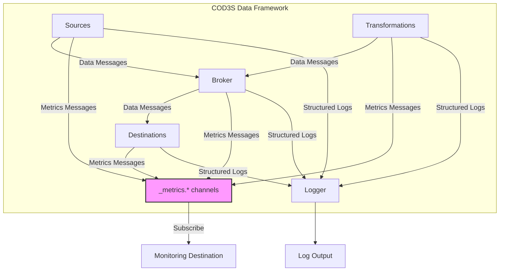
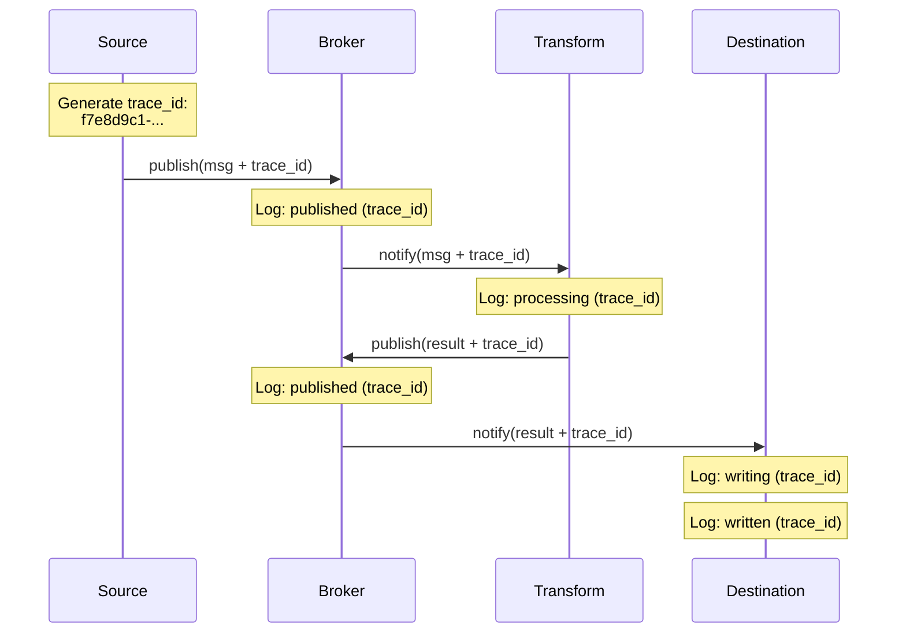

# COD3S Data Framework - Observability

**Version:** 1.0
**Date:** 2026-01-24
**Status:** Functional Specification

---

## Navigation

| Previous | Up | Next |
|----------|-----|------|
| [← 09-CONFIGURATION](09-CONFIGURATION.md) | [OVERVIEW](00-OVERVIEW.md) | [11-DEPLOYMENT →](11-DEPLOYMENT.md) |

---

## Table of Contents

- [Observability Philosophy](#observability-philosophy)
- [Metrics as Messages](#metrics-as-messages)
- [Logging](#logging)
- [Tracing](#tracing)
- [Debug Mode](#debug-mode)
- [Performance Monitoring](#performance-monitoring)
- [Alerting Integration](#alerting-integration)
- [Best Practices](#best-practices)

---

## Observability Philosophy

### Built-In Observability

COD3S Data is **observable by design** - visibility into system behavior without external tools (though V2.0 will integrate with industry standards).

**Core Principles:**

1. **Metrics as Messages** - Metrics use same infrastructure as data
2. **Self-Reporting** - Framework reports its own health
3. **Structured Logging** - Machine-readable, trace IDs
4. **Zero-Config Default** - Basic observability works out-of-the-box
5. **Extensible** - Can export to Prometheus, Grafana, etc. (V2.0+)



---

## Observatory (Web UI)

COD3S Data includes an **Observatory** module - a built-in web UI for real-time debugging and pipeline control. Observatory is implemented in V1.0 and can be enabled via CLI or configuration.

**Features:**
- Real-time pipeline visualization (sources, transformations, destinations)
- Component state monitoring (idle, running, paused, completed, stopped)
- Pipeline control (start, stop, restart) via WebSocket
- Interactive mode (pipeline waits for UI to start it)
- Message sampling and inspection

**Enabling Observatory:**
```bash
# Via CLI
cod3s-data run pipeline.yaml --observatory
cod3s-data run pipeline.yaml --observatory --observatory-port 9000
cod3s-data run pipeline.yaml --interactive  # implies --observatory

# Via YAML configuration
observatory:
  enabled: true
  port: 8765
  interactive: false
```

**Environment Variables:**
- `COD3S_OBSERVATORY_ENABLED` - Enable Observatory (`true`/`false`)
- `COD3S_OBSERVATORY_HOST` - Server host (default: `127.0.0.1`)
- `COD3S_OBSERVATORY_PORT` - Server port (default: `8765`)
- `COD3S_OBSERVATORY_BUFFER_SIZE` - Event buffer size
- `COD3S_OBSERVATORY_MEMORY_LIMIT_MB` - Memory limit
- `COD3S_OBSERVATORY_DEBUG` - Enable debug mode
- `COD3S_OBSERVATORY_SAMPLING_STRATEGY` - Sampling strategy
- `COD3S_OBSERVATORY_SAMPLING_RATE` - Sampling rate

**See also:** [API Reference - Framework constructor](../../api-reference.md) for programmatic usage.

---

## MetricsCollector

The `MetricsCollector` class provides a helper for batching and emitting metrics:

```python
from cod3s_data.observability.metrics import MetricsCollector

collector = MetricsCollector("source", tags={"source_id": "src-1"})
collector.increment("messages_produced")
collector.increment("messages_produced", 5)
collector.set("queue_size", 42)
await collector.flush()  # Emits all collected metrics and resets
```

**Methods:**
- `increment(metric_name, value=1)` - Increment a counter
- `set(metric_name, value)` - Set a gauge value
- `async flush(extra_tags=None)` - Emit all metrics and reset
- `reset()` - Reset without emitting

**See also:** `emit_metric()` and `emit_metric_async()` for single metric emission.

---

## Metrics as Messages

### Concept

**Metrics are published as regular messages** on reserved `_metrics.*` channels.

**Benefits:**
- Same subscription model (wildcards, filtering)
- Same routing infrastructure (broker)
- Same destinations (console, file, database)
- No special metric collection system needed

**Example:**
```python
# Framework publishes metrics internally
broker.publish(
    channel="_metrics.broker.throughput",
    message=Message(
        key="throughput",
        timestamp=now(),
        value=1234,  # messages/second
        tags={"window": "1s"}
    )
)

# Subscribe like any other channel
metrics_dest = ConsoleDestination(channel="_metrics.broker.**")
```

---

### Metric Categories

| Category | Channel Pattern | Description |
|----------|----------------|-------------|
| **Broker** | `_metrics.broker.*` | Throughput, latency, subscriptions |
| **Sources** | `_metrics.source.<name>.*` | Messages produced, errors, progress |
| **Transformations** | `_metrics.transform.<name>.*` | Processing time, state size, errors |
| **Destinations** | `_metrics.destination.<name>.*` | Buffer depth, write latency, failures |
| **System** | `_metrics.system.*` | Memory, CPU, threads |

---

### Broker Metrics

**Channel:** `_metrics.broker.*`

**Throughput:**
```yaml
channel: "_metrics.broker.throughput"
key: "throughput"
timestamp: "2024-01-15T10:30:45Z"
value: 1234  # Messages per second
tags:
  window: "1s"  # or "5s", "60s"
```

**Latency:**
```yaml
channel: "_metrics.broker.latency"
key: "latency"
timestamp: "2024-01-15T10:30:45Z"
value:
  p50: 3.2    # Median (ms)
  p95: 12.5   # 95th percentile
  p99: 48.7   # 99th percentile
  max: 102.3  # Maximum
tags:
  operation: "publish_to_notify"
```

**Subscriptions:**
```yaml
channel: "_metrics.broker.subscriptions"
key: "subscription_count"
timestamp: "2024-01-15T10:30:45Z"
value: 42
tags:
  type: "total"  # or "wildcard", "exact"
```

**Channels:**
```yaml
channel: "_metrics.broker.channels"
key: "channel_count"
timestamp: "2024-01-15T10:30:45Z"
value: 15
tags:
  state: "active"  # or "inactive", "total"
```

---

### Source Metrics

**Channel:** `_metrics.source.<source_name>.*`

**Messages Produced:**
```yaml
channel: "_metrics.source.csv_importer.messages"
key: "messages_produced"
timestamp: "2024-01-15T10:30:45Z"
value: 10234
tags:
  source_type: "csv"
  mode: "BATCH"
```

**Progress (BATCH/TRANSPOSE):**
```yaml
channel: "_metrics.source.csv_importer.progress"
key: "progress"
timestamp: "2024-01-15T10:30:45Z"
value: 0.45  # 45% complete
tags:
  total_messages: "100000"
  processed_messages: "45000"
  eta_seconds: "120"
```

**Errors:**
```yaml
channel: "_metrics.source.mqtt_sensor.errors"
key: "error_count"
timestamp: "2024-01-15T10:30:45Z"
value: 3
tags:
  error_type: "ConnectionError"
  last_error: "Connection refused"
```

---

### Transformation Metrics

**Channel:** `_metrics.transform.<transform_name>.*`

**Processing Time:**
```yaml
channel: "_metrics.transform.viscosity_computer.processing_time"
key: "processing_time_ms"
timestamp: "2024-01-15T10:30:45Z"
value:
  p50: 2.1
  p95: 5.8
  p99: 12.3
tags:
  transformation_type: "stateful"
```

**State Size (Stateful Transformations):**
```yaml
channel: "_metrics.transform.deduplicator.state_size"
key: "cache_entries"
timestamp: "2024-01-15T10:30:45Z"
value: 1534
tags:
  max_size: "10000"
  eviction_count: "42"
```

**Messages Filtered:**
```yaml
channel: "_metrics.transform.temp_filter.filtered"
key: "messages_filtered"
timestamp: "2024-01-15T10:30:45Z"
value: 234
tags:
  total_input: "10000"
  filter_rate: "0.0234"
```

---

### Destination Metrics

**Channel:** `_metrics.destination.<dest_name>.*`

**Buffer Utilization:**
```yaml
channel: "_metrics.destination.database_writer.buffer"
key: "buffer_depth"
timestamp: "2024-01-15T10:30:45Z"
value: 750
tags:
  buffer_size: "1000"
  utilization: "0.75"
  messages_dropped: "12"
  drop_strategy: "drop_oldest"
```

**Write Latency:**
```yaml
channel: "_metrics.destination.database_writer.latency"
key: "write_latency_ms"
timestamp: "2024-01-15T10:30:45Z"
value:
  p50: 15.2
  p95: 45.8
  p99: 102.3
tags:
  destination_type: "database"
```

**Failures:**
```yaml
channel: "_metrics.destination.database_writer.failures"
key: "write_failures"
timestamp: "2024-01-15T10:30:45Z"
value: 5
tags:
  retry_exhausted: "3"
  sent_to_dlq: "3"
  last_error: "Connection timeout"
```

---

### System Metrics

**Channel:** `_metrics.system.*`

**Memory Usage:**
```yaml
channel: "_metrics.system.memory"
key: "memory_usage_mb"
timestamp: "2024-01-15T10:30:45Z"
value: 245.7
tags:
  total_mb: "512"
  utilization: "0.48"
```

**CPU Usage:**
```yaml
channel: "_metrics.system.cpu"
key: "cpu_percent"
timestamp: "2024-01-15T10:30:45Z"
value: 23.5
tags:
  cores: "4"
```

---

### Consuming Metrics

**Example 1: Console Monitoring**
```yaml
destinations:
  - type: console
    channel: "_metrics.broker.**"
    format: "compact"
```

**Example 2: Time Series Database**
```yaml
destinations:
  - type: influxdb
    connection_string: "${INFLUX_URL}"
    channel: "_metrics.**"
    database: "cod3s_metrics"
```

**Example 3: Real-Time Dashboard**
```yaml
destinations:
  - type: websocket
    channel: "_metrics.broker.throughput"
    endpoint: "ws://dashboard:8080/metrics"
```

**Example 4: File Export**
```yaml
destinations:
  - type: file
    channel: "_metrics.**"
    path: "/var/log/cod3s/metrics.jsonl"
    rotation:
      max_size: "100MB"
      max_age: "24h"
```

---

## Logging

### Structured Logging

**All log messages are structured (JSON format):**

```json
{
  "timestamp": "2024-01-15T10:30:45.123Z",
  "level": "INFO",
  "component": "broker",
  "message": "Message published",
  "context": {
    "channel": "sensors.temp",
    "message_id": "a3b7c9d1-e4f6-4a8b-9c1d-e2f3a4b5c6d7",
    "trace_id": "f7e8d9c1-2a3b-4c5d-6e7f-8a9b0c1d2e3f"
  }
}
```

---

### Log Levels

| Level | Use Cases | Examples |
|-------|-----------|----------|
| **DEBUG** | Development, troubleshooting | Message contents, internal state |
| **INFO** | Normal operations | Component started, message published |
| **WARNING** | Abnormal but recoverable | Buffer overflow, retry attempt |
| **ERROR** | Errors requiring attention | Failed writes, DLQ messages |
| **CRITICAL** | System failures | Broker crash, unrecoverable error |

---

### Log Configuration

```yaml
logging:
  level: "INFO"  # DEBUG, INFO, WARNING, ERROR, CRITICAL
  format: "json"  # or "text"
  output: "stdout"  # or file path

  # Structured logging
  include_timestamps: true
  include_trace_ids: true
  include_component: true

  # Log filtering
  filters:
    - component: "broker"
      level: "DEBUG"
    - component: "destinations"
      level: "WARNING"

  # Output destinations
  handlers:
    - type: "console"
      level: "INFO"
    - type: "file"
      path: "/var/log/cod3s/cod3s.log"
      level: "WARNING"
      rotation:
        max_size: "100MB"
        max_files: 10
```

---

### Log Examples

**Source Started:**
```json
{
  "timestamp": "2024-01-15T10:30:00.000Z",
  "level": "INFO",
  "component": "source.csv_importer",
  "message": "Source started",
  "context": {
    "source_type": "csv",
    "mode": "BATCH",
    "channel": "sensors.temp",
    "file_path": "/data/sensors.csv"
  }
}
```

**Message Published:**
```json
{
  "timestamp": "2024-01-15T10:30:45.123Z",
  "level": "DEBUG",
  "component": "broker",
  "message": "Message published",
  "context": {
    "channel": "sensors.temp",
    "message_id": "a3b7c9d1-...",
    "subscribers_notified": 3,
    "trace_id": "f7e8d9c1-..."
  }
}
```

**Retry Attempt:**
```json
{
  "timestamp": "2024-01-15T10:30:46.234Z",
  "level": "WARNING",
  "component": "destination.database_writer",
  "message": "Write failed, retrying",
  "context": {
    "attempt": 1,
    "max_attempts": 3,
    "error": "ConnectionError: Connection refused",
    "retry_delay_ms": 1000,
    "message_id": "a3b7c9d1-...",
    "trace_id": "f7e8d9c1-..."
  }
}
```

**DLQ Message:**
```json
{
  "timestamp": "2024-01-15T10:30:50.345Z",
  "level": "ERROR",
  "component": "destination.database_writer",
  "message": "Message sent to DLQ after retry exhaustion",
  "context": {
    "attempts": 3,
    "dlq_channel": "_dlq.db_failures.sensors.temp",
    "error": "ConnectionError: Connection refused",
    "message_id": "a3b7c9d1-...",
    "trace_id": "f7e8d9c1-..."
  }
}
```

---

## Tracing

### Trace IDs

**Every message gets a trace ID** for end-to-end tracking:



**All logs for same message share trace_id** - easy to correlate

---

### Correlation

**Example: Track message through pipeline:**

```bash
# grep logs for specific trace_id
cat cod3s.log | grep "f7e8d9c1-2a3b-4c5d-6e7f-8a9b0c1d2e3f"

# Output (all logs for this message):
# [INFO] source.csv: Message read (trace_id=f7e8d9c1...)
# [DEBUG] broker: Message published to sensors.temp (trace_id=f7e8d9c1...)
# [DEBUG] transform.alert: Threshold check (trace_id=f7e8d9c1...)
# [INFO] transform.alert: Alert generated (trace_id=f7e8d9c1...)
# [DEBUG] broker: Message published to alerts.critical (trace_id=f7e8d9c1...)
# [INFO] destination.console: Message displayed (trace_id=f7e8d9c1...)
# [INFO] destination.database: Message written (trace_id=f7e8d9c1...)
```

---

## Debug Mode

### Enabling Debug Mode

**Configuration:**
```yaml
logging:
  level: "DEBUG"
  debug_channels: true  # Log all channel activity
```

**Or environment variable:**
```bash
export COD3S_LOG_LEVEL=DEBUG
export COD3S_DEBUG_CHANNELS=true
```

---

### Debug Output

**Message Contents:**
```json
{
  "level": "DEBUG",
  "component": "broker",
  "message": "Message routed",
  "context": {
    "channel": "sensors.temp",
    "message": {
      "key": "temperature",
      "timestamp": "2024-01-15T10:30:45Z",
      "value": 235.7,
      "tags": {"location": "warehouse_A"}
    },
    "subscribers": ["dest1", "dest2", "transform1"]
  }
}
```

**Channel Activity:**
```json
{
  "level": "DEBUG",
  "component": "broker",
  "message": "Channel activity",
  "context": {
    "active_channels": [
      "sensors.temp",
      "sensors.pressure",
      "alerts.critical"
    ],
    "message_counts": {
      "sensors.temp": 1234,
      "sensors.pressure": 567,
      "alerts.critical": 12
    }
  }
}
```

---

### Performance Impact

**Debug mode overhead:**
- 2-5x increase in logging volume
- 5-10% CPU overhead (serialization)
- Disk I/O increase (log writes)

**Recommendations:**
- ✅ Use in development/testing
- ✅ Use temporarily in production (troubleshooting)
- ❌ Don't leave enabled in production permanently

---

## Performance Monitoring

### Real-Time Monitoring

**Subscribe to performance metrics:**

```yaml
destinations:
  - type: console
    channel: "_metrics.broker.throughput"
    format: "compact"

  - type: console
    channel: "_metrics.broker.latency"
    format: "compact"

  - type: console
    channel: "_metrics.destination.*.buffer"
    format: "compact"
```

**Output:**
```
[10:30:45] _metrics.broker.throughput: 1234 msg/s (window=1s)
[10:30:45] _metrics.broker.latency: p50=3.2ms p99=48.7ms
[10:30:45] _metrics.destination.db.buffer: 750/1000 (75% utilization)
```

---

### Historical Analysis

**Export metrics to time series database:**

```yaml
destinations:
  - type: influxdb
    connection_string: "${INFLUX_URL}"
    channel: "_metrics.**"
    database: "cod3s_metrics"
```

**Query examples (InfluxQL):**
```sql
-- Average throughput over last hour
SELECT MEAN(value) FROM throughput
WHERE channel = '_metrics.broker.throughput'
AND time > now() - 1h
GROUP BY time(5m)

-- Peak latency
SELECT MAX(p99) FROM latency
WHERE channel = '_metrics.broker.latency'
AND time > now() - 24h

-- Buffer utilization trend
SELECT value FROM buffer_depth
WHERE channel =~ /destination.*buffer/
AND time > now() - 1h
```

---

### Performance Baselines

**Expected V1.0 Performance:**

| Metric | Baseline | Alert Threshold |
|--------|----------|----------------|
| Throughput | 5,000-10,000 msg/s | < 1,000 msg/s |
| Latency (p50) | 3-5 ms | > 20 ms |
| Latency (p99) | 30-50 ms | > 100 ms |
| Memory | 100-300 MB | > 400 MB |
| Buffer Utilization | 20-50% | > 90% |

---

## Alerting Integration

### Threshold Alerts

**Alert on high latency:**
```yaml
transformations:
  - type: threshold_alert
    input: "_metrics.broker.latency_p99"
    threshold: 100  # ms
    output: "alerts.performance.slow_routing"
    severity: "warning"

destinations:
  - type: webhook
    channel: "alerts.performance.**"
    url: "${PAGERDUTY_URL}"
```

---

### Alert on Buffer Saturation

```yaml
transformations:
  - type: threshold_alert
    input: "_metrics.destination.*.buffer_utilization"
    threshold: 0.9  # 90%
    output: "alerts.backpressure"
    severity: "warning"
```

---

### Alert on DLQ Activity

```yaml
destinations:
  - type: webhook
    channel: "_dlq.**"
    url: "${SLACK_WEBHOOK}"
    format: |
      {
        "text": "DLQ Message: {{channel}}",
        "details": "{{error_message}}"
      }
```

---

## Best Practices

### Metrics

**Do:**
- ✅ Subscribe to broker metrics in production
- ✅ Export metrics to time series database
- ✅ Set up alerts for critical metrics
- ✅ Monitor buffer utilization

**Don't:**
- ❌ Ignore high latency warnings
- ❌ Let metrics channels go unmonitored
- ❌ Skip DLQ monitoring

---

### Logging

**Do:**
- ✅ Use structured logging (JSON)
- ✅ Include trace IDs
- ✅ Use appropriate log levels
- ✅ Rotate log files

**Don't:**
- ❌ Log sensitive data (redact secrets)
- ❌ Use DEBUG in production permanently
- ❌ Ignore ERROR logs

---

### Troubleshooting

**Common Issues:**

**High Latency:**
1. Check `_metrics.broker.latency`
2. Check destination buffer utilization
3. Check transformation processing time
4. Review DEBUG logs for slow operations

**Message Loss:**
1. Check DLQ channels (`_dlq.**`)
2. Review source delivery guarantees
3. Check destination retry exhaustion
4. Review ERROR logs

**Memory Growth:**
1. Check `_metrics.system.memory`
2. Check buffer sizes
3. Check stateful transformation state size
4. Review history buffer configuration

---

## Summary

**COD3S Data Observability** provides comprehensive visibility:

1. **Metrics as Messages:**
   - Broker, source, transformation, destination metrics
   - Published on `_metrics.*` channels
   - Same infrastructure as data

2. **Structured Logging:**
   - JSON format
   - Trace IDs for correlation
   - Configurable levels and filters

3. **Tracing:**
   - End-to-end trace IDs
   - Correlate logs across components

4. **Debug Mode:**
   - Detailed logging
   - Message contents
   - Channel activity

5. **Integration:**
   - Export to time series databases
   - Alert on thresholds
   - Webhook notifications

**Next:** Explore [Deployment](11-DEPLOYMENT.md) for deployment modes and packaging.

---

## Navigation

| Previous | Up | Next |
|----------|-----|------|
| [← 09-CONFIGURATION](09-CONFIGURATION.md) | [OVERVIEW](00-OVERVIEW.md) | [11-DEPLOYMENT →](11-DEPLOYMENT.md) |

---

*This is a functional specification document. Implementation details will be defined in the technical specification phase.*
