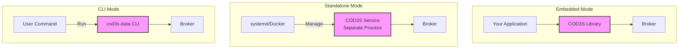

# COD3S Data Framework - Deployment

**Version:** 1.0
**Date:** 2026-01-24
**Status:** Functional Specification

---

## Navigation

| Previous | Up | Next |
|----------|-----|------|
| [← 10-OBSERVABILITY](10-OBSERVABILITY.md) | [OVERVIEW](00-OVERVIEW.md) | [12-TESTING →](12-TESTING.md) |

---

## Table of Contents

- [Deployment Modes](#deployment-modes)
- [Embedded Library Mode](#embedded-library-mode)
- [Standalone Service Mode](#standalone-service-mode)
- [CLI Tool Mode](#cli-tool-mode)
- [Packaging and Distribution](#packaging-and-distribution)
- [Resource Requirements](#resource-requirements)
- [Production Considerations](#production-considerations)
- [Best Practices](#best-practices)

---

## Deployment Modes

### Overview

COD3S Data supports **three deployment modes**, each suited for different use cases:

| Mode | Use Case | Lifecycle Management |
|------|----------|---------------------|
| **Embedded Library** | Integrate into existing application | Application controls |
| **Standalone Service** | Long-running data pipeline | OS/orchestrator controls |
| **CLI Tool** | Ad-hoc tasks, testing, batch jobs | Command-line execution |



---

## Embedded Library Mode

### Concept

**Integrate COD3S Data as a library** within your existing Python application.

**Characteristics:**
- Same process as host application
- Direct API access (Python)
- Shared resources (memory, CPU, threads)
- Start/stop controlled by application

---

### Installation

```bash
# Install via pip
pip install cod3s-data

# Or with optional dependencies
pip install cod3s-data[mqtt,database]

# Or from source
git clone https://github.com/cod3s/cod3s-data
cd cod3s-data
pip install -e .
```

---

### Basic Usage

```python
from cod3s_data import Framework
from cod3s_data.sources import RandomSource
from cod3s_data.destinations import ConsoleDestination

# Create framework instance
framework = Framework()

# Add components
source = RandomSource(channel="sensors.temp", rate_per_second=1)
framework.add_source(source)

dest = ConsoleDestination(channel="sensors.**")
framework.add_destination(dest)

# Start framework (non-blocking)
framework.start()

# Your application continues running
while True:
    # Your application logic
    process_business_logic()

# Stop framework on shutdown
framework.stop()
```

---

### Configuration from YAML

```python
from cod3s_data import Framework

# Load configuration from YAML
framework = Framework.from_yaml("pipeline.yaml")

# Start
framework.start()

# Run
import time
time.sleep(3600)  # Run for 1 hour

# Stop
framework.stop()
```

---

### Lifecycle Management

```python
from cod3s_data import Framework

# Create
framework = Framework()

# Configure
framework.configure_broker(history_size=1000)
framework.add_source(...)
framework.add_destination(...)

# Start (asynchronous - returns immediately)
framework.start()

# Check status
if framework.is_running():
    print("Framework running")

# Pause (future - not in V1.0)
# framework.pause()

# Resume (future - not in V1.0)
# framework.resume()

# Stop (graceful shutdown)
framework.stop(timeout=30)  # Wait up to 30s for shutdown

# Force stop
framework.stop(force=True)
```

---

### Benefits and Drawbacks

**Benefits:**
- ✅ Minimal overhead (no IPC)
- ✅ Direct Python API access
- ✅ Easy debugging (same process)
- ✅ Simple deployment (one process)

**Drawbacks:**
- ❌ Shares resources with application
- ❌ Framework crash affects application
- ❌ Harder to monitor separately
- ❌ Must restart application to restart framework

**Use Cases:**
- Data processing within web applications
- IoT edge devices (single-board computers)
- Desktop applications with data pipelines
- Jupyter notebooks and data science workflows

---

## Standalone Service Mode

### Concept

**Run COD3S Data as a separate process**, managed by OS or orchestrator.

**Characteristics:**
- Independent process
- Process isolation (crash doesn't affect other services)
- OS-managed lifecycle (systemd, Docker, Kubernetes)
- Configuration via YAML + environment variables

---

### Service Executable

```bash
# Install package includes service executable
pip install cod3s-data

# Run standalone service
cod3s-data serve --config /etc/cod3s/pipeline.yaml

# Or with environment variable
export CODS_CONFIG=/etc/cod3s/pipeline.yaml
cod3s-data serve

# Foreground (blocking)
cod3s-data serve --config pipeline.yaml

# Daemon mode (background - future)
cod3s-data serve --config pipeline.yaml --daemon
```

---

### systemd Integration

**systemd service file** (`/etc/systemd/system/cod3s-data.service`):

```ini
[Unit]
Description=COD3S Data Framework
After=network.target

[Service]
Type=simple
User=cod3s
Group=cod3s
WorkingDirectory=/opt/cod3s
ExecStart=/usr/local/bin/cod3s-data serve --config /etc/cod3s/pipeline.yaml
Restart=on-failure
RestartSec=10

# Environment
Environment="CODS_LOG_LEVEL=INFO"
Environment="CODS_BROKER_HISTORY_SIZE=1000"
EnvironmentFile=-/etc/cod3s/environment

# Logging
StandardOutput=journal
StandardError=journal
SyslogIdentifier=cod3s-data

# Resource limits
MemoryMax=1G
CPUQuota=200%

[Install]
WantedBy=multi-user.target
```

**Management:**
```bash
# Enable service
sudo systemctl enable cod3s-data

# Start service
sudo systemctl start cod3s-data

# Check status
sudo systemctl status cod3s-data

# View logs
sudo journalctl -u cod3s-data -f

# Restart service
sudo systemctl restart cod3s-data

# Stop service
sudo systemctl stop cod3s-data
```

---

### Docker Deployment

**Dockerfile:**
```dockerfile
FROM python:3.9-slim

# Install dependencies
RUN pip install --no-cache-dir cod3s-data[mqtt,database]

# Copy configuration
COPY pipeline.yaml /app/pipeline.yaml

# Working directory
WORKDIR /app

# Expose ports (if HTTP API in V2.0)
# EXPOSE 8080

# Health check (future)
# HEALTHCHECK --interval=30s --timeout=3s \
#   CMD cod3s-data health || exit 1

# Run service
CMD ["cod3s-data", "serve", "--config", "/app/pipeline.yaml"]
```

**Build and run:**
```bash
# Build image
docker build -t cod3s-data:latest .

# Run container
docker run -d \
  --name cod3s-data \
  -v /data:/data \
  -e CODS_LOG_LEVEL=INFO \
  -e DATABASE_URL=postgresql://db:5432/cod3s \
  cod3s-data:latest

# View logs
docker logs -f cod3s-data

# Stop container
docker stop cod3s-data
```

---

### Docker Compose

**docker-compose.yml:**
```yaml
version: '3.8'

services:
  cod3s-data:
    build: .
    container_name: cod3s-data
    restart: unless-stopped

    volumes:
      - ./data:/data
      - ./config:/config

    environment:
      - CODS_CONFIG=/config/pipeline.yaml
      - CODS_LOG_LEVEL=INFO
      - DATABASE_URL=postgresql://postgres:password@db:5432/cod3s
      - MQTT_BROKER=mqtt://mosquitto:1883

    depends_on:
      - db
      - mosquitto

    networks:
      - cod3s-network

  # PostgreSQL database
  db:
    image: postgres:15
    environment:
      - POSTGRES_DB=cod3s
      - POSTGRES_PASSWORD=password
    volumes:
      - db-data:/var/lib/postgresql/data
    networks:
      - cod3s-network

  # MQTT broker
  mosquitto:
    image: eclipse-mosquitto:2
    ports:
      - "1883:1883"
    networks:
      - cod3s-network

volumes:
  db-data:

networks:
  cod3s-network:
```

**Usage:**
```bash
# Start stack
docker-compose up -d

# View logs
docker-compose logs -f cod3s-data

# Stop stack
docker-compose down
```

---

### Benefits and Drawbacks

**Benefits:**
- ✅ Process isolation (crash doesn't affect other apps)
- ✅ OS-managed lifecycle (restart on failure)
- ✅ Separate monitoring
- ✅ Independent deployment

**Drawbacks:**
- ❌ More complex deployment
- ❌ IPC overhead (if application needs to interact)
- ❌ Requires service management (systemd, Docker)

**Use Cases:**
- Long-running data pipelines
- Production deployments
- Multi-service architectures
- Cloud deployments

---

## CLI Tool Mode

### Concept

**Run one-off commands** for testing, batch processing, utilities.

**Characteristics:**
- Command-line interface
- Short-lived execution
- Scripting and automation
- Testing and validation

---

### CLI Commands

**Run pipeline:**
```bash
# Run from YAML config
cod3s-data run --config pipeline.yaml

# Run for specific duration
cod3s-data run --config pipeline.yaml --duration 60s

# Run until sources complete (BATCH mode)
cod3s-data run --config pipeline.yaml --wait-for-completion
```

**Validate configuration:**
```bash
# Validate YAML configuration
cod3s-data validate --config pipeline.yaml

# Output:
# ✓ Configuration valid
# - 2 sources configured
# - 3 transformations configured
# - 2 destinations configured
```

**Test sources:**
```bash
# Test source connectivity
cod3s-data test-source --type csv --path data.csv

# Test with output
cod3s-data test-source --type csv --path data.csv --count 10
```

**Batch import:**
```bash
# Import CSV to database
cod3s-data import \
  --source csv \
  --file data.csv \
  --destination database \
  --connection "${DATABASE_URL}"
```

**Monitor metrics:**
```bash
# Subscribe to metrics and display
cod3s-data monitor --metrics-channel "_metrics.broker.**"

# Output:
# [10:30:45] _metrics.broker.throughput: 1234 msg/s
# [10:30:46] _metrics.broker.latency: p99=48.7ms
```

**Export data:**
```bash
# Replay from file and export
cod3s-data export \
  --source file \
  --input data.jsonl \
  --destination file \
  --output filtered.jsonl \
  --filter "value > 100"
```

---

### Scripting Examples

**Batch processing script:**
```bash
#!/bin/bash
# process_daily_data.sh

DATE=$(date +%Y-%m-%d)
INPUT_FILE="/data/sensors-${DATE}.csv"
OUTPUT_FILE="/output/processed-${DATE}.jsonl"

# Process with COD3S Data
cod3s-data run \
  --source csv --file "${INPUT_FILE}" \
  --transform threshold --threshold 100 \
  --destination file --output "${OUTPUT_FILE}" \
  --wait-for-completion

# Upload to S3
aws s3 cp "${OUTPUT_FILE}" "s3://bucket/processed/${DATE}.jsonl"
```

**Automated testing:**
```bash
#!/bin/bash
# test_pipeline.sh

# Validate configuration
if ! cod3s-data validate --config pipeline.yaml; then
  echo "Configuration invalid"
  exit 1
fi

# Run test with synthetic data
cod3s-data run \
  --config test_pipeline.yaml \
  --duration 10s

echo "Test passed"
```

---

### Benefits and Drawbacks

**Benefits:**
- ✅ Quick ad-hoc tasks
- ✅ Scripting and automation
- ✅ Testing and validation
- ✅ No service management needed

**Drawbacks:**
- ❌ Not for long-running services
- ❌ No persistent state
- ❌ Manual execution required

**Use Cases:**
- Batch data processing
- Testing pipelines
- Data migration
- Debugging and troubleshooting

---

## Packaging and Distribution

### Python Package (PyPI)

**Installation:**
```bash
# Stable release
pip install cod3s-data

# Development version
pip install cod3s-data==1.0.0rc1

# From source
pip install git+https://github.com/cod3s/cod3s-data.git
```

**Optional dependencies:**
```bash
# MQTT support
pip install cod3s-data[mqtt]

# Database support
pip install cod3s-data[database]

# All optional dependencies
pip install cod3s-data[all]
```

---

### System Packages

**Debian/Ubuntu (.deb):**
```bash
# Download package
wget https://releases.cod3s.io/cod3s-data_1.0.0_amd64.deb

# Install
sudo dpkg -i cod3s-data_1.0.0_amd64.deb

# Or via APT repository
echo "deb https://apt.cod3s.io stable main" | sudo tee /etc/apt/sources.list.d/cod3s.list
sudo apt update
sudo apt install cod3s-data
```

**Red Hat/CentOS (.rpm):**
```bash
# Download package
wget https://releases.cod3s.io/cod3s-data-1.0.0-1.x86_64.rpm

# Install
sudo rpm -i cod3s-data-1.0.0-1.x86_64.rpm

# Or via YUM repository
sudo yum install cod3s-data
```

---

### Docker Images

**Pull from registry:**
```bash
# Latest stable
docker pull cod3s/cod3s-data:latest

# Specific version
docker pull cod3s/cod3s-data:1.0.0

# Lightweight (Alpine-based)
docker pull cod3s/cod3s-data:1.0.0-alpine
```

**Image variants:**
- `latest` - Latest stable release (Debian-based)
- `1.0.0` - Specific version
- `1.0.0-alpine` - Lightweight Alpine-based
- `1.0.0-slim` - Minimal dependencies

---

## Resource Requirements

### Minimum Requirements

**V1.0 Baseline:**
- **CPU:** 1 core (2+ recommended)
- **RAM:** 256 MB (512 MB recommended)
- **Disk:** 100 MB (application) + log/data space
- **OS:** Linux, macOS, Windows (with Python 3.9+)

---

### Typical Workloads

**Light workload** (100 msg/s, 10 channels):
- CPU: 5-10% (1 core)
- RAM: 50-100 MB
- Network: <1 Mbps

**Medium workload** (1,000 msg/s, 100 channels):
- CPU: 20-40% (1 core)
- RAM: 100-200 MB
- Network: 1-10 Mbps

**Heavy workload** (10,000 msg/s, 1,000 channels):
- CPU: 80-100% (1 core) or 40-50% (2 cores)
- RAM: 300-500 MB
- Network: 10-50 Mbps

---

### Scaling Recommendations

**Vertical Scaling:**
- More RAM → Larger history buffers, more channels
- More CPU → Higher throughput, more transformations
- Faster disk → Faster file I/O (sources/destinations)

**Horizontal Scaling (V2.0+):**
- Multiple instances with external broker (Redis, RabbitMQ)
- Load balancing across instances
- Distributed processing

---

## Production Considerations

### High Availability

**Recommendations:**
- Run multiple instances (active-passive or active-active with external broker)
- Use process manager (systemd, Docker, Kubernetes)
- Configure restart on failure
- Monitor health metrics

**systemd (auto-restart):**
```ini
[Service]
Restart=on-failure
RestartSec=10
StartLimitBurst=5
```

**Kubernetes (liveness probe - V2.0):**
```yaml
livenessProbe:
  httpGet:
    path: /health
    port: 8080
  initialDelaySeconds: 30
  periodSeconds: 10
```

---

### Monitoring

**Production monitoring checklist:**
- ✅ Subscribe to `_metrics.broker.**` and export to time series DB
- ✅ Set up alerts for high latency, buffer saturation
- ✅ Monitor DLQ channels (`_dlq.**`)
- ✅ Track system resources (CPU, RAM)
- ✅ Centralized logging (e.g., ELK stack)

---

### Security

**Best practices:**
- ✅ Run as non-root user
- ✅ Use environment variables for secrets
- ✅ Restrict file permissions (600 for configs)
- ✅ Enable TLS for external connections (MQTT, databases)
- ✅ Network isolation (firewalls, VPCs)

**User setup:**
```bash
# Create dedicated user
sudo useradd -r -s /bin/false cod3s

# Set file ownership
sudo chown -R cod3s:cod3s /opt/cod3s
sudo chown cod3s:cod3s /etc/cod3s/pipeline.yaml
sudo chmod 600 /etc/cod3s/pipeline.yaml
```

---

### Backup and Recovery

**What to backup:**
- ✅ Configuration files (YAML)
- ✅ Custom transformations (Python code)
- ✅ Data files (if using file sources/destinations)
- ❌ In-memory broker state (lost on restart - V1.0)

**Disaster recovery:**
1. Restore configuration files
2. Restore custom code
3. Restart service
4. Replay data from sources (if available)

---

## Best Practices

### Deployment

**Do:**
- ✅ Use standalone service mode for production
- ✅ Use embedded mode for tight integration
- ✅ Use CLI mode for batch jobs and testing
- ✅ Automate deployment (CI/CD)

**Don't:**
- ❌ Run as root
- ❌ Hard-code secrets in configuration
- ❌ Skip validation step

---

### Configuration Management

**Do:**
- ✅ Version control YAML configs (git)
- ✅ Use environment-specific configs (dev, staging, prod)
- ✅ Validate configs before deployment
- ✅ Document custom transformations

**Don't:**
- ❌ Commit secrets to git
- ❌ Share production configs insecurely

---

### Monitoring and Operations

**Do:**
- ✅ Monitor metrics in real-time
- ✅ Set up alerting for critical issues
- ✅ Centralize logs
- ✅ Review DLQ regularly

**Don't:**
- ❌ Ignore performance warnings
- ❌ Skip log rotation
- ❌ Leave debug mode enabled permanently

---

## Summary

**COD3S Data Deployment** supports three modes:

1. **Embedded Library:**
   - Integrate into Python applications
   - Direct API access
   - Minimal overhead

2. **Standalone Service:**
   - Independent process
   - systemd/Docker managed
   - Production deployments

3. **CLI Tool:**
   - One-off commands
   - Testing and validation
   - Batch processing

4. **Packaging:**
   - PyPI (pip install)
   - System packages (.deb, .rpm)
   - Docker images

5. **Resource Requirements:**
   - Minimum: 1 core, 256 MB RAM
   - Typical: 2 cores, 512 MB RAM
   - Scales vertically and horizontally (V2.0+)

**Next:** Explore [Testing](12-TESTING.md) for testing strategies and tools.

---

## Navigation

| Previous | Up | Next |
|----------|-----|------|
| [← 10-OBSERVABILITY](10-OBSERVABILITY.md) | [OVERVIEW](00-OVERVIEW.md) | [12-TESTING →](12-TESTING.md) |

---

*This is a functional specification document. Implementation details will be defined in the technical specification phase.*
