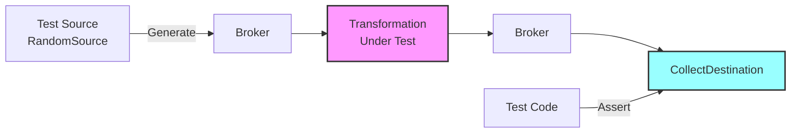

# COD3S Data Framework - Testing

**Version:** 1.0
**Date:** 2026-01-24
**Status:** Functional Specification

---

## Navigation

| Previous | Up | Next |
|----------|-----|------|
| [← 11-DEPLOYMENT](11-DEPLOYMENT.md) | [OVERVIEW](00-OVERVIEW.md) | [13-FUTURE-V2-V3 →](13-FUTURE-V2-V3.md) |

---

## Table of Contents

- [Testing Philosophy](#testing-philosophy)
- [Test Sources](#test-sources)
- [Record and Replay](#record-and-replay)
- [Assertions and Validation](#assertions-and-validation)
- [Integration Testing](#integration-testing)
- [Performance Testing](#performance-testing)
- [Test Patterns](#test-patterns)
- [Best Practices](#best-practices)

---

## Testing Philosophy

### Built-In Testability

COD3S Data is designed to be **easily testable** without external dependencies:

**Core Principles:**
1. **Synthetic Sources** - Generate test data (no external systems needed)
2. **In-Memory Collection** - Capture outputs for assertions
3. **Record/Replay** - Capture real data, replay in tests
4. **Deterministic Behavior** - Same input → same output (where applicable)
5. **Fast Feedback** - Unit tests run in milliseconds



---

## Test Sources

### RandomSource (Synthetic Data)

**Purpose:** Generate random values for testing

**Example:**
```python
import asyncio
from cod3s_data.config import PipelineConfig, SourceConfig, DestinationConfig
from cod3s_data.framework import Framework

async def test_random_source():
    config = PipelineConfig(
        name="random_test",
        sources=[
            SourceConfig(
                type="random",
                channel="test.random.temp",
                params={
                    "rate": 100,
                    "max_messages": 100,  # Finite BATCH mode
                    "min_value": 20.0,
                    "max_value": 100.0,
                },
            )
        ],
        destinations=[
            DestinationConfig(
                type="collect",
                channel_pattern="test.random.**",
                params={},
            )
        ],
    )

    async with Framework(config) as framework:
        await framework.run()

    # Access the collect destination
    collector = framework.destinations[0]
    messages = collector.get_all()
    assert len(messages) == 100
    assert all(20.0 <= m.value <= 100.0 for m in messages)
```

---

### SequenceSource (Deterministic Data)

**Purpose:** Generate predictable sequences

**Example:**
```python
SourceConfig(
    type="sequence",
    channel="test.sequence",
    params={
        "start_value": 1,
        "end_value": 101,
        "step_value": 1,
        "rate": 1000,
    },
)
# Expected output: 1, 2, 3, ..., 100
```

**Use Cases:**
- Test ordering preservation
- Test transformation logic
- Verify message counts

---

### TestSource (Custom Data)

> **Planned (V1.x):** A dedicated `TestSource` for injecting custom messages is not yet implemented. See [13-FUTURE](13-FUTURE-V2-V3.md).

**Current workaround:** Use `FileSource` with a temporary JSONL file, or create messages programmatically using the broker directly:

```python
from cod3s_data.broker.in_memory import InMemoryBroker
from cod3s_data.core.message import Message
from datetime import datetime, timezone

broker = InMemoryBroker()
await broker.start()

# Publish test messages directly
for value in [25.0, 50.0, 75.0]:
    msg = Message(
        key="temp",
        timestamp=datetime.now(timezone.utc),
        value=value,
    )
    await broker.publish("test.manual", msg)
```

**Use Cases:**
- Test edge cases (specific values)
- Test timestamp handling
- Test tag filtering

---

## Record and Replay

### Record Mode

**Purpose:** Capture real data for later replay

**Configuration:**
```yaml
# Record production data to file
destinations:
  - type: file
    channel: "sensors.**"
    path: "/test_data/recorded_messages.jsonl"
    format: "jsonl"
```

**Result:** JSONL file with captured messages

```json
{"key":"temp","timestamp":"2024-01-15T10:00:00Z","value":23.5,"tags":{"location":"warehouse_A"}}
{"key":"temp","timestamp":"2024-01-15T10:00:01Z","value":23.6,"tags":{"location":"warehouse_A"}}
```

---

### Replay Mode

**Purpose:** Replay recorded data in tests using `FileSource` (BATCH mode)

**Configuration:**
```yaml
# Replay recorded data (BATCH mode - processes all messages immediately)
sources:
  - type: file
    channel: "replay.sensors.temp"
    params:
      file_path: "/test_data/recorded_messages.jsonl"
```

> **Note:** TRANSPOSE mode (replay with original timing) is planned for V1.x. Currently, FileSource replays all messages as fast as possible in BATCH mode.

**Test Example:**
```python
import asyncio
from cod3s_data.config import PipelineConfig, SourceConfig, TransformConfig, DestinationConfig
from cod3s_data.framework import Framework

async def test_replay():
    config = PipelineConfig(
        name="replay_test",
        sources=[
            SourceConfig(
                type="file",
                channel="replay.sensors.temp",
                params={"file_path": "/test_data/recorded_messages.jsonl"},
            )
        ],
        transformations=[
            TransformConfig(
                type="filter",
                input_channels="replay.sensors.temp",
                output_channel="result",
                params={"predicate_code": "lambda msg: msg.value > 50"},
            )
        ],
        destinations=[
            DestinationConfig(type="collect", channel_pattern="result", params={})
        ],
    )

    async with Framework(config) as framework:
        await framework.run()

    collector = framework.destinations[0]
    messages = collector.get_all()
    assert len(messages) > 0
    assert all(m.value > 50 for m in messages)
```

---

## Assertions and Validation

### CollectDestination

**Purpose:** Capture messages for assertions

**API:**
```python
from cod3s_data.destinations.collect import CollectDestination

# When using the Framework with config, use type="collect":
DestinationConfig(type="collect", channel_pattern="test.output", params={})

# After framework.run(), access the collector:
collector = framework.destinations[0]  # CollectDestination instance

# Retrieve messages
messages = collector.get_all()

# Built-in assertions
collector.assert_count(100)          # Exact count
collector.assert_min_count(50)       # Minimum count

# Filter messages
filtered = collector.filter_by(key="temperature", sensor="TH001")

# Wait for messages (with timeout)
await collector.wait_for_messages(count=10, timeout=5.0)

# Reset
collector.clear()
```

---

### Assertion Helpers

**Count assertions:**
```python
# Exact count
assert len(messages) == 100

# Range
assert 90 <= len(messages) <= 110

# Non-empty
assert len(messages) > 0
```

**Value assertions:**
```python
# All values in range
assert all(20 <= m.value <= 100 for m in messages)

# Specific value
assert messages[0].value == 42

# Value type
assert all(isinstance(m.value, float) for m in messages)
```

**Tag assertions:**
```python
# Tag exists
assert all("location" in m.tags for m in messages)

# Tag value
assert messages[0].tags["location"] == "warehouse_A"

# Tag filtering
filtered = [m for m in messages if m.tags.get("priority") == "high"]
assert len(filtered) > 0
```

**Timestamp assertions:**
```python
# Chronological order
timestamps = [m.timestamp for m in messages]
assert timestamps == sorted(timestamps)

# Time range
from datetime import datetime, timezone
start = datetime(2024, 1, 15, 10, 0, 0, tzinfo=timezone.utc)
end = datetime(2024, 1, 15, 11, 0, 0, tzinfo=timezone.utc)
assert all(start <= m.timestamp <= end for m in messages)
```

---

## Integration Testing

### Full Pipeline Tests

**Example: Test filter pipeline using YAML-style config**

```python
import asyncio
import pytest
from cod3s_data.config import PipelineConfig, SourceConfig, TransformConfig, DestinationConfig
from cod3s_data.framework import Framework

@pytest.mark.asyncio
async def test_filter_pipeline():
    """Test that filter transformation drops values outside range"""

    config = PipelineConfig(
        name="filter_test",
        sources=[
            SourceConfig(
                type="sequence",
                channel="sensors.temp",
                params={"start_value": 0, "end_value": 200, "step_value": 10, "rate": 1000},
            )
        ],
        transformations=[
            TransformConfig(
                type="filter",
                input_channels="sensors.temp",
                output_channel="sensors.temp.clean",
                params={"predicate_code": "lambda msg: 20 <= msg.value <= 100"},
            )
        ],
        destinations=[
            DestinationConfig(type="collect", channel_pattern="sensors.temp.clean", params={}),
        ],
    )

    async with Framework(config) as framework:
        await framework.run()

    collector = framework.destinations[0]
    messages = collector.get_all()

    # Only values 20, 30, ..., 100 should pass
    assert len(messages) == 9
    assert all(20 <= m.value <= 100 for m in messages)
```

---

### Direct Component Tests

**Example: Test a transformation directly (without Framework)**

```python
import pytest
from cod3s_data.broker.in_memory import InMemoryBroker
from cod3s_data.core.message import Message
from cod3s_data.destinations.collect import CollectDestination
from cod3s_data.transformations.builtin import FilterTransform
from datetime import datetime, timezone

@pytest.mark.asyncio
async def test_filter_direct():
    """Test FilterTransform directly with broker"""

    broker = InMemoryBroker()
    await broker.start()

    # Set up filter
    filt = FilterTransform(
        broker=broker,
        input_channels="input",
        output_channel="output",
        predicate=lambda msg: msg.value > 50,
    )
    await filt.start()

    # Set up collector
    collector = CollectDestination(broker=broker, channel_pattern="output")
    await collector.start()

    # Publish test messages
    for v in [10, 60, 30, 80, 5, 99]:
        msg = Message(key="test", timestamp=datetime.now(timezone.utc), value=v)
        await broker.publish("input", msg)

    # Allow async processing
    await asyncio.sleep(0.1)

    # Assert: only values > 50 pass through
    messages = collector.get_all()
    assert len(messages) == 3
    assert [m.value for m in messages] == [60, 80, 99]

    await filt.stop()
    await collector.stop()
    await broker.stop()
```

---

## Performance Testing

### Throughput Test

**Example: Measure message throughput**

```python
import time
import asyncio
import pytest
from cod3s_data.config import PipelineConfig, SourceConfig, DestinationConfig
from cod3s_data.framework import Framework

@pytest.mark.asyncio
async def test_throughput():
    """Test that framework can handle high throughput"""

    config = PipelineConfig(
        name="perf_test",
        sources=[
            SourceConfig(
                type="random",
                channel="perf.test",
                params={"rate": 0, "max_messages": 10000},  # rate=0 → no delay
            )
        ],
        destinations=[
            DestinationConfig(type="collect", channel_pattern="perf.test", params={})
        ],
    )

    start = time.time()
    async with Framework(config) as framework:
        await framework.run()
    elapsed = time.time() - start

    collector = framework.destinations[0]
    messages = collector.get_all()
    throughput = len(messages) / elapsed

    assert len(messages) == 10000
    print(f"Throughput: {throughput:.0f} msg/s")
```

---

### Latency Test

**Example: Measure end-to-end latency**

```python
import asyncio
import pytest
from datetime import datetime, timezone
from cod3s_data.config import PipelineConfig, SourceConfig, DestinationConfig
from cod3s_data.framework import Framework

@pytest.mark.asyncio
async def test_latency():
    """Test end-to-end latency with sequence source"""

    config = PipelineConfig(
        name="latency_test",
        sources=[
            SourceConfig(
                type="sequence",
                channel="latency.test",
                params={"start_value": 0, "end_value": 1000, "rate": 0},
            )
        ],
        destinations=[
            DestinationConfig(type="collect", channel_pattern="latency.test", params={})
        ],
    )

    start = datetime.now(timezone.utc)
    async with Framework(config) as framework:
        await framework.run()
    end = datetime.now(timezone.utc)

    collector = framework.destinations[0]
    messages = collector.get_all()

    elapsed_ms = (end - start).total_seconds() * 1000
    avg_latency_ms = elapsed_ms / len(messages) if messages else 0

    assert len(messages) == 1000
    print(f"Average latency: {avg_latency_ms:.2f}ms per message")
```

---

## Test Patterns

### Pattern 1: Simple Transformation Test

```python
@pytest.mark.asyncio
async def test_filter_transformation():
    """Test temperature filter via pipeline config"""

    config = PipelineConfig(
        name="filter_test",
        sources=[
            SourceConfig(type="sequence", channel="input",
                         params={"start_value": 0, "end_value": 200, "step_value": 10, "rate": 1000})
        ],
        transformations=[
            TransformConfig(type="filter", input_channels="input", output_channel="output",
                            params={"predicate_code": "lambda msg: 20 <= msg.value <= 100"})
        ],
        destinations=[
            DestinationConfig(type="collect", channel_pattern="output", params={})
        ],
    )

    async with Framework(config) as fw:
        await fw.run()

    messages = fw.destinations[0].get_all()
    assert len(messages) == 9  # 20, 30, ..., 100
    assert all(20 <= m.value <= 100 for m in messages)
```

---

### Pattern 2: Configuration Validation Test

```python
import pytest
from pydantic import ValidationError
from cod3s_data.config import PipelineConfig
from cod3s_data.config.loaders import load_yaml

def test_invalid_configuration():
    """Test that invalid configuration is rejected"""

    with pytest.raises(FileNotFoundError):
        load_yaml("nonexistent.yaml")

    with pytest.raises(ValidationError):
        PipelineConfig(name="", sources=[], destinations=[])  # empty name
```

---

## Best Practices

### Unit Testing

**Do:**
- ✅ Test transformations in isolation
- ✅ Use TestSource or SequenceSource for predictable input
- ✅ Use CollectDestination for assertions
- ✅ Test edge cases (empty input, null values, extremes)
- ✅ Mock external dependencies

**Don't:**
- ❌ Test with real external systems (databases, MQTT brokers)
- ❌ Use REALTIME mode (use BATCH for deterministic tests)
- ❌ Skip error handling tests

---

### Integration Testing

**Do:**
- ✅ Test complete pipelines
- ✅ Use realistic data volumes
- ✅ Test failure scenarios (retry, DLQ)
- ✅ Validate metrics emission

**Don't:**
- ❌ Test with production data
- ❌ Run long-duration tests in CI

---

### Performance Testing

**Do:**
- ✅ Establish baselines
- ✅ Test under expected load
- ✅ Monitor resource usage (memory, CPU)
- ✅ Test throughput and latency separately

**Don't:**
- ❌ Run performance tests in parallel with other tests
- ❌ Use shared test environments

---

## Summary

**COD3S Data Testing** provides comprehensive testing capabilities:

1. **Test Sources:**
   - RandomSource (synthetic data)
   - SequenceSource (deterministic sequences)
   - TestSource (planned for V1.x - see [13-FUTURE](13-FUTURE-V2-V3.md))

2. **Record/Replay:**
   - Capture production data
   - Replay with TRANSPOSE mode
   - Time scaling for faster tests

3. **Assertions:**
   - CollectDestination for output capture
   - Rich assertion helpers
   - Count, value, tag, timestamp assertions

4. **Integration Testing:**
   - Full pipeline tests
   - Multi-component tests
   - Error handling tests

5. **Performance Testing:**
   - Throughput measurement
   - Latency measurement
   - Resource monitoring

**Next:** Explore [Future Roadmap](13-FUTURE-V2-V3.md) for planned features.

---

## Navigation

| Previous | Up | Next |
|----------|-----|------|
| [← 11-DEPLOYMENT](11-DEPLOYMENT.md) | [OVERVIEW](00-OVERVIEW.md) | [13-FUTURE-V2-V3 →](13-FUTURE-V2-V3.md) |

---

*This is a functional specification document. Implementation details will be defined in the technical specification phase.*
