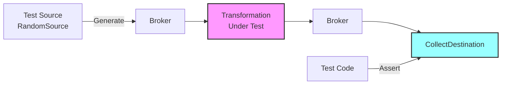

# COD3S Data Framework - Testing

**Version:** 1.0
**Date:** 2026-01-24
**Status:** Functional Specification

---

## Navigation

| Previous | Up | Next |
|----------|-----|------|
| [← 11-DEPLOYMENT](11-DEPLOYMENT.md) | [OVERVIEW](00-OVERVIEW.md) | [13-FUTURE-V2-V3 →](13-FUTURE-V2-V3.md) |

---

## Table of Contents

- [Testing Philosophy](#testing-philosophy)
- [Test Sources](#test-sources)
- [Record and Replay](#record-and-replay)
- [Assertions and Validation](#assertions-and-validation)
- [Integration Testing](#integration-testing)
- [Performance Testing](#performance-testing)
- [Test Patterns](#test-patterns)
- [Best Practices](#best-practices)

---

## Testing Philosophy

### Built-In Testability

COD3S Data is designed to be **easily testable** without external dependencies:

**Core Principles:**
1. **Synthetic Sources** - Generate test data (no external systems needed)
2. **In-Memory Collection** - Capture outputs for assertions
3. **Record/Replay** - Capture real data, replay in tests
4. **Deterministic Behavior** - Same input → same output (where applicable)
5. **Fast Feedback** - Unit tests run in milliseconds



---

## Test Sources

### RandomSource (Synthetic Data)

**Purpose:** Generate random values for testing

**Example:**
```python
from cod3s_data import Framework, RandomSource, CollectDestination

# Create test framework
framework = Framework()

# Random source
source = RandomSource(
    channel="test.random.temp",
    mode="BATCH",  # Run once and complete
    rate_per_second=100,
    duration_seconds=1,  # Generate for 1 second
    min_value=20.0,
    max_value=100.0
)
framework.add_source(source)

# Collector
collector = CollectDestination(channel="test.random.**")
framework.add_destination(collector)

# Run
framework.start_and_wait(timeout=5)

# Assert
messages = collector.get_messages()
assert len(messages) == 100  # 100 msg/s * 1s
assert all(20.0 <= m.value <= 100.0 for m in messages)
```

---

### SequenceSource (Deterministic Data)

**Purpose:** Generate predictable sequences

**Example:**
```python
from cod3s_data import SequenceSource

# Sequence source
source = SequenceSource(
    channel="test.sequence",
    mode="BATCH",
    start=1,
    stop=100,
    step=1
)

# Expected output: 1, 2, 3, ..., 100
```

**Use Cases:**
- Test ordering preservation
- Test transformation logic
- Test deduplication

---

### TestSource (Custom Data)

**Purpose:** Inject specific test messages

**API:**
```python
from cod3s_data import TestSource, Message

# Create test messages
messages = [
    Message(key="temp", timestamp="2024-01-15T10:00:00Z", value=25.0),
    Message(key="temp", timestamp="2024-01-15T10:00:01Z", value=50.0),
    Message(key="temp", timestamp="2024-01-15T10:00:02Z", value=75.0),
]

# Test source
source = TestSource(
    channel="test.manual",
    messages=messages,
    mode="BATCH"
)
```

**Use Cases:**
- Test edge cases (specific values)
- Test timestamp handling
- Test tag filtering

---

## Record and Replay

### Record Mode

**Purpose:** Capture real data for later replay

**Configuration:**
```yaml
# Record production data to file
destinations:
  - type: file
    channel: "sensors.**"
    path: "/test_data/recorded_messages.jsonl"
    format: "jsonl"
```

**Result:** JSONL file with captured messages

```json
{"key":"temp","timestamp":"2024-01-15T10:00:00Z","value":23.5,"tags":{"location":"warehouse_A"}}
{"key":"temp","timestamp":"2024-01-15T10:00:01Z","value":23.6,"tags":{"location":"warehouse_A"}}
```

---

### Replay Mode (TRANSPOSE)

**Purpose:** Replay recorded data in tests

**Configuration:**
```yaml
# Replay recorded data
sources:
  - type: file
    path: "/test_data/recorded_messages.jsonl"
    channel: "replay.sensors.temp"
    mode: TRANSPOSE  # Preserve original timestamps
    time_scale: 100  # Replay 100x faster (optional)
```

**Test Example:**
```python
from cod3s_data import Framework, FileSource, CollectDestination

framework = Framework()

# Replay source
source = FileSource(
    path="/test_data/recorded_messages.jsonl",
    channel="replay.sensors.temp",
    mode="TRANSPOSE",
    time_scale=100  # Speed up replay
)
framework.add_source(source)

# Add transformation under test
transform = MyTransformation(input="replay.sensors.temp", output="result")
framework.add_transformation(transform)

# Collect results
collector = CollectDestination(channel="result")
framework.add_destination(collector)

# Run
framework.start_and_wait()

# Assertions
messages = collector.get_messages()
assert len(messages) > 0
```

---

## Assertions and Validation

### CollectDestination

**Purpose:** Capture messages for assertions

**API:**
```python
from cod3s_data import CollectDestination

# Create collector
collector = CollectDestination(
    channel="test.output",
    max_messages=1000  # Prevent memory exhaustion
)

# Add to framework
framework.add_destination(collector)

# Run framework
framework.start_and_wait()

# Retrieve messages
messages = collector.get_messages()

# Assertions
assert len(messages) == expected_count
assert messages[0].key == "expected_key"
assert messages[0].value > 100
```

---

### Assertion Helpers

**Count assertions:**
```python
# Exact count
assert len(messages) == 100

# Range
assert 90 <= len(messages) <= 110

# Non-empty
assert len(messages) > 0
```

**Value assertions:**
```python
# All values in range
assert all(20 <= m.value <= 100 for m in messages)

# Specific value
assert messages[0].value == 42

# Value type
assert all(isinstance(m.value, float) for m in messages)
```

**Tag assertions:**
```python
# Tag exists
assert all("location" in m.tags for m in messages)

# Tag value
assert messages[0].tags["location"] == "warehouse_A"

# Tag filtering
filtered = [m for m in messages if m.tags.get("priority") == "high"]
assert len(filtered) > 0
```

**Timestamp assertions:**
```python
# Chronological order
timestamps = [m.timestamp for m in messages]
assert timestamps == sorted(timestamps)

# Time range
from datetime import datetime, timezone
start = datetime(2024, 1, 15, 10, 0, 0, tzinfo=timezone.utc)
end = datetime(2024, 1, 15, 11, 0, 0, tzinfo=timezone.utc)
assert all(start <= m.timestamp <= end for m in messages)
```

---

## Integration Testing

### Full Pipeline Tests

**Example: Test complete pipeline**

```python
import pytest
from cod3s_data import Framework
from cod3s_data.sources import RandomSource
from cod3s_data.transformations import ThresholdAlert
from cod3s_data.destinations import CollectDestination

def test_alert_pipeline():
    """Test that high temperatures trigger alerts"""

    # Setup
    framework = Framework()

    # Source: Random temperatures
    source = RandomSource(
        channel="sensors.temp",
        mode="BATCH",
        rate_per_second=100,
        duration_seconds=1,
        min_value=0.0,
        max_value=200.0
    )
    framework.add_source(source)

    # Transformation: Alert on temp > 100
    alert = ThresholdAlert(
        input_channel="sensors.temp",
        threshold=100,
        output_channel="alerts.high_temp",
        pass_through=True
    )
    framework.add_transformation(alert)

    # Collectors
    temp_collector = CollectDestination(channel="sensors.temp")
    alert_collector = CollectDestination(channel="alerts.high_temp")
    framework.add_destination(temp_collector)
    framework.add_destination(alert_collector)

    # Run
    framework.start_and_wait(timeout=10)

    # Assertions
    temp_messages = temp_collector.get_messages()
    alert_messages = alert_collector.get_messages()

    # All temperatures collected
    assert len(temp_messages) == 100

    # Only high temps triggered alerts
    high_temps = [m for m in temp_messages if m.value > 100]
    assert len(alert_messages) == len(high_temps)

    # Alert messages have correct severity
    assert all(m.tags.get("severity") == "critical" for m in alert_messages)
```

---

### Multi-Component Tests

**Example: Test stateful transformation**

```python
from cod3s_data import Framework, TestSource, Message, CollectDestination
from myapp.transforms import ViscosityComputer

def test_viscosity_computation():
    """Test multi-sensor viscosity computation"""

    framework = Framework()

    # Create test messages for 3 sensors
    temp_messages = [
        Message(key="temp", timestamp="2024-01-15T10:00:00Z", value=230),
        Message(key="temp", timestamp="2024-01-15T10:00:01Z", value=235),
    ]

    speed_messages = [
        Message(key="speed", timestamp="2024-01-15T10:00:00Z", value=45),
        Message(key="speed", timestamp="2024-01-15T10:00:01Z", value=50),
    ]

    force_messages = [
        Message(key="force", timestamp="2024-01-15T10:00:00Z", value=12),
        Message(key="force", timestamp="2024-01-15T10:00:01Z", value=15),
    ]

    # Test sources
    framework.add_source(TestSource("sensors.temp", temp_messages))
    framework.add_source(TestSource("sensors.speed", speed_messages))
    framework.add_source(TestSource("sensors.force", force_messages))

    # Transformation under test
    viscosity = ViscosityComputer(
        inputs=["sensors.temp", "sensors.speed", "sensors.force"],
        output="indicators.viscosity"
    )
    framework.add_transformation(viscosity)

    # Collector
    collector = CollectDestination(channel="indicators.viscosity")
    framework.add_destination(collector)

    # Run
    framework.start_and_wait()

    # Assertions
    results = collector.get_messages()
    assert len(results) == 2  # Two complete sets of sensor data
    assert all(r.key == "viscosity" for r in results)
    assert all(r.value > 0 for r in results)
```

---

## Performance Testing

### Throughput Test

**Example: Measure message throughput**

```python
import time
from cod3s_data import Framework, RandomSource, CollectDestination

def test_throughput():
    """Test that framework can handle 10,000 msg/s"""

    framework = Framework()

    # High-rate source
    source = RandomSource(
        channel="perf.test",
        mode="BATCH",
        rate_per_second=10000,
        duration_seconds=5  # 50,000 total messages
    )
    framework.add_source(source)

    # Collector
    collector = CollectDestination(channel="perf.test", max_messages=100000)
    framework.add_destination(collector)

    # Measure time
    start = time.time()
    framework.start_and_wait(timeout=30)
    elapsed = time.time() - start

    # Assertions
    messages = collector.get_messages()
    throughput = len(messages) / elapsed

    assert len(messages) >= 45000  # Allow 10% loss
    assert throughput >= 9000  # At least 9000 msg/s
    print(f"Throughput: {throughput:.0f} msg/s")
```

---

### Latency Test

**Example: Measure end-to-end latency**

```python
from cod3s_data import Framework, TestSource, Message, CollectDestination
from datetime import datetime, timezone

def test_latency():
    """Test end-to-end latency"""

    framework = Framework()

    # Create timestamped messages
    messages = [
        Message(
            key="latency_test",
            timestamp=datetime.now(timezone.utc).isoformat(),
            value=i
        )
        for i in range(1000)
    ]

    source = TestSource("latency.test", messages, mode="BATCH")
    framework.add_source(source)

    collector = CollectDestination(channel="latency.test")
    framework.add_destination(collector)

    # Run
    start = datetime.now(timezone.utc)
    framework.start_and_wait()
    end = datetime.now(timezone.utc)

    # Calculate latency
    elapsed_ms = (end - start).total_seconds() * 1000
    avg_latency_ms = elapsed_ms / len(messages)

    # Assertions
    assert avg_latency_ms < 5  # Average latency < 5ms
    print(f"Average latency: {avg_latency_ms:.2f}ms")
```

---

## Test Patterns

### Pattern 1: Simple Transformation Test

```python
def test_filter_transformation():
    """Test temperature filter"""

    framework = Framework()

    # Input: temperatures from 0 to 200
    source = SequenceSource(
        channel="input",
        start=0,
        stop=200,
        step=10
    )

    # Filter: keep only 20-100
    filter_transform = TemperatureFilter(
        input="input",
        output="output",
        min_value=20,
        max_value=100
    )

    collector = CollectDestination(channel="output")

    framework.add_source(source)
    framework.add_transformation(filter_transform)
    framework.add_destination(collector)

    framework.start_and_wait()

    # Assertions
    messages = collector.get_messages()
    assert len(messages) == 9  # 20, 30, ..., 100
    assert all(20 <= m.value <= 100 for m in messages)
```

---

### Pattern 2: Error Handling Test

```python
def test_transformation_error_handling():
    """Test that transformation errors are logged and sent to DLQ"""

    framework = Framework()

    # Create messages that will cause errors
    invalid_messages = [
        Message(key="test", value="invalid_number"),  # String instead of number
        Message(key="test", value=None),               # None value
    ]

    source = TestSource("input", invalid_messages)
    transform = NumericTransformation(input="input", output="output")
    dlq_collector = CollectDestination(channel="_dlq.**")

    framework.add_source(source)
    framework.add_transformation(transform)
    framework.add_destination(dlq_collector)

    framework.start_and_wait()

    # Assertions
    dlq_messages = dlq_collector.get_messages()
    assert len(dlq_messages) == 2  # Both invalid messages in DLQ
```

---

### Pattern 3: Configuration Validation Test

```python
def test_invalid_configuration():
    """Test that invalid configuration is rejected"""

    with pytest.raises(ConfigurationError):
        framework = Framework.from_yaml("invalid_pipeline.yaml")

    # Or test specific validation
    with pytest.raises(ValueError, match="buffer_size must be > 0"):
        dest = Destination(channel="test", buffer_size=0)
```

---

## Best Practices

### Unit Testing

**Do:**
- ✅ Test transformations in isolation
- ✅ Use TestSource or SequenceSource for predictable input
- ✅ Use CollectDestination for assertions
- ✅ Test edge cases (empty input, null values, extremes)
- ✅ Mock external dependencies

**Don't:**
- ❌ Test with real external systems (databases, MQTT brokers)
- ❌ Use REALTIME mode (use BATCH for deterministic tests)
- ❌ Skip error handling tests

---

### Integration Testing

**Do:**
- ✅ Test complete pipelines
- ✅ Use realistic data volumes
- ✅ Test failure scenarios (retry, DLQ)
- ✅ Validate metrics emission

**Don't:**
- ❌ Test with production data
- ❌ Run long-duration tests in CI

---

### Performance Testing

**Do:**
- ✅ Establish baselines
- ✅ Test under expected load
- ✅ Monitor resource usage (memory, CPU)
- ✅ Test throughput and latency separately

**Don't:**
- ❌ Run performance tests in parallel with other tests
- ❌ Use shared test environments

---

## Summary

**COD3S Data Testing** provides comprehensive testing capabilities:

1. **Test Sources:**
   - RandomSource (synthetic data)
   - SequenceSource (deterministic sequences)
   - TestSource (custom messages)

2. **Record/Replay:**
   - Capture production data
   - Replay with TRANSPOSE mode
   - Time scaling for faster tests

3. **Assertions:**
   - CollectDestination for output capture
   - Rich assertion helpers
   - Count, value, tag, timestamp assertions

4. **Integration Testing:**
   - Full pipeline tests
   - Multi-component tests
   - Error handling tests

5. **Performance Testing:**
   - Throughput measurement
   - Latency measurement
   - Resource monitoring

**Next:** Explore [Future Roadmap](13-FUTURE-V2-V3.md) for planned features.

---

## Navigation

| Previous | Up | Next |
|----------|-----|------|
| [← 11-DEPLOYMENT](11-DEPLOYMENT.md) | [OVERVIEW](00-OVERVIEW.md) | [13-FUTURE-V2-V3 →](13-FUTURE-V2-V3.md) |

---

*This is a functional specification document. Implementation details will be defined in the technical specification phase.*
