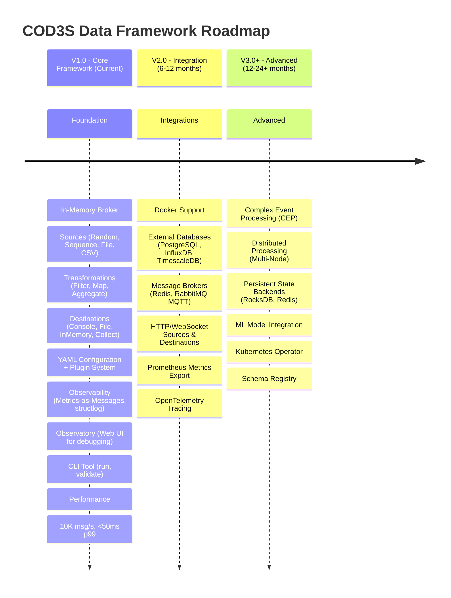

# COD3S Data Framework - Future Roadmap (V2.0 & V3.0+)

**Version:** 1.0
**Date:** 2026-01-24
**Status:** Functional Specification (Forward-Looking)

---

## Navigation

| Previous | Up | Next |
|----------|-----|------|
| [← 12-TESTING](12-TESTING.md) | [OVERVIEW](00-OVERVIEW.md) | [99-GLOSSARY →](99-GLOSSARY.md) |

---

## Table of Contents

- [Roadmap Overview](#roadmap-overview)
- [V2.0 - Integration](#v20---integration)
- [V3.0+ - Advanced Features](#v30---advanced-features)
- [Community Feedback Integration](#community-feedback-integration)

---

## Roadmap Overview

### Version Strategy

COD3S Data follows a **phased release strategy** with clear boundaries between versions:



---

### Guiding Principles

**V1.0 → V2.0 → V3.0+ Evolution:**

1. **Backward Compatibility** - V2.0 configurations work in V3.0
2. **Incremental Adoption** - Use new features without rewriting pipelines
3. **No Breaking Changes** - Deprecate gracefully (at least 1 major version notice)
4. **Community-Driven** - V1.0 feedback shapes V2.0/V3.0 priorities

---

## V1.x - Planned Enhancements

Features described in the V1.0 specification but not yet implemented. These will be added in minor releases (V1.1, V1.2, etc.):

### Sources
| Feature | Description | Spec Reference |
|---------|-------------|----------------|
| **TRANSPOSE mode** | Replay historical data with timestamp-based delays and time scaling | [04-SOURCES](04-SOURCES.md#transpose-mode) |
| **TestSource** | Inject custom test messages (for testing pipelines) | [12-TESTING](12-TESTING.md) |
| **Dynamic channel names** | Template-based channel names from message data (e.g., `sensors.{location}.temp`) | [04-SOURCES](04-SOURCES.md#dynamic-channel-names) |
| **Source progress monitoring** | Detailed `SourceStatus` with progress %, ETA, error info | [04-SOURCES](04-SOURCES.md) |

### Transformations
| Feature | Description | Spec Reference |
|---------|-------------|----------------|
| **DeduplicationTransform** | Remove duplicate messages (key+timestamp, message_id strategies) | [03-MESSAGES](03-MESSAGES.md#deduplication-transformation) |
| **ThresholdAlert** | Alert on threshold exceeded (pass-through + alert) | [05-TRANSFORMATIONS](05-TRANSFORMATIONS.md) |
| **UnitConversion** | Convert measurement units (Fahrenheit→Celsius, etc.) | [05-TRANSFORMATIONS](05-TRANSFORMATIONS.md) |
| **Sampler** | Downsample data (keep 1 in N) | [05-TRANSFORMATIONS](05-TRANSFORMATIONS.md) |
| **RateLimiter** | Throttle message rate | [05-TRANSFORMATIONS](05-TRANSFORMATIONS.md) |

### Messages & Broker
| Feature | Description | Spec Reference |
|---------|-------------|----------------|
| **Out-of-order strict mode** | Reject messages with timestamps older than latest seen | [03-MESSAGES](03-MESSAGES.md#strict-mode-reject-out-of-order) |
| **DLQ metadata enrichment** | Add original channel, failure reason, retry count to DLQ messages | [03-MESSAGES](03-MESSAGES.md#dlq-message-structure) |
| **Tag filtering with OR logic** | Allow list of values for same tag key (OR semantics) | [03-MESSAGES](03-MESSAGES.md#tags-metadata) |

---

## V2.0 - Integration

**Focus:** Industry-standard integrations and containerization

**Timeline:** 6-12 months after V1.0 release

**Themes:**
- External system integrations (databases, message brokers, protocols)
- Docker and orchestration support
- Advanced observability (Prometheus, OpenTelemetry)
- Improved developer experience

---

### Docker and Containerization

**Official Docker Images:**
```bash
# Pre-built images on Docker Hub
docker pull cod3s/cod3s-data:2.0.0

# Variants
cod3s/cod3s-data:2.0.0              # Full (Debian-based)
cod3s/cod3s-data:2.0.0-alpine       # Lightweight (Alpine-based)
cod3s/cod3s-data:2.0.0-slim         # Minimal dependencies
```

**Docker Compose Templates:**
```yaml
version: '3.8'

services:
  cod3s-data:
    image: cod3s/cod3s-data:2.0.0
    volumes:
      - ./config:/config
    environment:
      - COD3S_CONFIG=/config/pipeline.yaml
      - DATABASE_URL=${DATABASE_URL}
    depends_on:
      - postgres
      - redis

  postgres:
    image: postgres:15
    # ...

  redis:
    image: redis:7-alpine
    # ...
```

**Kubernetes Deployment:**
```yaml
apiVersion: apps/v1
kind: Deployment
metadata:
  name: cod3s-data
spec:
  replicas: 3
  selector:
    matchLabels:
      app: cod3s-data
  template:
    metadata:
      labels:
        app: cod3s-data
    spec:
      containers:
      - name: cod3s-data
        image: cod3s/cod3s-data:2.0.0
        env:
        - name: COD3S_CONFIG
          value: /config/pipeline.yaml
        - name: DATABASE_URL
          valueFrom:
            secretKeyRef:
              name: cod3s-secrets
              key: database-url
        volumeMounts:
        - name: config
          mountPath: /config
```

---

### External Databases

**PostgreSQL Support:**
```yaml
destinations:
  - type: postgresql
    connection_string: "${POSTGRES_URL}"
    table: "sensor_data"
    channel: "sensors.**"

    # Table auto-creation
    auto_create_table: true
    schema:
      timestamp: "timestamptz PRIMARY KEY"
      key: "varchar(255)"
      value: "jsonb"
      tags: "jsonb"

    # Batch insertion
    batch_size: 1000
    flush_interval: 5s
```

**InfluxDB Support (Time Series):**
```yaml
destinations:
  - type: influxdb
    url: "${INFLUX_URL}"
    token: "${INFLUX_TOKEN}"
    org: "my-org"
    bucket: "sensor-data"
    channel: "sensors.**"

    # Measurement configuration
    measurement_field: "key"  # Use message.key as measurement name
    timestamp_precision: "ns"

    # Retention policy
    retention_period: "30d"
```

**TimescaleDB Support:**
```yaml
destinations:
  - type: timescaledb
    connection_string: "${TIMESCALE_URL}"
    table: "sensor_metrics"
    channel: "sensors.**"

    # Hypertable configuration
    time_column: "timestamp"
    chunk_time_interval: "1 day"
    compression_enabled: true
```

---

### Message Brokers

**Redis Streams:**
```yaml
broker:
  type: redis
  connection:
    host: "localhost"
    port: 6379
    password: "${REDIS_PASSWORD}"
    db: 0

  # Stream configuration
  max_len: 10000  # Trim streams to 10K messages
  approximate: true

sources:
  - type: redis_stream
    stream: "sensor_stream"
    channel: "sensors.{field}"
    consumer_group: "cod3s_processors"
```

**RabbitMQ Support:**
```yaml
broker:
  type: rabbitmq
  connection:
    host: "localhost"
    port: 5672
    username: "${RABBITMQ_USER}"
    password: "${RABBITMQ_PASS}"
    vhost: "/"

  # Exchange configuration
  exchange: "cod3s_exchange"
  exchange_type: "topic"

sources:
  - type: rabbitmq
    queue: "sensor_queue"
    routing_key: "sensors.#"
    channel: "sensors.{routing_key}"
```

**MQTT Support:**
```yaml
sources:
  - type: mqtt
    broker: "mqtt://localhost:1883"
    username: "${MQTT_USER}"
    password: "${MQTT_PASS}"
    topics:
      - "sensors/+/temperature"
      - "sensors/+/pressure"
    channel: "sensors.{topic[1]}.{topic[2]}"
    qos: 1

destinations:
  - type: mqtt
    broker: "mqtt://localhost:1883"
    topic: "alerts/{severity}"
    channel: "alerts.**"
    qos: 2
    retain: false
```

---

### HTTP and WebSocket

**HTTP Source (Polling):**
```yaml
sources:
  - type: http
    url: "https://api.example.com/sensors"
    method: "GET"
    headers:
      Authorization: "Bearer ${API_TOKEN}"
    polling_interval: 10s
    channel: "api.sensors"
```

**HTTP Destination (POST):**
```yaml
destinations:
  - type: http
    url: "https://webhook.example.com/data"
    method: "POST"
    headers:
      Content-Type: "application/json"
    channel: "sensors.**"
    batch_size: 100
```

**WebSocket Source:**
```yaml
sources:
  - type: websocket
    url: "wss://stream.example.com/sensors"
    channel: "live.sensors"
```

**WebSocket Destination:**
```yaml
destinations:
  - type: websocket
    url: "ws://dashboard:8080/metrics"
    channel: "_metrics.broker.**"
```

---

### Advanced Observability

**Prometheus Metrics Export:**
```yaml
observability:
  metrics:
    prometheus:
      enabled: true
      port: 9090
      path: "/metrics"

# Exposes Prometheus-compatible metrics:
# cod3s_broker_throughput_total
# cod3s_broker_latency_seconds
# cod3s_destination_buffer_depth
# cod3s_transformation_processing_seconds
```

**OpenTelemetry Tracing:**
```yaml
observability:
  tracing:
    opentelemetry:
      enabled: true
      endpoint: "http://jaeger:14268/api/traces"
      service_name: "cod3s-data"
      sample_rate: 0.1  # 10% sampling

# Traces include:
# - Message lifecycle (source → broker → transform → destination)
# - Transformation processing time
# - Destination write latency
```

**Grafana Dashboards:**
- Pre-built Grafana dashboard templates
- Visualize throughput, latency, buffer depth
- Alert templates for common issues

---

### Improved Developer Experience

**HTTP API (Management):**
```yaml
api:
  http:
    enabled: true
    port: 8080
    auth:
      type: "token"
      token: "${API_TOKEN}"

# Endpoints:
# GET  /health                 - Health check
# GET  /metrics                - Metrics snapshot
# GET  /channels               - List active channels
# GET  /sources                - List sources
# POST /sources/{id}/pause     - Pause source
# POST /sources/{id}/resume    - Resume source
# GET  /transformations        - List transformations
# GET  /destinations           - List destinations
```

**Configuration Hot Reload:**
```yaml
# Watch configuration file for changes
cod3s-data serve --config pipeline.yaml --watch

# Reload on SIGHUP
kill -HUP <cod3s-pid>
```

**Schema Validation:**
```bash
# JSON Schema for YAML configuration
cod3s-data schema --output pipeline.schema.json

# Validate configuration
cod3s-data validate --config pipeline.yaml --schema pipeline.schema.json
```

---

## V3.0+ - Advanced Features

**Focus:** Advanced processing and distributed deployment

**Timeline:** 12-24+ months after V1.0 release (depends on V1.0/V2.0 adoption)

**Themes:**
- Complex event processing
- Distributed processing (multi-node)
- Persistent state backends
- ML integration
- Cloud-native deployment

**Note:** V3.0+ features are **ideas subject to change** based on V1.0/V2.0 feedback.

---

### Complex Event Processing (CEP)

**Pattern Detection:**
```yaml
transformations:
  - type: cep_pattern
    name: "temperature_spike_detector"
    inputs:
      - "sensors.*.temperature"
    pattern: |
      PATTERN (
        A as A.value > 100
        FOLLOWED BY
        B as B.value > 120
        WITHIN 60 seconds
      )
    output: "events.temperature_spike"
```

**Event Aggregation:**
```yaml
transformations:
  - type: cep_aggregate
    inputs:
      - "sensors.**.temperature"
    window: "5 minutes"
    groupby: "tags.location"
    aggregations:
      - "avg(value) as avg_temp"
      - "max(value) as max_temp"
      - "count(*) as reading_count"
    output: "aggregates.temperature_by_location"
```

**Event Correlation:**
```yaml
transformations:
  - type: cep_correlate
    inputs:
      - "sensors.*.temperature"
      - "sensors.*.vibration"
    correlation:
      match_by: "tags.machine_id"
      within: "10 seconds"
    condition: "temperature.value > 100 AND vibration.value > 5"
    output: "events.overheating_with_vibration"
```

---

### Distributed Processing

**Multi-Node Broker:**
```yaml
broker:
  type: "distributed"
  coordination:
    type: "etcd"  # or "consul", "zookeeper"
    endpoints:
      - "etcd1:2379"
      - "etcd2:2379"
      - "etcd3:2379"

  # Node configuration
  node_id: "node-1"
  cluster_name: "cod3s-cluster"

  # Partition strategy
  partitioning:
    strategy: "hash"  # or "range", "custom"
    partition_count: 16
    replication_factor: 3
```

**Distributed State:**
```yaml
transformations:
  - type: stateful_distributed
    name: "global_aggregator"
    inputs:
      - "sensors.**"
    output: "aggregates.**"

    # State backend
    state_backend:
      type: "redis"
      connection: "${REDIS_CLUSTER_URL}"
      persistence: true
      ttl: 3600
```

**Load Balancing:**
```yaml
# Automatic partition assignment
# Round-robin across nodes
# Fault tolerance (partition reassignment on node failure)
```

---

### Persistent State Backends

**RocksDB (Embedded):**
```yaml
transformations:
  - type: stateful_aggregator
    state_backend:
      type: "rocksdb"
      path: "/var/lib/cod3s/state/aggregator"
      checkpoint_interval: "60s"
      ttl: 86400  # 24 hours
```

**Redis (Distributed):**
```yaml
transformations:
  - type: deduplication
    state_backend:
      type: "redis"
      connection: "${REDIS_URL}"
      key_prefix: "cod3s:dedup:"
      ttl: 3600
```

**PostgreSQL (Durable):**
```yaml
transformations:
  - type: custom_stateful
    state_backend:
      type: "postgresql"
      connection: "${POSTGRES_URL}"
      table: "transformation_state"
      snapshot_interval: "300s"
```

---

### ML Model Integration

**Model Inference:**
```yaml
transformations:
  - type: ml_inference
    name: "anomaly_detector"
    input: "sensors.**.temperature"
    output: "predictions.anomaly"

    # Model configuration
    model:
      type: "onnx"  # or "tensorflow", "pytorch", "sklearn"
      path: "/models/anomaly_detector.onnx"
      preprocessing:
        - "normalize"
        - "rolling_window:10"
      postprocessing:
        - "threshold:0.8"
```

**Online Learning:**
```yaml
transformations:
  - type: ml_online_learning
    input: "sensors.**.temperature"
    output: "predictions.forecast"

    model:
      type: "river"  # Online ML library
      algorithm: "HoeffdingTree"
      features: ["value", "tags.location", "hour_of_day"]
      target: "value"
      retrain_interval: "1000 samples"
```

**Feature Store Integration:**
```yaml
transformations:
  - type: feature_enrichment
    input: "sensors.temp"
    output: "features.enriched"

    feature_store:
      type: "feast"
      repository: "${FEAST_REPO}"
      features:
        - "sensor_metadata"
        - "historical_stats"
```

---

### Kubernetes Operator

**Custom Resource Definition (CRD):**
```yaml
apiVersion: cod3s.io/v1
kind: Pipeline
metadata:
  name: sensor-processing
spec:
  sources:
    - type: mqtt
      broker: "mqtt://mosquitto:1883"
      topics:
        - "sensors/#"
      channel: "sensors.{topic}"

  transformations:
    - type: threshold_alert
      input: "sensors.*.temperature"
      threshold: 100
      output: "alerts.critical"

  destinations:
    - type: postgresql
      connection:
        secretRef:
          name: postgres-credentials
      table: "sensor_data"
      channel: "sensors.**"

  # Scaling configuration
  scaling:
    minReplicas: 2
    maxReplicas: 10
    targetCPUUtilization: 70
    targetThroughput: 5000  # msg/s per replica
```

**Operator Features:**
- Declarative pipeline management
- Auto-scaling based on metrics
- Rolling updates with zero downtime
- Health checks and self-healing
- Resource management (CPU, memory limits)

---

### Schema Registry

**Message Schema Evolution:**
```yaml
sources:
  - type: kafka
    topic: "sensors"
    channel: "sensors.{key}"

    # Schema registry
    schema_registry:
      url: "${SCHEMA_REGISTRY_URL}"
      auto_register: true
      compatibility: "BACKWARD"

destinations:
  - type: kafka
    topic: "processed"
    channel: "processed.**"

    schema_registry:
      url: "${SCHEMA_REGISTRY_URL}"
      validate: true
```

**Schema Validation:**
```yaml
transformations:
  - type: schema_validator
    input: "sensors.**"
    output: "validated.sensors"
    dlq: "_dlq.invalid_schema"

    schema:
      type: "avro"  # or "protobuf", "json-schema"
      definition: |
        {
          "type": "record",
          "fields": [
            {"name": "key", "type": "string"},
            {"name": "value", "type": "double"},
            {"name": "timestamp", "type": "string"}
          ]
        }
```

---

## Community Feedback Integration

### Feedback Channels

**How to influence the roadmap:**

1. **GitHub Discussions** - Propose features, discuss ideas
2. **GitHub Issues** - Report bugs, request enhancements
3. **User Surveys** - Periodic surveys for prioritization
4. **Community Calls** - Monthly video calls with maintainers
5. **Case Studies** - Share your use cases

---

### Decision Criteria

**How features are prioritized for V2.0/V3.0:**

1. **User Demand** - Requested by multiple users
2. **Use Case Impact** - Enables new use cases or significantly improves existing ones
3. **Ecosystem Fit** - Integrates with industry-standard tools
4. **Complexity** - Implementation effort vs. value
5. **Maintenance** - Long-term support burden

---

### Deprecation Policy

**When features are deprecated:**

1. **Announcement** - At least 1 major version in advance
2. **Deprecation Warnings** - Logged when deprecated features used
3. **Migration Guide** - Clear documentation for alternatives
4. **Removal** - Earliest 1 major version after deprecation

**Example Timeline:**
```
V2.0: Feature X announced as deprecated (warnings added)
V2.1, V2.2, ...: Feature X still works (warnings continue)
V3.0: Feature X removed (migration guide provided)
```

---

## Summary

**COD3S Data Future Roadmap:**

### V2.0 - Integration (6-12 months)
- Docker and Kubernetes support
- External databases (PostgreSQL, InfluxDB, TimescaleDB)
- Message brokers (Redis, RabbitMQ, MQTT)
- HTTP/WebSocket sources and destinations
- Prometheus and OpenTelemetry integrations
- HTTP management API
- Configuration hot reload

### V3.0+ - Advanced (12-24+ months)
- Complex Event Processing (CEP)
- Distributed multi-node processing
- Persistent state backends (RocksDB, Redis, PostgreSQL)
- ML model integration (inference, online learning)
- Kubernetes Operator
- Schema registry and evolution

### Community-Driven
- GitHub discussions and issues
- User surveys and community calls
- Clear deprecation policy
- Backward compatibility commitment

**Next:** See [Glossary](99-GLOSSARY.md) for comprehensive terminology reference.

---

## Navigation

| Previous | Up | Next |
|----------|-----|------|
| [← 12-TESTING](12-TESTING.md) | [OVERVIEW](00-OVERVIEW.md) | [99-GLOSSARY →](99-GLOSSARY.md) |

---

*This is a functional specification document describing future plans. Features and timelines are subject to change based on community feedback and adoption.*
