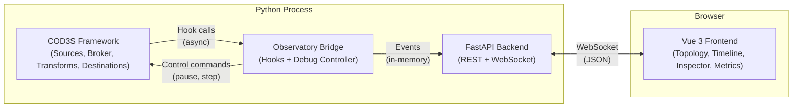
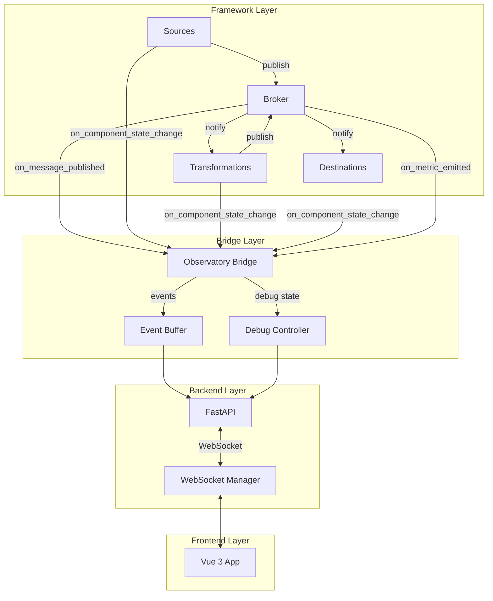
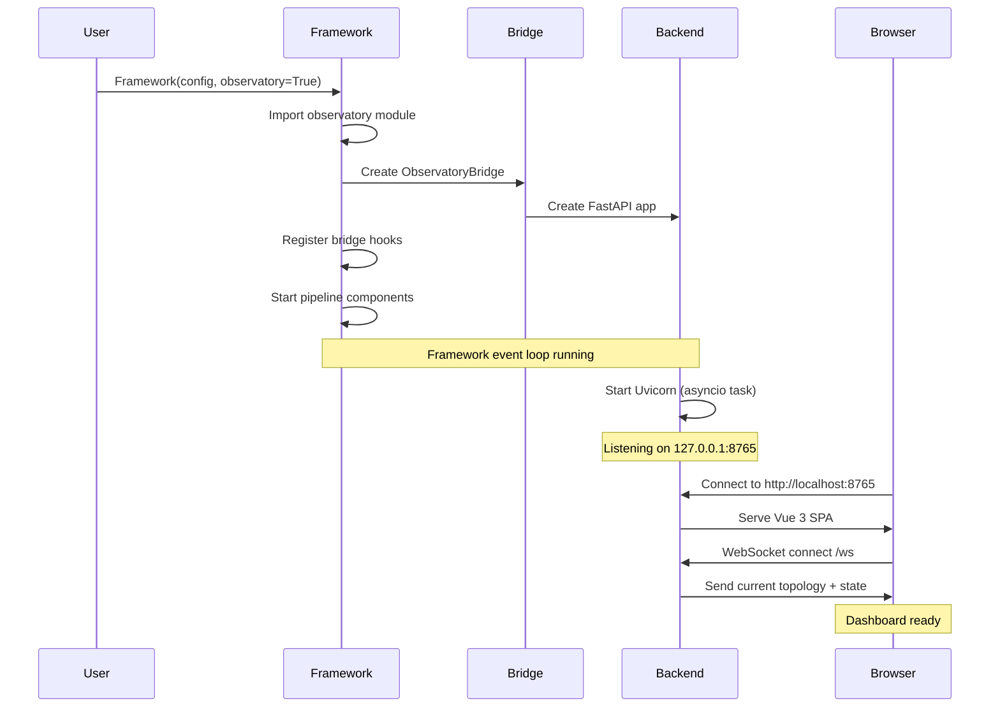
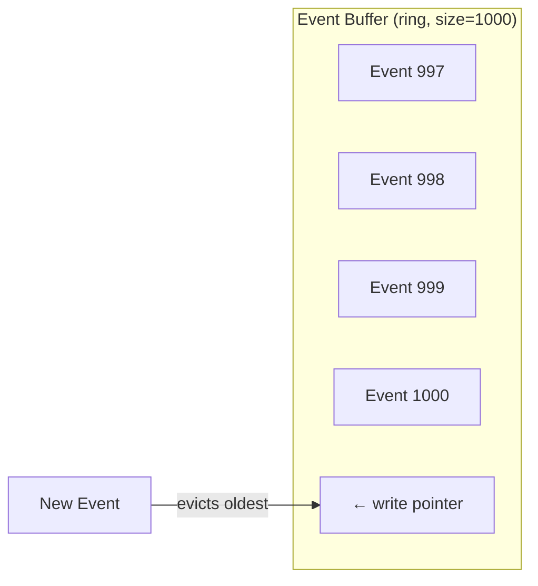
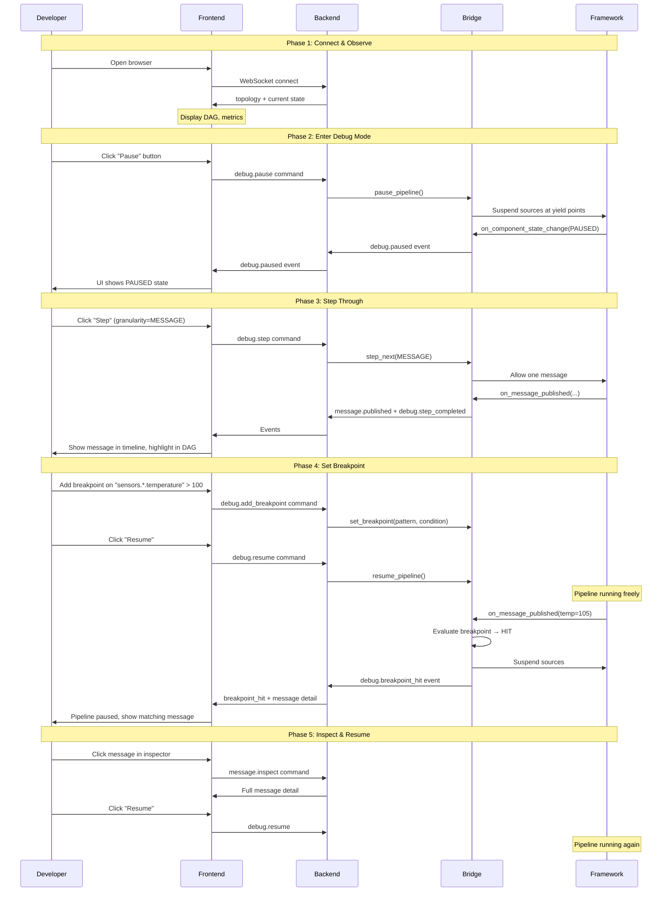

# COD3S Observatory - Architecture

**Version:** 1.0
**Date:** 2026-02-11
**Status:** Functional Specification

---

## Navigation

| Previous | Up | Next |
|----------|-----|------|
| [← OBS-00-OVERVIEW](OBS-00-OVERVIEW.md) | [OBS-00-OVERVIEW](OBS-00-OVERVIEW.md) | [OBS-02-BRIDGE →](OBS-02-BRIDGE.md) |

---

## Table of Contents

- [High-Level Architecture](#high-level-architecture)
- [Optional Module Pattern](#optional-module-pattern)
- [Activation](#activation)
- [Embedded Server](#embedded-server)
- [Memory Model](#memory-model)
- [Debug Session Lifecycle](#debug-session-lifecycle)
- [Performance Impact](#performance-impact)

---

## High-Level Architecture

The Observatory is composed of four layers connected linearly:



### Layer Responsibilities

| Layer | Technology | Responsibility |
|-------|-----------|---------------|
| **Framework** | Python / asyncio | Execute pipeline, call bridge hooks when present |
| **Bridge** | Python | Translate framework events to observatory events, manage debug state |
| **Backend** | FastAPI / Uvicorn | Serve REST API, manage WebSocket connections, serve static frontend |
| **Frontend** | Vue 3 / Vuetify 3 | Visualize topology, timeline, messages, metrics; send debug commands |

### Data Flow



---

## Optional Module Pattern

### Design Principle

The Observatory is **fully optional**. The framework must:
1. Function identically without Observatory installed
2. Have **zero performance overhead** when Observatory is not active
3. Never import `observatory` package directly from core code

### Import Guard Pattern

The framework uses an import guard to check for Observatory availability:

```python
# In framework.py — NOT: from cod3s_data.observatory import ...
# Instead: conditional check at startup

class Framework:
    def __init__(self, config, observatory: bool = False):
        self._bridge: ObservatoryBridge | None = None

        if observatory:
            try:
                from cod3s_data.observatory import create_observatory
                self._bridge = create_observatory(self, config)
            except ImportError:
                raise ImportError(
                    "Observatory requires extra dependencies. "
                    "Install with: pip install cod3s-data[observatory]"
                )
```

### Hook Pattern

Throughout the framework, bridge hooks are guarded by a None check:

```python
# In broker — zero cost when bridge is None
async def publish(self, channel: str, message: Message) -> int:
    # ... normal publish logic ...
    subscriber_count = await self._notify_subscribers(channel, message)

    if self._bridge is not None:
        await self._bridge.on_message_published(channel, message, subscriber_count)

    return subscriber_count
```

**Performance:** A `None` check is ~1 nanosecond — negligible even at 10K msg/s.

### Package Dependencies

```toml
# pyproject.toml
[project.optional-dependencies]
observatory = [
    "fastapi>=0.115",
    "uvicorn>=0.34",
    "websockets>=14.0",
]
```

The frontend is pre-built and bundled as static files — no Node.js dependency for end users.

---

## Activation

### Method 1: Python API

```python
from cod3s_data import Framework

# Enable with defaults
framework = Framework(config, observatory=True)

# Enable with custom configuration
from cod3s_data.observatory import ObservatoryConfig

obs_config = ObservatoryConfig(
    host="127.0.0.1",
    port=8765,
    debug=True,
    buffer_size=2000,
    memory_limit_mb=100,
)
framework = Framework(config, observatory=obs_config)
```

### Method 2: YAML Configuration

```yaml
# pipeline.yaml
sources:
  # ... sources ...

observatory:
  enabled: true
  host: "127.0.0.1"
  port: 8765
  debug: false
  buffer_size: 1000
  memory_limit_mb: 50
```

### Method 3: Environment Variables

```bash
export COD3S_OBSERVATORY_ENABLED=true
export COD3S_OBSERVATORY_PORT=8765
```

### Activation Sequence



---

## Embedded Server

### Uvicorn Integration

The Observatory web server runs **inside** the framework's asyncio event loop as a background task:

```python
# Conceptual — see OBS-TECH-01 for implementation details
import uvicorn

config = uvicorn.Config(app=fastapi_app, host="127.0.0.1", port=8765, loop="none")
server = uvicorn.Server(config)

# Run as asyncio task in the existing event loop
asyncio.create_task(server.serve())
```

**Key:** `loop="none"` tells Uvicorn to use the **existing** event loop instead of creating its own.

### Lifecycle

| Event | Observatory Action |
|-------|-------------------|
| Framework startup | Create bridge, start Uvicorn task |
| Framework running | Bridge hooks fire on framework events |
| Framework shutdown | Graceful Uvicorn shutdown, close WebSocket connections |
| Framework error | Bridge captures error event, frontend shows alert |

### Port Binding

- **Default:** `127.0.0.1:8765` (localhost only)
- **Configurable:** Host and port via configuration
- **Conflict handling:** If port is busy, log warning and continue without Observatory
- **Security (V1):** Localhost-only binding. Remote access deferred to V2 (requires auth).

---

## Memory Model

### Ring Buffers

The Observatory stores events in fixed-size ring buffers. When a buffer is full, the oldest event is evicted.



### Buffer Types

| Buffer | Default Size | Content | Purpose |
|--------|-------------|---------|---------|
| **Message events** | 1000 | Published messages (summary) | Timeline, topology animation |
| **Component states** | 100 per component | State transitions | Topology node colors |
| **Metric snapshots** | 300 per metric | Metric values (1/s × 5min) | Dashboard charts |
| **Error events** | 200 | Errors with context | Error panel |
| **Debug events** | 500 | Breakpoint hits, step events | Debug history |

### Memory Cap

- **Default limit:** 50 MB total Observatory memory usage
- **Enforcement:** Periodic check, oldest events evicted if over limit
- **Configurable:** `memory_limit_mb` in configuration
- **Excluded from limit:** Frontend static files (served once, cached by browser)

### Late-Connecting Frontends

When a new browser connects, it receives:
1. Current pipeline topology (sources, transforms, destinations, channels)
2. Current component states (running, paused, error)
3. Recent events from buffers (fills timeline and message list)
4. Current metric values (populates dashboard)
5. Current debug state (mode, granularity, breakpoints)

This allows a browser to connect at any time and immediately see a meaningful view.

---

## Debug Session Lifecycle

### Complete Session Sequence



---

## Performance Impact

### When Observatory is Not Installed

| Metric | Impact |
|--------|--------|
| CPU | 0% (no code loaded) |
| Memory | 0 bytes (no imports) |
| Latency | 0 ns (no hook checks) |
| Startup | 0 ms |

### When Observatory is Installed but Not Enabled

| Metric | Impact |
|--------|--------|
| CPU | 0% |
| Memory | ~0 (module loaded but bridge is None) |
| Latency per message | ~1 ns (`if self._bridge is not None` check) |
| Startup | ~0 ms |

### When Observatory is Active (No Debug)

| Metric | Impact |
|--------|--------|
| CPU | 1-3% (hook processing, WebSocket) |
| Memory | 10-50 MB (event buffers, FastAPI, static files) |
| Latency per message | 5-20 us (hook call, buffer write) |
| Startup | ~200 ms (Uvicorn, FastAPI) |

### When Observatory is Active (Debug Mode)

| Metric | Impact |
|--------|--------|
| CPU | 5-15% (breakpoint evaluation, debug controller) |
| Memory | 10-50 MB (same buffers) |
| Latency per message | 50-500 us (breakpoint eval, pause checks) |
| Note | Debug mode is not for production use |

### Sampling

For high-throughput pipelines, the bridge supports sampling to reduce overhead:
- **Every-Nth**: Process every Nth message (e.g., every 10th)
- **Time-based**: Process at most one message per time window (e.g., every 100ms)
- **Bypass**: Breakpoint evaluation always runs (no sampling) to avoid missing conditions

See: [OBS-02-BRIDGE](OBS-02-BRIDGE.md#sampling-and-throttling) for details.

---

## Summary

The Observatory architecture is designed around four principles:

1. **Zero overhead when absent** — Import guard pattern ensures no cost when not installed
2. **Minimal overhead when present** — In-process integration avoids serialization overhead
3. **Bidirectional communication** — Bridge enables both observation and control
4. **Memory-bounded** — Ring buffers with configurable caps prevent unbounded growth

**Next:** [OBS-02-BRIDGE](OBS-02-BRIDGE.md) defines the critical Bridge interface between framework and observatory.

---

## Navigation

| Previous | Up | Next |
|----------|-----|------|
| [← OBS-00-OVERVIEW](OBS-00-OVERVIEW.md) | [OBS-00-OVERVIEW](OBS-00-OVERVIEW.md) | [OBS-02-BRIDGE →](OBS-02-BRIDGE.md) |

---

*This is a functional specification document for the COD3S Observatory module. Technical implementation details are in [OBS-TECH-01-BACKEND-ARCHITECTURE](../../TECHNICAL_SPECIFICATION/OBSERVATORY/OBS-TECH-01-BACKEND-ARCHITECTURE.md).*
