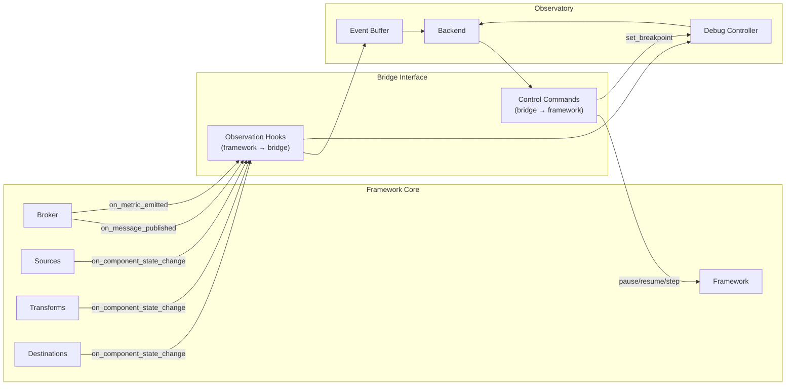
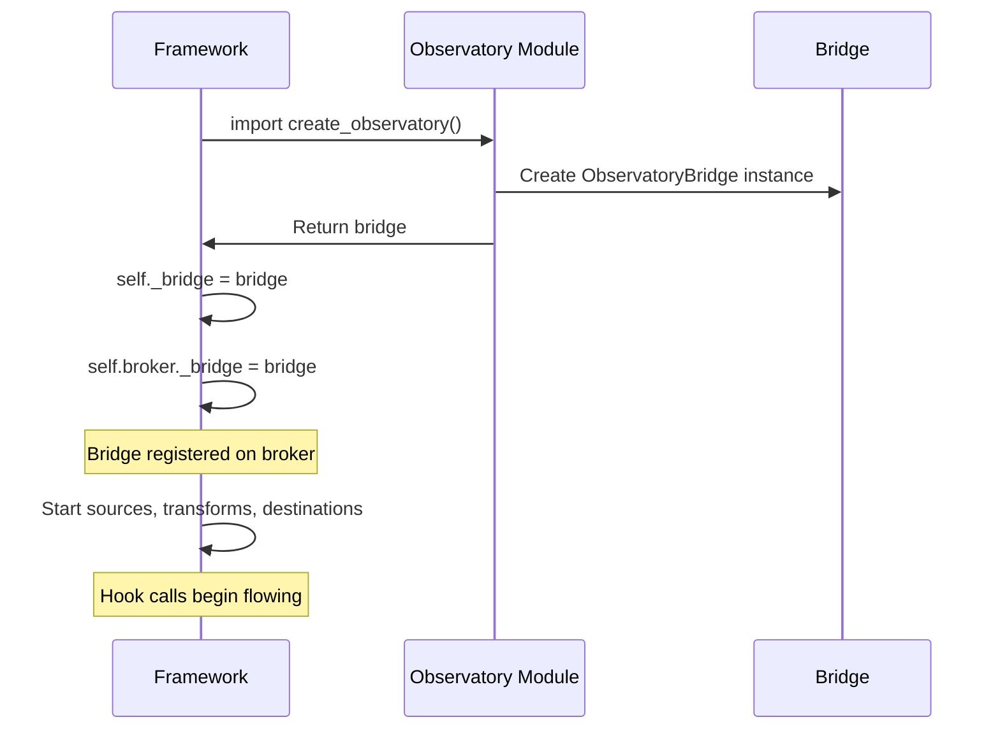
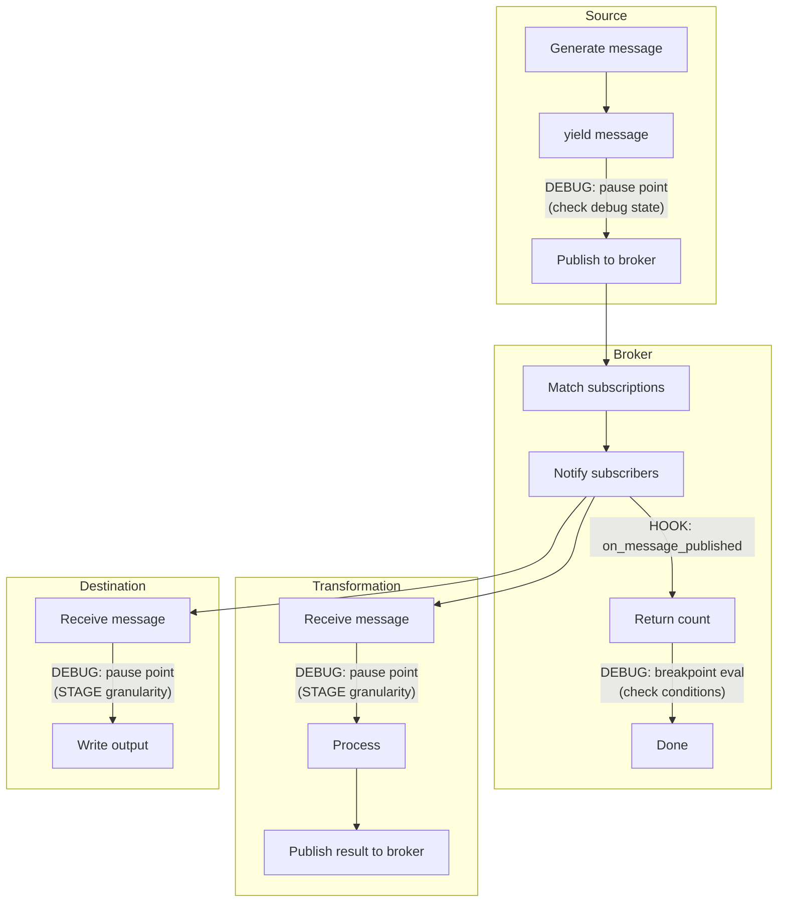
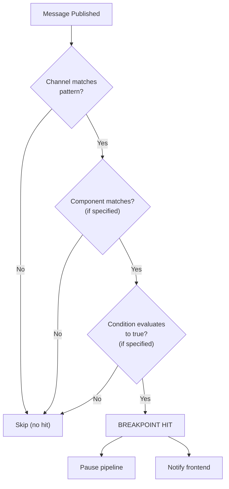

# COD3S Observatory - Bridge (Framework ↔ Observatory)

**Version:** 1.0
**Date:** 2026-02-11
**Status:** Functional Specification

---

## Navigation

| Previous | Up | Next |
|----------|-----|------|
| [← OBS-01-ARCHITECTURE](OBS-01-ARCHITECTURE.md) | [OBS-00-OVERVIEW](OBS-00-OVERVIEW.md) | [OBS-03-DEBUG-CONTROLS →](OBS-03-DEBUG-CONTROLS.md) |

---

## Table of Contents

- [Bridge Philosophy](#bridge-philosophy)
- [Observation Interface (Framework → Bridge)](#observation-interface-framework--bridge)
- [Control Interface (Bridge → Framework)](#control-interface-bridge--framework)
- [Registration](#registration)
- [Hook Points in the Pipeline](#hook-points-in-the-pipeline)
- [Sampling and Throttling](#sampling-and-throttling)
- [Breakpoint Specification](#breakpoint-specification)
- [Error Handling](#error-handling)

---

## Bridge Philosophy

The `ObservatoryBridge` is the **sole point of contact** between the COD3S framework and the Observatory module. This design ensures:

1. **Clean separation** — The framework never imports `observatory` directly
2. **Bidirectional** — Observation hooks (framework → bridge) and control commands (bridge → framework)
3. **Optional** — When `self._bridge is None`, all hooks are skipped
4. **Async** — All hooks are async to avoid blocking the event loop
5. **Lightweight** — Hooks do minimal work (buffer write + optional breakpoint check)



---

## Observation Interface (Framework → Bridge)

These hooks are called by framework components to notify the bridge of events. Each hook is guarded by a `None` check in the framework code.

### on_message_published

Called by the broker after a message is successfully published to subscribers.

```python
async def on_message_published(
    self,
    channel: str,
    message: Message,
    subscriber_count: int,
) -> None
```

| Parameter | Type | Description |
|-----------|------|-------------|
| `channel` | `str` | Channel the message was published to |
| `message` | `Message` | The published message (key, value, timestamp, tags) |
| `subscriber_count` | `int` | Number of subscribers notified |

**Trigger point:** `InMemoryBroker.publish()`, after `_notify_subscribers()`

**Frequency:** Every published message (subject to [sampling](#sampling-and-throttling))

**Debug interaction:** This hook triggers breakpoint evaluation if debug mode is active.

---

### on_component_state_change

Called when a pipeline component transitions between states.

```python
async def on_component_state_change(
    self,
    component_id: str,
    component_type: str,  # "source", "transformation", "destination"
    old_state: str,
    new_state: str,
) -> None
```

| Parameter | Type | Description |
|-----------|------|-------------|
| `component_id` | `str` | Unique component identifier (e.g., `"csv_source_1"`) |
| `component_type` | `str` | One of `"source"`, `"transformation"`, `"destination"` |
| `old_state` | `str` | Previous state (e.g., `"idle"`, `"running"`, `"paused"`, `"error"`, `"stopped"`) |
| `new_state` | `str` | New state |

**Trigger points:**
- `Source.start()` → `"idle"` → `"running"`
- `Source.stop()` → `"running"` → `"stopped"`
- `Source.pause()` → `"running"` → `"paused"`
- `Destination.start()` → `"idle"` → `"running"`
- `Transformation` registration → `"idle"` → `"running"`

**Frequency:** Low (only on state transitions)

---

### on_subscription_change

Called when a subscription is added or removed from the broker.

```python
async def on_subscription_change(
    self,
    pattern: str,
    action: str,  # "subscribe" or "unsubscribe"
    subscriber_id: str,
) -> None
```

| Parameter | Type | Description |
|-----------|------|-------------|
| `pattern` | `str` | Channel pattern (e.g., `"sensors.*.temperature"`) |
| `action` | `str` | `"subscribe"` or `"unsubscribe"` |
| `subscriber_id` | `str` | Identifier of the subscribing component |

**Trigger point:** `InMemoryBroker.subscribe()` and `InMemoryBroker.unsubscribe()`

**Usage:** Topology view updates edges when subscriptions change.

---

### on_metric_emitted

Called when the framework publishes a metric on `_metrics.*` channels.

```python
async def on_metric_emitted(
    self,
    metric_name: str,
    value: float | dict,
    tags: dict[str, str],
) -> None
```

| Parameter | Type | Description |
|-----------|------|-------------|
| `metric_name` | `str` | Metric identifier (e.g., `"broker.throughput"`, `"source.csv.messages"`) |
| `value` | `float \| dict` | Metric value (scalar or dict for percentiles) |
| `tags` | `dict` | Metric tags (e.g., `{"window": "1s"}`) |

**Trigger point:** Internal metric publishing in broker, sources, destinations

**Frequency:** Every metric emission (typically 1/s per metric)

---

### on_error

Called when a component encounters an error.

```python
async def on_error(
    self,
    component_id: str,
    error: Exception,
    context: dict[str, str],
) -> None
```

| Parameter | Type | Description |
|-----------|------|-------------|
| `component_id` | `str` | Component that encountered the error |
| `error` | `Exception` | The exception object |
| `context` | `dict` | Additional context (channel, message_id, retry_count, etc.) |

**Trigger points:** Error handlers in sources, destinations, transformations

**Usage:** Error panel in dashboard, error markers in topology

---

## Control Interface (Bridge → Framework)

These methods allow the Observatory to control framework behavior. They are primarily used for debug mode operations.

### Pipeline Control

```python
async def pause_pipeline(self) -> None
```
Pause all sources at their next yield point. In-flight messages are drained. See [OBS-03-DEBUG-CONTROLS](OBS-03-DEBUG-CONTROLS.md) for semantics.

```python
async def resume_pipeline(self) -> None
```
Resume all paused sources.

```python
async def pause_source(self, source_id: str) -> None
```
Pause a specific source.

```python
async def resume_source(self, source_id: str) -> None
```
Resume a specific source.

---

### Step Control

```python
async def step_next(self, granularity: str) -> None
```
Execute one step at the specified granularity level.

| Granularity | Behavior |
|-------------|----------|
| `"MESSAGE"` | Allow one message to be published by any source, then pause |
| `"STAGE"` | Allow one stage transition (source→broker, broker→transform, transform→broker, broker→destination), then pause |
| `"BREAKPOINT"` | Resume until next breakpoint hit, then pause |

---

### Breakpoint Management

```python
async def set_breakpoint(
    self,
    breakpoint_id: str,
    channel_pattern: str,
    condition: str | None = None,
    component_id: str | None = None,
) -> None
```

| Parameter | Type | Description |
|-----------|------|-------------|
| `breakpoint_id` | `str` | Unique identifier for this breakpoint |
| `channel_pattern` | `str` | Channel pattern to match (uses same wildcards as broker) |
| `condition` | `str \| None` | Optional condition on message value (e.g., `"value > 100"`) |
| `component_id` | `str \| None` | Optional: only trigger at this component |

```python
async def remove_breakpoint(self, breakpoint_id: str) -> None
```
Remove a breakpoint by its ID.

```python
async def list_breakpoints(self) -> list[dict]
```
Return all active breakpoints.

---

### State Inspection

```python
async def get_component_state(self, component_id: str) -> dict
```
Return the current state and metadata of a component.

```python
async def get_channel_history(
    self,
    channel: str,
    limit: int = 50,
) -> list[dict]
```
Return recent messages from a channel's history buffer.

```python
async def inject_message(
    self,
    channel: str,
    message: dict,
) -> None
```
Inject a test message into a channel (debug only). Useful for testing transformations without running sources.

---

## Registration

The bridge is registered during framework startup, before pipeline components are started:



### Registration Points

The bridge reference is set on these framework objects:

| Object | Attribute | Purpose |
|--------|-----------|---------|
| `Framework` | `_bridge` | Central reference, lifecycle management |
| `InMemoryBroker` | `_bridge` | Message publishing, subscription changes, metrics |
| Each `Source` | `_bridge` | Component state changes, debug pause points |
| Each `Destination` | `_bridge` | Component state changes, error reporting |

---

## Hook Points in the Pipeline

This diagram shows where bridge hooks fire during message processing:



### Hook Call Order (Single Message)

1. Source generates message
2. Source calls `broker.publish(channel, message)`
3. Broker matches subscriptions and notifies subscribers
4. **HOOK:** `on_message_published(channel, message, subscriber_count)`
5. **DEBUG:** If debug mode is active, evaluate breakpoints
6. **DEBUG:** If breakpoint hits or step completed, pause pipeline
7. Transformation receives message, processes it
8. **HOOK:** If transform publishes result, `on_message_published()` fires again
9. Destination receives message, writes output

---

## Sampling and Throttling

For high-throughput pipelines (>1000 msg/s), the bridge can sample messages to reduce overhead.

### Sampling Strategies

| Strategy | Description | Configuration |
|----------|-------------|---------------|
| **Every-Nth** | Process every Nth message (e.g., every 10th) | `sampling_rate: 10` |
| **Time-based** | At most one message per time window | `sampling_interval_ms: 100` |
| **None** | Process every message (default) | `sampling_rate: 1` |

### Breakpoint Bypass

Breakpoint evaluation **always runs** regardless of sampling settings. This ensures that:
- Breakpoints are never missed
- Debug behavior is predictable
- Only visualization updates are sampled

### Metric Throttling

Metrics are not sampled (they are already low-frequency, typically 1/s). The bridge forwards all metrics to the frontend.

### Configuration

```yaml
observatory:
  sampling:
    strategy: "every_nth"  # or "time_based" or "none"
    rate: 10               # For every_nth: process 1 in 10
    interval_ms: 100       # For time_based: max 1 per 100ms
```

**Default:** No sampling (`rate: 1`). Sampling is only needed for pipelines exceeding ~5000 msg/s where Observatory overhead becomes noticeable.

---

## Breakpoint Specification

### Breakpoint Structure

A breakpoint consists of three optional filters (at least one must be specified):

| Field | Type | Description | Example |
|-------|------|-------------|---------|
| `channel_pattern` | `str` | Channel pattern (same wildcards as broker) | `"sensors.*.temperature"` |
| `condition` | `str \| None` | Value condition expression | `"value > 100"` |
| `component_id` | `str \| None` | Restrict to specific component | `"csv_source_1"` |

### Channel Pattern Matching

Breakpoint channel patterns use the same matching logic as the broker's `SubscriptionRegistry.match_channel()`:

| Pattern | Matches | Doesn't Match |
|---------|---------|---------------|
| `sensors.temp` | `sensors.temp` | `sensors.pressure` |
| `sensors.*` | `sensors.temp`, `sensors.pressure` | `sensors.zone.temp` |
| `sensors.**` | `sensors.temp`, `sensors.zone.temp` | `alerts.critical` |
| `sensors.*.temperature` | `sensors.zone1.temperature` | `sensors.zone1.pressure` |

### Condition Expressions

Conditions are evaluated using a **safe expression parser** (no `eval()`):

**Supported operators:**
- Comparison: `>`, `<`, `>=`, `<=`, `==`, `!=`
- Logical: `and`, `or`, `not`
- String: `contains`, `startswith`, `endswith`
- Membership: `in`

**Available variables:**
- `value` — Message value (numeric or string)
- `key` — Message key
- `tags.<name>` — Tag value by name
- `channel` — Channel name

**Examples:**

```python
# Simple numeric condition
"value > 100"

# Multiple conditions
"value > 100 and tags.location == 'warehouse_A'"

# String matching
"key contains 'temperature'"

# Channel-based
"channel startswith 'sensors.zone1'"
```

### Breakpoint Evaluation Flow



---

## Error Handling

### Hook Errors

If a bridge hook throws an exception, the framework **catches and logs it** without affecting pipeline operation:

```python
# In broker — hook error never crashes the pipeline
if self._bridge is not None:
    try:
        await self._bridge.on_message_published(channel, message, count)
    except Exception as e:
        logger.warning("Observatory bridge hook error", error=str(e))
```

**Rationale:** The Observatory is a debug tool. It should never break the pipeline it's observing.

### Control Command Errors

If a control command fails (e.g., pause a non-existent source), the bridge returns an error to the frontend via WebSocket:

```json
{
  "type": "error",
  "payload": {
    "code": "COMPONENT_NOT_FOUND",
    "message": "Source 'unknown_source' does not exist",
    "command": "pause_source"
  }
}
```

### Disconnection

If all frontend clients disconnect:
- The Observatory continues buffering events (ring buffers)
- Debug mode is **not** automatically deactivated (pause state is preserved)
- Reconnecting clients receive current state and recent history from buffers

---

## Summary

The Bridge is the critical interface that enables Observatory functionality while maintaining framework independence:

1. **Observation hooks** (5 hooks) — Capture framework events for visualization
2. **Control commands** (10+ methods) — Enable debug mode operations
3. **Safe breakpoints** — Channel patterns + safe expression evaluation (no `eval`)
4. **Sampling** — Configurable throttling for high-throughput pipelines
5. **Error isolation** — Hook failures never affect pipeline operation

**Next:** [OBS-03-DEBUG-CONTROLS](OBS-03-DEBUG-CONTROLS.md) details the debug mode state machine and controls.

---

## Navigation

| Previous | Up | Next |
|----------|-----|------|
| [← OBS-01-ARCHITECTURE](OBS-01-ARCHITECTURE.md) | [OBS-00-OVERVIEW](OBS-00-OVERVIEW.md) | [OBS-03-DEBUG-CONTROLS →](OBS-03-DEBUG-CONTROLS.md) |

---

*This is a functional specification document for the COD3S Observatory module. Technical implementation details are in [OBS-TECH-02-BRIDGE-API](../../TECHNICAL_SPECIFICATION/OBSERVATORY/OBS-TECH-02-BRIDGE-API.md).*
