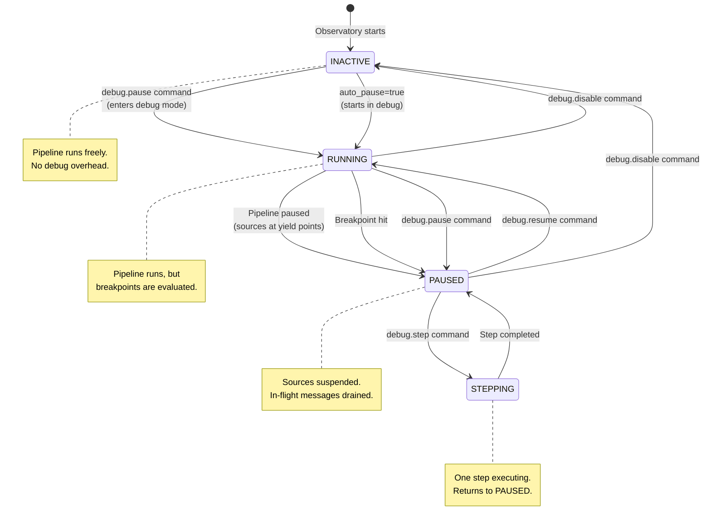
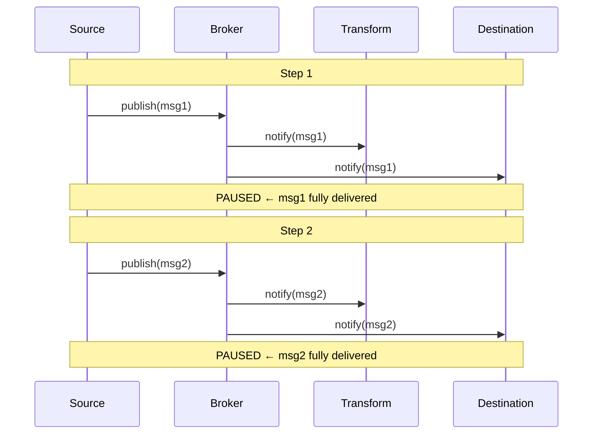
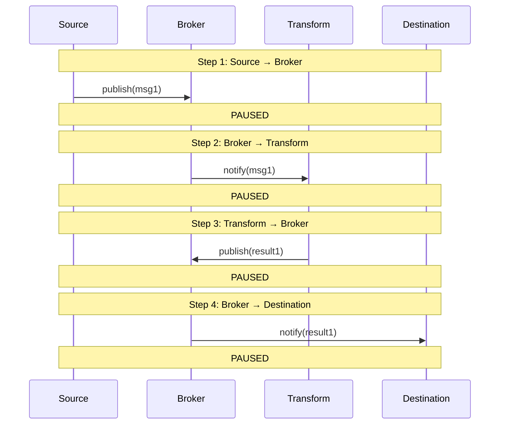
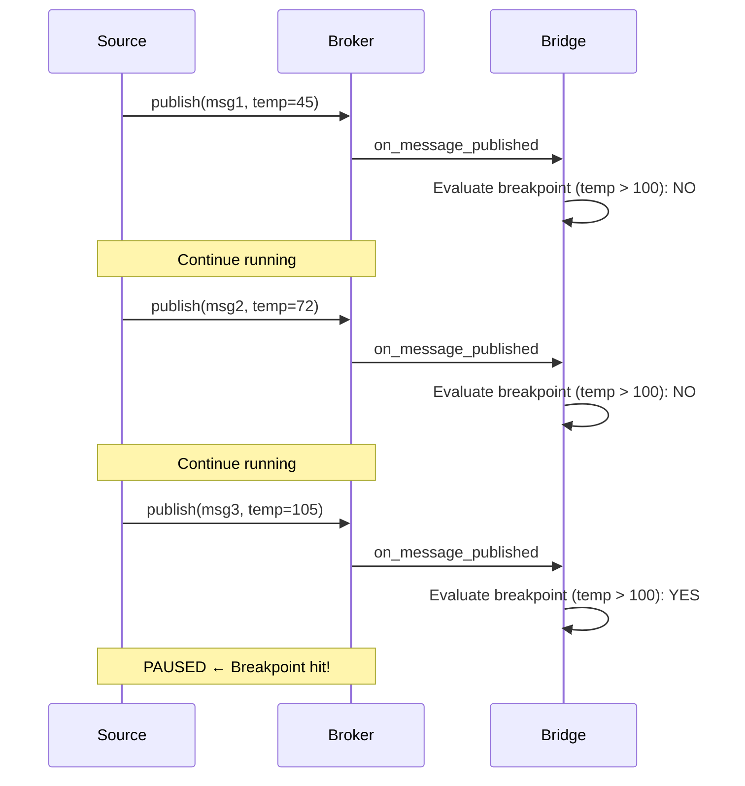
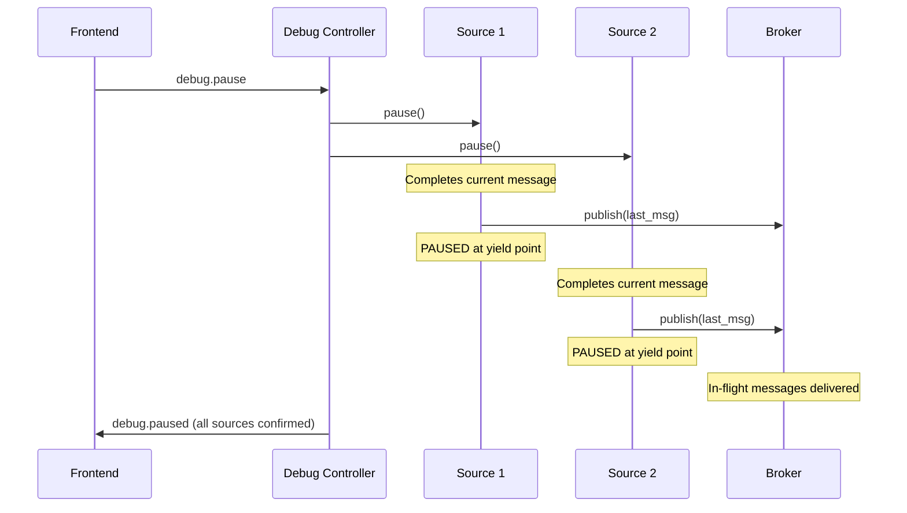

# COD3S Observatory - Debug Controls

**Version:** 1.0
**Date:** 2026-02-11
**Status:** Functional Specification

---

## Navigation

| Previous | Up | Next |
|----------|-----|------|
| [← OBS-02-BRIDGE](OBS-02-BRIDGE.md) | [OBS-00-OVERVIEW](OBS-00-OVERVIEW.md) | [OBS-04-PIPELINE-TOPOLOGY →](OBS-04-PIPELINE-TOPOLOGY.md) |

---

## Table of Contents

- [Debug Mode Overview](#debug-mode-overview)
- [Activation](#activation)
- [Debug Session State Machine](#debug-session-state-machine)
- [Granularity Levels](#granularity-levels)
- [Pause and Resume Semantics](#pause-and-resume-semantics)
- [Step-by-Step Execution](#step-by-step-execution)
- [Slow-Motion Mode](#slow-motion-mode)
- [Breakpoints](#breakpoints)
- [Debug UI Controls](#debug-ui-controls)
- [Performance Impact](#performance-impact)

---

## Debug Mode Overview

Debug mode transforms the Observatory from a passive observer into an active debugging tool. When debug mode is active, the developer can:

- **Pause** the pipeline (all sources suspend at yield points)
- **Step** through messages one at a time or stage by stage
- **Set breakpoints** to pause on specific conditions
- **Slow-motion** to observe message flow at reduced speed
- **Inspect** each message as it flows through the pipeline

Debug mode is designed for **development and testing environments** only. It should not be used in production.

---

## Activation

### Method 1: YAML Configuration

```yaml
observatory:
  enabled: true
  debug:
    enabled: true
    granularity: "MESSAGE"   # MESSAGE, STAGE, or BREAKPOINT
    auto_pause: false        # Start paused?
```

### Method 2: Python API

```python
framework = Framework(config, observatory=ObservatoryConfig(
    debug=True,
    debug_granularity="MESSAGE",
))
```

### Method 3: UI Toggle (Runtime)

Debug mode can be activated and deactivated at runtime through the Observatory UI. This does not require a restart.

### Method 4: WebSocket Command

```json
{
  "type": "debug.pause",
  "id": "cmd-001",
  "payload": {
    "granularity": "MESSAGE"
  }
}
```

---

## Debug Session State Machine



### State Descriptions

| State | Pipeline | Sources | Breakpoints | UI |
|-------|----------|---------|-------------|-----|
| **INACTIVE** | Running freely | Active | Not evaluated | Observe only |
| **RUNNING** | Running freely | Active | Evaluated on every message | Debug toolbar visible |
| **PAUSED** | Suspended | At yield points | N/A (pipeline is paused) | Step/Resume buttons active |
| **STEPPING** | Executing one step | Briefly active | Evaluated | Step animation |

---

## Granularity Levels

The step granularity determines what constitutes "one step" when using step-by-step execution.

### MESSAGE Granularity

**Behavior:** Pause after each message published by any source.



**Use case:** Fine-grained inspection. Follow each message through the full pipeline.

**Note:** The message is delivered to all subscribers before pausing. Transform outputs (published as new messages) are **not** counted as separate steps at MESSAGE granularity — they are part of the same message's processing chain.

---

### STAGE Granularity

**Behavior:** Pause after each stage transition in the pipeline.

The pipeline stages are:
1. **Source → Broker** (message published)
2. **Broker → Transform** (message delivered to transformation)
3. **Transform → Broker** (transformed result published)
4. **Broker → Destination** (message delivered to destination)



**Use case:** Understand the transformation pipeline. See what goes in and what comes out at each stage.

---

### BREAKPOINT Granularity

**Behavior:** Pipeline runs freely until a breakpoint condition is met.



**Use case:** Efficient debugging for high-throughput pipelines. Only stop when something interesting happens.

---

### Granularity Comparison

| Aspect | MESSAGE | STAGE | BREAKPOINT |
|--------|---------|-------|------------|
| **Pause frequency** | Every message | Every stage transition | Only on condition |
| **Pipeline overhead** | High | Very high | Low (evaluation only) |
| **Best for** | Low-throughput debug | Understanding flow | High-throughput, targeted |
| **Typical use** | ≤10 msg/s | ≤5 msg/s | Any throughput |
| **Steps per message** | 1 | 2-4 (depends on pipeline) | 0 (until breakpoint) |

---

## Pause and Resume Semantics

### Pause Sequence

When a pause is triggered (manually or by breakpoint/step):

1. **Signal sources:** All active sources receive a pause signal
2. **Yield point suspension:** Each source suspends at its next yield point (between messages)
3. **Drain in-flight:** Messages already in the broker complete their routing
4. **Confirm paused:** All sources confirm they are paused
5. **Notify frontend:** `debug.paused` event sent to all connected clients



**Key property:** No message is left in a half-processed state. The pipeline is always in a consistent state when paused.

### Resume Sequence

1. **Signal sources:** All paused sources receive a resume signal
2. **Sources continue:** Each source resumes from its yield point
3. **Notify frontend:** `debug.resumed` event

---

## Step-by-Step Execution

### Step Execution Flow

1. Developer clicks "Step" (or presses keyboard shortcut)
2. Frontend sends `debug.step` command with current granularity
3. Debug controller temporarily resumes the pipeline
4. Pipeline executes until one step completes (as defined by granularity)
5. Pipeline re-pauses
6. Frontend receives `debug.step_completed` event with step details

### Step Result

Each step produces a result that is sent to the frontend:

```json
{
  "type": "debug.step_completed",
  "payload": {
    "granularity": "MESSAGE",
    "step_number": 42,
    "event": {
      "type": "message_published",
      "channel": "sensors.temp",
      "message_summary": {
        "key": "temperature",
        "value": 105.3,
        "timestamp": "2026-02-11T10:30:45.123Z"
      },
      "subscriber_count": 3
    },
    "duration_ms": 2.3
  }
}
```

---

## Slow-Motion Mode

Slow-motion mode adds a configurable delay between messages, allowing developers to observe the pipeline in "slow motion" without manually stepping.

### Configuration

```yaml
observatory:
  debug:
    slow_motion:
      enabled: true
      delay_ms: 500  # 100ms to 5000ms
```

### Behavior

- Pipeline runs continuously but with an artificial delay after each message
- The topology view animates message flow in real time
- The timeline updates progressively
- Can be combined with breakpoints (breakpoints still trigger instant pause)

### Delay Range

| Delay | Effect | Use Case |
|-------|--------|----------|
| 100 ms | Fast slow-motion | Observe flow pattern |
| 250 ms | Medium | Follow individual messages |
| 500 ms | Slow (default) | Detailed observation |
| 1000 ms | Very slow | Step-like without clicking |
| 5000 ms | Near-step | Extremely detailed |

### Runtime Adjustment

Slow-motion delay can be adjusted at runtime via the UI slider without pausing the pipeline.

---

## Breakpoints

### Creating Breakpoints

**Via UI:**
1. Right-click a channel edge in the topology view → "Add breakpoint"
2. Or use the breakpoint panel → "New breakpoint"
3. Specify channel pattern and optional condition

**Via WebSocket command:**
```json
{
  "type": "debug.add_breakpoint",
  "id": "cmd-010",
  "payload": {
    "channel_pattern": "sensors.*.temperature",
    "condition": "value > 100",
    "component_id": null
  }
}
```

### Breakpoint Examples

| Scenario | Channel Pattern | Condition |
|----------|----------------|-----------|
| Any temperature message | `sensors.*.temperature` | - |
| High temperature | `sensors.*.temperature` | `value > 100` |
| Specific sensor | `sensors.zone1.*` | - |
| Error messages | `_dlq.**` | - |
| Tagged messages | `sensors.**` | `tags.priority == "critical"` |
| Specific source output | `sensors.temp` | - (component_id: `csv_source_1`) |

### Breakpoint Hit

When a breakpoint is triggered:
1. Pipeline pauses (same pause semantics as manual pause)
2. Frontend receives `debug.breakpoint_hit` event with:
   - The breakpoint that was triggered
   - The message that triggered it
   - The component where it was triggered
3. The message is highlighted in the topology and timeline views
4. The message inspector opens automatically with the triggering message

### Managing Breakpoints

- **Enable/Disable:** Toggle a breakpoint without deleting it
- **Delete:** Remove a breakpoint permanently
- **Edit:** Modify the condition of an existing breakpoint (UI only)
- **List:** View all breakpoints in the breakpoint panel

Breakpoints are **persisted in browser localStorage** and survive page reloads.

---

## Debug UI Controls

### Debug Toolbar

A floating toolbar appears at the top of the Observatory UI when debug mode is active:

```
┌─────────────────────────────────────────────────────────────┐
│  ⏸ Pause  │  ▶ Resume  │  ⏭ Step  │  🐌 Slow  │  ● BP: 3  │
│            │            │          │  [====]   │           │
│  State: PAUSED          │  Step: MESSAGE ▾     │  #42      │
└─────────────────────────────────────────────────────────────┘
```

### Keyboard Shortcuts

| Key | Action |
|-----|--------|
| `Space` | Toggle Pause / Resume |
| `N` | Step Next |
| `1` | Set granularity: MESSAGE |
| `2` | Set granularity: STAGE |
| `3` | Set granularity: BREAKPOINT |
| `S` | Toggle Slow-Motion |
| `B` | Open breakpoint panel |

### Toolbar Elements

| Element | Description |
|---------|-------------|
| **Pause/Resume** | Toggle button, changes based on current state |
| **Step** | Execute one step (only active when PAUSED) |
| **Slow-Motion** | Toggle + slider for delay adjustment |
| **Breakpoint Count** | Number of active breakpoints, click to open panel |
| **State Indicator** | Current debug state (INACTIVE, RUNNING, PAUSED, STEPPING) |
| **Granularity Selector** | Dropdown to change step granularity |
| **Step Counter** | Total steps executed in this debug session |

---

## Performance Impact

### Overhead by Debug State

| State | Overhead | Suitable For |
|-------|----------|-------------|
| **INACTIVE** | None | Any environment |
| **RUNNING** (no breakpoints) | ~1% CPU | Development |
| **RUNNING** (with breakpoints) | ~3-5% CPU (condition evaluation) | Development |
| **PAUSED** | None (pipeline stopped) | Development |
| **STEPPING** | N/A (manual pacing) | Development |
| **SLOW-MOTION** | ~1% CPU + artificial delay | Development |

### Recommendations

- Use **BREAKPOINT** granularity for high-throughput pipelines
- Use **MESSAGE** or **STAGE** only with low-throughput pipelines or test data
- Enable **slow-motion** when you want to observe without manual stepping
- **Never enable debug mode in production** — use observation mode only

---

## Summary

Debug controls provide three levels of interactive pipeline debugging:

1. **MESSAGE** — Pause after each message for fine-grained inspection
2. **STAGE** — Pause after each pipeline stage for flow understanding
3. **BREAKPOINT** — Free-running with conditional pauses for targeted debugging

Combined with slow-motion and the visual tools (topology, timeline, inspector), developers can fully understand and debug pipeline behavior without modifying code.

**Next:** [OBS-04-PIPELINE-TOPOLOGY](OBS-04-PIPELINE-TOPOLOGY.md) describes the visual DAG representation.

---

## Navigation

| Previous | Up | Next |
|----------|-----|------|
| [← OBS-02-BRIDGE](OBS-02-BRIDGE.md) | [OBS-00-OVERVIEW](OBS-00-OVERVIEW.md) | [OBS-04-PIPELINE-TOPOLOGY →](OBS-04-PIPELINE-TOPOLOGY.md) |

---

*This is a functional specification document for the COD3S Observatory module. Technical implementation details are in [OBS-TECH-02-BRIDGE-API](../../TECHNICAL_SPECIFICATION/OBSERVATORY/OBS-TECH-02-BRIDGE-API.md).*
