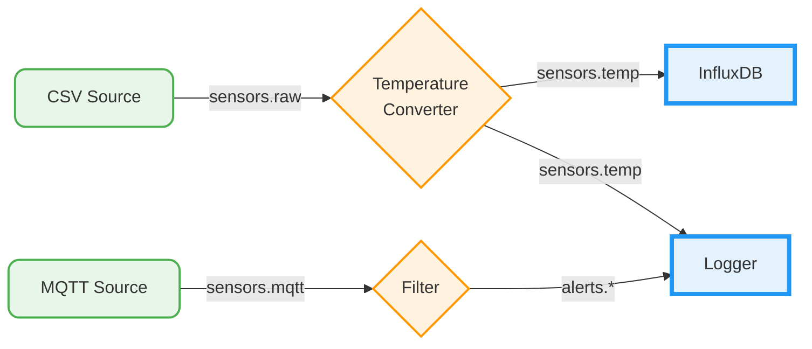
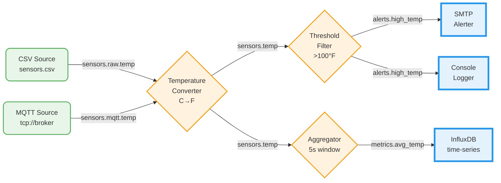

# COD3S Observatory - Pipeline Topology View

**Version:** 1.0
**Date:** 2026-02-11
**Status:** Functional Specification

---

## Navigation

| Previous | Up | Next |
|----------|-----|------|
| [← OBS-03-DEBUG-CONTROLS](OBS-03-DEBUG-CONTROLS.md) | [OBS-00-OVERVIEW](OBS-00-OVERVIEW.md) | [OBS-05-TEMPORAL-TIMELINE →](OBS-05-TEMPORAL-TIMELINE.md) |

---

## Table of Contents

- [Overview](#overview)
- [Data Model](#data-model)
- [Visual Design](#visual-design)
- [Node Shapes and Styling](#node-shapes-and-styling)
- [Edge Representation](#edge-representation)
- [Real-Time Updates](#real-time-updates)
- [Interactions](#interactions)
- [Layout Engine](#layout-engine)
- [Debug Overlay](#debug-overlay)
- [Performance Considerations](#performance-considerations)
- [Example Topology](#example-topology)

---

## Overview

The Pipeline Topology View provides a visual directed acyclic graph (DAG) representation of the data pipeline. It shows all components (sources, transformations, destinations) as nodes and data channels as edges, enabling developers to understand the pipeline structure at a glance.

**Key capabilities:**
- Real-time visualization of pipeline architecture
- Live state indication (running, paused, error, stopped)
- Message flow animation showing data movement
- Interactive exploration with node/edge details
- Debug integration (breakpoints, step position, pause states)
- Automatic layout with manual adjustment support

---

## Data Model

### Nodes

Each node represents a pipeline component. The data model for a node:

```typescript
interface TopologyNode {
  id: string;                    // Component ID (e.g., "csv_source_1")
  label: string;                 // Display name
  type: "SOURCE" | "TRANSFORM" | "DESTINATION" | "BROKER";
  state: "RUNNING" | "PAUSED" | "ERROR" | "STOPPED";
  position: { x: number, y: number };  // Layout coordinates
  metrics: {
    messages_processed: number;
    throughput_msg_per_sec: number;
    last_message_timestamp: string | null;
    error_count: number;
  };
  config_summary: Record<string, any>;  // Key config parameters
  breakpoints: string[];          // IDs of breakpoints on this component
}
```

### Edges

Each edge represents a channel (pub/sub relationship). The data model for an edge:

```typescript
interface TopologyEdge {
  id: string;                     // Edge ID (e.g., "csv_source_1->sensors.temp")
  source: string;                 // Source node ID
  target: string;                 // Target node ID
  channel: string;                // Channel name (e.g., "sensors.temp")
  subscription_pattern: string;   // Pattern used by subscriber
  message_rate: number;           // Messages per second
  last_message_timestamp: string | null;
  breakpoints: string[];          // IDs of breakpoints on this channel
}
```

### Graph Structure

The topology is a directed graph where:
- **Sources** have no incoming edges (only outgoing)
- **Transformations** have both incoming and outgoing edges
- **Destinations** have no outgoing edges (only incoming)
- **Broker** is an implicit central hub (not always rendered as a node)



---

## Visual Design

### Color Scheme by State

Nodes change color based on their current state:

| State | Color | Meaning |
|-------|-------|---------|
| **RUNNING** | Green (#4caf50) | Component is actively processing |
| **PAUSED** | Yellow/Amber (#ffc107) | Component is paused (debug mode) |
| **ERROR** | Red (#f44336) | Component has encountered an error |
| **STOPPED** | Gray (#9e9e9e) | Component is not running |

**Visual properties:**
- Border thickness: 2px for normal, 4px for selected
- Drop shadow for depth perception
- Pulse animation for active processing
- Error state includes a red dot badge with error count

---

## Node Shapes and Styling

### Source Nodes

**Shape:** Rounded rectangle (border-radius: 10px)

**Visual characteristics:**
- Background: Light green (#e8f5e9)
- Border: Green (#4caf50)
- Icon: Inlet/stream icon (top-left)
- Label: Component name

**Example:**
```
┌───────────────┐
│ 📥 CSV Source │
│               │
│  250 msg/s    │
└───────────────┘
```

### Transformation Nodes

**Shape:** Hexagon

**Visual characteristics:**
- Background: Light orange (#fff3e0)
- Border: Orange (#ff9800)
- Icon: Transform/gear icon (top-left)
- Label: Component name

**Example:**
```
    ┌─────┐
   ╱       ╲
  ╱  ⚙️ Temp ╲
 │  Converter │
  ╲    42%   ╱
   ╲       ╱
    └─────┘
```

### Destination Nodes

**Shape:** Rectangle with double border

**Visual characteristics:**
- Background: Light blue (#e3f2fd)
- Border: Blue (#2196f3), double line (4px with gap)
- Icon: Outlet/database icon (top-left)
- Label: Component name

**Example:**
```
╔═══════════════╗
║ 💾 InfluxDB   ║
║               ║
║  1.2k records ║
╚═══════════════╝
```

### Broker Node (Optional)

If rendered explicitly, the broker appears as a central hub:

**Shape:** Circle

**Visual characteristics:**
- Background: Light purple (#f3e5f5)
- Border: Purple (#9c27b0)
- Icon: Hub/network icon
- Label: "Broker"

**Note:** In most visualizations, the broker is implicit (edges go directly between components).

---

## Edge Representation

### Edge Styling

Edges (channels) are rendered as directed arrows:

- **Line style:** Solid line, 2px width
- **Arrow head:** Triangle, 8px
- **Color:** Gray (#757575) when idle, animated when active
- **Label:** Channel name (e.g., "sensors.temp")

### Flow Animation

When messages flow through a channel, a visual pulse animates along the edge:

```css
/* Pseudo-code for animation */
@keyframes pulse-flow {
  0% {
    stroke-dashoffset: 0;
    opacity: 1;
  }
  100% {
    stroke-dashoffset: -20;
    opacity: 0.3;
  }
}

.edge.active {
  animation: pulse-flow 0.6s linear infinite;
}
```

The pulse speed is proportional to message rate:
- **1-10 msg/s:** Slow pulse (1s duration)
- **10-100 msg/s:** Medium pulse (0.6s duration)
- **100+ msg/s:** Fast pulse (0.3s duration)

### Message Rate Display

Each edge displays the current message rate as a badge:

```
    [42 msg/s]
source ─────────→ transform
      sensors.temp
```

The badge updates every 1 second with smoothed average.

---

## Real-Time Updates

### Message Flow Visualization

When a message is published:
1. The source node pulses briefly (200ms green glow)
2. A pulse animates along all outgoing edges
3. Each subscriber node pulses when it receives the message (200ms blue glow)

**Debouncing:** At high throughput (>50 msg/s), pulses are throttled to avoid visual overload (max 10 pulses/second per edge).

### State Transitions

When a component's state changes:
1. The node color transitions smoothly (300ms ease-in-out)
2. A ripple effect emanates from the node (500ms)
3. A notification badge appears briefly with the new state

**Example:** When debug.pause is triggered, all source nodes transition from green to yellow with a ripple effect.

### Metrics Updates

Node metrics update every 2 seconds:
- Message count incrementing
- Throughput calculation (sliding 5-second window)
- Last message timestamp

These updates do NOT trigger visual animations (to avoid distraction).

---

## Interactions

### Click Node

**Action:** Open the **Component Detail Panel** (right sidebar)

**Panel contents:**
- Component ID and type
- Current state
- Configuration (YAML/JSON view)
- Metrics (table)
- Recent events (last 10)
- Actions (pause/resume, add breakpoint, restart)

### Click Edge

**Action:** Open the **Channel Detail Panel** (right sidebar)

**Panel contents:**
- Channel name and pattern
- Source and target components
- Message rate chart (last 60s)
- Recent messages (last 10, click to open inspector)
- Actions (add breakpoint, filter messages)

### Right-Click Node

**Context menu:**
- Pause component
- Resume component
- Add breakpoint on all outputs
- Inspect component state
- View logs
- Restart component

### Right-Click Edge

**Context menu:**
- Add breakpoint on this channel
- Watch messages in real-time
- Filter messages
- Mute/unmute flow animation

### Pan and Zoom

- **Pan:** Click and drag on empty space
- **Zoom:** Mouse wheel or pinch gesture
- **Fit to screen:** Double-click on empty space
- **Reset view:** Button in toolbar

### Minimap

A minimap (bottom-right corner) shows the entire topology with the current viewport highlighted. Clicking the minimap pans to that location.

```
┌─────────────────────────────────────┐
│                                     │
│                                     │
│       [Main Topology View]          │
│                                     │
│                                     │
│                     ┌─────┐         │
│                     │┌───┐│ ← Minimap
│                     ││▓▓▓││   (current view)
│                     │└───┘│
│                     └─────┘         │
└─────────────────────────────────────┘
```

---

## Layout Engine

### Automatic Layout (dagre)

The topology uses the **dagre** algorithm for automatic layout:

**Configuration:**
- **Direction:** Left-to-right (sources on left, destinations on right)
- **Rank separation:** 150px (horizontal distance between columns)
- **Node separation:** 100px (vertical distance between nodes)
- **Edge separation:** 20px (minimum spacing between parallel edges)

**Ranking:**
1. Sources → Rank 0
2. Transformations → Rank 1+ (based on distance from sources)
3. Destinations → Final rank

### Manual Adjustment

Users can drag nodes to custom positions. The layout engine respects these overrides:
- Manual positions are **persisted in localStorage**
- Edges are re-routed automatically (orthogonal routing)
- "Reset layout" button reverts to automatic layout

### Force-Directed Simulation

For complex topologies (>20 nodes), an optional **force-directed layout** is available:
- Uses D3.js force simulation
- Nodes repel each other, edges act as springs
- Converges to a stable layout over 2-3 seconds
- Better for cyclic graphs (though DAGs are recommended)

---

## Debug Overlay

### Breakpoint Indicators

Nodes or edges with breakpoints display a **red dot badge** (top-right corner):

```
┌───────────────┐ 🔴 ← Breakpoint
│ CSV Source    │
└───────────────┘
```

Clicking the badge opens the breakpoint panel filtered to that component/channel.

### Current Step Position

When debug mode is active and paused, the **current step position** is highlighted:

- The node/edge that will execute next is outlined with a **blue dashed border** (4px)
- A floating tooltip shows "Next step: [description]"

**Example:** In MESSAGE granularity, the source that will publish the next message is highlighted.

### Paused State Indicators

When the pipeline is paused:
- All source nodes show a **pause icon overlay** (⏸)
- The entire topology has a semi-transparent yellow overlay (5% opacity)
- A banner at the top shows "Pipeline PAUSED — Step or Resume"

---

## Performance Considerations

### Rendering Strategy

The topology view uses **Canvas API** for rendering (not DOM):
- Faster rendering for large graphs (50+ nodes)
- Custom hit detection for interactions
- Offscreen canvas for double-buffering

### Throttling

To maintain 60 FPS:
- Pulse animations are GPU-accelerated (CSS transforms)
- Metrics updates are batched (every 2s)
- Flow pulses are throttled at high message rates (max 10/s per edge)

### Large Topologies

For topologies with >50 nodes:
- Automatic layout switches to force-directed
- Minimap is enabled by default
- Edge labels are hidden until zoom > 100%
- Virtualization: only render nodes/edges in viewport + margin

---

## Example Topology

### Scenario: IoT Sensor Pipeline



### Layout Description

**Rank 0 (Sources):**
- CSV Source (top)
- MQTT Source (bottom)

**Rank 1 (Transformations):**
- Temperature Converter (center)

**Rank 2 (Transformations):**
- Threshold Filter (top)
- Aggregator (bottom)

**Rank 3 (Destinations):**
- SMTP Alerter (top)
- Console Logger (middle)
- InfluxDB (bottom)

**Edges:**
- `sensors.raw.temp` (CSV → Converter)
- `sensors.mqtt.temp` (MQTT → Converter)
- `sensors.temp` (Converter → Filter and Aggregator, bifurcation)
- `alerts.high_temp` (Filter → Alerter and Logger, bifurcation)
- `metrics.avg_temp` (Aggregator → InfluxDB)

---

## Summary

The Pipeline Topology View provides an interactive, real-time visualization of the data pipeline as a directed acyclic graph. With node shapes differentiated by component type, colors indicating state, and animated edges showing message flow, developers can quickly understand pipeline structure and behavior.

Combined with debug controls (breakpoints, step position highlighting, pause indicators), the topology view becomes a powerful debugging tool for understanding and troubleshooting data pipelines.

**Next:** [OBS-05-TEMPORAL-TIMELINE](OBS-05-TEMPORAL-TIMELINE.md) describes the time-based message flow visualization.

---

## Navigation

| Previous | Up | Next |
|----------|-----|------|
| [← OBS-03-DEBUG-CONTROLS](OBS-03-DEBUG-CONTROLS.md) | [OBS-00-OVERVIEW](OBS-00-OVERVIEW.md) | [OBS-05-TEMPORAL-TIMELINE →](OBS-05-TEMPORAL-TIMELINE.md) |

---

*This is a functional specification document for the COD3S Observatory module. Technical implementation details are in [OBS-TECH-03-TOPOLOGY-RENDERER](../../TECHNICAL_SPECIFICATION/OBSERVATORY/OBS-TECH-03-TOPOLOGY-RENDERER.md).*
