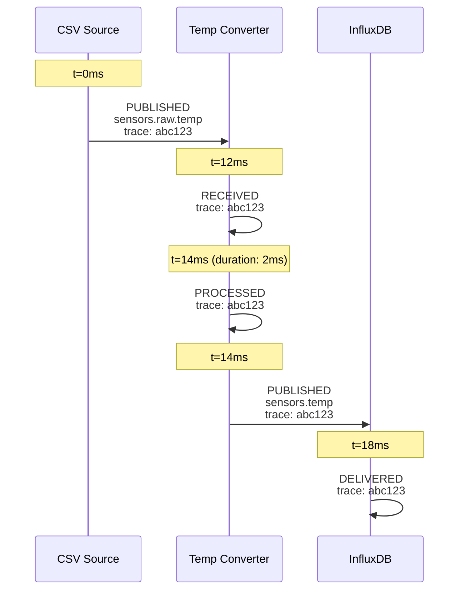

# COD3S Observatory - Temporal Timeline View

**Version:** 1.0
**Date:** 2026-02-11
**Status:** Functional Specification

---

## Navigation

| Previous | Up | Next |
|----------|-----|------|
| [← OBS-04-PIPELINE-TOPOLOGY](OBS-04-PIPELINE-TOPOLOGY.md) | [OBS-00-OVERVIEW](OBS-00-OVERVIEW.md) | [OBS-06-MESSAGE-INSPECTOR →](OBS-06-MESSAGE-INSPECTOR.md) |

---

## Table of Contents

- [Overview](#overview)
- [Data Model](#data-model)
- [Visual Layout](#visual-layout)
- [Lane Types](#lane-types)
- [Timeline Elements](#timeline-elements)
- [Interactions](#interactions)
- [Zoom and Navigation](#zoom-and-navigation)
- [Live Tail Mode](#live-tail-mode)
- [Performance Rendering](#performance-rendering)
- [Message Correlation](#message-correlation)
- [Debug Integration](#debug-integration)
- [Example Timeline](#example-timeline)

---

## Overview

The Temporal Timeline View visualizes message flow through the pipeline over time. It uses a horizontal timeline with vertical swim lanes for each pipeline component, showing when messages are published, processed, and delivered.

**Key capabilities:**
- Chronological visualization of all pipeline events
- Correlation of related messages across components (via trace IDs)
- Performance analysis (processing duration, latency)
- Live tail mode for real-time monitoring
- Debug integration (breakpoint hits, step markers, paused time ranges)
- High-performance rendering for thousands of events

---

## Data Model

### Timeline Event

Each event on the timeline represents a discrete action in the pipeline:

```typescript
interface TimelineEvent {
  id: string;                      // Event ID
  timestamp: number;               // Unix timestamp (ms)
  component_id: string;            // Component where event occurred
  event_type: "PUBLISHED" | "RECEIVED" | "PROCESSED" | "DELIVERED" | "ERROR";
  message_summary: {
    key: string;
    channel: string;
    trace_id: string;
    value_preview: any;            // Truncated value for display
  };
  duration_ms?: number;            // For processing spans
  parent_event_id?: string;        // For correlation
  tags: Record<string, any>;
  error?: {
    type: string;
    message: string;
  };
}
```

### Time Range

The timeline displays a sliding time window:

```typescript
interface TimeRange {
  start: number;      // Unix timestamp (ms)
  end: number;        // Unix timestamp (ms)
  duration_ms: number; // end - start
  zoom_level: number;  // 1 = normal, 2 = 2x zoom, etc.
}
```

**Default window:** Last 60 seconds (auto-scrolls in live tail mode)

---

## Visual Layout

### Coordinate System

```
   Time axis (horizontal) →
   ├────┬────┬────┬────┬────┬────┬────┬────┬────┬────┬────┬────┤
   0s   5s   10s  15s  20s  25s  30s  35s  40s  45s  50s  55s  60s

   ▼ Component lanes (vertical)

   ┌─────────────────────────────────────────────────────────────┐
   │ CSV Source      [●]   [●]      [●][●]                       │ ← Lane 1
   ├─────────────────────────────────────────────────────────────┤
   │ Broker          [─]   [─]      [─][─]                       │ ← Lane 2
   ├─────────────────────────────────────────────────────────────┤
   │ Temp Converter   [───]  [───]    [───][───]                │ ← Lane 3
   ├─────────────────────────────────────────────────────────────┤
   │ InfluxDB         [●]   [●]      [●][●]                       │ ← Lane 4
   └─────────────────────────────────────────────────────────────┘

   Legend:
   [●] = Message marker (instant event)
   [───] = Processing span (duration event)
```

### Dimensions

- **Lane height:** 60px (48px content + 12px margin)
- **Time axis height:** 40px (top)
- **Marker size:** 8px diameter (circle)
- **Span bar height:** 20px

---

## Lane Types

### Source Lanes

**Purpose:** Show when messages are published by sources.

**Visual characteristics:**
- Background: Light green (#f1f8f4)
- Marker color: Green (#4caf50)
- Label: Source component name (left side, 150px width)

**Elements:**
- **Markers:** One per published message
- **Tooltip:** Message key, channel, timestamp

### Broker Lane

**Purpose:** Show when messages are received and routed by the broker.

**Visual characteristics:**
- Background: Light purple (#f3e5f5)
- Marker color: Purple (#9c27b0)
- Label: "Broker"

**Elements:**
- **Horizontal bars:** Represent message routing duration (publish → all subscribers notified)
- **Tooltip:** Channel, subscriber count, routing duration

**Note:** The broker lane is optional and can be hidden for clarity.

### Transformation Lanes

**Purpose:** Show when transformations receive, process, and publish messages.

**Visual characteristics:**
- Background: Light orange (#fff9f0)
- Marker color: Orange (#ff9800)
- Label: Transformation component name

**Elements:**
- **Processing spans:** Horizontal bars showing processing duration (input received → output published)
- **Input marker:** Start of span (circle, left edge)
- **Output marker:** End of span (circle, right edge)
- **Tooltip:** Input channel, output channel, processing duration, transformation result

### Destination Lanes

**Purpose:** Show when messages are delivered to destinations.

**Visual characteristics:**
- Background: Light blue (#f0f8ff)
- Marker color: Blue (#2196f3)
- Label: Destination component name

**Elements:**
- **Markers:** One per delivered message
- **Tooltip:** Message key, channel, timestamp, delivery status

### Error Lane (Special)

**Purpose:** Show errors across all components.

**Visual characteristics:**
- Background: Light red (#ffebee)
- Marker color: Red (#f44336)
- Label: "Errors"

**Elements:**
- **Error markers:** Large markers (12px) with exclamation icon
- **Tooltip:** Error type, message, component, timestamp

---

## Timeline Elements

### Message Markers

**Representation:** Circles (8px diameter)

**States:**
- **Normal:** Solid fill, component color
- **Hovered:** Stroke (2px, darker shade), cursor changes
- **Selected:** Stroke (3px, black), remains highlighted
- **Correlated:** Stroke (2px, cyan) when related to selected message

**Position:** Horizontal position = timestamp (scaled to timeline), vertical = center of lane

### Processing Spans

**Representation:** Rounded rectangles (20px height, border-radius 4px)

**Visual:**
- Fill: Component color at 30% opacity
- Border: Component color, 2px
- Start/end markers: Circles (8px) at both ends

**Duration label:** Displayed inside span if width > 60px, otherwise on hover

**Example:**
```
Input received ●──────────[127ms]──────────● Output published
```

### Trace Lines

**Purpose:** Connect related messages across lanes (same trace_id).

**Visual:**
- Dashed lines (2px, cyan #00bcd4)
- Drawn diagonally between correlated events
- Only visible when a message is selected or hovered

**Example:**
```
CSV Source      [●]────────────────────┐
                                        │ Trace line
Temp Converter   └──────────────[●────]
```

### Time Markers

**Purpose:** Show current time and important timestamps.

**Types:**
1. **Current time marker** (live tail mode): Vertical red line at right edge
2. **Breakpoint hit marker:** Vertical orange dashed line
3. **Paused time marker:** Vertical yellow line

---

## Interactions

### Click Message Marker

**Action:** Open the message in the **Message Inspector** (bottom panel or sidebar).

**Visual feedback:**
- Marker is highlighted with black stroke
- Trace lines to correlated messages appear
- Inspector panel slides in/opens

### Click Processing Span

**Action:** Show transformation details in a popover.

**Popover contents:**
- Input message summary
- Output message summary
- Processing duration
- Transformation name and config
- "Inspect Input" and "Inspect Output" buttons

### Drag to Select Time Range

**Action:** Select a rectangular area on the timeline.

**Behavior:**
1. User clicks and drags horizontally
2. A selection rectangle appears (semi-transparent blue)
3. On release, all events within the time range are selected
4. A summary panel shows: event count, time range, message rate

**Use case:** Analyze burst activity or export events in a time window.

### Double-Click Lane Header

**Action:** Collapse/expand the lane.

**Collapsed state:** Lane height reduces to 24px, events are hidden, only label visible.

**Use case:** Simplify view when many components are present.

### Hover Over Marker/Span

**Action:** Show a tooltip with event details.

**Tooltip content:**
- Event type (PUBLISHED, PROCESSED, etc.)
- Timestamp (absolute and relative)
- Message key and channel
- Component name
- Processing duration (for spans)
- Value preview (first 50 chars)

**Position:** Tooltip follows mouse, offset 10px right and 10px down.

---

## Zoom and Navigation

### Zoom Levels

The timeline supports 10 zoom levels:

| Level | Time Range | Granularity | Use Case |
|-------|-----------|-------------|----------|
| 1 | 5 minutes | 5s/tick | Overview |
| 2 | 2 minutes | 2s/tick | General monitoring |
| 3 | 1 minute | 1s/tick | Default view |
| 4 | 30 seconds | 500ms/tick | Detailed analysis |
| 5 | 10 seconds | 200ms/tick | Fine-grained inspection |
| 6 | 5 seconds | 100ms/tick | Micro-analysis |
| 7 | 2 seconds | 50ms/tick | Performance debugging |
| 8 | 1 second | 20ms/tick | Ultra-fine |
| 9 | 500 ms | 10ms/tick | Extreme zoom |
| 10 | 100 ms | 2ms/tick | Maximum zoom (latency analysis) |

### Zoom Controls

- **Mouse wheel:** Zoom in/out (centered on cursor position)
- **Pinch gesture:** Zoom in/out (touch devices)
- **Zoom slider:** UI control (top-right)
- **Keyboard:** `+` to zoom in, `-` to zoom out, `0` to reset

### Pan Controls

- **Click and drag:** Pan horizontally on time axis
- **Scroll horizontally:** Mouse wheel + Shift
- **Keyboard arrows:** Left/right to pan, Up/Down to scroll lanes

### Jump to Time

A time input field (top-right) allows direct navigation:
- Enter absolute timestamp (ISO 8601 or Unix ms)
- Or relative time (e.g., "-30s", "+1m")
- Timeline scrolls to center on that time

---

## Live Tail Mode

### Behavior

When live tail mode is enabled (default):
- Timeline auto-scrolls to keep the latest events visible
- The right edge represents "now"
- New events appear on the right and scroll left
- Current time marker is visible at right edge

**Toggle:** Button in toolbar (📍 "Live" — active when green).

### Auto-Scroll Logic

```typescript
function updateTimeline(newEvents: TimelineEvent[]) {
  if (liveTailMode && !userIsPanning) {
    const now = Date.now();
    const visibleDuration = getVisibleDuration(); // Based on zoom
    const newRange = {
      start: now - visibleDuration,
      end: now,
    };
    setTimeRange(newRange);
  }
  renderEvents(newEvents);
}
```

**User override:** If the user pans away from the right edge, live tail pauses automatically. A "Resume Live Tail" button appears.

---

## Performance Rendering

### Virtualization

To handle thousands of events efficiently:

**Strategy:** Only render events within the visible time range + 10% margin.

```typescript
function getVisibleEvents(allEvents: TimelineEvent[], range: TimeRange): TimelineEvent[] {
  const margin = (range.end - range.start) * 0.1;
  return allEvents.filter(e =>
    e.timestamp >= (range.start - margin) &&
    e.timestamp <= (range.end + margin)
  );
}
```

**Benefit:** Constant rendering time regardless of total event count.

### Canvas-Based Rendering

The timeline is rendered using **HTML Canvas** (not DOM):
- Each lane is a separate canvas for layered rendering
- Offscreen canvas for double-buffering (no flicker)
- WebGL acceleration for large datasets (>10k events)

**Rendering loop:**
1. Clear canvas
2. Draw lane backgrounds
3. Draw time axis (ticks and labels)
4. Draw trace lines (if active)
5. Draw processing spans
6. Draw message markers
7. Draw overlays (selection, time markers, debug indicators)

**Frame rate:** Target 60 FPS. If rendering takes >16ms, reduce detail (smaller markers, fewer labels).

### Aggregation in Zoomed-Out View

At zoom levels 1-2 (showing >2 minutes), individual markers are aggregated into a **density heatmap**:

**Aggregation logic:**
- Divide time range into 100 buckets
- Count events per bucket per lane
- Render as a color gradient (light = few events, dark = many events)

**Example:**
```
   Zoom level 1 (5 minutes):

   CSV Source      [▓▓▓░░░▓▓▓▓░░░░░▓▓░░░░░░░░░░░░░░░░▓▓▓▓]
   Broker          [▓▓▓░░░▓▓▓▓░░░░░▓▓░░░░░░░░░░░░░░░░▓▓▓▓]
   Temp Converter  [▓▓▓░░░▓▓▓▓░░░░░▓▓░░░░░░░░░░░░░░░░▓▓▓▓]

   ▓ = High density, ░ = Low density
```

**Transition:** When zooming in past level 3, aggregation fades out and individual markers appear.

---

## Message Correlation

### Trace ID Linking

Messages with the same `trace_id` are correlated and visually linked.

**Visual representation:**
1. Click or hover over a message marker
2. All related messages (same trace_id) are highlighted
3. Dashed cyan lines connect the events chronologically
4. A sidebar shows the "Message Journey" (ordered list of events)

### Journey Visualization

**Example:** A temperature reading flows through the pipeline:



**On the timeline:**
- All 5 events (PUBLISHED, RECEIVED, PROCESSED, PUBLISHED, DELIVERED) appear in their respective lanes
- Dashed lines connect them in sequence
- Total latency (0ms → 18ms) is displayed

### Correlation Panel

When a message is selected, a **Correlation Panel** (right sidebar) appears:

**Contents:**
- **Trace ID:** abc123
- **Total Latency:** 18ms (source publish → destination deliver)
- **Event Sequence:**
  1. CSV Source → PUBLISHED @ t=0ms
  2. Temp Converter → RECEIVED @ t=12ms (latency: 12ms)
  3. Temp Converter → PROCESSED @ t=14ms (duration: 2ms)
  4. Temp Converter → PUBLISHED @ t=14ms
  5. InfluxDB → DELIVERED @ t=18ms (latency: 4ms)
- **Breakdown Chart:** Horizontal bar chart showing time spent in each stage

---

## Debug Integration

### Breakpoint Hit Markers

When a breakpoint is triggered:
1. A vertical **orange dashed line** appears at the timestamp of the hit
2. The message that triggered the breakpoint is highlighted (red stroke)
3. A tooltip shows "Breakpoint Hit: [condition]"

**Example:**
```
   Timeline:
   ├────┬────┬────┊────┬────┬────┐
        │         ┊ ← Breakpoint hit at t=15s
        │         ┊
   CSV Source    [●] ← Red highlight
```

### Step Position Marker

In debug mode (PAUSED or STEPPING), a **current step marker** appears:

**Visual:** Vertical blue solid line at the timestamp of the current step.

**Label:** "Step #42" (top of marker)

**Use case:** Show exactly where execution is paused in the timeline.

### Paused Time Range Highlight

When the pipeline is paused, the **paused time range** is highlighted:

**Visual:** Semi-transparent yellow overlay covering the time range from pause start to current time.

**Example:**
```
   Timeline:
   ├────┬────┬────┬━━━━┬━━━━┬━━━━┐
                   ┊     Yellow overlay (paused)
                   ┊
                  Pause started
```

**Label:** "PAUSED" (center of overlay)

---

## Example Timeline

### Scenario: Temperature Spike Detection

```
   Time axis:
   ├────┬────┬────┬────┬────┬────┬────┬────┬────┬────┬────┬────┤
   0s   5s   10s  15s  20s  25s  30s  35s  40s  45s  50s  55s  60s

   CSV Source
   ├─────────────────────────────────────────────────────────────┤
   │     [●]   [●]   [●]   [●]   [●][●][●][●]   [●]   [●]   [●]  │
   │                             Spike detected ↑                │
   └─────────────────────────────────────────────────────────────┘

   Temp Converter
   ├─────────────────────────────────────────────────────────────┤
   │      [───]  [───]  [───]  [───]  [───][───][───][───]  [───]│
   │                                  Fast processing ↑          │
   └─────────────────────────────────────────────────────────────┘

   Threshold Filter
   ├─────────────────────────────────────────────────────────────┤
   │                                   [●][●][●][●]               │
   │                                   Only spike passed ↑        │
   └─────────────────────────────────────────────────────────────┘

   SMTP Alerter
   ├─────────────────────────────────────────────────────────────┤
   │                                   [●][●][●][●]               │
   │                                   Alerts sent ↑              │
   └─────────────────────────────────────────────────────────────┘

   Correlation:
   - 4 rapid messages at t=25-27s trigger threshold filter
   - Cyan dashed lines connect the correlated events
   - Total latency from CSV to SMTP: ~50ms per message
```

### Annotations

Users can add **annotations** to the timeline:
- Right-click on time axis → "Add annotation"
- Text label + timestamp
- Persisted in browser localStorage
- Useful for marking important events during debugging

**Example:**
```
   ├────┬────┬────┬────┬────┬────┬────┬────┬────┬────┬────┬────┤
                        ↑
                   "Spike started"
                   (annotation)
```

---

## Summary

The Temporal Timeline View provides a chronological visualization of all pipeline events, enabling developers to understand message flow, identify bottlenecks, and correlate related messages across components.

With performance-optimized rendering (canvas-based, virtualized), high zoom precision (down to milliseconds), and live tail mode, the timeline supports both real-time monitoring and post-hoc analysis.

Combined with debug controls (breakpoint markers, step position, paused time ranges), the timeline becomes an essential tool for debugging temporal issues like race conditions, latency spikes, and message ordering problems.

**Next:** [OBS-06-MESSAGE-INSPECTOR](OBS-06-MESSAGE-INSPECTOR.md) describes the detailed message inspection interface.

---

## Navigation

| Previous | Up | Next |
|----------|-----|------|
| [← OBS-04-PIPELINE-TOPOLOGY](OBS-04-PIPELINE-TOPOLOGY.md) | [OBS-00-OVERVIEW](OBS-00-OVERVIEW.md) | [OBS-06-MESSAGE-INSPECTOR →](OBS-06-MESSAGE-INSPECTOR.md) |

---

*This is a functional specification document for the COD3S Observatory module. Technical implementation details are in [OBS-TECH-04-TIMELINE-RENDERER](../../TECHNICAL_SPECIFICATION/OBSERVATORY/OBS-TECH-04-TIMELINE-RENDERER.md).*
