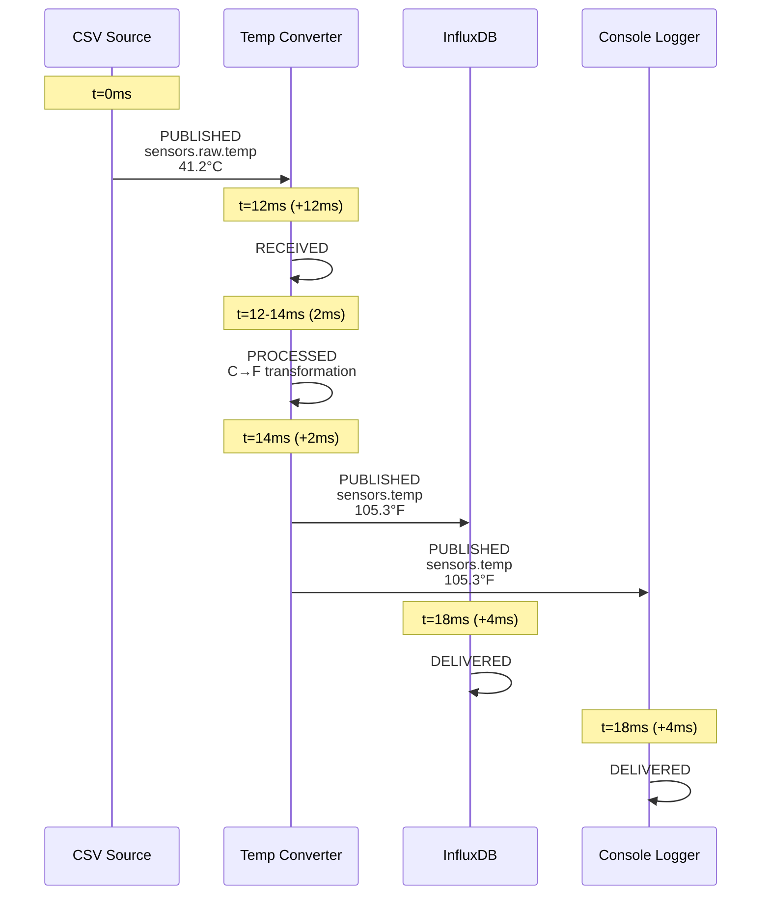

# COD3S Observatory - Message Inspector

**Version:** 1.0
**Date:** 2026-02-11
**Status:** Functional Specification

---

## Navigation

| Previous | Up | Next |
|----------|-----|------|
| [← OBS-05-TEMPORAL-TIMELINE](OBS-05-TEMPORAL-TIMELINE.md) | [OBS-00-OVERVIEW](OBS-00-OVERVIEW.md) | [OBS-07-METRICS-DASHBOARD →](OBS-07-METRICS-DASHBOARD.md) |

---

## Table of Contents

- [Overview](#overview)
- [Data Model](#data-model)
- [UI Layout](#ui-layout)
- [Panels and Tabs](#panels-and-tabs)
- [Selection Methods](#selection-methods)
- [Live Stream Mode](#live-stream-mode)
- [Comparison Mode](#comparison-mode)
- [Search and Filtering](#search-and-filtering)
- [Export and Copy](#export-and-copy)
- [Performance Considerations](#performance-considerations)

---

## Overview

The Message Inspector provides a detailed, multi-faceted view of individual messages flowing through the pipeline. It serves as the primary tool for understanding message structure, tracking message journeys, and debugging transformation logic.

**Key capabilities:**
- View message metadata, value, and tags in structured formats
- Trace message journey through the pipeline (source → destination)
- Compare messages side-by-side (e.g., transformation input vs. output)
- Search and filter messages by various criteria
- Stream messages in real-time from specific channels
- Export messages for offline analysis

---

## Data Model

### Message Structure

Each message in the COD3S framework has this structure:

```typescript
interface Message {
  key: string;                      // Message identifier
  value: any;                       // Payload (any JSON-serializable type)
  channel: string;                  // Publication channel
  timestamp: number;                // Unix timestamp (milliseconds)
  tags: Record<string, any>;        // Arbitrary key-value metadata
  _trace_id: string;                // Internal correlation ID
  _source_id: string;               // Component that published the message
  _subscriber_count: number;        // Number of components subscribed to this channel
}
```

### Inspector State

```typescript
interface InspectorState {
  mode: "SINGLE" | "COMPARISON" | "STREAM";
  selectedMessage: Message | null;
  comparisonMessage: Message | null;
  streamChannel: string | null;
  streamFilter: FilterCriteria | null;
  activeTab: "SUMMARY" | "VALUE" | "TAGS" | "JOURNEY" | "RAW";
}
```

---

## UI Layout

### Panel Position

The Message Inspector appears as a **bottom panel** (default) or **right sidebar** (configurable):

**Bottom panel layout:**
```
┌─────────────────────────────────────────────────────────────┐
│                                                             │
│              [Main View: Topology or Timeline]              │
│                                                             │
├─────────────────────────────────────────────────────────────┤
│                                                             │
│              [Message Inspector Panel]                      │
│                                                             │
└─────────────────────────────────────────────────────────────┘
```

**Dimensions:**
- Height: 400px (resizable, 200px min, 80% max)
- Drag handle at top for resizing
- Collapse button (minimize to 40px tab bar)

**Right sidebar layout:**
```
┌────────────────────────────────┬────────────────────────────┐
│                                │                            │
│     [Main View]                │   [Message Inspector]      │
│                                │                            │
│                                │                            │
└────────────────────────────────┴────────────────────────────┘
```

**Dimensions:**
- Width: 600px (resizable, 400px min, 50% max)

---

## Panels and Tabs

The inspector has five tabs, each providing a different view of the message.

### Tab 1: Summary

**Purpose:** Show key metadata at a glance.

**Layout:** Two-column table

| Field | Value |
|-------|-------|
| **Key** | `temperature_sensor_1` |
| **Channel** | `sensors.temp` |
| **Timestamp** | `2026-02-11T10:30:45.123Z` (5 seconds ago) |
| **Source** | `csv_source` |
| **Subscriber Count** | `3` |
| **Trace ID** | `abc123-def456-ghi789` (copy button) |
| **Value Type** | `object` (detected) |
| **Tags Count** | `2` |

**Actions:**
- Copy trace ID to clipboard
- Jump to source component (in topology)
- Show journey (switch to Journey tab)

**Visual:**
- Monospace font for IDs and timestamps
- Color-coded value type (green for valid, red for error)

### Tab 2: Value

**Purpose:** Display the message payload in an interactive tree view.

**Format:** JSON tree with collapsible nodes

**Example:**
```
📦 value (object)
├── 📄 sensor_id: "temp_001"
├── 📊 reading: 105.3
├── 📄 unit: "fahrenheit"
├── 📦 location (object)
│   ├── 📄 zone: "A"
│   ├── 📍 x: 12.5
│   └── 📍 y: 8.2
└── 📋 readings (array) [3 items]
    ├── 🔢 [0]: 103.1
    ├── 🔢 [1]: 104.7
    └── 🔢 [2]: 105.3
```

**Features:**
- **Expand/collapse:** Click on tree nodes
- **Copy value:** Right-click → "Copy value" (JSON string)
- **Copy path:** Right-click → "Copy path" (e.g., `value.location.x`)
- **Type indication:** Icons for string, number, object, array, boolean, null
- **Syntax highlighting:** Colors for different types
- **Search within value:** Ctrl+F highlights matching paths

**Large values:**
- Arrays/objects with >100 items show "Load more..." button
- Strings >1000 chars are truncated with "Expand" button

### Tab 3: Tags

**Purpose:** Display message tags as a key-value table.

**Layout:** Sortable table

| Key | Value | Type |
|-----|-------|------|
| `priority` | `high` | string |
| `retry_count` | `0` | number |
| `validated` | `true` | boolean |
| `timestamp_source` | `2026-02-11T10:30:44.000Z` | string |

**Features:**
- **Sort:** Click column headers to sort by key or value
- **Filter:** Search box filters visible rows
- **Add tag** (if inspector is in edit mode, future feature): Button to add custom tag
- **Copy all tags:** Button exports tags as JSON

**Empty state:** "No tags on this message."

### Tab 4: Journey

**Purpose:** Show the message's path through the pipeline from source to destination(s).

**Layout:** Vertical timeline (chronological steps)

**Example:**
```
┌─────────────────────────────────────────────────────────────┐
│  Journey for message "temperature_sensor_1"                  │
│  Trace ID: abc123-def456-ghi789                              │
└─────────────────────────────────────────────────────────────┘

  ●  t=0ms        PUBLISHED
     ↓            CSV Source → Channel: sensors.raw.temp
                  Value: {"sensor_id": "temp_001", "reading": 41.2}

  ●  t=12ms       RECEIVED (+12ms)
     ↓            Temp Converter (transformation)

  ⚙  t=12-14ms    PROCESSED (2ms duration)
     ↓            Temp Converter
                  Transformation: C→F
                  Result: {"sensor_id": "temp_001", "reading": 105.3}

  ●  t=14ms       PUBLISHED (+2ms)
     ↓            Temp Converter → Channel: sensors.temp

  ●  t=18ms       DELIVERED (+4ms)
                  InfluxDB (destination)

  ●  t=18ms       DELIVERED (+4ms)
                  Console Logger (destination)

┌─────────────────────────────────────────────────────────────┐
│  Total Latency: 18ms                                         │
│  Stages: Source → Transform (12ms) → Destination (4ms)       │
└─────────────────────────────────────────────────────────────┘
```

**Features:**
- **Click event:** Highlight corresponding element in topology/timeline
- **Latency breakdown:** Hover over timeline to see time spent in each stage
- **Error indication:** If an error occurred, show red marker with error details

**Visualization:**


### Tab 5: Raw JSON

**Purpose:** Show the complete message as a JSON string (for copy/paste, debugging).

**Layout:** Code editor with syntax highlighting

**Example:**
```json
{
  "key": "temperature_sensor_1",
  "value": {
    "sensor_id": "temp_001",
    "reading": 105.3,
    "unit": "fahrenheit",
    "location": {
      "zone": "A",
      "x": 12.5,
      "y": 8.2
    },
    "readings": [103.1, 104.7, 105.3]
  },
  "channel": "sensors.temp",
  "timestamp": 1707648645123,
  "tags": {
    "priority": "high",
    "retry_count": 0,
    "validated": true,
    "timestamp_source": "2026-02-11T10:30:44.000Z"
  },
  "_trace_id": "abc123-def456-ghi789",
  "_source_id": "temp_converter",
  "_subscriber_count": 2
}
```

**Features:**
- **Copy to clipboard:** Button copies entire JSON
- **Download:** Button downloads as `.json` file
- **Format:** Toggle between compact and pretty-printed
- **Line numbers:** Enabled by default
- **Syntax validation:** Highlights any malformed JSON (should never happen for valid messages)

---

## Selection Methods

### Method 1: Click in Topology View

**Trigger:** User clicks a node or edge in the topology view.

**Behavior:**
- Inspector opens (if collapsed)
- Shows the most recent message from that component/channel
- If multiple messages available, shows a dropdown to select a specific one

### Method 2: Click in Timeline

**Trigger:** User clicks a message marker or processing span in the timeline.

**Behavior:**
- Inspector opens with the exact message at that timestamp
- Journey tab highlights the clicked event
- Timeline marker is highlighted with selection stroke

### Method 3: Search by Identifier

**Trigger:** User enters a search query in the inspector search bar.

**Search criteria:**
- **Key:** Exact or partial match
- **Channel:** Pattern match (e.g., `sensors.*`)
- **Trace ID:** Exact match
- **Time range:** Between timestamps

**Behavior:**
- Inspector shows a **search results list**
- Clicking a result opens that message in the inspector

**Example search UI:**
```
┌─────────────────────────────────────────────────────────────┐
│  🔍 Search Messages                                          │
│  ┌───────────────────────────────────────────────────────┐  │
│  │ Key or Trace ID: ________                            │  │
│  │ Channel: sensors.*         Time: Last 1 hour ▾       │  │
│  │ [Search]                                              │  │
│  └───────────────────────────────────────────────────────┘  │
│                                                             │
│  Results: 127 messages                                      │
│  ┌───────────────────────────────────────────────────────┐  │
│  │ • temp_001 @ 10:30:45 (sensors.temp)                 │  │
│  │ • temp_002 @ 10:30:46 (sensors.temp)                 │  │
│  │ • temp_003 @ 10:30:47 (sensors.temp)                 │  │
│  │ ...                                                   │  │
│  └───────────────────────────────────────────────────────┘  │
└─────────────────────────────────────────────────────────────┘
```

### Method 4: Breakpoint Hit Auto-Open

**Trigger:** A breakpoint is triggered in debug mode.

**Behavior:**
- Inspector opens automatically (slides in with animation)
- Shows the message that triggered the breakpoint
- Breakpoint condition is displayed at the top (yellow banner)
- Journey tab is pre-selected if the breakpoint is on a transformation output

**Example banner:**
```
┌─────────────────────────────────────────────────────────────┐
│ ⚠️  Breakpoint Hit: value.reading > 100                      │
│     Triggered by: temp_converter on channel sensors.temp     │
└─────────────────────────────────────────────────────────────┘
```

---

## Live Stream Mode

### Purpose

Watch messages on a specific channel in real-time as they are published.

### Activation

**Method 1:** Right-click a channel edge in topology → "Watch channel"

**Method 2:** In inspector, click "Stream" button and enter channel pattern

**Method 3:** WebSocket command:
```json
{
  "type": "inspector.stream",
  "id": "cmd-020",
  "payload": {
    "channel_pattern": "sensors.temp",
    "max_messages": 100,
    "auto_scroll": true
  }
}
```

### UI Layout

**Stream mode replaces the inspector tabs with a live feed:**

```
┌─────────────────────────────────────────────────────────────┐
│  📡 Streaming: sensors.temp                      [Stop]      │
├─────────────────────────────────────────────────────────────┤
│  Messages (newest first):                                    │
│  ┌───────────────────────────────────────────────────────┐  │
│  │ ● temp_003 @ 10:30:47                                 │  │
│  │   Value: {"reading": 106.1, ...}              [Inspect]│  │
│  ├───────────────────────────────────────────────────────┤  │
│  │ ● temp_002 @ 10:30:46                                 │  │
│  │   Value: {"reading": 105.3, ...}              [Inspect]│  │
│  ├───────────────────────────────────────────────────────┤  │
│  │ ● temp_001 @ 10:30:45                                 │  │
│  │   Value: {"reading": 104.7, ...}              [Inspect]│  │
│  └───────────────────────────────────────────────────────┘  │
│  🔄 Auto-scroll: ON    Buffer: 100 messages    Clear        │
└─────────────────────────────────────────────────────────────┘
```

### Features

- **Auto-scroll:** New messages appear at top, list auto-scrolls (can be disabled)
- **Buffer limit:** Keep last N messages (configurable, 100 default, 1000 max)
- **Click "Inspect":** Opens that message in full inspector (pauses stream)
- **Filter:** Text input filters visible messages by key or value content
- **Pause/Resume:** Pause stream (keeps connection, stops displaying new messages)
- **Clear:** Remove all messages from buffer
- **Export:** Download all buffered messages as JSON array

### Performance

- Rendering is throttled to 10 FPS (max 10 new messages displayed per second)
- If message rate exceeds 100 msg/s, a warning appears: "High throughput — some messages may be dropped"

---

## Comparison Mode

### Purpose

Compare two messages side-by-side, typically:
- Transformation input vs. output
- Same message at different pipeline stages
- Two similar messages (e.g., before/after config change)

### Activation

**Method 1:** In Journey tab, click "Compare" button between two events

**Method 2:** Select a message, then Shift+Click another message in timeline/topology

**Method 3:** In inspector, click "Compare" button and select second message from dropdown

### UI Layout

**Split-panel view:**

```
┌──────────────────────────────┬──────────────────────────────┐
│  Message A                   │  Message B                   │
│  Key: temp_001               │  Key: temp_001               │
│  Channel: sensors.raw.temp   │  Channel: sensors.temp       │
│  Timestamp: 10:30:45.000     │  Timestamp: 10:30:45.014     │
├──────────────────────────────┼──────────────────────────────┤
│  Value:                      │  Value:                      │
│  {                           │  {                           │
│    "sensor_id": "temp_001",  │    "sensor_id": "temp_001",  │
│    "reading": 41.2,          │    "reading": 105.3,    ← DIFF
│    "unit": "celsius"         │    "unit": "fahrenheit" ← DIFF
│  }                           │  }                           │
└──────────────────────────────┴──────────────────────────────┘
```

### Difference Highlighting

- **Changed fields:** Yellow background
- **Added fields:** Green background (only in B)
- **Removed fields:** Red background (only in A)
- **Unchanged fields:** No background

**Visual indicators:**
- `← DIFF` marker on changed lines
- Sync scrolling (both panels scroll together)

### Diff View Options

| Option | Description |
|--------|-------------|
| **Unified** | Single panel with +/- indicators (like git diff) |
| **Split** | Side-by-side panels (default) |
| **Value only** | Compare only the `value` field (ignore metadata) |
| **Full** | Compare entire message including trace ID, timestamp, etc. |

### Example: Transformation Input vs. Output

**Scenario:** Temperature converter (Celsius → Fahrenheit)

**Input message (sensors.raw.temp):**
```json
{
  "key": "temp_001",
  "value": {
    "sensor_id": "temp_001",
    "reading": 41.2,
    "unit": "celsius"
  },
  "channel": "sensors.raw.temp",
  "timestamp": 1707648645000,
  "_trace_id": "abc123"
}
```

**Output message (sensors.temp):**
```json
{
  "key": "temp_001",
  "value": {
    "sensor_id": "temp_001",
    "reading": 105.3,
    "unit": "fahrenheit"
  },
  "channel": "sensors.temp",
  "timestamp": 1707648645014,
  "_trace_id": "abc123"
}
```

**Diff summary:**
- **Changed:** `value.reading` (41.2 → 105.3)
- **Changed:** `value.unit` ("celsius" → "fahrenheit")
- **Changed:** `channel` (sensors.raw.temp → sensors.temp)
- **Changed:** `timestamp` (+14ms)
- **Unchanged:** `key`, `_trace_id`, `value.sensor_id`

---

## Search and Filtering

### Search Interface

**Location:** Top bar of inspector (always visible)

```
┌─────────────────────────────────────────────────────────────┐
│  🔍 [Search messages...]                          [Filters ▾]│
└─────────────────────────────────────────────────────────────┘
```

### Search Criteria

| Criterion | Input Type | Example |
|-----------|-----------|---------|
| **Key** | Text (partial match) | `temp_001` |
| **Channel** | Pattern | `sensors.*.temperature` |
| **Trace ID** | Text (exact match) | `abc123-def456` |
| **Time range** | DateTime picker | `2026-02-11 10:30:00` to `10:35:00` |
| **Value content** | Full-text search | `reading > 100` (not implemented in v1.0) |
| **Tags** | Key-value filter | `priority=high` |

### Advanced Filters

**Filter panel (expandable):**

```
┌─────────────────────────────────────────────────────────────┐
│  Filters                                                     │
│  ┌───────────────────────────────────────────────────────┐  │
│  │ Channel: [sensors.*          ]                        │  │
│  │ Time:    [Last 1 hour ▾      ]                        │  │
│  │ Source:  [All components ▾   ]                        │  │
│  │ Tags:    [priority=high      ] [+ Add]                │  │
│  │                                                        │  │
│  │ [Apply]  [Reset]                                      │  │
│  └───────────────────────────────────────────────────────┘  │
└─────────────────────────────────────────────────────────────┘
```

### Search Results

Results appear as a **paginated list**:

```
┌─────────────────────────────────────────────────────────────┐
│  Search Results: 127 messages                                │
│                                                             │
│  ┌─────────────────────────────────────────────────────┐    │
│  │ ● temp_001 @ 10:30:45                               │    │
│  │   sensors.temp • Trace: abc123        [Inspect]     │    │
│  ├─────────────────────────────────────────────────────┤    │
│  │ ● temp_002 @ 10:30:46                               │    │
│  │   sensors.temp • Trace: abc456        [Inspect]     │    │
│  └─────────────────────────────────────────────────────┘    │
│                                                             │
│  Page 1 of 13                          [< Prev] [Next >]    │
└─────────────────────────────────────────────────────────────┘
```

**Click "Inspect":** Opens full inspector for that message.

---

## Export and Copy

### Export Formats

| Format | Extension | Use Case |
|--------|-----------|----------|
| **JSON** | `.json` | Programmatic analysis, re-ingestion |
| **CSV** | `.csv` | Spreadsheet analysis (flattens nested objects) |
| **Text** | `.txt` | Human-readable log format |

### Copy Actions

| Action | Shortcut | Result |
|--------|----------|--------|
| **Copy entire message** | Ctrl+C | JSON string to clipboard |
| **Copy key** | - | Key string to clipboard |
| **Copy trace ID** | - | Trace ID to clipboard |
| **Copy value** | - | Value as JSON |
| **Copy value path** | Right-click tree node | JSONPath (e.g., `$.value.location.x`) |

### Batch Export

Select multiple messages (in search results or stream) and export as:
- **JSON array:** `[{message1}, {message2}, ...]`
- **NDJSON:** Newline-delimited JSON (one message per line)
- **CSV:** Table with columns: key, channel, timestamp, value (flattened), tags

---

## Performance Considerations

### Message Storage

**Backend:** Messages are stored in a **ring buffer** (limited size, oldest messages evicted).

**Default capacity:** Last 10,000 messages OR last 10 minutes (whichever comes first)

**Configurable:**
```yaml
observatory:
  message_buffer:
    max_messages: 10000
    max_duration_seconds: 600
```

### Frontend Caching

**Inspector caches the last 100 inspected messages** in memory to allow instant navigation.

**Cache invalidation:** When a new message with the same trace_id arrives, cached journey is updated.

### Lazy Loading

**Large values (>100 KB):** Value tab shows "Load full value" button instead of rendering immediately.

**Large journeys (>50 events):** Journey tab paginates events (show first 20, "Load more" button).

---

## Summary

The Message Inspector is the central tool for detailed message analysis. With five specialized views (Summary, Value, Tags, Journey, Raw JSON), developers can inspect every aspect of a message, trace its path through the pipeline, compare transformations, and search/filter across thousands of messages.

Live stream mode enables real-time channel monitoring, while comparison mode helps verify transformation logic. Combined with the topology and timeline views, the inspector completes the Observatory's debugging toolkit.

**Next:** [OBS-07-METRICS-DASHBOARD](OBS-07-METRICS-DASHBOARD.md) describes the performance monitoring interface.

---

## Navigation

| Previous | Up | Next |
|----------|-----|------|
| [← OBS-05-TEMPORAL-TIMELINE](OBS-05-TEMPORAL-TIMELINE.md) | [OBS-00-OVERVIEW](OBS-00-OVERVIEW.md) | [OBS-07-METRICS-DASHBOARD →](OBS-07-METRICS-DASHBOARD.md) |

---

*This is a functional specification document for the COD3S Observatory module. Technical implementation details are in [OBS-TECH-05-MESSAGE-INSPECTOR](../../TECHNICAL_SPECIFICATION/OBSERVATORY/OBS-TECH-05-MESSAGE-INSPECTOR.md).*
