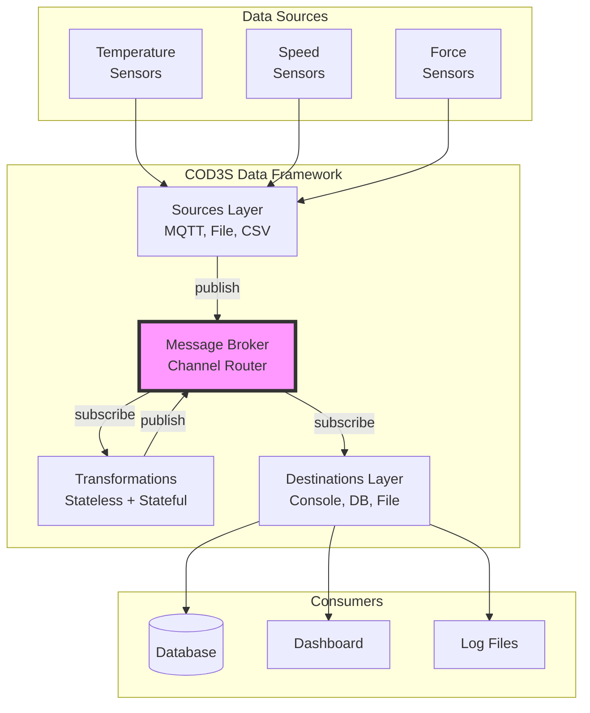
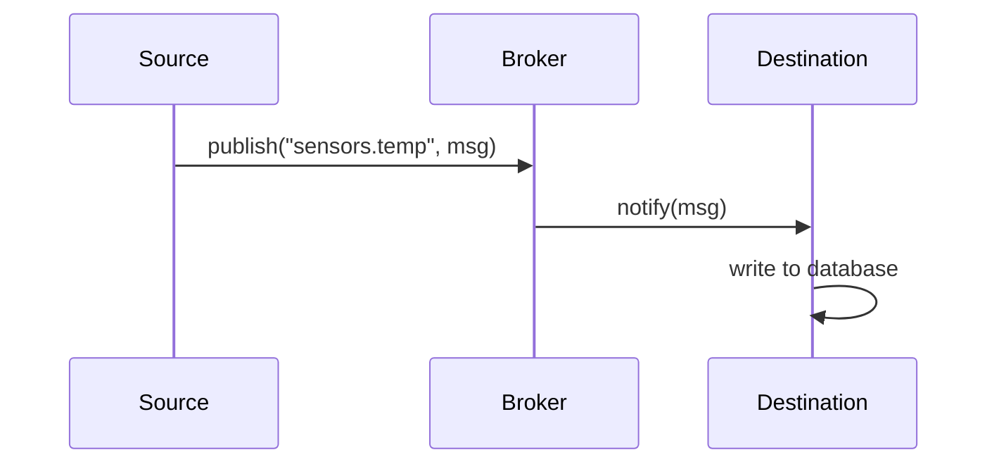

# COD3S Data Framework
## Technical Deep Dive

**Comprehensive Architecture and Implementation Guide**

Version 1.0 | 2026-01-24
For Developers, Architects, and DevOps Engineers

---

## Agenda

1. Introduction and Context
2. High-Level Architecture
3. Core Components Deep Dive
4. Message Lifecycle and Data Flows
5. Configuration and Deployment
6. Observability and Monitoring
7. Testing Strategies
8. V1.0 Scope and V2.0+ Roadmap
9. Implementation Considerations

---

# Part 1: Introduction

---

## The Problem We're Solving

### Industrial Data Pipeline Challenges

**Integration Complexity**
- Each sensor type requires custom integration code
- No standard pattern for data ingestion/processing
- Tight coupling between sources and consumers

**Processing Bottlenecks**
- Hard to implement real-time transformations
- Difficult to coordinate multi-sensor data
- No built-in support for stateful processing

**Limited Observability**
- Black-box pipelines with poor visibility
- Debugging requires custom instrumentation

---

## Design Principles

### 1. Simplicity Over Features
- Solve 80% of use cases with 20% of complexity
- V1.0: In-memory broker (simple, fast) vs. requiring Kafka/RabbitMQ

### 2. Developer Experience First
- Comprehensive examples for common patterns
- Clear error messages with actionable guidance
- YAML for simple cases, Python API for advanced

### 3. Production-Ready by Default
- Built-in retry logic, dead letter queues
- Bounded buffers prevent memory exhaustion
- Metrics and logging out-of-the-box

---

## Design Principles (cont.)

### 4. Observable by Design
- Metrics exposed as messages (self-reporting)
- Structured logging with correlation IDs
- Debug mode for detailed tracing

### 5. Extensible, Not Monolithic
- Clear interfaces for Sources, Transformations, Destinations
- Easy to add custom implementations (<50 lines of Python)
- No need to fork the framework

### 6. Technology-Agnostic Core
- Framework doesn't mandate Docker, Kubernetes, cloud
- Works on bare metal, VMs, containers, edge devices
- Standard Python (no exotic dependencies)

---

## Use Case: 3D Printer Monitoring

**Scenario**: Manufacturing facility with 3D printers

**Sensors per printer**:
- Temperature (extruder, bed, ambient)
- Motor speed (X/Y/Z axes, extruder)
- Vibration (frame, motors)
- Force (filament feeding resistance)

**Requirements**:
1. Real-time alerts (temp > threshold)
2. Computed indicators (viscosity = f(temp, speed, force))
3. Data persistence (historical analysis)
4. Flexible routing (console, database, dashboard)

**Solution**: COD3S Data framework with YAML configuration

---

# Part 2: Architecture

---

## High-Level Architecture



---

## Architectural Principles

### Loose Coupling via Broker
- All components communicate **only** through the broker
- No direct component-to-component calls
- Easy to add/remove/replace components

### Publish-Subscribe Pattern
- Sources **publish** to channels
- Destinations **subscribe** to channel patterns
- Transformations are both publishers and subscribers

### Dynamic Routing
- Channels created on-the-fly (no pre-declaration)
- Wildcard subscriptions (`sensors.*`, `sensors.**`)
- Hierarchical naming convention (`domain.subdomain.metric`)

---

## Core Components

### 1. Sources (Data Ingestion)
**Responsibility**: Ingest data from external systems, publish messages

**V1.0 Catalog**:
- `RandomSource` - Generate random values (testing)
- `SequenceSource` - Generate numeric sequences (testing)
- `FileSource` - Read line-delimited files
- `CSVSource` - Read CSV files with headers

**Key Features**:
- Batch modes: BATCH (finite), REALTIME (continuous), TRANSPOSE (planned V1.x)
- Controllable: cancel, pause/resume, progress tracking
- Configurable delivery: at-most-once (default), at-least-once

---

## Core Components (cont.)

### 2. Broker (Message Distribution)
**Responsibility**: Route messages from publishers to subscribers

**V1.0**: In-memory broker
- Low latency (<50ms p99)
- No persistence (messages lost on restart)
- Recent message history for late-joining subscribers

**Key Functions**:
```python
publish(channel, message)        # Publish message
subscribe(pattern, callback)     # Register subscriber
get_history(channel, count)      # Retrieve recent messages
```

---

## Core Components (cont.)

### 3. Transformations (Data Processing)

**Stateless (1:N)**:
- Input: Single message from one channel
- Output: 0, 1, or N messages
- Examples: Filtering, alerts, unit conversion

**Stateful (N:M)**:
- Input: Multiple messages from multiple channels
- Output: 0, 1, or N messages
- State: Framework-managed helpers (latest values, windows)
- Examples: Multi-sensor computations, aggregations

**Framework Helpers**:
- `self.state` - Dict for tracking state (latest values, counters, etc.)
- `transform_with_state(message, state)` - Override in StatefulTransform
- `AggregateTransform` - Built-in time/count window aggregation

---

## Core Components (cont.)

### 4. Destinations (Data Output)
**Responsibility**: Consume messages, send to external systems

**V1.0 Catalog**:
- `ConsoleDestination` - Print to stdout (debugging)
- `FileDestination` - Append to files
- `InMemoryDestination` / `CollectDestination` - Testing

**Key Features**:
- Buffering with overflow strategies (drop oldest, drop newest)
- Retry logic (exponential/fixed backoff)
- Dead Letter Queue for failed messages
- Historical access: none/recent/all

---

## Core Components (cont.)

### 5. Channels (Routing Paths)
**Responsibility**: Logical routing paths for messages

**Characteristics**:
- Hierarchical naming: `domain.subdomain.metric`
- Dynamic creation (no pre-declaration)
- Wildcard subscriptions: `*` (single-level), `**` (multi-level)
- Reserved prefix: `_` (system channels: `_dlq.*`, `_metrics.*`)

**Examples**:
```
sensors.printer1.temperature.extruder
sensors.printer1.motor.speed.x
indicators.printer1.viscosity
alerts.critical
_dlq.db_failures.sensors.temp
_metrics.broker.throughput
```

---

# Part 3: Messages

---

## Message Structure

### Message Anatomy

```yaml
key: "temperature_extruder"        # What is measured
timestamp: "2024-01-15T10:30:45Z"  # When (UTC)
value: 235.7                       # Measurement value
tags:                              # Optional metadata
  location: "warehouse_A"
  sensor_id: "TH001"
  printer_id: "printer_1"
id: "a3b7c9d1-..."                # Unique ID (auto-generated)
```

**Value Types**: Numbers, strings, booleans, JSON objects, arrays

**Tags**: Key-value metadata for filtering (all values as strings)

---

## Delivery Guarantees

### Configurable Per Source

**At-Most-Once (Default)**
- Fire-and-forget (no ACK)
- Fast, low overhead
- May lose messages on failure
- Use case: High-frequency, non-critical data

**At-Least-Once (Opt-In)**
- Acknowledged delivery with retries
- No message loss (except DLQ)
- May deliver duplicates
- Use case: Critical data (safety, compliance)

**Note**: Delivery guarantees are configured at the broker level in V1.0, not per-source YAML fields.

---

## Message Ordering

### No Ordering Guarantee

**Design Decision**: Framework does NOT guarantee message ordering

**Rationale**:
- Simpler architecture (no buffering, no latency)
- More scalable (no coordination)
- Matches distributed reality (network delays, parallel processing)

**Implications**:
- Messages may arrive out of order
- Applications sort by timestamp if order matters
- Stateful transformations: `self.state` tracks most recently **arrived** (not latest timestamp)

**Out-of-Order Handling**:
- Default: Accept all (warn + emit metrics)
- Strict mode: Reject older messages (send to DLQ)

---

## Timezone Handling

### Accept Timezone-Aware, Normalize to UTC

**Accepted Formats** (ISO 8601):
```python
"2024-01-15T10:00:00Z"           # UTC with Z suffix ✅ Preferred
"2024-01-15T10:00:00+00:00"      # UTC explicit offset
"2024-01-15T11:00:00+01:00"      # Paris time (CET)
"2024-01-15T04:00:00-05:00"      # New York time (EST)
"2024-01-15T10:00:00"            # No timezone → REJECTED (ValueError)
```

**Normalization**:
- All timestamps converted to UTC internally
- Original timezone NOT preserved
- Transformations receive UTC timestamps
- Naive (no timezone) timestamps are **rejected with ValueError**

---

## Retry Strategies and Dead Letter Queue

### Destination-Level Retries

```yaml
destination:
  retry_attempts: 3
  retry_backoff: "exponential"  # or "fixed"
  retry_initial_delay: 1s
  retry_max_delay: 60s
  dead_letter_channel: "_dlq.db_failures"
```

**Exponential Backoff**: `delay = min(initial * 2^attempt, max)`
- Attempt 1: 1s, Attempt 2: 2s, Attempt 3: 4s, ...

**Fixed Backoff**: `delay = initial` (constant)

**Dead Letter Queue (DLQ)**:
- Reserved channels: `_dlq.*`
- Captures failed messages (original + error metadata)
- Subscribe to DLQ for monitoring/alerting

---

# Part 4: Data Flow Patterns

---

## Pattern 1: Simple Forwarding

**Use Case**: Ingest sensor data, write to database



**Configuration**:
```yaml
sources:
  - type: mqtt
    channel: "sensors.temp"

destinations:
  - type: database
    channel_pattern: "sensors.temp"
```

---

## Pattern 2: Filtering and Alerting

**Use Case**: Monitor temperature, alert if exceeds threshold

```yaml
sources:
  - type: mqtt
    channel: "sensors.temp"

transformations:
  - type: filter
    input_channels: "sensors.temp"
    output_channel: "alerts.critical"
    params:
      predicate: "value > 240"

destinations:
  - type: console
    channel_pattern: "alerts.critical"
  - type: database
    channel_pattern: "sensors.temp"
```

**Result**: Original data to DB, alerts to console

---

## Pattern 3: Multi-Sensor Computation

**Use Case**: Compute viscosity from temp, speed, force (stateful)

```python
class ViscosityComputer(StatefulTransform):
    async def transform_with_state(self, message, state):
        state[message.key] = message  # Track latest per key
        if len(state) < 3:
            return None  # Wait for all sensors

        viscosity = compute_viscosity(
            state["sensors.temp"].value,
            state["sensors.speed"].value,
            state["sensors.force"].value,
        )

        return Message(key="viscosity", value=viscosity, ...)
```

---

## Pattern 4: Transformation Chain

**Use Case**: Raw → Filter → Map → Storage

```yaml
sources:
  - type: mqtt
    channel: "sensors.temp.raw"

transformations:
  - type: filter
    input_channels: "sensors.temp.raw"
    output_channel: "sensors.temp.valid"
    params:
      predicate: "value is not None"

  - type: map
    input_channels: "sensors.temp.valid"
    output_channel: "sensors.temp.celsius"
    params:
      expression: "(value - 32) * 5 / 9"

destinations:
  - type: database
    channel_pattern: "sensors.temp.celsius"
```

> **Note**: Deduplication and unit_conversion transforms are **Planned (V1.x)**.
> V1.0 provides `filter`, `map`, and `aggregate` built-in transforms.

---

## Pattern 5: Fan-Out (Multiple Destinations)

**Use Case**: Same data to console, database, file

```yaml
sources:
  - type: mqtt
    channel: "sensors.temp"

destinations:
  - type: console
    channel_pattern: "sensors.temp"

  - type: database
    channel_pattern: "sensors.temp"

  - type: file
    channel_pattern: "sensors.temp"
    params:
      path: "sensor_data.log"
```

**Result**: Same message delivered to all subscribed destinations

---

# Part 5: Configuration

---

## Triple Configuration Approach

### 1. YAML (Declarative)

**Best for**: Standard cases, simple pipelines

```yaml
sources:
  - type: mqtt
    channel: "sensors.temp"

destinations:
  - type: console
    channel_pattern: "sensors.**"
```

### 2. Python API (Programmatic)

**Best for**: Dynamic configuration, advanced use cases

```python
config = PipelineConfig(
    sources=[SourceConfig(type="random", channel="sensors.temp", params={"rate": 1})],
    destinations=[DestinationConfig(type="console", channel_pattern="sensors.**")],
)
async with Framework(config) as framework:
    await framework.run()
```

---

## Triple Configuration Approach (cont.)

### 3. Environment Variables (Deployment)

**Best for**: Deployment-specific overrides (dev/staging/prod)

```bash
export COD3S_BROKER_HISTORY_SIZE=500
export COD3S_BROKER_ENABLE_METRICS=true
export COD3S_OBSERVATORY_ENABLED=true
export COD3S_PIPELINE_NAME=prod_pipeline

cod3s-data run pipeline.yaml
```

### Configuration Hierarchy (Precedence)

```
Environment Variables (highest)
  ↓
Python API (overrides YAML)
  ↓
YAML Configuration (base)
  ↓
Framework Defaults (lowest)
```

---

## Configuration Example: Complete Pipeline

```yaml
# pipeline.yaml
name: "printer_monitoring"

broker:
  enable_metrics: true
  history_size: 200

plugins:
  - my_project.custom_transforms

sources:
  - label: temp_sensor
    type: random
    channel: "sensors.temperature"
    params:
      rate: 10
      min_value: 180
      max_value: 260

transformations:
  - label: high_temp_alert
    type: filter
    input_channels: "sensors.temperature"
    output_channel: "alerts.critical.temperature"
    params:
      predicate: "value > 250"

  - label: viscosity_compute
    type: viscosity_computer  # Custom plugin-based transform
    input_channels:
      - "sensors.temperature"
      - "sensors.speed"
      - "sensors.force"
    output_channel: "indicators.viscosity"

destinations:
  - label: console_alerts
    type: console
    channel_pattern: "alerts.**"

  - label: file_storage
    type: file
    channel_pattern: "sensors.**"
    params:
      path: "sensor_data.jsonl"
```

---

# Part 6: Observability

---

## Metrics as Messages

### Self-Reporting System

**Concept**: Framework publishes metrics as messages to `_metrics.*` channels

**Benefits**:
- Uniform abstraction (metrics use same infrastructure as data)
- Subscribe to metrics like any other channel
- Route metrics to console, file, database, Prometheus (V2.0)

**System Metrics** (auto-published):
```
_metrics.broker.throughput
_metrics.broker.latency
_metrics.source.<name>.messages_sent
_metrics.destination.<name>.messages_received
_metrics.destination.<name>.buffer_depth
_metrics.transformation.<name>.processing_time
_metrics.dlq.message_count
```

---

## Metrics Example

### Subscribe to Metrics

```yaml
# Monitor all metrics
destinations:
  - type: console
    channel_pattern: "_metrics.**"

# Monitor specific metrics
destinations:
  - type: file
    channel_pattern: "_metrics.broker.**"
    params:
      path: "metrics.jsonl"

# Alert on high DLQ count
transformations:
  - type: filter
    input_channels: "_metrics.dlq.message_count"
    output_channel: "alerts.operations.high_dlq"
    params:
      predicate: "value > 100"
```

**Metrics Message Structure**:
```yaml
key: "throughput"
timestamp: "2024-01-15T10:30:45Z"
value: 8542  # messages/second
tags:
  component: "broker"
  metric_type: "throughput"
```

---

## Logging and Tracing

### Structured Logging

**Log Levels**: DEBUG, INFO, WARNING, ERROR, CRITICAL

**Log Format**:
```json
{
  "timestamp": "2024-01-15T10:30:45Z",
  "level": "WARNING",
  "component": "destination.database",
  "message": "Retry attempt 2/3 failed",
  "trace_id": "a3b7c9d1-...",
  "message_id": "a3b7c9d1-...",
  "error": "ConnectionRefusedError: database:5432"
}
```

**Trace IDs**: Follow message through entire pipeline
- Source generates message → trace ID assigned
- All logs for that message share same trace ID
- Easy to grep logs for specific message flow

---

## Debug Mode

### Enhanced Visibility

**Enable Debug Mode** (via Observatory):
```yaml
observatory:
  enabled: true
  debug:
    enabled: true
```

**Debug Output**:
- Every message published/delivered (full content)
- Subscription registration/unregistration
- Buffer state (depth, overflow events)
- Transformation input/output (before/after)
- Retry attempts and backoff delays

**Performance Impact**: Significant (verbose logging) - use only for debugging

---

# Part 7: Deployment

---

## Deployment Modes

### 1. Embedded Library

**Use Case**: Integrate into existing Python application

```python
import asyncio
from cod3s_data.config.models import PipelineConfig, SourceConfig, DestinationConfig
from cod3s_data.framework import Framework

config = PipelineConfig(
    sources=[SourceConfig(type="random", channel="sensors.temp", params={"rate": 1})],
    destinations=[DestinationConfig(type="console", channel_pattern="sensors.**")],
)

async def main():
    async with Framework(config) as framework:
        await framework.run()

asyncio.run(main())
```

**Benefits**: Minimal overhead, direct API access, easy debugging
**Drawbacks**: Shares resources with application

---

## Deployment Modes (cont.)

### 2. Standalone Service

**Use Case**: Separate process, managed by systemd or Docker

```bash
# Start with YAML configuration
cod3s-data run pipeline.yaml

# With Observatory enabled
cod3s-data run pipeline.yaml --observatory
```

**Systemd Service**:
```ini
[Unit]
Description=COD3S Data Service
After=network.target

[Service]
Type=simple
ExecStart=/usr/local/bin/cod3s-data run /etc/cod3s/pipeline.yaml
Restart=always

[Install]
WantedBy=multi-user.target
```

**Benefits**: Process isolation, restart independently
**Drawbacks**: Separate deployment, IPC overhead

---

## Deployment Modes (cont.)

### 3. CLI Tool

**Use Case**: Command-line operations (testing, batch processing)

```bash
# Run a pipeline from YAML configuration
cod3s-data run pipeline.yaml

# Run with Observatory web UI
cod3s-data run pipeline.yaml --observatory

# Run in interactive mode (pipeline waits for UI to start it)
cod3s-data run pipeline.yaml --interactive

# Validate configuration without running
cod3s-data validate pipeline.yaml
```

**Benefits**: Quick ad-hoc tasks, scripting, testing
**Drawbacks**: Not for long-running services

---

## Resource Requirements (V1.0 Targets)

### Performance Targets

| Metric | Target | Notes |
|--------|--------|-------|
| **Latency** | <50ms p99 | Message ingestion to delivery |
| **Throughput** | 10,000 msg/s | Single instance, in-memory broker |
| **Memory** | <512MB | Typical workload (1000 msg buffer) |
| **CPU** | Single-core | Multi-core for higher throughput |

### Scaling Strategies

**Vertical Scaling** (V1.0):
- Increase buffer sizes
- Add more CPU cores
- Increase memory for larger buffers

**Horizontal Scaling** (V2.0+):
- Multiple instances with external broker (Redis, RabbitMQ)
- Load balancing across instances

---

# Part 8: Testing

---

## Test Sources

### Built-in Test Sources (V1.0)

**RandomSource**:
```yaml
sources:
  - type: random
    channel: "test.random.temp"
    params:
      min_value: 0
      max_value: 100
      rate: 10  # messages per second
      max_messages: 600  # stop after 600 messages
```

**SequenceSource**:
```yaml
sources:
  - type: sequence
    channel: "test.sequence"
    params:
      start_value: 1
      end_value: 1000
      step_value: 1
```

**Use Case**: Validate transformations and destinations without real sensors

---

## Record/Replay Testing

### TRANSPOSE Mode (**Planned V1.x**)

> **Note**: TRANSPOSE mode is planned for a future V1.x release.
> V1.0 supports CSV in BATCH mode for replaying recorded data.

**Record Production Data**:
```yaml
# Production pipeline
sources:
  - type: mqtt
    channel: "sensors.temp"

destinations:
  - type: file
    channel_pattern: "sensors.temp"
    params:
      path: "recorded_data.jsonl"  # JSONL format
```

**Replay for Testing (BATCH mode, V1.0)**:
```yaml
# Test pipeline
sources:
  - type: csv
    channel: "sensors.temp"
    params:
      path: "recorded_data.csv"

destinations:
  - type: collect
    channel_pattern: "output.**"
```

---

## Integration Testing

### CollectDestination for Assertions

```python
# test_pipeline.py
import pytest
from cod3s_data.config.models import PipelineConfig, SourceConfig, DestinationConfig
from cod3s_data.framework import Framework

@pytest.mark.asyncio
async def test_pipeline():
    config = PipelineConfig(
        sources=[SourceConfig(
            type="sequence", channel="sensors.temp",
            params={"start_value": 1, "end_value": 101},
        )],
        destinations=[DestinationConfig(
            type="collect", channel_pattern="sensors.temp",
        )],
    )
    async with Framework(config) as fw:
        await fw.run()

    # Access collector via fw.destinations[0]
    collector = fw.destinations[0]
    assert len(collector.messages) == 100
    assert all(m.value > 0 for m in collector.messages)
```

---

## Testing Best Practices

### Recommended Testing Strategy

1. **Unit Tests**: Individual transformations
   ```python
   async def test_filter_transform():
       # Test transform logic directly
       msg = Message(key="temp", timestamp=now_utc(), value=150)
       result = await transform.transform(msg)
       assert result is not None
   ```

2. **Integration Tests**: Full pipelines with test sources
   ```python
   async def test_pipeline():
       config = PipelineConfig(
           sources=[SourceConfig(type="sequence", ...)],
           destinations=[DestinationConfig(type="collect", ...)],
       )
       async with Framework(config) as fw:
           await fw.run()
       assert len(fw.destinations[0].messages) > 0
   ```

3. **CSV Replay Tests**: Test with recorded data
   ```python
   async def test_with_recorded_data():
       config = PipelineConfig(
           sources=[SourceConfig(type="csv", channel="sensors.temp",
               params={"path": "recorded.csv"})],
           destinations=[DestinationConfig(type="collect", ...)],
       )
       async with Framework(config) as fw:
           await fw.run()
   ```

---

# Part 9: V1.0 Scope and Roadmap

---

## V1.0 Scope (Current Specification)

### Included Features

✅ **Core Framework**:
- In-memory message broker with metrics and history
- Hierarchical channel routing with wildcards
- Advisory delivery guarantees (at-most-once, at-least-once)
- Plugin system for custom components

✅ **Components**:
- Sources: Random, Sequence, File, CSV
- Transformations: Filter, Map, Aggregate, Stateless, Stateful
- Destinations: Console, File, InMemory/Collect

✅ **Operations**:
- YAML + Python API + `COD3S_*` environment variable configuration
- CLI tool (`cod3s-data run`, `cod3s-data validate`)
- Observatory web UI for debugging and monitoring
- Metrics as messages (`_metrics.*` channels)
- Structured logging with trace IDs

---

## V1.0 Scope (cont.)

### Limitations (V1.0)

❌ **Not Included**:
- Distributed processing (single-node only)
- Persistent message storage (in-memory only)
- External message brokers (Redis, RabbitMQ)
- External databases (PostgreSQL, InfluxDB)
- MQTT, HTTP, Kafka connectors (V2.0)
- Prometheus, OpenTelemetry integration (V2.0)
- Complex event processing (V3.0+)
- Schema registry and versioning (V3.0+)

**Rationale**: V1.0 focuses on **core functionality** with minimal dependencies. V2.0 adds **integrations**, V3.0 adds **advanced features**.

---

## V2.0 Roadmap (Future)

### Focus: Industry-Standard Integrations

**Timeline**: 6-12 months after V1.0 release

**Planned Features**:
- 🔄 **Docker Containerization**: Official Docker images, compose examples
- 🔄 **External Databases**: PostgreSQL, InfluxDB, TimescaleDB sources/destinations
- 🔄 **Message Brokers**: Redis Streams, RabbitMQ support
- 🔄 **Protocol Connectors**: MQTT, HTTP, Kafka sources/destinations
- 🔄 **Advanced Observability**: Prometheus metrics, OpenTelemetry tracing
- 🔄 **Health Checks**: HTTP endpoints for orchestration (Kubernetes probes)
- 🔄 **Configuration Tools**: Schema validation, configuration wizards

---

## V3.0+ Roadmap (Ideas)

### Focus: Advanced Processing and Distribution

**Timeline**: Undefined (depends on community needs)

**Ideas**:
- 💡 **Complex Event Processing (CEP)**: Pattern detection, event correlation
- 💡 **Distributed Processing**: Multi-node coordination, horizontal scaling
- 💡 **Persistent State**: RocksDB, Redis backends for stateful transformations
- 💡 **ML Integration**: Model inference, online learning, feature extraction
- 💡 **Cloud-Native**: Kubernetes operator, auto-scaling, service mesh
- 💡 **Data Governance**: Schema registry, lineage tracking, audit trails

**Note**: V3.0+ features subject to V1/V2 adoption and community feedback

---

# Part 10: Implementation Considerations

---

## Reference Implementation (V1.0)

### Technology Choices

**Language**: Python 3.12+
- Wide adoption in industrial/IoT
- Easy to extend (custom sources/transformations)
- Rich ecosystem (MQTT, databases, HTTP)

**Concurrency**: asyncio (non-blocking I/O)
- Lightweight (no thread overhead)
- Native Python support
- Suitable for I/O-bound workloads

**Serialization**: JSON
- Human-readable (debugging)
- Universal support
- Acceptable performance for V1.0 targets

**Note**: These are **implementation choices**, not **specification requirements**. Other implementations (Go, Rust, C++) are possible.

---

## Performance Optimization Tips

### Achieving V1.0 Targets (<50ms p99, 10K msg/s)

1. **Minimize Allocations**: Reuse message objects where possible

2. **Batch Processing**: Process messages in batches (transformations, destinations)

3. **Async I/O**: Non-blocking I/O for sources/destinations (don't block event loop)

4. **Buffer Tuning**: Balance memory vs latency
   ```yaml
   destination:
     buffer_size: 10000  # Larger buffers = better throughput
     flush_interval: 100ms  # Trade-off: latency vs batching
   ```

5. **Monitoring**: Use metrics to identify bottlenecks
   ```yaml
   destinations:
     - type: console
       channel_pattern: "_metrics.**.latency"
   ```

---

## Extension Points

### Adding Custom Components

**Custom Source** (implement `produce()` generator):
```python
import asyncio
from datetime import datetime, timezone
from cod3s_data.sources.base import Source
from cod3s_data.core.message import Message

class MyCustomSource(Source):
    async def produce(self):
        while True:
            data = await self.fetch_data()
            yield Message(
                key="my_key",
                value=data,
                timestamp=datetime.now(timezone.utc),
            )
            await asyncio.sleep(1)

    async def fetch_data(self):
        # Your custom logic here
        return 42
```

**Register via Plugin and Use**:
```yaml
plugins:
  - my_project.custom_sources

sources:
  - type: my_custom_source
    channel: "custom.data"
    params:
      param1: "value1"
```

---

## Extension Points (cont.)

### Custom Transformation

```python
from cod3s_data.transformations.base import Transformation
from cod3s_data.core.message import Message
from datetime import datetime, timezone

class MyTransform(Transformation):
    def __init__(self, broker, input_channels, output_channel, threshold=100):
        super().__init__(broker, input_channels, output_channel)
        self.threshold = threshold

    async def transform(self, message):
        if message.value > self.threshold:
            alert = Message(
                key="alert",
                value=f"High value: {message.value}",
                timestamp=datetime.now(timezone.utc),
            )
            return [message, alert]
        return [message]
```

**Register via Plugin and Use**:
```yaml
plugins:
  - my_project.custom_transforms

transformations:
  - type: my_transform
    input_channels: "sensors.temp"
    output_channel: "alerts.temp"
    params:
      threshold: 100
```

---

## Security Considerations (V1.0)

### Current Scope

**V1.0**: Minimal security features (focus on functionality)
- No built-in authentication/authorization
- No encryption (use external tools: VPN, SSH tunnels)
- No input validation (trust all sources)

**Recommendation**: Deploy in trusted environments (internal networks)

### V2.0 Security Roadmap

**Planned**:
- 🔄 TLS/SSL support for MQTT, HTTP connectors
- 🔄 API authentication (JWT, API keys)
- 🔄 Input validation and sanitization
- 🔄 Role-based access control (RBAC)

---

## Development Workflow

### Recommended Development Process

1. **Define Pipeline Requirements**
   - Identify sources, transformations, destinations
   - Define channels and routing patterns

2. **Start with YAML Configuration**
   - Simple cases first
   - Test with test sources (Random, Sequence)

3. **Add Custom Transformations (if needed)**
   - Implement in Python
   - Unit test transformations independently

4. **Integration Testing**
   - Full pipeline with test sources
   - Use CollectDestination for assertions

5. **Record/Replay Testing**
   - Capture production data (FileDestination)
   - Replay for regression testing (TRANSPOSE mode)

---

## Development Workflow (cont.)

### Debugging Tips

1. **Enable Observatory Debug Mode**:
   ```yaml
   observatory:
     enabled: true
     debug:
       enabled: true
   ```

2. **Subscribe to All Metrics**:
   ```yaml
   destinations:
     - type: console
       channel_pattern: "_metrics.**"
   ```

3. **Monitor DLQ**:
   ```yaml
   destinations:
     - type: console
       channel_pattern: "_dlq.**"
   ```

4. **Use Trace IDs**: Grep logs for specific message flow
   ```bash
   grep "a3b7c9d1-..." cods_data.log
   ```

---

# Summary and Next Steps

---

## Key Takeaways

### COD3S Data Framework

✅ **Lightweight** data streaming for industrial IoT
✅ **Flexible** configuration (YAML, Python, env vars)
✅ **Production-ready** reliability (retry, DLQ, backpressure)
✅ **Observable** by design (metrics as messages)
✅ **Extensible** plugin architecture

### V1.0 Scope
- In-memory broker, test sources, basic destinations
- Performance: <50ms p99, 10K msg/s, <512MB RAM
- Ready for embedded or standalone deployment

### V2.0+ Roadmap
- V2.0: Docker, databases, MQTT, Prometheus (6-12 months)
- V3.0+: CEP, distributed processing, ML (future)

---

## Next Steps for Developers

### Getting Started

1. **Read Full Specification**
   - 15 detailed documents covering all aspects
   - Start with [00-OVERVIEW.md](FUNCTIONAL_SPECIFICATION/00-OVERVIEW.md)

2. **Study Examples**
   - 3D printer monitoring use case
   - Common data flow patterns

3. **Prototype and Experiment**
   - Implement reference implementation (Python 3.12+)
   - Validate performance targets
   - Build example applications

4. **Contribute**
   - Custom sources, transformations, destinations
   - Documentation improvements
   - Community feedback

---

## Resources

### Documentation

- 📖 **Full Specification Suite**: 15 detailed documents
  - [00-OVERVIEW.md](FUNCTIONAL_SPECIFICATION/00-OVERVIEW.md) - Entry point
  - [02-ARCHITECTURE.md](FUNCTIONAL_SPECIFICATION/02-ARCHITECTURE.md) - System design
  - [03-MESSAGES.md](FUNCTIONAL_SPECIFICATION/03-MESSAGES.md) - Core data model
  - [99-GLOSSARY.md](FUNCTIONAL_SPECIFICATION/99-GLOSSARY.md) - Terminology reference

- 📊 **Executive Presentation**: [PRESENTATION-EXECUTIVE.md](PRESENTATION-EXECUTIVE.md)

- 🏗️ **QA Session**: [QA_SPEC.md](FUNCTIONAL_SPECIFICATION/QA_SPEC.md) - All design decisions documented

### Contact
[Project team contact information]

---

# Thank You

## Questions & Discussion

**Let's build the future of industrial data streaming together!**

---

*COD3S Data Framework - Technical Deep Dive*
*Version 1.0 Functional Specification | 2026-01-24*
*For Developers, Architects, and DevOps Engineers*
