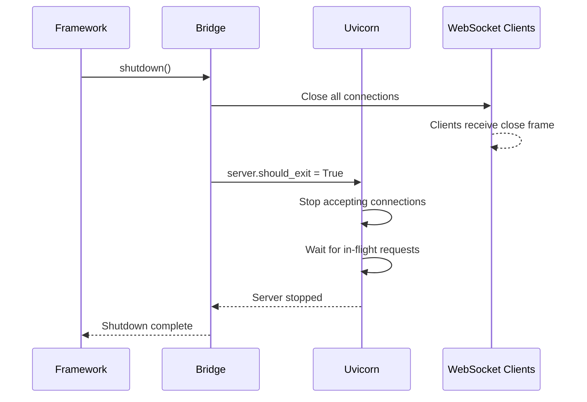

# Observatory Backend Architecture - Technical Specification

**Document:** OBS-TECH-01-BACKEND-ARCHITECTURE.md
**Version:** 1.0.0
**Date:** 2026-02-11
**Status:** Draft
**Implements:** [OBS-01-ARCHITECTURE](../../FUNCTIONAL_SPECIFICATION/OBSERVATORY/OBS-01-ARCHITECTURE.md), [OBS-08-CONFIGURATION](../../FUNCTIONAL_SPECIFICATION/OBSERVATORY/OBS-08-CONFIGURATION.md)

## Navigation

| Previous | Up | Next |
|----------|-----|------|
| [← OBS-TECH-00](OBS-TECH-00-OVERVIEW.md) | [OBS-TECH-00-OVERVIEW](OBS-TECH-00-OVERVIEW.md) | [OBS-TECH-02 →](OBS-TECH-02-BRIDGE-API.md) |

---

## Table of Contents

1. [Package Structure](#package-structure)
2. [Entry Point](#entry-point)
3. [FastAPI Application](#fastapi-application)
4. [Uvicorn Embedding](#uvicorn-embedding)
5. [REST Endpoints](#rest-endpoints)
6. [WebSocket Endpoint](#websocket-endpoint)
7. [Static File Serving](#static-file-serving)
8. [Configuration Model](#configuration-model)
9. [Graceful Shutdown](#graceful-shutdown)

---

## Package Structure

```
cod3s_data/observatory/
├── __init__.py           # create_observatory() entry point, import guard
├── app.py                # FastAPI application factory
├── bridge.py             # ObservatoryBridge (see OBS-TECH-02)
├── config.py             # ObservatoryConfig (Pydantic model)
├── debug.py              # DebugController, BreakpointEvaluator
├── buffer.py             # EventBuffer (ring buffer)
├── sampler.py            # MessageSampler
├── server.py             # Uvicorn embedding logic
├── websocket_manager.py  # WebSocket connection management
├── routes/
│   ├── __init__.py
│   ├── health.py         # GET /api/health
│   ├── topology.py       # GET /api/topology, /api/components
│   ├── channels.py       # GET /api/channels/{name}/history
│   ├── debug.py          # POST/DELETE /api/debug/breakpoints
│   └── ws.py             # WebSocket /ws
├── models/
│   ├── __init__.py
│   ├── events.py         # WebSocket event Pydantic models
│   ├── commands.py       # WebSocket command Pydantic models
│   └── responses.py      # REST response Pydantic models
└── static/               # Pre-built Vue 3 frontend
    ├── index.html
    └── assets/
        ├── index-[hash].js
        └── index-[hash].css
```

---

## Entry Point

### `__init__.py`

```python
"""
COD3S Observatory - Optional web-based observability module.

Usage:
    pip install cod3s-data[observatory]

    from cod3s_data import Framework
    framework = Framework(config, observatory=True)
"""

from __future__ import annotations

from typing import TYPE_CHECKING

if TYPE_CHECKING:
    from cod3s_data.framework import Framework
    from cod3s_data.observatory.bridge import ObservatoryBridge
    from cod3s_data.observatory.config import ObservatoryConfig


def create_observatory(
    framework: Framework,
    config: ObservatoryConfig | None = None,
) -> ObservatoryBridge:
    """
    Create and configure the Observatory module.

    Called by Framework.__init__() when observatory=True.

    Args:
        framework: The COD3S framework instance
        config: Optional configuration (defaults used if None)

    Returns:
        Configured ObservatoryBridge instance
    """
    from cod3s_data.observatory.config import ObservatoryConfig
    from cod3s_data.observatory.bridge import ObservatoryBridge
    from cod3s_data.observatory.buffer import EventBuffer
    from cod3s_data.observatory.debug import DebugController
    from cod3s_data.observatory.sampler import MessageSampler
    from cod3s_data.observatory.app import create_app
    from cod3s_data.observatory.server import EmbeddedServer
    from cod3s_data.observatory.websocket_manager import WebSocketManager

    if config is None:
        config = ObservatoryConfig()

    # Create components
    event_buffer = EventBuffer(
        max_size=config.buffer_size,
        memory_limit_bytes=config.memory_limit_mb * 1024 * 1024,
    )
    debug_controller = DebugController()
    sampler = MessageSampler(
        strategy=config.sampling.strategy,
        rate=config.sampling.rate,
        interval_ms=config.sampling.interval_ms,
    )
    ws_manager = WebSocketManager()

    # Create bridge
    bridge = ObservatoryBridge(
        framework=framework,
        event_buffer=event_buffer,
        debug_controller=debug_controller,
        sampler=sampler,
        websocket_manager=ws_manager,
    )

    # Create FastAPI app
    app = create_app(bridge, event_buffer, debug_controller, ws_manager, config)

    # Create embedded server
    server = EmbeddedServer(app, config.host, config.port)
    bridge._server = server

    return bridge
```

---

## FastAPI Application

### `app.py`

```python
from fastapi import FastAPI
from fastapi.staticfiles import StaticFiles
from pathlib import Path

from cod3s_data.observatory.routes import health, topology, channels, debug, ws


def create_app(
    bridge: ObservatoryBridge,
    event_buffer: EventBuffer,
    debug_controller: DebugController,
    ws_manager: WebSocketManager,
    config: ObservatoryConfig,
) -> FastAPI:
    """
    Create the FastAPI application.

    Mounts REST routes, WebSocket endpoint, and static files.
    """
    app = FastAPI(
        title="COD3S Observatory",
        version="1.0.0",
        docs_url="/api/docs" if config.debug else None,
        redoc_url=None,
    )

    # Store dependencies for route access
    app.state.bridge = bridge
    app.state.buffer = event_buffer
    app.state.debug = debug_controller
    app.state.ws_manager = ws_manager
    app.state.config = config

    # Mount API routes
    app.include_router(health.router, prefix="/api")
    app.include_router(topology.router, prefix="/api")
    app.include_router(channels.router, prefix="/api")
    app.include_router(debug.router, prefix="/api/debug")

    # Mount WebSocket
    app.include_router(ws.router)

    # Mount static frontend (must be last — catches all remaining routes)
    static_dir = Path(__file__).parent / "static"
    if static_dir.exists():
        app.mount("/", StaticFiles(directory=static_dir, html=True), name="static")

    return app
```

---

## Uvicorn Embedding

### `server.py`

```python
import asyncio
import structlog
import uvicorn
from fastapi import FastAPI

logger = structlog.get_logger()


class EmbeddedServer:
    """
    Embeds Uvicorn in the framework's asyncio event loop.

    Key: loop="none" tells Uvicorn to use the existing event loop.
    """

    def __init__(self, app: FastAPI, host: str, port: int) -> None:
        self._app = app
        self._host = host
        self._port = port
        self._server: uvicorn.Server | None = None
        self._task: asyncio.Task | None = None

    async def start(self) -> None:
        """Start the Uvicorn server as an asyncio task."""
        config = uvicorn.Config(
            app=self._app,
            host=self._host,
            port=self._port,
            loop="none",           # Use existing event loop
            log_level="warning",   # Reduce Uvicorn noise
            access_log=False,
        )
        self._server = uvicorn.Server(config)

        try:
            self._task = asyncio.create_task(self._server.serve())
            logger.info(
                "Observatory started",
                url=f"http://{self._host}:{self._port}",
            )
        except OSError as e:
            logger.warning(
                "Observatory failed to start (port may be in use)",
                host=self._host,
                port=self._port,
                error=str(e),
            )

    async def stop(self) -> None:
        """Gracefully stop the server."""
        if self._server is not None:
            self._server.should_exit = True
            if self._task is not None:
                await self._task
            logger.info("Observatory stopped")
```

---

## REST Endpoints

### Health

```python
# routes/health.py
from fastapi import APIRouter, Request

router = APIRouter()

@router.get("/health")
async def health(request: Request) -> dict:
    buffer = request.app.state.buffer
    debug = request.app.state.debug
    ws = request.app.state.ws_manager

    return {
        "status": "ok",
        "version": "1.0.0",
        "buffer_size": buffer.size,
        "buffer_memory_mb": round(buffer.estimated_memory_mb, 2),
        "debug_state": debug.state.value,
        "connected_clients": ws.client_count,
    }
```

### Topology

```python
# routes/topology.py
from fastapi import APIRouter, Request

router = APIRouter()

@router.get("/topology")
async def get_topology(request: Request) -> dict:
    bridge = request.app.state.bridge
    return await bridge.get_topology()

@router.get("/components")
async def list_components(request: Request) -> list[dict]:
    bridge = request.app.state.bridge
    return await bridge.list_components()

@router.get("/components/{component_id}")
async def get_component(component_id: str, request: Request) -> dict:
    bridge = request.app.state.bridge
    return await bridge.get_component_state(component_id)
```

### Channels

```python
# routes/channels.py
from fastapi import APIRouter, Request, Query

router = APIRouter()

@router.get("/channels/{channel_name:path}/history")
async def channel_history(
    channel_name: str,
    request: Request,
    limit: int = Query(default=50, ge=1, le=1000),
) -> dict:
    bridge = request.app.state.bridge
    messages = await bridge.get_channel_history(channel_name, limit)
    return {"channel": channel_name, "messages": messages}
```

### Debug Breakpoints

```python
# routes/debug.py
from fastapi import APIRouter, Request, HTTPException
from pydantic import BaseModel

router = APIRouter()

class BreakpointCreate(BaseModel):
    channel_pattern: str
    condition: str | None = None
    component_id: str | None = None

@router.get("/breakpoints")
async def list_breakpoints(request: Request) -> list[dict]:
    bridge = request.app.state.bridge
    return await bridge.list_breakpoints()

@router.post("/breakpoints", status_code=201)
async def create_breakpoint(body: BreakpointCreate, request: Request) -> dict:
    import uuid
    bridge = request.app.state.bridge
    bp_id = f"bp-{uuid.uuid4().hex[:8]}"
    try:
        await bridge.set_breakpoint(
            breakpoint_id=bp_id,
            channel_pattern=body.channel_pattern,
            condition=body.condition,
            component_id=body.component_id,
        )
    except ValueError as e:
        raise HTTPException(status_code=400, detail=str(e))
    return {"breakpoint_id": bp_id}

@router.delete("/breakpoints/{breakpoint_id}", status_code=204)
async def delete_breakpoint(breakpoint_id: str, request: Request) -> None:
    bridge = request.app.state.bridge
    try:
        await bridge.remove_breakpoint(breakpoint_id)
    except KeyError:
        raise HTTPException(status_code=404, detail="Breakpoint not found")
```

---

## WebSocket Endpoint

### `routes/ws.py`

```python
from fastapi import APIRouter, WebSocket, WebSocketDisconnect
import structlog

logger = structlog.get_logger()
router = APIRouter()

@router.websocket("/ws")
async def websocket_endpoint(websocket: WebSocket) -> None:
    ws_manager = websocket.app.state.ws_manager
    bridge = websocket.app.state.bridge
    buffer = websocket.app.state.buffer
    debug = websocket.app.state.debug

    await websocket.accept()
    client_id = await ws_manager.connect(websocket)

    try:
        # Send initial state snapshot
        snapshot = buffer.get_snapshot()
        topology = await bridge.get_topology()
        await websocket.send_json({
            "type": "connected",
            "id": f"evt-{client_id}",
            "timestamp": _now_iso(),
            "payload": {
                "server_version": "1.0.0",
                "topology": topology,
                "debug": {
                    "state": debug.state.value,
                    "granularity": debug.granularity.value,
                    "breakpoints": debug.list_breakpoints(),
                    "slow_motion": debug._slow_motion,
                    "step_count": debug._step_count,
                },
                **snapshot,
            },
        })

        # Process incoming commands
        while True:
            data = await websocket.receive_json()
            await _handle_command(data, bridge, debug, buffer, websocket)

    except WebSocketDisconnect:
        logger.info("Observatory client disconnected", client_id=client_id)
    finally:
        ws_manager.disconnect(client_id)
```

### `websocket_manager.py`

```python
import asyncio
import uuid
from fastapi import WebSocket
import structlog

logger = structlog.get_logger()


class WebSocketManager:
    """Manages multiple WebSocket client connections."""

    def __init__(self) -> None:
        self._clients: dict[str, WebSocket] = {}

    async def connect(self, websocket: WebSocket) -> str:
        client_id = uuid.uuid4().hex[:8]
        self._clients[client_id] = websocket
        logger.info("Observatory client connected", client_id=client_id)
        return client_id

    def disconnect(self, client_id: str) -> None:
        self._clients.pop(client_id, None)

    @property
    def client_count(self) -> int:
        return len(self._clients)

    async def broadcast_event(self, event_type: str, payload: dict) -> None:
        """Broadcast an event to all connected clients."""
        if not self._clients:
            return

        message = {
            "type": event_type,
            "id": f"evt-{uuid.uuid4().hex[:8]}",
            "timestamp": _now_iso(),
            "payload": payload,
        }

        disconnected = []
        for client_id, ws in self._clients.items():
            try:
                await ws.send_json(message)
            except Exception:
                disconnected.append(client_id)

        for client_id in disconnected:
            self.disconnect(client_id)
```

---

## Static File Serving

The pre-built Vue 3 frontend is served as static files from `cod3s_data/observatory/static/`.

### Build Process (CI Only)

```bash
# In the frontend/ directory
npm run build
# Output: frontend/dist/

# Copy to Python package
cp -r frontend/dist/* cod3s_data/observatory/static/
```

### Serving Strategy

1. API routes (`/api/*`) are handled by FastAPI routers
2. WebSocket (`/ws`) is handled by the WebSocket router
3. All other routes serve `static/index.html` (Vue SPA with client-side routing)
4. Static assets (`/assets/*`) are served directly

The `StaticFiles(html=True)` configuration enables SPA fallback — any unmatched route returns `index.html`, allowing Vue Router to handle navigation.

---

## Configuration Model

### `config.py`

```python
from pydantic import BaseModel, Field


class SamplingConfig(BaseModel):
    """Sampling configuration for high-throughput pipelines."""
    strategy: str = Field(default="none", pattern="^(none|every_nth|time_based)$")
    rate: int = Field(default=1, ge=1, le=10000)
    interval_ms: int = Field(default=100, ge=10, le=10000)


class DebugConfig(BaseModel):
    """Debug mode configuration."""
    enabled: bool = False
    granularity: str = Field(default="message", pattern="^(message|stage|breakpoint)$")
    auto_pause: bool = False


class ObservatoryConfig(BaseModel):
    """
    Observatory module configuration.

    Can be created from:
    - Python: ObservatoryConfig(port=9000)
    - YAML: observatory: section in pipeline config
    - Environment: COD3S_OBSERVATORY_* variables
    """
    enabled: bool = True
    host: str = Field(default="127.0.0.1")
    port: int = Field(default=8765, ge=1024, le=65535)
    debug: DebugConfig = Field(default_factory=DebugConfig)
    buffer_size: int = Field(default=1000, ge=100, le=100000)
    memory_limit_mb: int = Field(default=50, ge=10, le=500)
    sampling: SamplingConfig = Field(default_factory=SamplingConfig)

    model_config = {"env_prefix": "COD3S_OBSERVATORY_"}
```

---

## Graceful Shutdown

### Shutdown Sequence



The bridge exposes a `shutdown()` method called by `Framework.stop()`:

```python
async def shutdown(self) -> None:
    """Gracefully stop the Observatory."""
    # Close all WebSocket connections
    for client_id in list(self._ws._clients.keys()):
        try:
            await self._ws._clients[client_id].close()
        except Exception:
            pass
    self._ws._clients.clear()

    # Stop Uvicorn
    if self._server is not None:
        await self._server.stop()
```

---

## Summary

The backend architecture consists of:

1. **Entry point** — `create_observatory()` factory function, import-guarded
2. **FastAPI app** — Routes for REST API + WebSocket + static files
3. **Embedded Uvicorn** — `loop="none"` to share the framework's asyncio event loop
4. **REST endpoints** — Health, topology, components, channels, breakpoints
5. **WebSocket** — Bidirectional real-time communication (see OBS-TECH-03)
6. **Static serving** — Pre-built Vue SPA with HTML5 history fallback
7. **Configuration** — Pydantic model with env var support
8. **Graceful shutdown** — Close WebSockets, stop Uvicorn, clean up

---

## Navigation

| Previous | Up | Next |
|----------|-----|------|
| [← OBS-TECH-00](OBS-TECH-00-OVERVIEW.md) | [OBS-TECH-00-OVERVIEW](OBS-TECH-00-OVERVIEW.md) | [OBS-TECH-02 →](OBS-TECH-02-BRIDGE-API.md) |
