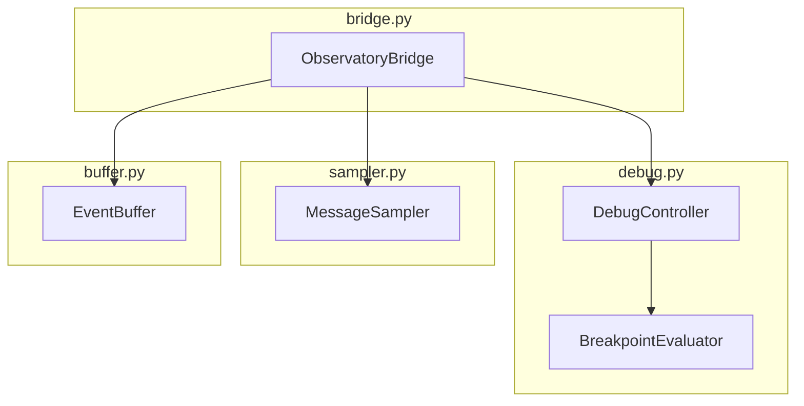

# Observatory Bridge API - Technical Specification

**Document:** OBS-TECH-02-BRIDGE-API.md
**Version:** 1.0.0
**Date:** 2026-02-11
**Status:** Draft
**Implements:** [OBS-02-BRIDGE](../../FUNCTIONAL_SPECIFICATION/OBSERVATORY/OBS-02-BRIDGE.md), [OBS-03-DEBUG-CONTROLS](../../FUNCTIONAL_SPECIFICATION/OBSERVATORY/OBS-03-DEBUG-CONTROLS.md)

## Navigation

| Previous | Up | Next |
|----------|-----|------|
| [← OBS-TECH-01](OBS-TECH-01-BACKEND-ARCHITECTURE.md) | [OBS-TECH-00-OVERVIEW](OBS-TECH-00-OVERVIEW.md) | [OBS-TECH-03 →](OBS-TECH-03-WEBSOCKET-PROTOCOL.md) |

---

## Table of Contents

1. [Overview](#overview)
2. [ObservatoryBridge Class](#observatorybridge-class)
3. [Hook Points in Framework Code](#hook-points-in-framework-code)
4. [DebugController](#debugcontroller)
5. [BreakpointEvaluator](#breakpointevaluator)
6. [MessageSampler](#messagesampler)
7. [EventBuffer](#eventbuffer)

---

## Overview

The Bridge API consists of four main components:



| Component | File | Responsibility |
|-----------|------|---------------|
| `ObservatoryBridge` | `bridge.py` | Main bridge class, implements observation hooks and control interface |
| `DebugController` | `debug.py` | Debug state machine, pause/resume/step synchronization |
| `BreakpointEvaluator` | `debug.py` | Safe breakpoint condition evaluation |
| `MessageSampler` | `sampler.py` | Sampling/throttling for high-throughput pipelines |
| `EventBuffer` | `buffer.py` | Ring buffer for observatory events |

---

## ObservatoryBridge Class

### Class Definition

```python
from __future__ import annotations

import asyncio
from typing import TYPE_CHECKING

from cod3s_data.core.message import Message

if TYPE_CHECKING:
    from cod3s_data.framework import Framework

class ObservatoryBridge:
    """
    Sole point of contact between the COD3S framework and the Observatory.

    Implements observation hooks (framework → observatory) and
    control commands (observatory → framework).
    """

    def __init__(
        self,
        framework: Framework,
        event_buffer: EventBuffer,
        debug_controller: DebugController,
        sampler: MessageSampler,
        websocket_manager: WebSocketManager,
    ) -> None:
        self._framework = framework
        self._buffer = event_buffer
        self._debug = debug_controller
        self._sampler = sampler
        self._ws = websocket_manager

    # --- Observation Hooks (Framework → Bridge) ---

    async def on_message_published(
        self,
        channel: str,
        message: Message,
        subscriber_count: int,
    ) -> None:
        """
        Called by the broker after a message is published.

        Args:
            channel: Channel the message was published to
            message: The published message
            subscriber_count: Number of subscribers notified
        """
        # Check debug breakpoints (always, regardless of sampling)
        if self._debug.is_active:
            await self._debug.check_message(channel, message)

        # Apply sampling
        if not self._sampler.should_process(channel):
            return

        # Buffer the event
        event = MessageEvent(
            channel=channel,
            message_summary=MessageSummary.from_message(message),
            subscriber_count=subscriber_count,
        )
        self._buffer.push(event)

        # Broadcast to connected frontends
        await self._ws.broadcast_event("message.published", event.to_dict())

    async def on_component_state_change(
        self,
        component_id: str,
        component_type: str,
        old_state: str,
        new_state: str,
    ) -> None:
        """Called when a pipeline component changes state."""
        event = ComponentStateEvent(
            component_id=component_id,
            component_type=component_type,
            old_state=old_state,
            new_state=new_state,
        )
        self._buffer.push(event)
        await self._ws.broadcast_event("component.state", event.to_dict())

    async def on_subscription_change(
        self,
        pattern: str,
        action: str,
        subscriber_id: str,
    ) -> None:
        """Called when a subscription is added or removed."""
        event = SubscriptionEvent(
            pattern=pattern,
            action=action,
            subscriber_id=subscriber_id,
        )
        self._buffer.push(event)
        await self._ws.broadcast_event("topology.update", event.to_dict())

    async def on_metric_emitted(
        self,
        metric_name: str,
        value: float | dict,
        tags: dict[str, str],
    ) -> None:
        """Called when the framework emits a metric."""
        event = MetricEvent(
            metric_name=metric_name,
            value=value,
            tags=tags,
        )
        self._buffer.push(event)
        await self._ws.broadcast_event("metric.update", event.to_dict())

    async def on_error(
        self,
        component_id: str,
        error: Exception,
        context: dict[str, str],
    ) -> None:
        """Called when a component encounters an error."""
        event = ErrorEvent(
            component_id=component_id,
            error_type=type(error).__name__,
            error_message=str(error),
            context=context,
        )
        self._buffer.push(event)
        await self._ws.broadcast_event("error.occurred", event.to_dict())

    # --- Control Interface (Bridge → Framework) ---

    async def pause_pipeline(self) -> None:
        """Pause all sources at their next yield point."""
        await self._debug.pause()
        for source in self._framework.sources:
            await source.pause()
        await self._ws.broadcast_event("debug.paused", {
            "mode": self._debug.state.value,
            "granularity": self._debug.granularity.value,
        })

    async def resume_pipeline(self) -> None:
        """Resume all paused sources."""
        await self._debug.resume()
        for source in self._framework.sources:
            await source.resume()
        await self._ws.broadcast_event("debug.resumed", {})

    async def pause_source(self, source_id: str) -> None:
        """Pause a specific source."""
        source = self._framework.get_source(source_id)
        if source is None:
            raise ValueError(f"Source '{source_id}' not found")
        await source.pause()

    async def resume_source(self, source_id: str) -> None:
        """Resume a specific source."""
        source = self._framework.get_source(source_id)
        if source is None:
            raise ValueError(f"Source '{source_id}' not found")
        await source.resume()

    async def step_next(self, granularity: str) -> dict:
        """
        Execute one step at the specified granularity.

        Returns:
            Step result with event details
        """
        return await self._debug.step(granularity)

    async def set_breakpoint(
        self,
        breakpoint_id: str,
        channel_pattern: str,
        condition: str | None = None,
        component_id: str | None = None,
    ) -> None:
        """Add a breakpoint."""
        self._debug.add_breakpoint(
            breakpoint_id=breakpoint_id,
            channel_pattern=channel_pattern,
            condition=condition,
            component_id=component_id,
        )

    async def remove_breakpoint(self, breakpoint_id: str) -> None:
        """Remove a breakpoint by ID."""
        self._debug.remove_breakpoint(breakpoint_id)

    async def list_breakpoints(self) -> list[dict]:
        """Return all active breakpoints."""
        return self._debug.list_breakpoints()

    async def get_component_state(self, component_id: str) -> dict:
        """Return current state and metadata of a component."""
        component = self._framework.get_component(component_id)
        if component is None:
            raise ValueError(f"Component '{component_id}' not found")
        return {
            "id": component_id,
            "type": component.component_type,
            "state": component.state,
            "metadata": component.metadata,
        }

    async def get_channel_history(
        self,
        channel: str,
        limit: int = 50,
    ) -> list[dict]:
        """Return recent messages from a channel."""
        return self._buffer.get_channel_messages(channel, limit)

    async def inject_message(
        self,
        channel: str,
        message_data: dict,
    ) -> None:
        """Inject a test message into a channel (debug only)."""
        if not self._debug.is_active:
            raise RuntimeError("inject_message requires debug mode")
        message = Message(**message_data)
        await self._framework.broker.publish(channel, message)
```

---

## Hook Points in Framework Code

The bridge hooks are inserted at specific points in the existing framework code. Each insertion follows the same pattern:

```python
if self._bridge is not None:
    try:
        await self._bridge.on_xxx(...)
    except Exception as e:
        logger.warning("Observatory bridge error", error=str(e))
```

### InMemoryBroker (cod3s_data/broker/in_memory.py)

**Hook: `on_message_published`**

```python
class InMemoryBroker:
    def __init__(self):
        self._bridge: ObservatoryBridge | None = None
        # ... existing init ...

    async def publish(self, channel: str, message: Message) -> int:
        # ... existing publish logic ...
        subscriber_count = await self._notify_subscribers(channel, message)

        # Observatory hook
        if self._bridge is not None:
            try:
                await self._bridge.on_message_published(
                    channel, message, subscriber_count
                )
            except Exception as e:
                logger.warning("Observatory hook error", hook="on_message_published", error=str(e))

        return subscriber_count
```

**Hook: `on_subscription_change`**

```python
    async def subscribe(self, pattern: str, callback, subscriber_id: str = "") -> None:
        # ... existing subscribe logic ...

        if self._bridge is not None:
            try:
                await self._bridge.on_subscription_change(
                    pattern, "subscribe", subscriber_id
                )
            except Exception as e:
                logger.warning("Observatory hook error", hook="on_subscription_change", error=str(e))
```

### Source Base Class (cod3s_data/sources/base.py)

**Hook: `on_component_state_change`**

```python
class Source:
    def __init__(self):
        self._bridge: ObservatoryBridge | None = None
        self._debug_pause_event: asyncio.Event = asyncio.Event()
        self._debug_pause_event.set()  # Not paused initially
        # ... existing init ...

    async def start(self) -> None:
        old_state = self._state
        self._state = "running"

        if self._bridge is not None:
            try:
                await self._bridge.on_component_state_change(
                    self.id, "source", old_state, "running"
                )
            except Exception as e:
                logger.warning("Observatory hook error", error=str(e))

        await self._run()

    async def _run(self) -> None:
        """Main source loop with debug pause points."""
        async for message in self._generate_messages():
            # Debug pause point: wait if paused
            await self._debug_pause_event.wait()

            await self._broker.publish(self._channel, message)

    async def pause(self) -> None:
        """Suspend source at next yield point."""
        self._debug_pause_event.clear()
        # State change hook fires in _run loop

    async def resume(self) -> None:
        """Resume paused source."""
        self._debug_pause_event.set()
```

### Framework (cod3s_data/framework.py)

**Bridge registration:**

```python
class Framework:
    def __init__(self, config, observatory: bool | ObservatoryConfig = False):
        self._bridge: ObservatoryBridge | None = None

        if observatory:
            try:
                from cod3s_data.observatory import create_observatory
                obs_config = observatory if isinstance(observatory, ObservatoryConfig) else None
                self._bridge = create_observatory(self, obs_config)
            except ImportError:
                raise ImportError(
                    "Observatory requires extra dependencies. "
                    "Install with: pip install cod3s-data[observatory]"
                )

        # Pass bridge reference to broker
        self.broker._bridge = self._bridge

    async def start(self) -> None:
        # Start Observatory server if bridge is active
        if self._bridge is not None:
            await self._bridge.start_server()

        # Start pipeline components
        for source in self._sources:
            source._bridge = self._bridge
            await source.start()

        for destination in self._destinations:
            destination._bridge = self._bridge
            await destination.start()
```

---

## DebugController

The `DebugController` manages the debug state machine and coordinates pause/resume/step operations.

### State Machine

```python
from enum import Enum

class DebugState(Enum):
    INACTIVE = "inactive"
    RUNNING = "running"
    PAUSED = "paused"
    STEPPING = "stepping"

class DebugGranularity(Enum):
    MESSAGE = "message"
    STAGE = "stage"
    BREAKPOINT = "breakpoint"
```

### Class Definition

```python
class DebugController:
    """
    Manages debug state machine and synchronization.

    Uses asyncio.Event for pause/step coordination to avoid
    busy-waiting or polling.
    """

    def __init__(self) -> None:
        self._state: DebugState = DebugState.INACTIVE
        self._granularity: DebugGranularity = DebugGranularity.MESSAGE
        self._breakpoint_evaluator = BreakpointEvaluator()
        self._step_count: int = 0

        # Synchronization primitives
        self._pause_event = asyncio.Event()
        self._pause_event.set()  # Not paused initially
        self._step_completed = asyncio.Event()

        # Slow-motion
        self._slow_motion: bool = False
        self._slow_motion_delay_ms: int = 500

    @property
    def is_active(self) -> bool:
        return self._state != DebugState.INACTIVE

    @property
    def state(self) -> DebugState:
        return self._state

    @property
    def granularity(self) -> DebugGranularity:
        return self._granularity

    async def pause(self) -> None:
        """Transition to PAUSED state."""
        if self._state == DebugState.INACTIVE:
            self._state = DebugState.RUNNING
        self._state = DebugState.PAUSED
        self._pause_event.clear()

    async def resume(self) -> None:
        """Transition to RUNNING state."""
        self._state = DebugState.RUNNING
        self._pause_event.set()

    async def step(self, granularity: str) -> dict:
        """
        Execute one step.

        1. Set state to STEPPING
        2. Temporarily resume pipeline
        3. Wait for step completion
        4. Re-pause pipeline
        5. Return step result
        """
        self._granularity = DebugGranularity(granularity)
        self._state = DebugState.STEPPING
        self._step_completed.clear()

        # Temporarily allow execution
        self._pause_event.set()

        # Wait for step to complete (set by check_message/check_stage)
        await self._step_completed.wait()

        # Re-pause
        self._state = DebugState.PAUSED
        self._pause_event.clear()
        self._step_count += 1

        return self._last_step_result

    async def check_message(self, channel: str, message: Message) -> None:
        """
        Called on every message published. Handles:
        - Breakpoint evaluation
        - Step completion (MESSAGE granularity)
        - Slow-motion delay
        - Pause waiting
        """
        # Evaluate breakpoints (always, even during free running)
        if self._breakpoint_evaluator.has_breakpoints:
            hit = self._breakpoint_evaluator.evaluate(channel, message)
            if hit is not None:
                self._last_step_result = {
                    "type": "breakpoint_hit",
                    "breakpoint": hit.to_dict(),
                    "channel": channel,
                    "message": message.to_dict(),
                }
                self._state = DebugState.PAUSED
                self._pause_event.clear()
                self._step_completed.set()
                return

        # Handle stepping
        if self._state == DebugState.STEPPING:
            if self._granularity == DebugGranularity.MESSAGE:
                self._last_step_result = {
                    "type": "message_published",
                    "channel": channel,
                    "message": message.to_dict(),
                }
                self._step_completed.set()
                return

        # Handle slow-motion
        if self._slow_motion and self._state == DebugState.RUNNING:
            await asyncio.sleep(self._slow_motion_delay_ms / 1000.0)

        # Handle pause
        await self._pause_event.wait()

    def set_granularity(self, granularity: str) -> None:
        self._granularity = DebugGranularity(granularity)

    def set_slow_motion(self, enabled: bool, delay_ms: int = 500) -> None:
        self._slow_motion = enabled
        self._slow_motion_delay_ms = max(100, min(5000, delay_ms))

    def add_breakpoint(self, **kwargs) -> None:
        self._breakpoint_evaluator.add(**kwargs)

    def remove_breakpoint(self, breakpoint_id: str) -> None:
        self._breakpoint_evaluator.remove(breakpoint_id)

    def list_breakpoints(self) -> list[dict]:
        return self._breakpoint_evaluator.list_all()
```

---

## BreakpointEvaluator

Evaluates breakpoint conditions **safely** without using `eval()`.

### Class Definition

```python
from dataclasses import dataclass
from cod3s_data.broker.registry import SubscriptionRegistry


@dataclass
class Breakpoint:
    id: str
    channel_pattern: str
    condition: str | None
    component_id: str | None
    enabled: bool = True
    hit_count: int = 0

    def to_dict(self) -> dict:
        return {
            "id": self.id,
            "channel_pattern": self.channel_pattern,
            "condition": self.condition,
            "component_id": self.component_id,
            "enabled": self.enabled,
            "hit_count": self.hit_count,
        }


class BreakpointEvaluator:
    """
    Evaluates breakpoints against messages using safe expression parsing.

    Reuses SubscriptionRegistry.match_channel() for channel pattern matching.
    Uses a restricted expression parser for value conditions (no eval()).
    """

    def __init__(self) -> None:
        self._breakpoints: dict[str, Breakpoint] = {}
        self._channel_matcher = SubscriptionRegistry()

    @property
    def has_breakpoints(self) -> bool:
        return any(bp.enabled for bp in self._breakpoints.values())

    def add(
        self,
        breakpoint_id: str,
        channel_pattern: str,
        condition: str | None = None,
        component_id: str | None = None,
    ) -> None:
        # Validate condition syntax at creation time
        if condition is not None:
            self._validate_condition(condition)

        self._breakpoints[breakpoint_id] = Breakpoint(
            id=breakpoint_id,
            channel_pattern=channel_pattern,
            condition=condition,
            component_id=component_id,
        )

    def remove(self, breakpoint_id: str) -> None:
        if breakpoint_id not in self._breakpoints:
            raise KeyError(f"Breakpoint '{breakpoint_id}' not found")
        del self._breakpoints[breakpoint_id]

    def list_all(self) -> list[dict]:
        return [bp.to_dict() for bp in self._breakpoints.values()]

    def evaluate(
        self,
        channel: str,
        message: Message,
        component_id: str | None = None,
    ) -> Breakpoint | None:
        """
        Evaluate all breakpoints against a message.

        Returns:
            The first matching Breakpoint, or None if no match.
        """
        for bp in self._breakpoints.values():
            if not bp.enabled:
                continue

            # Check channel pattern
            if not self._channel_matcher.match_channel(bp.channel_pattern, channel):
                continue

            # Check component (if specified)
            if bp.component_id is not None and bp.component_id != component_id:
                continue

            # Check condition (if specified)
            if bp.condition is not None:
                if not self._evaluate_condition(bp.condition, channel, message):
                    continue

            # Match found
            bp.hit_count += 1
            return bp

        return None

    def _validate_condition(self, condition: str) -> None:
        """Validate condition syntax at creation time."""
        # Parse and validate the expression tree
        # Raises ValueError if syntax is invalid
        _parse_expression(condition)

    def _evaluate_condition(
        self,
        condition: str,
        channel: str,
        message: Message,
    ) -> bool:
        """
        Evaluate a condition expression safely.

        Available variables:
            value  - message.value
            key    - message.key
            tags.* - message.tags[name]
            channel - channel name

        Supported operators:
            > < >= <= == !=
            and or not
            contains startswith endswith
            in
        """
        context = {
            "value": message.value,
            "key": message.key,
            "channel": channel,
        }
        # Add tags as dotted names
        if message.tags:
            for tag_key, tag_value in message.tags.items():
                context[f"tags.{tag_key}"] = tag_value

        tree = _parse_expression(condition)
        return _eval_tree(tree, context)
```

### Safe Expression Parser

The expression parser supports a restricted grammar — no function calls, no attribute access beyond `tags.*`, no imports:

```
expression := comparison (('and' | 'or') comparison)*
comparison := term (('>' | '<' | '>=' | '<=' | '==' | '!=') term)?
            | term 'contains' term
            | term 'startswith' term
            | term 'endswith' term
            | term 'in' term
            | 'not' expression
term       := NUMBER | STRING | IDENTIFIER | DOTTED_IDENTIFIER
```

**Implementation note:** Use Python's `ast` module to parse and walk a restricted AST, rejecting any node types not in the whitelist (Name, Compare, BoolOp, Num, Str, Constant, Attribute for `tags.x` only).

---

## MessageSampler

Controls the rate of events forwarded to the Observatory for high-throughput pipelines.

```python
import time


class MessageSampler:
    """
    Sampling strategies for high-throughput pipelines.

    Breakpoint evaluation always bypasses sampling.
    """

    def __init__(
        self,
        strategy: str = "none",
        rate: int = 1,
        interval_ms: int = 100,
    ) -> None:
        self._strategy = strategy
        self._rate = max(1, rate)
        self._interval_s = interval_ms / 1000.0
        self._counter: int = 0
        self._last_process_time: float = 0.0

    def should_process(self, channel: str) -> bool:
        """
        Determine if this message should be processed by the Observatory.

        Args:
            channel: Message channel (metrics channels always pass)

        Returns:
            True if the message should be forwarded
        """
        # Always forward metrics (they are already low-frequency)
        if channel.startswith("_metrics."):
            return True

        if self._strategy == "none":
            return True

        if self._strategy == "every_nth":
            self._counter += 1
            return self._counter % self._rate == 0

        if self._strategy == "time_based":
            now = time.monotonic()
            if now - self._last_process_time >= self._interval_s:
                self._last_process_time = now
                return True
            return False

        return True
```

---

## EventBuffer

Ring buffer implementation for storing observatory events.

```python
from collections import deque
from dataclasses import dataclass, field
from datetime import datetime, timezone
from enum import Enum
import sys


class EventType(Enum):
    MESSAGE = "message"
    COMPONENT_STATE = "component_state"
    SUBSCRIPTION = "subscription"
    METRIC = "metric"
    ERROR = "error"
    DEBUG = "debug"


@dataclass
class ObservatoryEvent:
    type: EventType
    timestamp: datetime = field(default_factory=lambda: datetime.now(timezone.utc))
    data: dict = field(default_factory=dict)

    def to_dict(self) -> dict:
        return {
            "type": self.type.value,
            "timestamp": self.timestamp.isoformat(),
            "data": self.data,
        }


class EventBuffer:
    """
    Fixed-size ring buffer for observatory events.

    Oldest events are evicted when capacity is reached.
    Supports filtering by event type and channel.
    """

    def __init__(
        self,
        max_size: int = 1000,
        memory_limit_bytes: int = 50 * 1024 * 1024,  # 50 MB
    ) -> None:
        self._buffer: deque[ObservatoryEvent] = deque(maxlen=max_size)
        self._memory_limit = memory_limit_bytes
        self._estimated_memory: int = 0

    def push(self, event: ObservatoryEvent) -> None:
        """Add an event to the buffer."""
        # Estimate memory for the new event
        event_size = sys.getsizeof(event) + sys.getsizeof(event.data)
        self._estimated_memory += event_size

        # Evict old events if over memory limit
        while self._estimated_memory > self._memory_limit and self._buffer:
            old = self._buffer.popleft()
            self._estimated_memory -= sys.getsizeof(old) + sys.getsizeof(old.data)

        self._buffer.append(event)

    def get_recent(
        self,
        limit: int = 100,
        event_type: EventType | None = None,
    ) -> list[dict]:
        """Get recent events, optionally filtered by type."""
        events = self._buffer
        if event_type is not None:
            events = [e for e in events if e.type == event_type]
        return [e.to_dict() for e in list(events)[-limit:]]

    def get_channel_messages(self, channel: str, limit: int = 50) -> list[dict]:
        """Get recent messages from a specific channel."""
        messages = [
            e.to_dict()
            for e in self._buffer
            if e.type == EventType.MESSAGE
            and e.data.get("channel") == channel
        ]
        return messages[-limit:]

    def get_snapshot(self) -> dict:
        """
        Get full state snapshot for late-connecting frontends.

        Returns topology, component states, recent messages,
        metric values, and debug state.
        """
        return {
            "messages": self.get_recent(100, EventType.MESSAGE),
            "component_states": self.get_recent(50, EventType.COMPONENT_STATE),
            "metrics": self.get_recent(50, EventType.METRIC),
            "errors": self.get_recent(20, EventType.ERROR),
            "debug_events": self.get_recent(50, EventType.DEBUG),
        }

    @property
    def size(self) -> int:
        return len(self._buffer)

    @property
    def estimated_memory_mb(self) -> float:
        return self._estimated_memory / (1024 * 1024)
```

---

## Summary

The Bridge API implementation consists of:

1. **ObservatoryBridge** — Main class with 5 observation hooks and 10+ control methods
2. **DebugController** — State machine (INACTIVE→RUNNING→PAUSED→STEPPING) using `asyncio.Event`
3. **BreakpointEvaluator** — Safe expression parsing with `ast` module (no `eval()`)
4. **MessageSampler** — Every-Nth and time-based strategies, metrics always pass
5. **EventBuffer** — `deque`-based ring buffer with memory cap enforcement

**Key integration points:**
- `InMemoryBroker.publish()` → `on_message_published`
- `Source.start()/pause()/resume()` → `on_component_state_change`
- `Source._run()` → `await self._debug_pause_event.wait()` (debug pause point)

---

## Navigation

| Previous | Up | Next |
|----------|-----|------|
| [← OBS-TECH-01](OBS-TECH-01-BACKEND-ARCHITECTURE.md) | [OBS-TECH-00-OVERVIEW](OBS-TECH-00-OVERVIEW.md) | [OBS-TECH-03 →](OBS-TECH-03-WEBSOCKET-PROTOCOL.md) |
