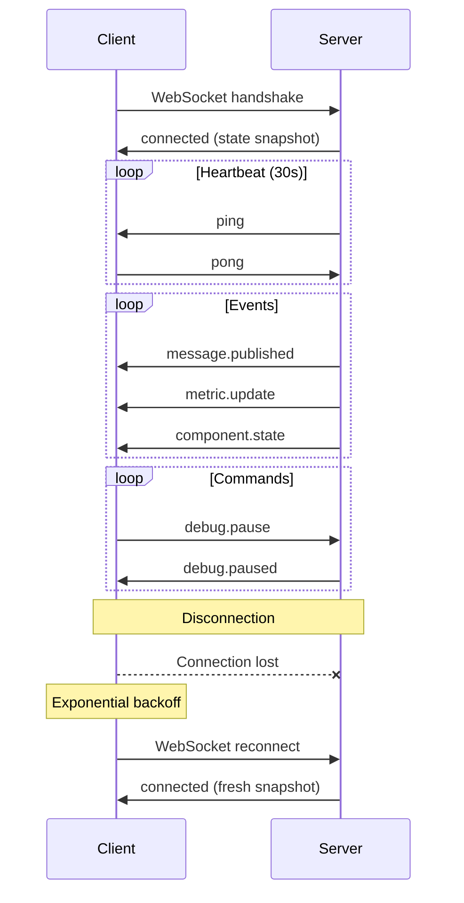

# Observatory WebSocket Protocol - Technical Specification

**Document:** OBS-TECH-03-WEBSOCKET-PROTOCOL.md
**Version:** 1.0.0
**Date:** 2026-02-11
**Status:** Draft
**Implements:** [OBS-02-BRIDGE](../../FUNCTIONAL_SPECIFICATION/OBSERVATORY/OBS-02-BRIDGE.md), [OBS-03-DEBUG-CONTROLS](../../FUNCTIONAL_SPECIFICATION/OBSERVATORY/OBS-03-DEBUG-CONTROLS.md)

## Navigation

| Previous | Up | Next |
|----------|-----|------|
| [← OBS-TECH-02](OBS-TECH-02-BRIDGE-API.md) | [OBS-TECH-00-OVERVIEW](OBS-TECH-00-OVERVIEW.md) | [OBS-TECH-04 →](OBS-TECH-04-FRONTEND-ARCHITECTURE.md) |

---

## Table of Contents

1. [Message Format](#message-format)
2. [Events (Server → Client)](#events-server--client)
3. [Commands (Client → Server)](#commands-client--server)
4. [Error Codes](#error-codes)
5. [Connection Management](#connection-management)

---

## Message Format

All WebSocket messages use JSON with a standard envelope:

```json
{
  "type": "string",
  "id": "string",
  "timestamp": "ISO 8601 string",
  "payload": {}
}
```

| Field | Type | Description |
|-------|------|-------------|
| `type` | `string` | Message type identifier (dot-separated namespace) |
| `id` | `string` | Unique message ID (UUID v4) |
| `timestamp` | `string` | ISO 8601 timestamp with timezone |
| `payload` | `object` | Type-specific payload |

### Naming Convention

- **Events** (server → client): `<domain>.<action>` (e.g., `message.published`, `debug.paused`)
- **Commands** (client → server): `<domain>.<verb>` (e.g., `debug.pause`, `channel.watch`)
- **Responses**: Same `id` as the command, type `<domain>.<verb>.response`

---

## Events (Server → Client)

### connected

Sent immediately after WebSocket handshake. Includes current state snapshot.

```json
{
  "type": "connected",
  "id": "evt-001",
  "timestamp": "2026-02-11T10:30:00.000Z",
  "payload": {
    "server_version": "1.0.0",
    "framework_name": "my-pipeline",
    "topology": {
      "nodes": [
        {
          "id": "csv_source_1",
          "type": "source",
          "label": "CSV Source",
          "state": "running",
          "metadata": {"source_type": "csv", "mode": "BATCH"}
        },
        {
          "id": "temp_filter",
          "type": "transformation",
          "label": "Temperature Filter",
          "state": "running",
          "metadata": {"transform_type": "stateless"}
        },
        {
          "id": "console_dest",
          "type": "destination",
          "label": "Console Output",
          "state": "running",
          "metadata": {"dest_type": "console"}
        }
      ],
      "edges": [
        {
          "id": "edge-1",
          "source": "csv_source_1",
          "target": "temp_filter",
          "channel": "sensors.temperature",
          "message_rate": 100
        },
        {
          "id": "edge-2",
          "source": "temp_filter",
          "target": "console_dest",
          "channel": "alerts.temperature",
          "message_rate": 5
        }
      ]
    },
    "debug": {
      "state": "inactive",
      "granularity": "message",
      "breakpoints": [],
      "slow_motion": false,
      "step_count": 0
    },
    "recent_messages": [],
    "metrics": {}
  }
}
```

---

### topology.update

Sent when the pipeline topology changes (new component, removed subscription).

```json
{
  "type": "topology.update",
  "id": "evt-010",
  "timestamp": "2026-02-11T10:30:05.000Z",
  "payload": {
    "action": "subscribe",
    "pattern": "sensors.*.pressure",
    "subscriber_id": "pressure_filter",
    "node": null,
    "edge": {
      "id": "edge-3",
      "source": "csv_source_1",
      "target": "pressure_filter",
      "channel": "sensors.*.pressure"
    }
  }
}
```

---

### message.published

Sent when a message is published (subject to sampling).

```json
{
  "type": "message.published",
  "id": "evt-020",
  "timestamp": "2026-02-11T10:30:45.123Z",
  "payload": {
    "channel": "sensors.temperature",
    "message": {
      "key": "temperature",
      "value": 105.3,
      "timestamp": "2026-02-11T10:30:45.100Z",
      "tags": {"location": "zone_1", "sensor_id": "T-001"},
      "trace_id": "f7e8d9c1-2a3b-4c5d-6e7f-8a9b0c1d2e3f"
    },
    "subscriber_count": 3,
    "source_component": "csv_source_1"
  }
}
```

---

### message.detail

Response to `message.inspect` command. Full message content.

```json
{
  "type": "message.detail",
  "id": "evt-021",
  "timestamp": "2026-02-11T10:30:45.200Z",
  "payload": {
    "channel": "sensors.temperature",
    "message": {
      "key": "temperature",
      "value": 105.3,
      "timestamp": "2026-02-11T10:30:45.100Z",
      "tags": {"location": "zone_1", "sensor_id": "T-001"},
      "trace_id": "f7e8d9c1-2a3b-4c5d-6e7f-8a9b0c1d2e3f",
      "metadata": {
        "source": "csv_source_1",
        "publish_latency_us": 45
      }
    },
    "journey": [
      {"component": "csv_source_1", "action": "published", "timestamp": "2026-02-11T10:30:45.100Z"},
      {"component": "broker", "action": "routed", "timestamp": "2026-02-11T10:30:45.101Z", "subscriber_count": 3},
      {"component": "temp_filter", "action": "received", "timestamp": "2026-02-11T10:30:45.102Z"},
      {"component": "temp_filter", "action": "transformed", "timestamp": "2026-02-11T10:30:45.103Z", "output_channel": "alerts.temperature"},
      {"component": "console_dest", "action": "received", "timestamp": "2026-02-11T10:30:45.104Z"},
      {"component": "console_dest", "action": "written", "timestamp": "2026-02-11T10:30:45.105Z"}
    ]
  }
}
```

---

### metric.update

Sent when a new metric value is emitted (~1/s per metric).

```json
{
  "type": "metric.update",
  "id": "evt-030",
  "timestamp": "2026-02-11T10:30:46.000Z",
  "payload": {
    "metric_name": "broker.throughput",
    "value": 1234,
    "tags": {"window": "1s"},
    "unit": "msg/s"
  }
}
```

---

### component.state

Sent when a component changes state.

```json
{
  "type": "component.state",
  "id": "evt-040",
  "timestamp": "2026-02-11T10:30:50.000Z",
  "payload": {
    "component_id": "csv_source_1",
    "component_type": "source",
    "old_state": "running",
    "new_state": "paused"
  }
}
```

---

### debug.paused

Sent when the pipeline enters PAUSED state.

```json
{
  "type": "debug.paused",
  "id": "evt-050",
  "timestamp": "2026-02-11T10:31:00.000Z",
  "payload": {
    "reason": "manual",
    "granularity": "message",
    "step_count": 42
  }
}
```

---

### debug.resumed

Sent when the pipeline resumes from PAUSED state.

```json
{
  "type": "debug.resumed",
  "id": "evt-051",
  "timestamp": "2026-02-11T10:31:05.000Z",
  "payload": {}
}
```

---

### debug.breakpoint_hit

Sent when a breakpoint condition is matched.

```json
{
  "type": "debug.breakpoint_hit",
  "id": "evt-052",
  "timestamp": "2026-02-11T10:31:10.000Z",
  "payload": {
    "breakpoint": {
      "id": "bp-001",
      "channel_pattern": "sensors.*.temperature",
      "condition": "value > 100",
      "hit_count": 3
    },
    "message": {
      "channel": "sensors.zone1.temperature",
      "key": "temperature",
      "value": 105.3,
      "timestamp": "2026-02-11T10:31:09.990Z",
      "tags": {"location": "zone_1"}
    }
  }
}
```

---

### debug.step_completed

Sent after a step operation completes.

```json
{
  "type": "debug.step_completed",
  "id": "evt-053",
  "timestamp": "2026-02-11T10:31:15.000Z",
  "payload": {
    "granularity": "message",
    "step_number": 43,
    "event": {
      "type": "message_published",
      "channel": "sensors.temperature",
      "message_summary": {
        "key": "temperature",
        "value": 98.7
      },
      "subscriber_count": 3
    },
    "duration_ms": 2.3
  }
}
```

---

### error.occurred

Sent when a pipeline component encounters an error.

```json
{
  "type": "error.occurred",
  "id": "evt-060",
  "timestamp": "2026-02-11T10:32:00.000Z",
  "payload": {
    "component_id": "database_dest",
    "error_type": "ConnectionError",
    "error_message": "Connection refused",
    "context": {
      "channel": "sensors.temperature",
      "retry_count": "2",
      "max_retries": "3"
    }
  }
}
```

---

## Commands (Client → Server)

### subscribe

Subscribe to specific event types (used for filtering).

```json
{
  "type": "subscribe",
  "id": "cmd-001",
  "timestamp": "2026-02-11T10:30:01.000Z",
  "payload": {
    "events": ["message.published", "metric.update", "debug.*"]
  }
}
```

**Response:**
```json
{
  "type": "subscribe.response",
  "id": "cmd-001",
  "timestamp": "2026-02-11T10:30:01.010Z",
  "payload": {
    "success": true,
    "subscribed_events": ["message.published", "metric.update", "debug.*"]
  }
}
```

---

### debug.pause

Pause the pipeline.

```json
{
  "type": "debug.pause",
  "id": "cmd-010",
  "timestamp": "2026-02-11T10:31:00.000Z",
  "payload": {}
}
```

**Response:** `debug.paused` event

---

### debug.resume

Resume the pipeline.

```json
{
  "type": "debug.resume",
  "id": "cmd-011",
  "timestamp": "2026-02-11T10:31:05.000Z",
  "payload": {}
}
```

**Response:** `debug.resumed` event

---

### debug.step

Execute one step.

```json
{
  "type": "debug.step",
  "id": "cmd-012",
  "timestamp": "2026-02-11T10:31:10.000Z",
  "payload": {
    "granularity": "message"
  }
}
```

**Response:** `debug.step_completed` event

---

### debug.set_granularity

Change step granularity.

```json
{
  "type": "debug.set_granularity",
  "id": "cmd-013",
  "timestamp": "2026-02-11T10:31:15.000Z",
  "payload": {
    "granularity": "stage"
  }
}
```

---

### debug.slow_motion

Enable/disable slow-motion mode.

```json
{
  "type": "debug.slow_motion",
  "id": "cmd-014",
  "timestamp": "2026-02-11T10:31:20.000Z",
  "payload": {
    "enabled": true,
    "delay_ms": 500
  }
}
```

---

### debug.add_breakpoint

Add a breakpoint.

```json
{
  "type": "debug.add_breakpoint",
  "id": "cmd-015",
  "timestamp": "2026-02-11T10:31:25.000Z",
  "payload": {
    "channel_pattern": "sensors.*.temperature",
    "condition": "value > 100",
    "component_id": null
  }
}
```

**Response:**
```json
{
  "type": "debug.add_breakpoint.response",
  "id": "cmd-015",
  "timestamp": "2026-02-11T10:31:25.010Z",
  "payload": {
    "success": true,
    "breakpoint_id": "bp-001"
  }
}
```

---

### debug.remove_breakpoint

Remove a breakpoint.

```json
{
  "type": "debug.remove_breakpoint",
  "id": "cmd-016",
  "timestamp": "2026-02-11T10:31:30.000Z",
  "payload": {
    "breakpoint_id": "bp-001"
  }
}
```

---

### channel.history

Request recent messages from a channel.

```json
{
  "type": "channel.history",
  "id": "cmd-020",
  "timestamp": "2026-02-11T10:32:00.000Z",
  "payload": {
    "channel": "sensors.temperature",
    "limit": 50
  }
}
```

**Response:**
```json
{
  "type": "channel.history.response",
  "id": "cmd-020",
  "timestamp": "2026-02-11T10:32:00.010Z",
  "payload": {
    "channel": "sensors.temperature",
    "messages": [
      {"key": "temperature", "value": 98.2, "timestamp": "...", "tags": {}},
      {"key": "temperature", "value": 99.1, "timestamp": "...", "tags": {}}
    ]
  }
}
```

---

### message.inspect

Request full details of a specific message.

```json
{
  "type": "message.inspect",
  "id": "cmd-021",
  "timestamp": "2026-02-11T10:32:05.000Z",
  "payload": {
    "trace_id": "f7e8d9c1-2a3b-4c5d-6e7f-8a9b0c1d2e3f"
  }
}
```

**Response:** `message.detail` event

---

### channel.watch

Start watching a channel in live stream mode.

```json
{
  "type": "channel.watch",
  "id": "cmd-022",
  "timestamp": "2026-02-11T10:32:10.000Z",
  "payload": {
    "channel_pattern": "sensors.*.temperature",
    "enabled": true
  }
}
```

When watching is enabled, `message.published` events for matching channels are sent even if not in the default subscription filter.

---

## Error Codes

When a command fails, the server responds with an error:

```json
{
  "type": "error",
  "id": "cmd-010",
  "timestamp": "2026-02-11T10:31:00.010Z",
  "payload": {
    "code": "NOT_IN_DEBUG_MODE",
    "message": "Cannot step: debug mode is not active",
    "command": "debug.step"
  }
}
```

### Error Code Table

| Code | Description | Triggered By |
|------|-------------|-------------|
| `INVALID_COMMAND` | Unknown command type | Any unrecognized command |
| `INVALID_PAYLOAD` | Missing or invalid payload fields | Any command with bad payload |
| `NOT_IN_DEBUG_MODE` | Debug command sent when not in debug mode | `debug.step`, `debug.resume` |
| `ALREADY_PAUSED` | Pipeline is already paused | `debug.pause` |
| `NOT_PAUSED` | Pipeline is not paused | `debug.step`, `debug.resume` |
| `BREAKPOINT_NOT_FOUND` | Breakpoint ID does not exist | `debug.remove_breakpoint` |
| `INVALID_CONDITION` | Breakpoint condition syntax error | `debug.add_breakpoint` |
| `COMPONENT_NOT_FOUND` | Component ID does not exist | `pause_source`, `get_component_state` |
| `CHANNEL_NOT_FOUND` | No history for this channel | `channel.history` |
| `MESSAGE_NOT_FOUND` | Trace ID not in buffer | `message.inspect` |
| `INJECT_REQUIRES_DEBUG` | Message injection requires debug mode | `inject_message` |

---

## Connection Management

### WebSocket Endpoint

```
ws://127.0.0.1:8765/ws
```

### Multi-Client Support

- Multiple browsers can connect simultaneously
- All clients receive the same events (broadcast)
- All clients share the same debug state
- Debug commands from any client affect all clients

### Heartbeat

- Server sends `ping` frame every 30 seconds
- Client must respond with `pong` within 10 seconds
- Connection closed if no pong received

### Reconnection

- Client implements exponential backoff reconnection (1s, 2s, 4s, 8s, max 30s)
- On reconnection, server sends `connected` event with full state snapshot
- No message replay (ring buffer may have evicted old events)

### Connection Lifecycle



---

## Summary

The WebSocket protocol provides:

1. **Standard envelope** — `{type, id, timestamp, payload}` for all messages
2. **11 event types** — From topology updates to debug state changes
3. **10 command types** — From subscription filtering to debug controls
4. **11 error codes** — Clear error reporting for invalid operations
5. **Multi-client broadcast** — All clients see the same state
6. **Heartbeat + reconnection** — Reliable connection management

---

## Navigation

| Previous | Up | Next |
|----------|-----|------|
| [← OBS-TECH-02](OBS-TECH-02-BRIDGE-API.md) | [OBS-TECH-00-OVERVIEW](OBS-TECH-00-OVERVIEW.md) | [OBS-TECH-04 →](OBS-TECH-04-FRONTEND-ARCHITECTURE.md) |
