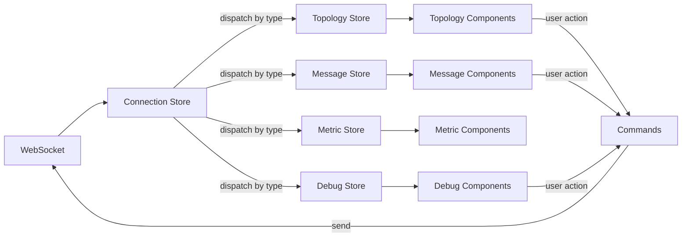

# Observatory State Management - Technical Specification

**Document:** OBS-TECH-06-STATE-MANAGEMENT.md
**Version:** 1.0.0
**Date:** 2026-02-11
**Status:** Draft
**Implements:** All OBS-04 through OBS-07 frontend state requirements

## Navigation

| Previous | Up | Next |
|----------|-----|------|
| [← OBS-TECH-05](OBS-TECH-05-COMPONENT-LIBRARY.md) | [OBS-TECH-00-OVERVIEW](OBS-TECH-00-OVERVIEW.md) | [OBS-TECH-07 →](OBS-TECH-07-TESTING.md) |

---

## Table of Contents

1. [Data Flow](#data-flow)
2. [Connection Store](#connection-store)
3. [Topology Store](#topology-store)
4. [Message Store](#message-store)
5. [Metric Store](#metric-store)
6. [Debug Store](#debug-store)
7. [Persistence](#persistence)

---

## Data Flow



**Flow:**
1. WebSocket events arrive at Connection Store
2. Connection Store dispatches to domain stores by event type
3. Domain stores update reactive state
4. Vue components reactively render updated state
5. User actions trigger commands sent back through WebSocket

---

## Connection Store

```typescript
// stores/connection.ts
import { defineStore } from 'pinia'
import { ref } from 'vue'
import { useTopologyStore } from './topology'
import { useMessageStore } from './messages'
import { useMetricStore } from './metrics'
import { useDebugStore } from './debug'

export const useConnectionStore = defineStore('connection', () => {
  // State
  const connected = ref(false)
  const reconnecting = ref(false)
  const error = ref<string | null>(null)
  const clientId = ref<string | null>(null)

  // Private
  let ws: WebSocket | null = null
  let reconnectTimer: ReturnType<typeof setTimeout> | null = null
  let reconnectAttempt = 0

  function connect(url: string = `ws://${location.host}/ws`) {
    ws = new WebSocket(url)

    ws.onopen = () => {
      connected.value = true
      reconnecting.value = false
      error.value = null
      reconnectAttempt = 0
    }

    ws.onmessage = (event) => {
      const msg = JSON.parse(event.data)
      dispatch(msg)
    }

    ws.onclose = () => {
      connected.value = false
      scheduleReconnect()
    }

    ws.onerror = (e) => {
      error.value = 'WebSocket connection error'
    }
  }

  function dispatch(msg: { type: string; payload: any }) {
    const topology = useTopologyStore()
    const messages = useMessageStore()
    const metrics = useMetricStore()
    const debug = useDebugStore()

    switch (msg.type) {
      case 'connected':
        clientId.value = msg.id
        topology.initFromSnapshot(msg.payload.topology)
        debug.initFromSnapshot(msg.payload.debug)
        if (msg.payload.recent_messages) {
          messages.initFromSnapshot(msg.payload.recent_messages)
        }
        break

      case 'topology.update':
        topology.handleUpdate(msg.payload)
        break

      case 'message.published':
        messages.addMessage(msg.payload)
        topology.updateMessageRate(msg.payload.channel)
        break

      case 'message.detail':
        messages.setMessageDetail(msg.payload)
        break

      case 'metric.update':
        metrics.updateMetric(msg.payload)
        break

      case 'component.state':
        topology.updateComponentState(msg.payload)
        break

      case 'debug.paused':
        debug.setPaused(msg.payload)
        break

      case 'debug.resumed':
        debug.setResumed()
        break

      case 'debug.breakpoint_hit':
        debug.setBreakpointHit(msg.payload)
        messages.addMessage(msg.payload.message)
        break

      case 'debug.step_completed':
        debug.setStepCompleted(msg.payload)
        break

      case 'error.occurred':
        messages.addError(msg.payload)
        topology.setComponentError(msg.payload.component_id)
        break
    }
  }

  function send(message: object) {
    if (ws && ws.readyState === WebSocket.OPEN) {
      ws.send(JSON.stringify(message))
    }
  }

  function scheduleReconnect() {
    if (reconnectTimer) return
    reconnecting.value = true
    const delay = Math.min(30000, 1000 * Math.pow(2, reconnectAttempt))
    reconnectAttempt++
    reconnectTimer = setTimeout(() => {
      reconnectTimer = null
      connect()
    }, delay)
  }

  return { connected, reconnecting, error, clientId, connect, send }
})
```

---

## Topology Store

```typescript
// stores/topology.ts
import { defineStore } from 'pinia'
import { ref, computed } from 'vue'
import type { TopologyNode, TopologyEdge } from '@/types/topology'

export const useTopologyStore = defineStore('topology', () => {
  // State
  const nodes = ref<TopologyNode[]>([])
  const edges = ref<TopologyEdge[]>([])
  const selectedNodeId = ref<string | null>(null)
  const selectedEdgeId = ref<string | null>(null)

  // Computed
  const sources = computed(() => nodes.value.filter((n) => n.type === 'source'))
  const transformations = computed(() => nodes.value.filter((n) => n.type === 'transformation'))
  const destinations = computed(() => nodes.value.filter((n) => n.type === 'destination'))
  const nodeById = computed(() => {
    const map = new Map<string, TopologyNode>()
    nodes.value.forEach((n) => map.set(n.id, n))
    return map
  })

  // Actions
  function initFromSnapshot(topology: { nodes: TopologyNode[]; edges: TopologyEdge[] }) {
    nodes.value = topology.nodes
    edges.value = topology.edges
  }

  function handleUpdate(payload: any) {
    if (payload.node) {
      const idx = nodes.value.findIndex((n) => n.id === payload.node.id)
      if (idx >= 0) {
        nodes.value[idx] = payload.node
      } else {
        nodes.value.push(payload.node)
      }
    }
    if (payload.edge) {
      const idx = edges.value.findIndex((e) => e.id === payload.edge.id)
      if (idx >= 0) {
        edges.value[idx] = payload.edge
      } else {
        edges.value.push(payload.edge)
      }
    }
  }

  function updateComponentState(payload: {
    component_id: string
    new_state: string
  }) {
    const node = nodes.value.find((n) => n.id === payload.component_id)
    if (node) {
      node.state = payload.new_state as TopologyNode['state']
    }
  }

  function updateMessageRate(channel: string) {
    // Increment rate counter for edges matching this channel
    edges.value
      .filter((e) => e.channel === channel)
      .forEach((e) => { e.messageRate++ })

    // Decay rates every second (handled by a setInterval in the store setup)
  }

  function setComponentError(componentId: string) {
    const node = nodes.value.find((n) => n.id === componentId)
    if (node) {
      node.state = 'error'
    }
  }

  function selectNode(nodeId: string | null) {
    selectedNodeId.value = nodeId
    selectedEdgeId.value = null
  }

  function selectEdge(edgeId: string | null) {
    selectedEdgeId.value = edgeId
    selectedNodeId.value = null
  }

  return {
    nodes, edges, selectedNodeId, selectedEdgeId,
    sources, transformations, destinations, nodeById,
    initFromSnapshot, handleUpdate, updateComponentState,
    updateMessageRate, setComponentError, selectNode, selectEdge,
  }
})
```

---

## Message Store

```typescript
// stores/messages.ts
import { defineStore } from 'pinia'
import { ref, computed } from 'vue'

interface MessageSummary {
  channel: string
  key: string
  value: any
  timestamp: string
  tags: Record<string, string>
  traceId?: string
  subscriberCount: number
}

interface MessageWithDetail extends MessageSummary {
  journey?: Array<{
    component: string
    action: string
    timestamp: string
  }>
}

export const useMessageStore = defineStore('messages', () => {
  // State
  const messages = ref<MessageSummary[]>([])
  const selectedMessage = ref<MessageWithDetail | null>(null)
  const searchQuery = ref('')
  const channelFilter = ref<string | null>(null)
  const maxMessages = 1000  // Client-side buffer limit

  // Computed
  const filteredMessages = computed(() => {
    let result = messages.value

    if (channelFilter.value) {
      result = result.filter((m) => m.channel.includes(channelFilter.value!))
    }

    if (searchQuery.value) {
      const q = searchQuery.value.toLowerCase()
      result = result.filter(
        (m) =>
          m.key.toLowerCase().includes(q) ||
          m.channel.toLowerCase().includes(q) ||
          JSON.stringify(m.value).toLowerCase().includes(q)
      )
    }

    return result
  })

  // Actions
  function initFromSnapshot(recentMessages: MessageSummary[]) {
    messages.value = recentMessages
  }

  function addMessage(payload: any) {
    const msg: MessageSummary = {
      channel: payload.channel,
      key: payload.message.key,
      value: payload.message.value,
      timestamp: payload.message.timestamp,
      tags: payload.message.tags ?? {},
      traceId: payload.message.trace_id,
      subscriberCount: payload.subscriber_count,
    }
    messages.value.push(msg)

    // Trim buffer
    if (messages.value.length > maxMessages) {
      messages.value = messages.value.slice(-maxMessages)
    }
  }

  function setMessageDetail(payload: any) {
    selectedMessage.value = {
      channel: payload.channel,
      key: payload.message.key,
      value: payload.message.value,
      timestamp: payload.message.timestamp,
      tags: payload.message.tags ?? {},
      traceId: payload.message.trace_id,
      subscriberCount: 0,
      journey: payload.journey,
    }
  }

  function addError(payload: any) {
    // Errors are also shown in the message list
    messages.value.push({
      channel: `_error.${payload.component_id}`,
      key: payload.error_type,
      value: payload.error_message,
      timestamp: new Date().toISOString(),
      tags: payload.context,
      subscriberCount: 0,
    })
  }

  function selectMessage(msg: MessageSummary | null) {
    selectedMessage.value = msg as MessageWithDetail
  }

  function setSearch(query: string) {
    searchQuery.value = query
  }

  function setChannelFilter(channel: string | null) {
    channelFilter.value = channel
  }

  return {
    messages, selectedMessage, searchQuery, channelFilter,
    filteredMessages,
    initFromSnapshot, addMessage, setMessageDetail, addError,
    selectMessage, setSearch, setChannelFilter,
  }
})
```

---

## Metric Store

```typescript
// stores/metrics.ts
import { defineStore } from 'pinia'
import { ref, computed } from 'vue'

interface MetricDataPoint {
  timestamp: string
  value: number | Record<string, number>
  tags: Record<string, string>
}

interface MetricSeries {
  name: string
  unit: string
  dataPoints: MetricDataPoint[]
  latestValue: number | Record<string, number>
}

const MAX_DATA_POINTS = 300  // 5 minutes at 1/s

export const useMetricStore = defineStore('metrics', () => {
  // State
  const series = ref<Map<string, MetricSeries>>(new Map())

  // Computed
  const metricNames = computed(() => Array.from(series.value.keys()))

  function getMetric(name: string): MetricSeries | undefined {
    return series.value.get(name)
  }

  function getLatestValue(name: string): number | undefined {
    const s = series.value.get(name)
    if (!s) return undefined
    const v = s.latestValue
    return typeof v === 'number' ? v : undefined
  }

  // Actions
  function updateMetric(payload: {
    metric_name: string
    value: number | Record<string, number>
    tags: Record<string, string>
  }) {
    const { metric_name, value, tags } = payload
    let s = series.value.get(metric_name)

    if (!s) {
      s = {
        name: metric_name,
        unit: tags.unit ?? '',
        dataPoints: [],
        latestValue: value,
      }
      series.value.set(metric_name, s)
    }

    s.latestValue = value
    s.dataPoints.push({
      timestamp: new Date().toISOString(),
      value,
      tags,
    })

    // Trim old data points
    if (s.dataPoints.length > MAX_DATA_POINTS) {
      s.dataPoints = s.dataPoints.slice(-MAX_DATA_POINTS)
    }
  }

  return {
    series, metricNames,
    getMetric, getLatestValue, updateMetric,
  }
})
```

---

## Debug Store

```typescript
// stores/debug.ts
import { defineStore } from 'pinia'
import { ref } from 'vue'
import type { DebugState, Granularity, Breakpoint } from '@/types/debug'

export const useDebugStore = defineStore('debug', () => {
  // State
  const state = ref<DebugState>('inactive')
  const granularity = ref<Granularity>('message')
  const breakpoints = ref<Breakpoint[]>([])
  const slowMotion = ref(false)
  const slowMotionDelay = ref(500)
  const stepCount = ref(0)
  const lastBreakpointHit = ref<{ breakpoint: Breakpoint; message: any } | null>(null)
  const stepHistory = ref<Array<{ stepNumber: number; event: any; timestamp: string }>>([])

  // Actions
  function initFromSnapshot(debug: any) {
    state.value = debug.state
    granularity.value = debug.granularity
    breakpoints.value = debug.breakpoints ?? []
    slowMotion.value = debug.slow_motion ?? false
    stepCount.value = debug.step_count ?? 0
  }

  function setPaused(payload: any) {
    state.value = 'paused'
    if (payload.granularity) {
      granularity.value = payload.granularity
    }
  }

  function setResumed() {
    state.value = 'running'
    lastBreakpointHit.value = null
  }

  function setBreakpointHit(payload: any) {
    state.value = 'paused'
    lastBreakpointHit.value = {
      breakpoint: payload.breakpoint,
      message: payload.message,
    }

    // Update hit count in local breakpoints
    const bp = breakpoints.value.find((b) => b.id === payload.breakpoint.id)
    if (bp) {
      bp.hitCount = payload.breakpoint.hit_count
    }
  }

  function setStepCompleted(payload: any) {
    state.value = 'paused'
    stepCount.value = payload.step_number

    stepHistory.value.push({
      stepNumber: payload.step_number,
      event: payload.event,
      timestamp: payload.timestamp ?? new Date().toISOString(),
    })

    // Keep last 100 steps
    if (stepHistory.value.length > 100) {
      stepHistory.value = stepHistory.value.slice(-100)
    }
  }

  function addBreakpointLocal(bp: Breakpoint) {
    breakpoints.value.push(bp)
  }

  function removeBreakpointLocal(bpId: string) {
    breakpoints.value = breakpoints.value.filter((b) => b.id !== bpId)
  }

  return {
    state, granularity, breakpoints, slowMotion, slowMotionDelay,
    stepCount, lastBreakpointHit, stepHistory,
    initFromSnapshot, setPaused, setResumed,
    setBreakpointHit, setStepCompleted,
    addBreakpointLocal, removeBreakpointLocal,
  }
})
```

---

## Persistence

### localStorage Persistence

UI preferences and breakpoints are persisted in `localStorage` to survive page reloads:

```typescript
// In debug store setup
const STORAGE_KEY = 'cod3s-observatory-debug'

// Load on init
const saved = localStorage.getItem(STORAGE_KEY)
if (saved) {
  const data = JSON.parse(saved)
  breakpoints.value = data.breakpoints ?? []
  granularity.value = data.granularity ?? 'message'
  slowMotionDelay.value = data.slowMotionDelay ?? 500
}

// Save on change (debounced)
watch([breakpoints, granularity, slowMotionDelay], () => {
  localStorage.setItem(STORAGE_KEY, JSON.stringify({
    breakpoints: breakpoints.value,
    granularity: granularity.value,
    slowMotionDelay: slowMotionDelay.value,
  }))
}, { deep: true })
```

### What Is Persisted

| Data | Storage | Survives Reload |
|------|---------|----------------|
| Breakpoints | localStorage | Yes |
| Granularity preference | localStorage | Yes |
| Slow-motion delay | localStorage | Yes |
| Topology layout (manual positions) | localStorage | Yes |
| Message buffer | None (transient) | No |
| Metric history | None (transient) | No |
| Debug state | Server (re-sent on connect) | Yes (via snapshot) |

---

## Summary

State management is organized into 5 Pinia stores:

1. **Connection** — WebSocket lifecycle, event dispatch to domain stores
2. **Topology** — Pipeline nodes, edges, state transitions, selection
3. **Messages** — Message buffer (1000 max), search, filtering, detail view
4. **Metrics** — Time series data (300 points / 5min per metric)
5. **Debug** — State machine, breakpoints, step history

**Data flow:** WebSocket → ConnectionStore → dispatch → DomainStores → Components → Commands → WebSocket

---

## Navigation

| Previous | Up | Next |
|----------|-----|------|
| [← OBS-TECH-05](OBS-TECH-05-COMPONENT-LIBRARY.md) | [OBS-TECH-00-OVERVIEW](OBS-TECH-00-OVERVIEW.md) | [OBS-TECH-07 →](OBS-TECH-07-TESTING.md) |
