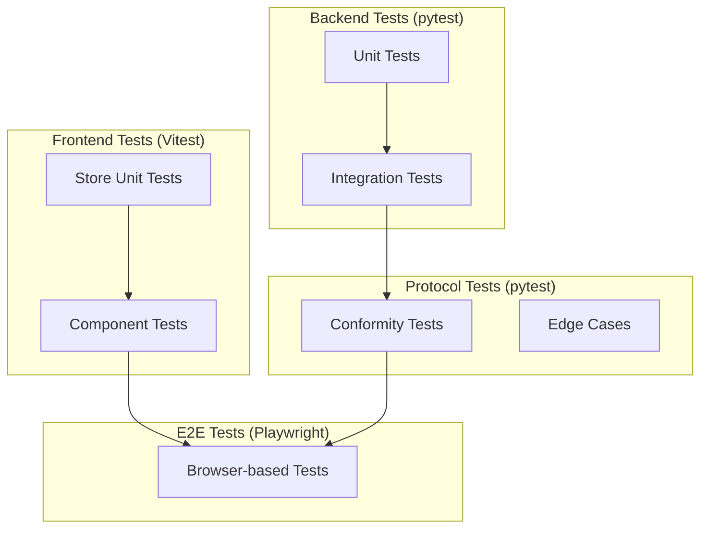

# Observatory Testing Strategy - Technical Specification

**Document:** OBS-TECH-07-TESTING.md
**Version:** 1.0.0
**Date:** 2026-02-11
**Status:** Draft
**Implements:** Testing requirements for all Observatory components

## Navigation

| Previous | Up | Next |
|----------|-----|------|
| [← OBS-TECH-06](OBS-TECH-06-STATE-MANAGEMENT.md) | [OBS-TECH-00-OVERVIEW](OBS-TECH-00-OVERVIEW.md) | [OBS-TECH-APPENDIX-A →](OBS-TECH-APPENDIX-A-DECISIONS.md) |

---

## Table of Contents

1. [Test Architecture Overview](#test-architecture-overview)
2. [Backend Tests](#backend-tests)
3. [Frontend Tests](#frontend-tests)
4. [Protocol Tests](#protocol-tests)
5. [End-to-End Tests](#end-to-end-tests)
6. [Test Fixtures](#test-fixtures)

---

## Test Architecture Overview



### Test Matrix

| Layer | Framework | Scope | Files |
|-------|-----------|-------|-------|
| Backend Unit | pytest + pytest-asyncio | Bridge, DebugController, BreakpointEvaluator, EventBuffer, MessageSampler | `tests/unit/observatory/` |
| Backend Integration | pytest + httpx + websockets | FastAPI endpoints, WebSocket protocol | `tests/integration/observatory/` |
| Frontend Unit | Vitest | Pinia stores, composables | `frontend/tests/unit/` |
| Frontend Component | Vitest + Vue Test Utils | Vue components | `frontend/tests/components/` |
| Protocol | pytest + websockets | WebSocket message conformity | `tests/integration/observatory/protocol/` |
| E2E | Playwright | Full stack browser tests | `tests/e2e/observatory/` |

---

## Backend Tests

### Unit Tests

#### Bridge Tests

```python
# tests/unit/observatory/test_bridge.py
import pytest
from unittest.mock import AsyncMock, MagicMock
from cod3s_data.observatory.bridge import ObservatoryBridge
from cod3s_data.observatory.buffer import EventBuffer
from cod3s_data.observatory.debug import DebugController
from cod3s_data.observatory.sampler import MessageSampler
from cod3s_data.core.message import Message


@pytest.fixture
def mock_bridge():
    """Create a bridge with mocked dependencies."""
    framework = MagicMock()
    buffer = EventBuffer(max_size=100)
    debug = DebugController()
    sampler = MessageSampler()
    ws_manager = AsyncMock()

    bridge = ObservatoryBridge(
        framework=framework,
        event_buffer=buffer,
        debug_controller=debug,
        sampler=sampler,
        websocket_manager=ws_manager,
    )
    return bridge, ws_manager


@pytest.mark.asyncio
async def test_on_message_published_broadcasts(mock_bridge):
    bridge, ws = mock_bridge
    msg = Message(key="temp", value=42.0, timestamp=...)
    await bridge.on_message_published("sensors.temp", msg, 3)
    ws.broadcast_event.assert_called_once()


@pytest.mark.asyncio
async def test_on_message_published_buffers_event(mock_bridge):
    bridge, _ = mock_bridge
    msg = Message(key="temp", value=42.0, timestamp=...)
    await bridge.on_message_published("sensors.temp", msg, 3)
    assert bridge._buffer.size == 1


@pytest.mark.asyncio
async def test_on_message_published_respects_sampling(mock_bridge):
    bridge, ws = mock_bridge
    bridge._sampler = MessageSampler(strategy="every_nth", rate=3)
    msg = Message(key="temp", value=42.0, timestamp=...)

    for i in range(3):
        await bridge.on_message_published("sensors.temp", msg, 1)

    # Only 1 of 3 messages should be broadcast
    assert ws.broadcast_event.call_count == 1
```

#### Debug Controller Tests

```python
# tests/unit/observatory/test_debug_controller.py

@pytest.mark.asyncio
async def test_initial_state_is_inactive():
    dc = DebugController()
    assert dc.state == DebugState.INACTIVE
    assert not dc.is_active

@pytest.mark.asyncio
async def test_pause_transitions_to_paused():
    dc = DebugController()
    await dc.pause()
    assert dc.state == DebugState.PAUSED

@pytest.mark.asyncio
async def test_resume_transitions_to_running():
    dc = DebugController()
    await dc.pause()
    await dc.resume()
    assert dc.state == DebugState.RUNNING

@pytest.mark.asyncio
async def test_step_returns_to_paused():
    dc = DebugController()
    await dc.pause()
    # Simulate message published during step
    async def publish():
        await asyncio.sleep(0.01)
        msg = Message(key="temp", value=42.0, timestamp=...)
        await dc.check_message("sensors.temp", msg)

    asyncio.create_task(publish())
    result = await dc.step("message")
    assert dc.state == DebugState.PAUSED
    assert result["type"] == "message_published"

@pytest.mark.asyncio
async def test_slow_motion_adds_delay():
    dc = DebugController()
    dc.set_slow_motion(True, delay_ms=100)
    await dc.pause()
    await dc.resume()

    start = time.monotonic()
    msg = Message(key="temp", value=42.0, timestamp=...)
    await dc.check_message("sensors.temp", msg)
    elapsed = time.monotonic() - start
    assert elapsed >= 0.09  # ~100ms with tolerance
```

#### Breakpoint Evaluator Tests

```python
# tests/unit/observatory/test_breakpoints.py

def test_channel_pattern_match():
    evaluator = BreakpointEvaluator()
    evaluator.add(breakpoint_id="bp-1", channel_pattern="sensors.*.temperature")
    msg = Message(key="temp", value=105.0, timestamp=...)
    result = evaluator.evaluate("sensors.zone1.temperature", msg)
    assert result is not None
    assert result.id == "bp-1"

def test_channel_pattern_no_match():
    evaluator = BreakpointEvaluator()
    evaluator.add(breakpoint_id="bp-1", channel_pattern="sensors.*.temperature")
    msg = Message(key="pressure", value=1.0, timestamp=...)
    result = evaluator.evaluate("sensors.zone1.pressure", msg)
    assert result is None

def test_condition_evaluation():
    evaluator = BreakpointEvaluator()
    evaluator.add(breakpoint_id="bp-1", channel_pattern="sensors.**", condition="value > 100")
    msg_low = Message(key="temp", value=50.0, timestamp=...)
    msg_high = Message(key="temp", value=105.0, timestamp=...)
    assert evaluator.evaluate("sensors.temp", msg_low) is None
    assert evaluator.evaluate("sensors.temp", msg_high) is not None

def test_invalid_condition_raises():
    evaluator = BreakpointEvaluator()
    with pytest.raises(ValueError):
        evaluator.add(breakpoint_id="bp-1", channel_pattern="**", condition="import os")

def test_hit_count_increments():
    evaluator = BreakpointEvaluator()
    evaluator.add(breakpoint_id="bp-1", channel_pattern="**")
    msg = Message(key="temp", value=42.0, timestamp=...)
    evaluator.evaluate("sensors.temp", msg)
    evaluator.evaluate("sensors.temp", msg)
    bp = evaluator._breakpoints["bp-1"]
    assert bp.hit_count == 2
```

#### Event Buffer Tests

```python
# tests/unit/observatory/test_buffer.py

def test_push_and_retrieve():
    buf = EventBuffer(max_size=10)
    event = ObservatoryEvent(type=EventType.MESSAGE, data={"channel": "test"})
    buf.push(event)
    assert buf.size == 1
    recent = buf.get_recent(limit=10)
    assert len(recent) == 1

def test_ring_buffer_eviction():
    buf = EventBuffer(max_size=5)
    for i in range(10):
        buf.push(ObservatoryEvent(type=EventType.MESSAGE, data={"i": i}))
    assert buf.size == 5
    recent = buf.get_recent(limit=10)
    assert recent[0]["data"]["i"] == 5  # First 5 evicted

def test_memory_limit_enforcement():
    buf = EventBuffer(max_size=10000, memory_limit_bytes=1000)
    large_data = {"payload": "x" * 500}
    for i in range(100):
        buf.push(ObservatoryEvent(type=EventType.MESSAGE, data=large_data))
    assert buf.estimated_memory_mb < 0.001  # Under 1KB limit

def test_filter_by_event_type():
    buf = EventBuffer(max_size=100)
    buf.push(ObservatoryEvent(type=EventType.MESSAGE, data={}))
    buf.push(ObservatoryEvent(type=EventType.METRIC, data={}))
    buf.push(ObservatoryEvent(type=EventType.MESSAGE, data={}))
    messages = buf.get_recent(limit=10, event_type=EventType.MESSAGE)
    assert len(messages) == 2
```

### Integration Tests

```python
# tests/integration/observatory/test_api.py
import pytest
from httpx import AsyncClient, ASGITransport
from cod3s_data.observatory.app import create_app


@pytest.fixture
async def client(mock_bridge):
    app = create_app(...)
    transport = ASGITransport(app=app)
    async with AsyncClient(transport=transport, base_url="http://test") as ac:
        yield ac


@pytest.mark.asyncio
async def test_health_endpoint(client):
    response = await client.get("/api/health")
    assert response.status_code == 200
    data = response.json()
    assert data["status"] == "ok"

@pytest.mark.asyncio
async def test_topology_endpoint(client):
    response = await client.get("/api/topology")
    assert response.status_code == 200
    data = response.json()
    assert "nodes" in data
    assert "edges" in data

@pytest.mark.asyncio
async def test_breakpoint_crud(client):
    # Create
    response = await client.post("/api/debug/breakpoints", json={
        "channel_pattern": "sensors.**",
        "condition": "value > 100",
    })
    assert response.status_code == 201
    bp_id = response.json()["breakpoint_id"]

    # List
    response = await client.get("/api/debug/breakpoints")
    assert len(response.json()) == 1

    # Delete
    response = await client.delete(f"/api/debug/breakpoints/{bp_id}")
    assert response.status_code == 204
```

---

## Frontend Tests

### Store Unit Tests

```typescript
// frontend/tests/unit/stores/debug.test.ts
import { setActivePinia, createPinia } from 'pinia'
import { describe, it, expect, beforeEach } from 'vitest'
import { useDebugStore } from '@/stores/debug'

describe('Debug Store', () => {
  beforeEach(() => {
    setActivePinia(createPinia())
  })

  it('initializes with inactive state', () => {
    const store = useDebugStore()
    expect(store.state).toBe('inactive')
  })

  it('handles pause event', () => {
    const store = useDebugStore()
    store.setPaused({ granularity: 'message' })
    expect(store.state).toBe('paused')
    expect(store.granularity).toBe('message')
  })

  it('handles breakpoint hit', () => {
    const store = useDebugStore()
    store.setBreakpointHit({
      breakpoint: { id: 'bp-1', hit_count: 1 },
      message: { channel: 'test', value: 42 },
    })
    expect(store.state).toBe('paused')
    expect(store.lastBreakpointHit).not.toBeNull()
  })

  it('tracks step history', () => {
    const store = useDebugStore()
    store.setStepCompleted({
      step_number: 1,
      event: { type: 'message_published' },
    })
    expect(store.stepCount).toBe(1)
    expect(store.stepHistory).toHaveLength(1)
  })
})
```

### Component Tests

```typescript
// frontend/tests/components/DebugToolbar.test.ts
import { mount } from '@vue/test-utils'
import { createPinia } from 'pinia'
import { createVuetify } from 'vuetify'
import { describe, it, expect } from 'vitest'
import DebugToolbar from '@/components/debug/DebugToolbar.vue'

describe('DebugToolbar', () => {
  const vuetify = createVuetify()
  const pinia = createPinia()

  it('shows when debug is active', () => {
    const wrapper = mount(DebugToolbar, {
      global: { plugins: [pinia, vuetify] },
    })
    // Set debug state to running
    const store = useDebugStore()
    store.state = 'running'
    expect(wrapper.isVisible()).toBe(true)
  })

  it('hides when debug is inactive', () => {
    const wrapper = mount(DebugToolbar, {
      global: { plugins: [pinia, vuetify] },
    })
    const store = useDebugStore()
    store.state = 'inactive'
    expect(wrapper.find('.debug-toolbar').exists()).toBe(false)
  })

  it('disables step when not paused', () => {
    const wrapper = mount(DebugToolbar, {
      global: { plugins: [pinia, vuetify] },
    })
    const store = useDebugStore()
    store.state = 'running'
    const stepBtn = wrapper.find('[data-test="step-btn"]')
    expect(stepBtn.attributes('disabled')).toBeDefined()
  })
})
```

---

## Protocol Tests

```python
# tests/integration/observatory/protocol/test_websocket.py
import pytest
import json
from websockets.client import connect


@pytest.mark.asyncio
async def test_connected_event_on_connect(observatory_server):
    """Client receives connected event with state snapshot on connect."""
    async with connect(f"ws://127.0.0.1:{observatory_server.port}/ws") as ws:
        msg = json.loads(await ws.recv())
        assert msg["type"] == "connected"
        assert "topology" in msg["payload"]
        assert "debug" in msg["payload"]


@pytest.mark.asyncio
async def test_invalid_command_returns_error(observatory_server):
    """Server returns INVALID_COMMAND for unknown command types."""
    async with connect(f"ws://127.0.0.1:{observatory_server.port}/ws") as ws:
        await ws.recv()  # Consume connected event
        await ws.send(json.dumps({
            "type": "nonexistent.command",
            "id": "test-1",
            "timestamp": "2026-02-11T00:00:00Z",
            "payload": {},
        }))
        msg = json.loads(await ws.recv())
        assert msg["type"] == "error"
        assert msg["payload"]["code"] == "INVALID_COMMAND"


@pytest.mark.asyncio
async def test_debug_pause_resume_cycle(observatory_server):
    """Full pause → step → resume cycle through WebSocket."""
    async with connect(f"ws://127.0.0.1:{observatory_server.port}/ws") as ws:
        await ws.recv()  # connected

        # Pause
        await ws.send(json.dumps({
            "type": "debug.pause", "id": "c-1",
            "timestamp": "2026-02-11T00:00:00Z", "payload": {},
        }))
        msg = json.loads(await ws.recv())
        assert msg["type"] == "debug.paused"

        # Resume
        await ws.send(json.dumps({
            "type": "debug.resume", "id": "c-2",
            "timestamp": "2026-02-11T00:00:00Z", "payload": {},
        }))
        msg = json.loads(await ws.recv())
        assert msg["type"] == "debug.resumed"


@pytest.mark.asyncio
async def test_multi_client_broadcast(observatory_server):
    """Events are broadcast to all connected clients."""
    async with connect(f"ws://127.0.0.1:{observatory_server.port}/ws") as ws1:
        async with connect(f"ws://127.0.0.1:{observatory_server.port}/ws") as ws2:
            await ws1.recv()  # connected
            await ws2.recv()  # connected

            # Pause from client 1
            await ws1.send(json.dumps({
                "type": "debug.pause", "id": "c-1",
                "timestamp": "2026-02-11T00:00:00Z", "payload": {},
            }))

            # Both clients should receive paused event
            msg1 = json.loads(await ws1.recv())
            msg2 = json.loads(await ws2.recv())
            assert msg1["type"] == "debug.paused"
            assert msg2["type"] == "debug.paused"
```

---

## End-to-End Tests

```python
# tests/e2e/observatory/test_full_stack.py

@pytest.mark.asyncio
async def test_observatory_with_real_pipeline():
    """Start a real framework with Observatory and verify UI is accessible."""
    config = FrameworkConfig(...)
    framework = Framework(config, observatory=True)

    async with framework:
        # Verify server is running
        async with httpx.AsyncClient() as client:
            response = await client.get("http://127.0.0.1:8765/api/health")
            assert response.status_code == 200

            # Verify topology
            response = await client.get("http://127.0.0.1:8765/api/topology")
            data = response.json()
            assert len(data["nodes"]) > 0

        # Verify WebSocket
        async with connect("ws://127.0.0.1:8765/ws") as ws:
            msg = json.loads(await ws.recv())
            assert msg["type"] == "connected"

            # Wait for some messages to flow
            events = []
            for _ in range(10):
                event = json.loads(await asyncio.wait_for(ws.recv(), timeout=5))
                events.append(event)

            # Should have received message and/or metric events
            event_types = {e["type"] for e in events}
            assert event_types & {"message.published", "metric.update"}
```

---

## Test Fixtures

### MockBridge

```python
# tests/fixtures/observatory.py
class MockBridge:
    """Lightweight bridge for testing without full framework."""

    def __init__(self):
        self.published_messages = []
        self.state_changes = []

    async def on_message_published(self, channel, message, count):
        self.published_messages.append((channel, message, count))

    async def on_component_state_change(self, cid, ctype, old, new):
        self.state_changes.append((cid, ctype, old, new))

    async def get_topology(self):
        return {
            "nodes": [
                {"id": "src1", "type": "source", "label": "Test Source", "state": "running"},
                {"id": "dst1", "type": "destination", "label": "Test Dest", "state": "running"},
            ],
            "edges": [
                {"id": "e1", "source": "src1", "target": "dst1", "channel": "test"},
            ],
        }
```

### FakeWebSocket

```typescript
// frontend/tests/fixtures/FakeWebSocket.ts
export class FakeWebSocket {
  sent: object[] = []
  onmessage: ((event: MessageEvent) => void) | null = null

  send(data: string) {
    this.sent.push(JSON.parse(data))
  }

  simulateMessage(msg: object) {
    this.onmessage?.({ data: JSON.stringify(msg) } as MessageEvent)
  }
}
```

---

## Summary

The testing strategy covers all layers:

1. **Backend unit** — Bridge, DebugController, BreakpointEvaluator, EventBuffer (~50 tests)
2. **Backend integration** — FastAPI endpoints + WebSocket protocol (~20 tests)
3. **Frontend unit** — Pinia stores, composables (~30 tests)
4. **Frontend component** — Vue components with Vuetify (~20 tests)
5. **Protocol conformity** — WebSocket message format, error codes (~15 tests)
6. **E2E** — Full stack with Playwright (~5 tests)

**Total estimated:** ~140 tests

---

## Navigation

| Previous | Up | Next |
|----------|-----|------|
| [← OBS-TECH-06](OBS-TECH-06-STATE-MANAGEMENT.md) | [OBS-TECH-00-OVERVIEW](OBS-TECH-00-OVERVIEW.md) | [OBS-TECH-APPENDIX-A →](OBS-TECH-APPENDIX-A-DECISIONS.md) |
